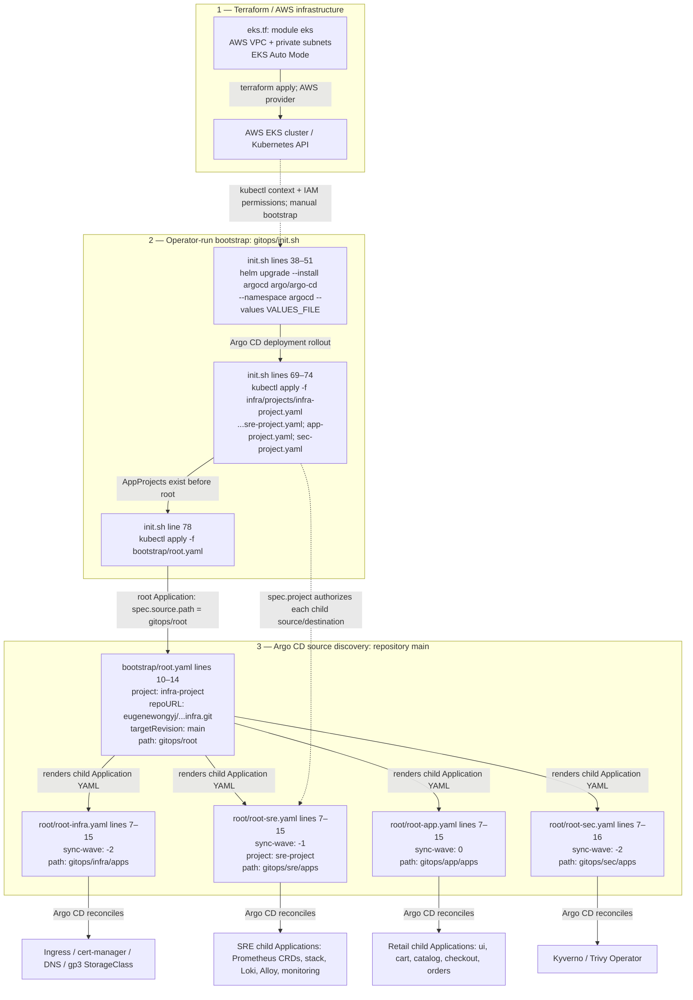
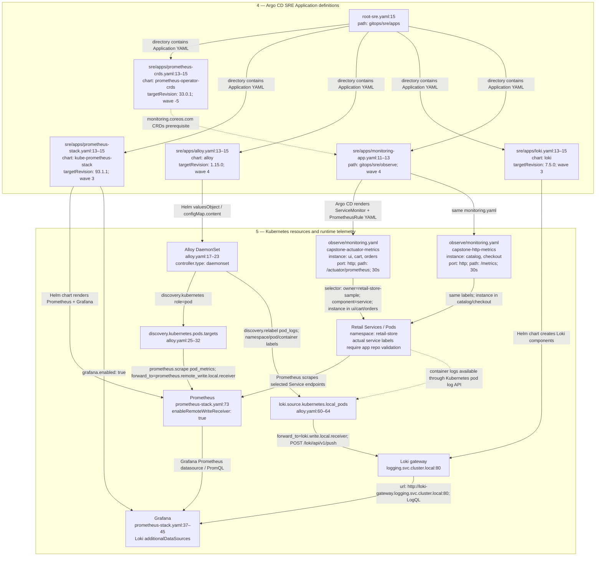

# Part I — GitOps Platform Documentation (TK)

This repository contains the complete **GitOps Infrastructure-as-Code (IaC)** for provisioning and managing the eks cluster on AWS EKS. It leverages **Argo CD** and the **App of Apps** pattern to fully automate the deployment of core infrastructure, observability (SRE) tooling, and business applications.

## 📂 Repository Architecture

The deployment is strictly ordered using Argo CD `sync-wave` annotations to prevent race conditions (e.g., ensuring CRDs and Ingress controllers exist before deploying applications that depend on them).

- **`bootstrap/`**: Contains `init.sh` (bootstrap script), `root.yaml` (the App of Apps entry point), and Argo CD Helm values.
- **`infra/`**: Core cluster infrastructure (Ingress NGINX, Cert-Manager, External-DNS, StorageClass).
- **`sre/`**: Observability stack (kube-prometheus-stack, Grafana Alloy, Prometheus CRDs).
- **`app/`**: Workload microservices (Sample).
- **`destroy.sh`**: A robust teardown script that safely strips finalizers, cleans up AWS resources (NLBs), and purges namespaces.

### Deployment Sequence (Sync Waves)

1. **Wave -5**: Prometheus CRDs (`prometheus-operator-crds`)
2. **Wave -2**: Root Infra App (triggers Ingress, Cert-Manager, External-DNS)
3. **Wave -1**: Root SRE App (triggers Monitoring stack)
4. **Wave 0**: Root App (triggers Business Workloads)
5. **Internal Waves**: Ingress (`-1`) -> Cert-Manager (`0`) -> ClusterIssuer (`1`) -> SRE (`3`) -> Workload microservices (`4`)

---

## 🛠️ Bootstrap the Cluster

To bootstrap the entire cluster from scratch, run the initialization script:

```bash
chmod +x init.sh
./init.sh
```

## Accessing Platform Dashboards

After successfully running `./init.sh`, the core platform UI dashboards will be provisioned. Use the commands below to retrieve your initial admin passwords.

### 1. Argo CD

Argo CD orchestrates our GitOps deployments and provides a UI to monitor application health and sync status.

- **URL:** [https://group2-capstone-argocd.sctp-sandbox.com](https://group2-capstone-argocd.sctp-sandbox.com)
- **Username:** `admin`
- **Retrieve Password:** Run the following command to decode the initial admin password from the Kubernetes secret:

```bash
kubectl -n argocd get secret argocd-initial-admin-secret -o jsonpath="{.data.password}" | base64 -d && echo
```

### 2. Grafana (Prometheus Monitoring Stack)

Grafana provides cluster observability, metrics, and alerting dashboards, deployed via the kube-prometheus-stack.

- **URL:** [https://group2-capstone-grafana.sctp-sandbox.com](https://group2-capstone-grafana.sctp-sandbox.com)
- **Username:** `admin`
- **Retrieve Password:** Run the following command to decode the initial admin password from the Kubernetes secret:

```bash
kubectl -n monitoring get secret kube-prometheus-stack-grafana -o jsonpath="{.data.admin-password}" | base64 -d && echo
```

### The Core Philosophy: GitOps

**Git is the single source of truth** for your cluster's desired state. You do not run `kubectl apply` or `helm install` manually to deploy applications. Instead, you update files in this Git repository, and Argo CD ensures the Kubernetes cluster exactly matches what is in Git.

### The Reconciliation Loop

Argo CD operates on a continuous **Reconciliation Loop**. It constantly asks three questions:

1. **What is the Desired State?** (What does the YAML/Helm chart in this Git repo say?)
2. **What is the Live State?** (What is currently actually running in the Kubernetes cluster?)
3. **Do they match?**
   - If **Yes**: The Application status is marked as **`Synced`** and **`Healthy`**.
   - If **No**: The Application status is marked as **`OutOfSync`**. Depending on the `syncPolicy`, Argo CD will either wait for a manual approval or automatically apply the changes.

### Key Concepts Used in This Repository

#### 1. Applications & AppProjects

- **Application**: A Kubernetes Custom Resource (CRD) that links a Git repository to a target Kubernetes cluster/namespace.
- **AppProject**: A logical grouping that acts as a security boundary. You have `infra-project`, `sre-project`, and `app-project`. These restrict where applications can deploy (e.g., an app in `app-project` cannot accidentally deploy into the `kube-system` namespace).

#### 2. The "App of Apps" Pattern

Instead of manually creating hundreds of Applications, you create one "Root" Application (`root.yaml`) that points to a directory in Git containing *other* Application YAML files.

- `root.yaml` deploys `root-infra.yaml`, `root-sre.yaml`, and `root-app.yaml`.
- Argo CD sees those new applications and deploys them, creating a cascading tree of deployments.

#### 3. Sync Waves (Dependency Management)

Applying files out of order causes errors (e.g., trying to create an Ingress before the Ingress Controller exists). Argo CD solves this using the **`argocd.argoproj.io/sync-wave`** annotation.

- Argo CD sorts all resources by their wave number (lowest to highest) and waits for each wave to become "Healthy" before moving to the next.
- **Example:** The Ingress NGINX is at `Wave -1`, so it is fully provisioned and AWS assigns an NLB *before* Cert-Manager (`Wave 0`) tries to provision SSL certificates through it.

#### 4. Automated Sync Policy (Prune & Self-Heal)

In the Application manifests, you will see:

```yaml
syncPolicy:
  automated:
    prune: true
    selfHeal: true
```

---

---

# Part II — Capstone: Verified End-to-End Code Traceability

> **Source snapshot:** `2c38f631246c2cf9361fd1784c8b14b85b76f0ba`. The code excerpts below are taken from the uploaded `capstone-code-review.zip`, not hypothetical templates. Line links are pinned to this commit. **They establish what Git declares, not what the live cluster is running.** This section does not modify TK's Part I.

## 1. Source-anchored execution map

### A. Provisioning, bootstrap and Argo CD discovery



### B. Exact SRE configuration, telemetry and log paths



### C. Storage, Loki S3, alerts and load validation

```mermaid
flowchart TB
  subgraph STORAGE["6 — Prometheus persistent storage"]
    SC["infra/apps/gp3-storageclass.yaml<br/>metadata.name: gp3<br/>provisioner: ebs.csi.eks.amazonaws.com<br/>reclaimPolicy: Retain<br/>volumeBindingMode: WaitForFirstConsumer"]
    V["sre/apps/prometheus-stack.yaml:75–82<br/>storageSpec.volumeClaimTemplate.spec<br/>storageClassName: gp3<br/>accessModes: ReadWriteOnce<br/>requests.storage: 20Gi"]
    PVC["Operator-managed StatefulSet → PVC"]
    CSI["EKS Auto Mode EBS CSI → PV / EBS volume"]
    V -->|"volumeClaimTemplate requests 20Gi"| PVC
    PVC -->|"spec.storageClassName: gp3"| SC
    SC -->|"provisioner: ebs.csi.eks.amazonaws.com"| CSI
  end
  subgraph LOGSTORE["7 — Loki object storage"]
    L["sre/apps/loki.yaml:23–42<br/>storage.type: s3<br/>schema: tsdb/v13<br/>region: ap-southeast-1"]
    S3["S3 bucket: group2-capstone-loki-logs-ap-southeast-1"]
    L -->|"bucketNames.chunks / ruler / admin"| S3
  end
  subgraph ALERT["8 — Monitoring alerts"]
    RULE["sre/observe/monitoring.yaml<br/>kind: PrometheusRule<br/>metadata.name: capstone-alerts"]
    P["Prometheus rule evaluation"]
    AM["Alertmanager routing / receiver<br/>receiver delivery not verified from snapshot"]
    RULE -->|"spec.groups[].rules[].expr / for / labels"| P
    P -->|"firing alerts"| AM
  end
  subgraph TEST["9 — Operator-run load validation"]
    RUN["sre/validate/run.sh:8,19<br/>CAPSTONE_PRODUCT_PATH required<br/>locust --headless --host TARGET_HOST"]
    PY["sre/validate/locustfile.py<br/>ProductListingUser(HttpUser)<br/>self.client.get(PRODUCT_PATH)<br/>LoadTestShape / BASE_USERS / SPAWN_RATE"]
    APP["Approved Capstone staging HTTP endpoint"]
    MET["Application latency, error rate, request rate"]
    RUN -->|"-f locustfile.py; --host TARGET_HOST"| PY
    PY -->|"HTTP GET; product_listing"| APP
    APP -->|"generates measurable traffic"| MET
  end
```



**Arrow semantics:** Solid arrows indicate declared references or intended data paths. The dotted EKS-to-bootstrap arrow is a **manual operator action**, not a Terraform provisioner. Parent-child Application sync waves do not guarantee readiness across independently reconciled Applications. Some runtime arrows depend on chart rendering, external application source, network access and live validation.


**Diagram interpretation and source boundaries:** `gitops/init.sh` is an operator-run bootstrap, not a Terraform execution step. Argo CD sync waves order resources within a sync operation, not all independently reconciling child Applications. Alloy uses Kubernetes pod-log streaming rather than a verified host `/var/log/pods` tail. The retail chart's rendered Service labels and named ports, S3 access, Alertmanager delivery and live scrape success remain unverified.

### Diagram-specific cross-file syntax register

| From | Exact source syntax | To / consequence |
|---|---|---|
| `gitops/bootstrap/root.yaml:14` | `path: gitops/root` | Argo CD reads `gitops/root/*.yaml` |
| `gitops/root/root-sre.yaml:11–15` | `project: sre-project`, `path: gitops/sre/apps` | Argo CD checks `sre-project` and reads SRE child Applications |
| `gitops/sre/apps/prometheus-crds.yaml:13–15` | `chart: prometheus-operator-crds`, `targetRevision: 33.0.1` | CRDs required before Prometheus custom resources can be accepted |
| `gitops/sre/apps/prometheus-stack.yaml:13–15` | `chart: kube-prometheus-stack`, `targetRevision: 93.1.1` | Helm renders Prometheus, Alertmanager, Grafana and related resources |
| `gitops/sre/apps/prometheus-stack.yaml:73` | `enableRemoteWriteReceiver: true` | Enables the receiver used by Alloy's `/api/v1/write` endpoint |
| `gitops/sre/apps/alloy.yaml:30–39` | `forward_to = [prometheus.remote_write.local.receiver]` | Scrape pipeline forwards to the in-cluster Prometheus remote-write URL |
| `gitops/sre/apps/alloy.yaml:61–69` | `forward_to = [loki.write.local.receiver]` | Kubernetes pod log pipeline forwards to Loki's `/loki/api/v1/push` |
| `gitops/sre/apps/prometheus-stack.yaml:76–82` | `storageClassName: gp3`, `storage: 20Gi` | Requires matching StorageClass `metadata.name: gp3` |
| `gitops/infra/apps/gp3-storageclass.yaml` | `provisioner: ebs.csi.eks.amazonaws.com`, `reclaimPolicy: Retain` | EKS Auto Mode EBS CSI provisions persistent volume; retained PV may outlive PVC |
| `gitops/sre/apps/loki.yaml:23–42` | `storage.type: s3`, `schema: v13` | Declares Loki TSDB object storage in the configured S3 bucket |
| `gitops/sre/observe/monitoring.yaml` | `namespaceSelector.matchNames: [retail-store]`, `selector.matchLabels`, `endpoints.port: http` | Selects retail Services; matching labels and named ports require app chart verification |
| `gitops/sre/validate/locustfile.py` | `CAPSTONE_PRODUCT_PATH`, `self.client.get(PRODUCT_PATH)` | Operator-run HTTP traffic to the explicitly approved endpoint |

**Review cautions:** This is a *source-declared architecture*. No cluster runtime health, AWS permissions, actual ServiceMonitor matches, S3 write success, or notification delivery is asserted. The separate retail application repository must be checked before adding exact workload chart line references.


## 2. Exact source-to-consumer register

| Source line(s) | Actual syntax | Consumed by / effect | Consequence if changed |
|---|---|---|---|
| [`vpc.tf:7–10`](https://github.com/eugenewongyj/cloud-ntu-capstone-group2-infra/blob/2c38f631246c2cf9361fd1784c8b14b85b76f0ba/vpc.tf#L7-L10) | `aws_vpc.main` / `var.vpc_cidr` | Terraform creates VPC | Changes network CIDR / replacement implications |
| [`vpc.tf:47–51`](https://github.com/eugenewongyj/cloud-ntu-capstone-group2-infra/blob/2c38f631246c2cf9361fd1784c8b14b85b76f0ba/vpc.tf#L47-L51) | `aws_subnet.private` | `eks.tf` consumes private subnet IDs | EKS node placement changes |
| [`eks.tf:1–14`](https://github.com/eugenewongyj/cloud-ntu-capstone-group2-infra/blob/2c38f631246c2cf9361fd1784c8b14b85b76f0ba/eks.tf#L1-L14) | `module "eks"`, `vpc_id`, `subnet_ids` | EKS module uses VPC and private subnets | Wrong IDs prevent proper cluster networking |
| [`eks.tf:20–23`](https://github.com/eugenewongyj/cloud-ntu-capstone-group2-infra/blob/2c38f631246c2cf9361fd1784c8b14b85b76f0ba/eks.tf#L20-L23) | `cluster_compute_config.enabled = true` | EKS Auto Mode node pools | Different compute management behavior |
| [`gitops/init.sh:4–11`](https://github.com/eugenewongyj/cloud-ntu-capstone-group2-infra/blob/2c38f631246c2cf9361fd1784c8b14b85b76f0ba/gitops/init.sh#L4-L11) | `SCRIPT_DIR`, `CLUSTER_NAME`, `AWS_REGION` | Bash resolves relative paths; AWS CLI selects cluster | Wrong cluster/context risks unintended deployment |
| [`gitops/init.sh:43–48`](https://github.com/eugenewongyj/cloud-ntu-capstone-group2-infra/blob/2c38f631246c2cf9361fd1784c8b14b85b76f0ba/gitops/init.sh#L43-L48) | `helm upgrade --install argocd` | Helm installs Argo CD into `argocd` | Helm values and chart configuration affect controllers |
| [`gitops/init.sh:69–78`](https://github.com/eugenewongyj/cloud-ntu-capstone-group2-infra/blob/2c38f631246c2cf9361fd1784c8b14b85b76f0ba/gitops/init.sh#L69-L78) | `kubectl apply -f ...projects...` and `bootstrap/root.yaml` | Registers projects before root Application | Missing project blocks child authorization |
| [`gitops/bootstrap/root.yaml:10–19`](https://github.com/eugenewongyj/cloud-ntu-capstone-group2-infra/blob/2c38f631246c2cf9361fd1784c8b14b85b76f0ba/gitops/bootstrap/root.yaml#L10-L19) | `targetRevision: main`, `path: gitops/root` | Argo CD discovers four root children | Wrong branch/path changes desired state |
| [`gitops/root/root-sre.yaml:11–18`](https://github.com/eugenewongyj/cloud-ntu-capstone-group2-infra/blob/2c38f631246c2cf9361fd1784c8b14b85b76f0ba/gitops/root/root-sre.yaml#L11-L18) | `project: sre-project`, `path: gitops/sre/apps` | SRE Applications are discovered | Wrong project/path prevents SRE fan-out |
| [`gitops/sre/apps/prometheus-crds.yaml:13–24`](https://github.com/eugenewongyj/cloud-ntu-capstone-group2-infra/blob/2c38f631246c2cf9361fd1784c8b14b85b76f0ba/gitops/sre/apps/prometheus-crds.yaml#L13-L24) | chart `prometheus-operator-crds`, version `33.0.1`, `prune: false` | Installs CRDs for monitoring objects | CRD absence rejects ServiceMonitor/PrometheusRule |
| [`gitops/sre/apps/prometheus-stack.yaml:13–19`](https://github.com/eugenewongyj/cloud-ntu-capstone-group2-infra/blob/2c38f631246c2cf9361fd1784c8b14b85b76f0ba/gitops/sre/apps/prometheus-stack.yaml#L13-L19) | chart `kube-prometheus-stack`, version `93.1.1`, `crds.enabled: false` | Helm deploys monitoring stack, relying on separate CRDs | Chart/CRD incompatibility can break reconciliation |
| [`gitops/sre/apps/prometheus-stack.yaml:73–82`](https://github.com/eugenewongyj/cloud-ntu-capstone-group2-infra/blob/2c38f631246c2cf9361fd1784c8b14b85b76f0ba/gitops/sre/apps/prometheus-stack.yaml#L73-L82) | `enableRemoteWriteReceiver`, `storageClassName: gp3`, `storage: 20Gi` | Prometheus storage and remote write receiver | Missing class / disabled receiver affects PVC or Alloy write |
| [`gitops/infra/apps/gp3-storageclass.yaml:4–15`](https://github.com/eugenewongyj/cloud-ntu-capstone-group2-infra/blob/2c38f631246c2cf9361fd1784c8b14b85b76f0ba/gitops/infra/apps/gp3-storageclass.yaml#L4-L15) | `gp3`, `ebs.csi.eks.amazonaws.com`, `Retain` | EKS Auto Mode EBS CSI provisions PV | Retained PV may survive claim deletion |
| [`gitops/sre/apps/alloy.yaml:29–39`](https://github.com/eugenewongyj/cloud-ntu-capstone-group2-infra/blob/2c38f631246c2cf9361fd1784c8b14b85b76f0ba/gitops/sre/apps/alloy.yaml#L29-L39) | `prometheus.scrape` → `prometheus.remote_write` | Alloy attempts to push metrics to Prometheus | Endpoint / receiver / discovery mismatch breaks write |
| [`gitops/sre/apps/alloy.yaml:60–70`](https://github.com/eugenewongyj/cloud-ntu-capstone-group2-infra/blob/2c38f631246c2cf9361fd1784c8b14b85b76f0ba/gitops/sre/apps/alloy.yaml#L60-L70) | `loki.source.kubernetes` → `loki.write.local` | Pod logs forwarded to Loki gateway | Wrong DNS/port prevents log delivery |
| [`gitops/sre/apps/loki.yaml:18–42`](https://github.com/eugenewongyj/cloud-ntu-capstone-group2-infra/blob/2c38f631246c2cf9361fd1784c8b14b85b76f0ba/gitops/sre/apps/loki.yaml#L18-L42) | `SimpleScalable`, `storage.type: s3`, `schema: v13` | Loki uses configured S3 backend | Missing IAM/bucket access prevents storage |
| [`gitops/sre/apps/prometheus-stack.yaml:38–45`](https://github.com/eugenewongyj/cloud-ntu-capstone-group2-infra/blob/2c38f631246c2cf9361fd1784c8b14b85b76f0ba/gitops/sre/apps/prometheus-stack.yaml#L38-L45) | Grafana `additionalDataSources` Loki URL | Grafana queries Loki gateway | Incorrect Service address breaks logs UI |
| [`gitops/sre/apps/monitoring-app.yaml:10–19`](https://github.com/eugenewongyj/cloud-ntu-capstone-group2-infra/blob/2c38f631246c2cf9361fd1784c8b14b85b76f0ba/gitops/sre/apps/monitoring-app.yaml#L10-L19) | `path: gitops/sre/observe`, `include: '*.yaml'` | Argo CD loads monitoring YAML only | JSON/PromQL files are **not** directly deployed by this Application |
| [`gitops/sre/observe/monitoring.yaml:8–33`](https://github.com/eugenewongyj/cloud-ntu-capstone-group2-infra/blob/2c38f631246c2cf9361fd1784c8b14b85b76f0ba/gitops/sre/observe/monitoring.yaml#L8-L33) | `ServiceMonitor` Actuator selectors / `/actuator/prometheus` | Prometheus Operator configures scrape | Labels, named Service port and endpoint must match |
| [`gitops/sre/observe/monitoring.yaml:41–65`](https://github.com/eugenewongyj/cloud-ntu-capstone-group2-infra/blob/2c38f631246c2cf9361fd1784c8b14b85b76f0ba/gitops/sre/observe/monitoring.yaml#L41-L65) | `ServiceMonitor` `/metrics` | Catalog / checkout scrape intent | Missing metrics endpoint causes scrape errors |
| [`gitops/sre/observe/monitoring.yaml:73–95`](https://github.com/eugenewongyj/cloud-ntu-capstone-group2-infra/blob/2c38f631246c2cf9361fd1784c8b14b85b76f0ba/gitops/sre/observe/monitoring.yaml#L73-L95) | `PrometheusRule`, `CapstoneTargetDown` | Prometheus evaluates `up` expression | No matching series means rule may never fire |
| [`gitops/sre/validate/run.sh:3–21`](https://github.com/eugenewongyj/cloud-ntu-capstone-group2-infra/blob/2c38f631246c2cf9361fd1784c8b14b85b76f0ba/gitops/sre/validate/run.sh#L3-L21) | `TARGET_HOST`, `CAPSTONE_PRODUCT_PATH`, `locust --headless` | Operator-run test against approved endpoint | Wrong URL or path invalidates test |
| [`gitops/sre/validate/locustfile.py:18–45`](https://github.com/eugenewongyj/cloud-ntu-capstone-group2-infra/blob/2c38f631246c2cf9361fd1784c8b14b85b76f0ba/gitops/sre/validate/locustfile.py#L18-L45) | `PRODUCT_PATH`, `HttpUser`, `@task`, `self.client.get` | Generates HTTP requests and validates response | Different path/marker changes workload and success criteria |

## 3. Terraform → AWS → bootstrap (actual code)


**Source:** [`vpc.tf:L7–L16`](https://github.com/eugenewongyj/cloud-ntu-capstone-group2-infra/blob/2c38f631246c2cf9361fd1784c8b14b85b76f0ba/vpc.tf#L7-L16) — VPC identity is referenced as `aws_vpc.main.id` by EKS and subnet resources.

```hcl
resource "aws_vpc" "main" {
  cidr_block           = var.vpc_cidr
  enable_dns_hostnames = true
  enable_dns_support   = true

  tags = {
    Name        = "${var.project_name}-vpc"
    environment = "common"
    component   = "infra"
  }
```


**Source:** [`eks.tf:L1–L29`](https://github.com/eugenewongyj/cloud-ntu-capstone-group2-infra/blob/2c38f631246c2cf9361fd1784c8b14b85b76f0ba/eks.tf#L1-L29) — The exact VPC linkage is `vpc_id = aws_vpc.main.id` and `subnet_ids = aws_subnet.private[*].id`.

```hcl
module "eks" {
  source  = "terraform-aws-modules/eks/aws"
  version = "~> 20.31"

  cluster_name    = "${var.project_name}-cluster"
  cluster_version = "1.37"

  # Cluster API endpoint access
  cluster_endpoint_public_access  = true
  cluster_endpoint_private_access = true

  # Connect to VPC created in vpc.tf
  vpc_id     = aws_vpc.main.id
  subnet_ids = aws_subnet.private[*].id

  # -------------------------------------------------------------
  # Compute Mode: EKS Auto Mode
  # Automatically handles node provisioning, patching, and scaling
  # -------------------------------------------------------------
  cluster_compute_config = {
    enabled    = true
    node_pools = ["general-purpose", "system"]
  }

  # Grants cluster admin permissions to the role/user executing Terraform
  enable_cluster_creator_admin_permissions = true

  # Enable IRSA (IAM Roles for Service Accounts)
  enable_irsa = true
```


**Source:** [`gitops/init.sh:L4–L11`](https://github.com/eugenewongyj/cloud-ntu-capstone-group2-infra/blob/2c38f631246c2cf9361fd1784c8b14b85b76f0ba/gitops/init.sh#L4-L11) — Actual cluster name and region are hard-coded in bootstrap; verify against `var.project_name` before running.

```bash
SCRIPT_DIR="$(cd "$(dirname "${BASH_SOURCE[0]}")" && pwd)"
cd "$SCRIPT_DIR"

CLUSTER_NAME="group2-capstone-cluster"
AWS_REGION="ap-southeast-1"
REPO_URL="https://github.com/eugenewongyj/cloud-ntu-capstone-group2-infra.git"
# AWS_SECRET_ID="group2-capstone/argocd/github-pat"
VALUES_FILE="bootstrap/common-infra/argocd-values.yaml"
```


**Source:** [`gitops/init.sh:L18–L28`](https://github.com/eugenewongyj/cloud-ntu-capstone-group2-infra/blob/2c38f631246c2cf9361fd1784c8b14b85b76f0ba/gitops/init.sh#L18-L28) — Kubeconfig update is executed; StorageClass bootstrap lines 23–24 are commented out.

```bash
# 1. Update Kubeconfig
echo "--> [1/9] Updating kubeconfig..."
aws eks update-kubeconfig --region "${AWS_REGION}" --name "${CLUSTER_NAME}"

# 2. Deploy default gp3 StorageClass & Pre-create core namespaces
# echo "--> [2/9] Applying gp3 StorageClass and pre-creating namespaces..."
# kubectl apply -f bootstrap/common-infra/gp3.yaml

for ns in argocd ingress-nginx cert-manager external-dns monitoring logging trivy-system kyverno; do
  kubectl create namespace "${ns}" --dry-run=client -o yaml | kubectl apply -f -
done
```


**Source:** [`gitops/init.sh:L38–L51`](https://github.com/eugenewongyj/cloud-ntu-capstone-group2-infra/blob/2c38f631246c2cf9361fd1784c8b14b85b76f0ba/gitops/init.sh#L38-L51) — Argo CD installation is an imperative bootstrap step, not a GitOps child Application.

```bash
# 4. Bootstrap Argo CD via Helm
echo "--> [4/9] Deploying Argo CD Helm chart with custom values..."
helm repo add argo https://argoproj.github.io/argo-helm 2>/dev/null || true
helm repo update argo

helm upgrade --install argocd argo/argo-cd \
  --namespace argocd \
  --create-namespace \
  --values "${VALUES_FILE}" \
  --wait \
  --timeout 10m

echo "Waiting for Argo CD API server deployment rollout..."
kubectl rollout status deployment/argocd-server -n argocd --timeout=180s
```


**Source:** [`gitops/init.sh:L69–L78`](https://github.com/eugenewongyj/cloud-ntu-capstone-group2-infra/blob/2c38f631246c2cf9361fd1784c8b14b85b76f0ba/gitops/init.sh#L69-L78) — Project registration precedes root Application registration.

```bash
# 6. Apply AppProjects (with destination ingress-nginx whitelisted)
echo "--> [6/9] Applying Argo CD AppProjects..."
kubectl apply -f infra/projects/infra-project.yaml
kubectl apply -f sre/projects/sre-project.yaml
kubectl apply -f app/projects/app-project.yaml
kubectl apply -f sec/projects/sec-project.yaml

# 7. GitOps Handoff (App-of-Apps Root Deployments)
echo "--> [7/9] Applying Root GitOps Applications..."
kubectl apply -f bootstrap/root.yaml
```


**Source discrepancy:** `gitops/init.sh:23–24` comments out direct gp3 application. The `gp3` StorageClass is instead declared at `gitops/infra/apps/gp3-storageclass.yaml`. Also, `REPO_URL` in `init.sh:9` is assigned but the repository credential registration block at lines 53–67 is commented out. Do not claim Secrets Manager credentials are configured by this script.


## 4. Root Argo CD Application → four workstreams


**Source:** [`gitops/bootstrap/root.yaml:L9–L20`](https://github.com/eugenewongyj/cloud-ntu-capstone-group2-infra/blob/2c38f631246c2cf9361fd1784c8b14b85b76f0ba/gitops/bootstrap/root.yaml#L9-L20)

```yaml
spec:
  project: infra-project
  source:
    repoURL: https://github.com/eugenewongyj/cloud-ntu-capstone-group2-infra.git
    targetRevision: main
    path: gitops/root
  destination:
    server: https://kubernetes.default.svc
    namespace: argocd
  syncPolicy:
    automated: { prune: true, selfHeal: true }
    syncOptions: [CreateNamespace=true]
```


**Source:** [`gitops/root/root-infra.yaml:L3–L18`](https://github.com/eugenewongyj/cloud-ntu-capstone-group2-infra/blob/2c38f631246c2cf9361fd1784c8b14b85b76f0ba/gitops/root/root-infra.yaml#L3-L18) — `root-infra` selects its own `spec.project`, Git revision, path and namespace.

```yaml
metadata:
  name: root-infra
  namespace: argocd
  annotations:
    argocd.argoproj.io/sync-wave: "-2"
  finalizers:
    - resources-finalizer.argocd.argoproj.io
spec:
  project: infra-project
  source:
    repoURL: https://github.com/eugenewongyj/cloud-ntu-capstone-group2-infra.git
    targetRevision: main
    path: gitops/infra/apps
  destination:
    server: https://kubernetes.default.svc
    namespace: argocd
```


**Source:** [`gitops/root/root-app.yaml:L3–L18`](https://github.com/eugenewongyj/cloud-ntu-capstone-group2-infra/blob/2c38f631246c2cf9361fd1784c8b14b85b76f0ba/gitops/root/root-app.yaml#L3-L18) — `root-app` selects its own `spec.project`, Git revision, path and namespace.

```yaml
metadata:
  name: root-app
  namespace: argocd
  annotations:
    argocd.argoproj.io/sync-wave: "0"
  finalizers:
    - resources-finalizer.argocd.argoproj.io
spec:
  project: app-project
  source:
    repoURL: https://github.com/eugenewongyj/cloud-ntu-capstone-group2-infra.git
    targetRevision: main
    path: gitops/app/apps
  destination:
    server: https://kubernetes.default.svc
    namespace: argocd
```


**Source:** [`gitops/root/root-sec.yaml:L3–L18`](https://github.com/eugenewongyj/cloud-ntu-capstone-group2-infra/blob/2c38f631246c2cf9361fd1784c8b14b85b76f0ba/gitops/root/root-sec.yaml#L3-L18) — `root-sec` selects its own `spec.project`, Git revision, path and namespace.

```yaml
metadata:
  name: root-sec
  namespace: argocd
  annotations:
    argocd.argoproj.io/sync-wave: "-2"
  finalizers:
    - resources-finalizer.argocd.argoproj.io
spec:
  project: sec-project # Or create a dedicated 'sec-project'
  source:
    repoURL: https://github.com/eugenewongyj/cloud-ntu-capstone-group2-infra.git # Use your infra/sec repo URL
    targetRevision: main
    # Point this to a new directory containing trivy-operator.yaml, etc.
    path: gitops/sec/apps
  destination:
    server: https://kubernetes.default.svc
```


**Source:** [`gitops/root/root-sre.yaml:L3–L18`](https://github.com/eugenewongyj/cloud-ntu-capstone-group2-infra/blob/2c38f631246c2cf9361fd1784c8b14b85b76f0ba/gitops/root/root-sre.yaml#L3-L18) — `root-sre` selects its own `spec.project`, Git revision, path and namespace.

```yaml
metadata:
  name: root-sre
  namespace: argocd
  annotations:
    argocd.argoproj.io/sync-wave: "-1"
  finalizers:
    - resources-finalizer.argocd.argoproj.io
spec:
  project: sre-project
  source:
    repoURL: https://github.com/eugenewongyj/cloud-ntu-capstone-group2-infra.git
    targetRevision: main
    path: gitops/sre/apps
  destination:
    server: https://kubernetes.default.svc
    namespace: argocd
```


**Project authorization:** `gitops/init.sh:71–74` applies all four AppProjects. The root Applications select `infra-project`, `app-project`, `sec-project`, and `sre-project` respectively. `targetRevision: main` means a documentation branch push alone does not alter the GitOps desired state until merged.


## 5. SRE fan-out → Helm chart versions and CRD ordering


**Source:** [`gitops/sre/apps/prometheus-crds.yaml:L1–L24`](https://github.com/eugenewongyj/cloud-ntu-capstone-group2-infra/blob/2c38f631246c2cf9361fd1784c8b14b85b76f0ba/gitops/sre/apps/prometheus-crds.yaml#L1-L24)

```yaml
apiVersion: argoproj.io/v1alpha1
kind: Application
metadata:
  name: prometheus-crds
  namespace: argocd
  annotations:
    argocd.argoproj.io/sync-wave: "-5"
  finalizers:
    - resources-finalizer.argocd.argoproj.io
spec:
  project: sre-project
  source:
    repoURL: https://prometheus-community.github.io/helm-charts
    chart: prometheus-operator-crds
    targetRevision: 33.0.1
  destination:
    server: https://kubernetes.default.svc
    namespace: argocd
  syncPolicy:
    automated:
      prune: false
      selfHeal: true
    syncOptions:
      - ServerSideApply=true
```


**Source:** [`gitops/sre/apps/prometheus-stack.yaml:L1–L35`](https://github.com/eugenewongyj/cloud-ntu-capstone-group2-infra/blob/2c38f631246c2cf9361fd1784c8b14b85b76f0ba/gitops/sre/apps/prometheus-stack.yaml#L1-L35)

```yaml
apiVersion: argoproj.io/v1alpha1
kind: Application
metadata:
  name: kube-prometheus-stack
  namespace: argocd
  annotations:
    argocd.argoproj.io/sync-wave: "3"
  finalizers:
    - resources-finalizer.argocd.argoproj.io
spec:
  project: sre-project
  source:
    repoURL: https://prometheus-community.github.io/helm-charts
    chart: kube-prometheus-stack
    targetRevision: 93.1.1
    helm:
      valuesObject:
        crds:
          enabled: false

        # Disable EKS-managed control plane components
        kubeControllerManager:
          enabled: false
        kubeScheduler:
          enabled: false
        kubeEtcd:
          enabled: false
        kubeProxy:
          enabled: false

        # Keep CoreDNS and Kubelet (these run on your worker nodes)
        coreDns:
          enabled: true
        kubelet:
          enabled: true
```


**Source:** [`gitops/sre/apps/monitoring-app.yaml:L1–L25`](https://github.com/eugenewongyj/cloud-ntu-capstone-group2-infra/blob/2c38f631246c2cf9361fd1784c8b14b85b76f0ba/gitops/sre/apps/monitoring-app.yaml#L1-L25)

```yaml
apiVersion: argoproj.io/v1alpha1
kind: Application
metadata:
  name: capstone-monitoring
  namespace: argocd
  annotations:
    argocd.argoproj.io/sync-wave: "4"
spec:
  project: sre-project
  source:
    repoURL: https://github.com/eugenewongyj/cloud-ntu-capstone-group2-infra.git
    targetRevision: main
    path: gitops/sre/observe
    directory:
      recurse: false
      include: '*.yaml'
  destination:
    server: https://kubernetes.default.svc
    namespace: monitoring
  syncPolicy:
    automated:
      prune: true
      selfHeal: true
    syncOptions:
      - CreateNamespace=true
```


**Ordering caveat:** `prometheus-crds` has wave `-5`, `kube-prometheus-stack` wave `3`, and `capstone-monitoring` wave `4` *as child Application objects*. These annotations do not guarantee that CRDs are established and the operator is ready before a separate child Application reconciles. Validate actual CRDs and Argo CD Application health.


## 6. Persistent metrics: exact PVC ↔ StorageClass linkage


**Source:** [`gitops/sre/apps/prometheus-stack.yaml:L59–L82`](https://github.com/eugenewongyj/cloud-ntu-capstone-group2-infra/blob/2c38f631246c2cf9361fd1784c8b14b85b76f0ba/gitops/sre/apps/prometheus-stack.yaml#L59-L82)

```yaml
        # 2. Prometheus configuration, persistent storage + Ingress
        prometheus:
          enabled: true
          ingress:
            enabled: true
            ingressClassName: nginx
            annotations:
              cert-manager.io/cluster-issuer: letsencrypt-staging
            hosts:
              - group2-capstone-prometheus.sctp-sandbox.com
            tls:
              - secretName: prometheus-tls
                hosts:
                  - group2-capstone-prometheus.sctp-sandbox.com
          prometheusSpec:
            enableRemoteWriteReceiver: true
            storageSpec:
              volumeClaimTemplate:
                spec:
                  storageClassName: gp3
                  accessModes: ["ReadWriteOnce"]
                  resources:
                    requests:
                      storage: 20Gi
```


**Source:** [`gitops/infra/apps/gp3-storageclass.yaml:L1–L15`](https://github.com/eugenewongyj/cloud-ntu-capstone-group2-infra/blob/2c38f631246c2cf9361fd1784c8b14b85b76f0ba/gitops/infra/apps/gp3-storageclass.yaml#L1-L15)

```yaml
apiVersion: storage.k8s.io/v1
kind: StorageClass
metadata:
  name: gp3
  annotations:
    storageclass.kubernetes.io/is-default-class: "true"
provisioner: ebs.csi.eks.amazonaws.com  # Native Auto Mode driver
reclaimPolicy: Retain
volumeBindingMode: WaitForFirstConsumer
allowVolumeExpansion: true
parameters:
  type: gp3
  # Add your sandbox's mandatory tags here to bypass the 403 SCP Explicit Deny
  tagSpecification_1: "Owner=group2-capstone-cluster"
  tagSpecification_2: "Environment=sandbox"
```


**Transitive chain:** Helm values `prometheus.prometheusSpec.storageSpec.volumeClaimTemplate.spec.storageClassName: gp3` → Prometheus Operator-generated StatefulSet/PVC → `StorageClass.metadata.name: gp3` → `provisioner: ebs.csi.eks.amazonaws.com` → EBS-backed PV. `reclaimPolicy: Retain` means PV lifecycle must be handled deliberately. The `20Gi` value is a requested size, not a confirmed live PVC.


## 7. Retail service metrics → ServiceMonitor → Prometheus → Grafana


**Source:** [`gitops/app/apps/ui.yaml:L6–L28`](https://github.com/eugenewongyj/cloud-ntu-capstone-group2-infra/blob/2c38f631246c2cf9361fd1784c8b14b85b76f0ba/gitops/app/apps/ui.yaml#L6-L28)

```yaml
spec:
  project: app-project
  source:
    repoURL: https://github.com/eugenewongyj/cloud-ntu-capstone-group2-app.git
    targetRevision: main
    path: src/ui/chart
    helm:
      releaseName: ui
      valuesObject:
        # Add this block to enable Prometheus scraping
        metrics:
          enabled: true
        serviceMonitor:
          enabled: true
          # This label is critical: it tells Prometheus to pick up this monitor
          additionalLabels:
            release: kube-prometheus-stack
  destination:
    server: https://kubernetes.default.svc
    namespace: retail-store
  syncPolicy:
    syncOptions:
      - CreateNamespace=true
```


**Source:** [`gitops/sre/observe/monitoring.yaml:L8–L33`](https://github.com/eugenewongyj/cloud-ntu-capstone-group2-infra/blob/2c38f631246c2cf9361fd1784c8b14b85b76f0ba/gitops/sre/observe/monitoring.yaml#L8-L33)

```yaml
apiVersion: monitoring.coreos.com/v1            # Prometheus Operator API.
kind: ServiceMonitor                            # Discovers Actuator metrics Services.
metadata:                                       # Identifies the monitoring resource.
  name: capstone-actuator-metrics               # Name of the first ServiceMonitor.
  namespace: monitoring                # Namespace for monitoring resources.
  labels:
    release: kube-prometheus-stack
spec:                                           # Defines metrics discovery.
  namespaceSelector:                            # Selects application namespaces.
    matchNames:                                 # Lists allowed namespaces.
      - retail-store                                 # Namespace configured in Helmfile.
  selector:                                     # Selects matching Kubernetes Services.
    matchLabels:                                # Requires these Service labels.
      app.kubernetes.io/owner: retail-store-sample  # Restricts to retail Services.
      app.kubernetes.io/component: service      # Restricts to application Services.
    matchExpressions:                           # Filters specific Helm releases.
      - key: app.kubernetes.io/instance         # Uses the Helm release-name label.
        operator: In                            # Matches listed values.
        values:                                 # Lists Actuator-enabled releases.
          - ui                                  # UI release.
          - cart                               # Cart release.
          - orders                              # Orders release.
  endpoints:                                    # Defines the metrics scrape endpoint.
    - port: http                                # Named Kubernetes Service port.
      path: /actuator/prometheus                # Spring Actuator metrics.
      interval: 30s                             # Scrapes every 30 seconds.
```


**Source:** [`gitops/sre/observe/monitoring.yaml:L41–L65`](https://github.com/eugenewongyj/cloud-ntu-capstone-group2-infra/blob/2c38f631246c2cf9361fd1784c8b14b85b76f0ba/gitops/sre/observe/monitoring.yaml#L41-L65)

```yaml
apiVersion: monitoring.coreos.com/v1            # Prometheus Operator API.
kind: ServiceMonitor                            # Discovers /metrics Services.
metadata:                                       # Identifies the monitoring resource.
  name: capstone-http-metrics                   # Name of the second ServiceMonitor.
  namespace: monitoring                # Namespace for monitoring resources.
  labels:
    release: kube-prometheus-stack
spec:                                           # Defines metrics discovery.
  namespaceSelector:                            # Selects application namespaces.
    matchNames:                                 # Lists allowed namespaces.
      - retail-store                                 # Application namespace.
  selector:                                     # Selects matching Services.
    matchLabels:                                # Requires these Service labels.
      app.kubernetes.io/owner: retail-store-sample  # Restricts to retail Services.
      app.kubernetes.io/component: service      # Restricts to application Services.
    matchExpressions:                           # Filters specific Helm releases.
      - key: app.kubernetes.io/instance         # Helm release-name label.
        operator: In                            # Matches listed values.
        values:                                 # Services using /metrics.
          - catalog                             # Catalog release.
          - checkout                            # Checkout release.
  endpoints:                                    # Defines scrape endpoint.
    - port: http                                # Named Kubernetes Service port.
      path: /metrics                            # Prometheus-compatible metrics.
      interval: 30s                             # Scrapes every 30 seconds.
```


**Source:** [`gitops/sre/observe/monitoring.yaml:L73–L95`](https://github.com/eugenewongyj/cloud-ntu-capstone-group2-infra/blob/2c38f631246c2cf9361fd1784c8b14b85b76f0ba/gitops/sre/observe/monitoring.yaml#L73-L95)

```yaml
apiVersion: monitoring.coreos.com/v1            # Prometheus Operator API.
kind: PrometheusRule                            # Defines Prometheus alerting rules.
metadata:                                       # Identifies the alerting resource.
  name: capstone-alerts                         # PrometheusRule resource name.
  namespace: monitoring                # Monitoring namespace.
  labels:
    release: kube-prometheus-stack
spec:                                           # Defines alert evaluation.
  groups:                                       # Organises related rules.
    - name: capstone.rules                      # Alert group name.
      rules:                                    # Individual alert definitions.

        # ----------------------------------------------------
        # ALERT 1 — PROMETHEUS TARGET DOWN
        # ----------------------------------------------------

        - alert: CapstoneTargetDown             # Detects failed metrics scrapes.
          expr: up{namespace="retail-store"} == 0    # Failed scrapes in default namespace.
          for: 2m                               # Failure persists for 2 minutes.
          labels:                               # Alert classification.
            severity: warning                   # Warning-level incident.
          annotations:                          # Incident context.
            summary: "Capstone metrics target unavailable"
```


**Source:** [`gitops/sre/observe/grafana-dashboard.yaml:L1–L36`](https://github.com/eugenewongyj/cloud-ntu-capstone-group2-infra/blob/2c38f631246c2cf9361fd1784c8b14b85b76f0ba/gitops/sre/observe/grafana-dashboard.yaml#L1-L36)

```yaml
apiVersion: v1
kind: ConfigMap
metadata:
  name: capstone-sre-dashboard
  namespace: monitoring
  labels:
    grafana_dashboard: "1"
data:
  capstone-health.json: |
    {
      "title": "Capstone — SRE Health Dashboard",
      "uid": "capstone-sre-health",
      "schemaVersion": 39,
      "version": 1,
      "refresh": "30s",
      "time": {
        "from": "now-1h",
        "to": "now"
      },
      "templating": {
        "list": []
      },
      "panels": [
        {
          "id": 1,
          "title": "Prometheus Scrape Availability",
          "type": "timeseries",
          "datasource": {
            "type": "prometheus",
            "uid": "prometheus"
          },
          "targets": [
            {
              "expr": "up{namespace=\"retail-store\"}",
              "refId": "A",
              "legendFormat": "{{namespace}} / {{pod}} / {{deployment}} / {{instance}}"
```


**Critical two-sided match:** The `ServiceMonitor.spec.selector.matchLabels` at `monitoring.yaml:19–22` selects **Service** labels, and `matchExpressions` at lines 23–29 selects release instances. The `endpoints.port: http` at line 31 must match the **Service port name**, not merely a container port. The application charts are in a **different repository** (`cloud-ntu-capstone-group2-app`), so their rendered Services and labels are **not present in this ZIP**; do not mark the match verified. The UI Application declares `serviceMonitor.enabled: true` and `release: kube-prometheus-stack`, but the actual chart template and resulting ServiceMonitor must be inspected for duplication or label mismatch. `monitoring-app.yaml:14–16` includes only YAML files, not `capstone-health.json` or `.promql` directly.


## 8. Alloy metrics and logs → Prometheus / Loki → Grafana


**Source:** [`gitops/sre/apps/alloy.yaml:L17–L40`](https://github.com/eugenewongyj/cloud-ntu-capstone-group2-infra/blob/2c38f631246c2cf9361fd1784c8b14b85b76f0ba/gitops/sre/apps/alloy.yaml#L17-L40)

```yaml
      valuesObject:
        controller:
          type: daemonset
        alloy:
          configMap:
            create: true
            content: |
              // 1. Discover all pods on the local node
              discovery.kubernetes "pods" {
                role = "pod"
              }

              // 2. SCRAPE METRICS: Scrape Prometheus metrics from discovered pods
              prometheus.scrape "pod_metrics" {
                targets    = discovery.kubernetes.pods.targets
                forward_to = [prometheus.remote_write.local.receiver]
              }

              // 3. EXPORT METRICS: Send metrics to your in-cluster Prometheus service
              prometheus.remote_write "local" {
                endpoint {
                  url = "http://kube-prometheus-stack-prometheus.monitoring.svc.cluster.local:9090/api/v1/write"
                }
              }
```


**Source:** [`gitops/sre/apps/alloy.yaml:L42–L71`](https://github.com/eugenewongyj/cloud-ntu-capstone-group2-infra/blob/2c38f631246c2cf9361fd1784c8b14b85b76f0ba/gitops/sre/apps/alloy.yaml#L42-L71)

```yaml
              // 4. COLLECT LOGS: Extract Kubernetes metadata to use as log labels
              discovery.relabel "pod_logs" {
                targets = discovery.kubernetes.pods.targets

                rule {
                  source_labels = ["__meta_kubernetes_namespace"]
                  target_label  = "namespace"
                }
                rule {
                  source_labels = ["__meta_kubernetes_pod_name"]
                  target_label  = "pod"
                }
                rule {
                  source_labels = ["__meta_kubernetes_pod_container_name"]
                  target_label  = "container"
                }
              }

              // 5. Scrape the logs from the discovered pods
              loki.source.kubernetes "local_pods" {
                targets    = discovery.relabel.pod_logs.output
                forward_to = [loki.write.local.receiver]
              }

              // 6. Ship the logs to your internal in-cluster Loki destination
              loki.write "local" {
                endpoint {
                  url = "http://loki-gateway.logging.svc.cluster.local:80/loki/api/v1/push"
                }
              }
```


**Source:** [`gitops/sre/apps/loki.yaml:L17–L42`](https://github.com/eugenewongyj/cloud-ntu-capstone-group2-infra/blob/2c38f631246c2cf9361fd1784c8b14b85b76f0ba/gitops/sre/apps/loki.yaml#L17-L42)

```yaml
      valuesObject:
        deploymentMode: SimpleScalable

        loki:
          auth_enabled: false

          # Configure Loki to use AWS S3 directly
          storage:
            bucketNames:
              chunks: group2-capstone-loki-logs-ap-southeast-1
              ruler: group2-capstone-loki-logs-ap-southeast-1
              admin: group2-capstone-loki-logs-ap-southeast-1
            type: s3
            s3:
              region: ap-southeast-1
              s3ForcePathStyle: false

          schemaConfig:
            configs:
              - from: "2024-01-01"
                store: tsdb
                object_store: s3
                schema: v13
                index:
                  prefix: index_
                  period: 24h
```


**Source:** [`gitops/sre/apps/prometheus-stack.yaml:L37–L57`](https://github.com/eugenewongyj/cloud-ntu-capstone-group2-infra/blob/2c38f631246c2cf9361fd1784c8b14b85b76f0ba/gitops/sre/apps/prometheus-stack.yaml#L37-L57)

```yaml
        # 1. Grafana configuration + Ingress
        grafana:
          enabled: true
          additionalDataSources:
            - name: Loki
              type: loki
              access: proxy
              url: http://loki-gateway.logging.svc.cluster.local:80
              jsonData:
                maxLines: 1000
          ingress:
            enabled: true
            ingressClassName: nginx
            annotations:
              cert-manager.io/cluster-issuer: letsencrypt-staging
            hosts:
              - group2-capstone-grafana.sctp-sandbox.com
            tls:
              - secretName: grafana-tls
                hosts:
                  - group2-capstone-grafana.sctp-sandbox.com
```


**Metrics:** Alloy declares `prometheus.scrape "pod_metrics"` and forwards to `prometheus.remote_write.local.receiver`; the URL points at `...prometheus...:9090/api/v1/write`. Prometheus values explicitly set `enableRemoteWriteReceiver: true` (`prometheus-stack.yaml:74`). This is **additional** to Prometheus Operator ServiceMonitor scraping; it does not establish that all discovered pods expose compatible metrics endpoints.

**Logs:** Alloy `discovery.kubernetes "pods"` → `discovery.relabel "pod_logs"` → `loki.source.kubernetes "local_pods"` → `loki.write "local"` → Loki gateway `/loki/api/v1/push`. Loki is configured for S3 (`loki.yaml:23–42`), but this ZIP does not demonstrate that the pod IAM permissions, S3 bucket and actual ingestion work. Grafana adds Loki datasource at `prometheus-stack.yaml:40–45`.


## 9. Load testing: actual command and Python control flow


**Source:** [`gitops/sre/validate/run.sh:L1–L21`](https://github.com/eugenewongyj/cloud-ntu-capstone-group2-infra/blob/2c38f631246c2cf9361fd1784c8b14b85b76f0ba/gitops/sre/validate/run.sh#L1-L21)

```bash
#!/usr/bin/env bash
set -euo pipefail
: "${TARGET_HOST:?Set TARGET_HOST to an approved test/staging URL, e.g. https://staging.example.com}"
if [[ ! "$TARGET_HOST" =~ ^https?:// ]]; then
  echo 'TARGET_HOST must begin with http:// or https://' >&2
  exit 2
fi
: "${CAPSTONE_PRODUCT_PATH:?Set CAPSTONE_PRODUCT_PATH to the verified product listing endpoint path}"
if [[ ! "$CAPSTONE_PRODUCT_PATH" == /* || "$CAPSTONE_PRODUCT_PATH" == //* ]]; then
  echo 'CAPSTONE_PRODUCT_PATH must begin with one /' >&2
  exit 2
fi
LOAD_PROFILE="${LOAD_PROFILE:-baseline}"
case "$LOAD_PROFILE" in baseline|flash-demo|flash-2h) ;; *) echo 'Invalid LOAD_PROFILE' >&2; exit 2;; esac
OUT="${OUTPUT_DIR:-results/$(date -u +%Y%m%dT%H%M%SZ)-${LOAD_PROFILE}}"
mkdir -p "$(dirname "$OUT")"
export LOAD_PROFILE CAPSTONE_PRODUCT_PATH
printf 'Host: %s\nPath: %s\nProfile: %s\nResults: %s\n' "$TARGET_HOST" "$CAPSTONE_PRODUCT_PATH" "$LOAD_PROFILE" "$OUT"
locust -f locustfile.py --headless --host "$TARGET_HOST" \
  --csv "$OUT" --csv-full-history --html "${OUT}.html" \
  --only-summary
```


**Source:** [`gitops/sre/validate/locustfile.py:L18–L45`](https://github.com/eugenewongyj/cloud-ntu-capstone-group2-infra/blob/2c38f631246c2cf9361fd1784c8b14b85b76f0ba/gitops/sre/validate/locustfile.py#L18-L45)

```python
PRODUCT_PATH = os.getenv("CAPSTONE_PRODUCT_PATH", "")
if not PRODUCT_PATH.startswith("/") or PRODUCT_PATH.startswith("//"):
    raise ValueError("CAPSTONE_PRODUCT_PATH must be a relative absolute-path beginning with /")

BASE_USERS = env_int("BASE_USERS", 5)
SPAWN_RATE = env_int("SPAWN_RATE", 2)
PROFILE = os.getenv("LOAD_PROFILE", "baseline").lower()
if PROFILE not in {"baseline", "flash-demo", "flash-2h"}:
    raise ValueError("LOAD_PROFILE must be baseline, flash-demo, or flash-2h")


class ProductListingUser(HttpUser):
    wait_time = between(1, 3)

    @task
    def product_listing(self):
        # Group all product listing requests under one metric name.
        # Fail non-2xx responses and optionally enforce a simple response marker.
        with self.client.get(PRODUCT_PATH, name="product_listing", catch_response=True,
                             timeout=10) as response:
            if not 200 <= response.status_code < 300:
                response.failure(f"HTTP {response.status_code}")
            else:
                marker = os.getenv("CAPSTONE_EXPECT_TEXT", "")
                if marker and marker not in response.text:
                    response.failure("Expected product listing marker not found")
                else:
                    response.success()
```


**Source:** [`gitops/sre/validate/locustfile.py:L48–L68`](https://github.com/eugenewongyj/cloud-ntu-capstone-group2-infra/blob/2c38f631246c2cf9361fd1784c8b14b85b76f0ba/gitops/sre/validate/locustfile.py#L48-L68)

```python
class FlashSaleShape(LoadTestShape):
    """User concurrency stages, not guaranteed RPS multipliers.

    Baseline: 5m by default.
    Demo: 2m baseline, 3m 10x, 3m 20x, 2m recovery.
    2h: 5m baseline, 60m 10x, 60m 20x, 5m recovery.
    """
    def tick(self):
        if PROFILE == "baseline":
            stages = [(300, BASE_USERS)]
        elif PROFILE == "flash-demo":
            stages = [(120, BASE_USERS), (300, BASE_USERS * 10),
                      (480, BASE_USERS * 20), (600, BASE_USERS)]
        else:
            stages = [(300, BASE_USERS), (3900, BASE_USERS * 10),
                      (7500, BASE_USERS * 20), (7800, BASE_USERS)]
        elapsed = self.get_run_time()
        for cutoff, users in stages:
            if elapsed < cutoff:
                return (users, SPAWN_RATE)
        return None
```


**Cross-file variables:** `run.sh:3,8` requires `TARGET_HOST` and `CAPSTONE_PRODUCT_PATH`; `run.sh:17` exports `CAPSTONE_PRODUCT_PATH`, which `locustfile.py:18` reads. `run.sh:19` passes `--host "$TARGET_HOST"`; `locustfile.py:36` requests the validated product path. `LOAD_PROFILE` is exported at `run.sh:17` and parsed at `locustfile.py:24–26`; `FlashSaleShape.tick()` maps it to concurrency stages, not guaranteed requests/second. **Do not run against production/shared endpoints without approval.**


## 10. Verification and outstanding source gaps

| Question | Source-backed answer | Additional evidence required |
|---|---|---|
| Is the cluster EKS Auto Mode? | `eks.tf:20–23` declares it | AWS EKS API / actual node state |
| Is Prometheus persistent? | `prometheus-stack.yaml:73–82` requests 20Gi gp3 | Bound PVC and actual mounted volume |
| Is Loki configured for S3? | `loki.yaml:23–42` declares S3 backend | Bucket exists, IAM access and successful writes |
| Are all five retail Services scrapeable? | `monitoring.yaml:8–65` declares selectors and endpoints | External app repo templates and live target status |
| Are alerts delivered? | `monitoring.yaml` declares rules | Alertmanager route/receiver and delivery test |
| Is Grafana dashboard auto-loaded? | `grafana-dashboard.yaml:1–9` declares labelled ConfigMap | Grafana sidecar/chart settings and UI dashboard presence |
| Are sync waves sufficient? | Waves exist on Applications | Child Application readiness and CRD establishment |
| Does Locust test the real product listing? | `locustfile.py` validates configured path | Approved host and verified application route |

**Read-only checks (after confirming AWS account and context):**

```bash
# Work from your existing docs branch; do not switch branches.
git rev-parse HEAD
git grep -n -E 'repoURL:|targetRevision:|path:|sync-wave|storageClassName:|ServiceMonitor' -- gitops/
aws sts get-caller-identity
aws configure get region
kubectl config current-context
kubectl get applications.argoproj.io -n argocd -o custom-columns=NAME:.metadata.name,SYNC:.status.sync.status,HEALTH:.status.health.status
kubectl get storageclass,pv,pvc -A
kubectl get servicemonitors,prometheusrules -A
```

**Review rule:** When changing a reference, review *both ends* of the dependency: for example, a ServiceMonitor selector and the actual Service labels in the separate application repository. All source links above are pinned to the exported commit, so they remain stable as `main` evolves.
