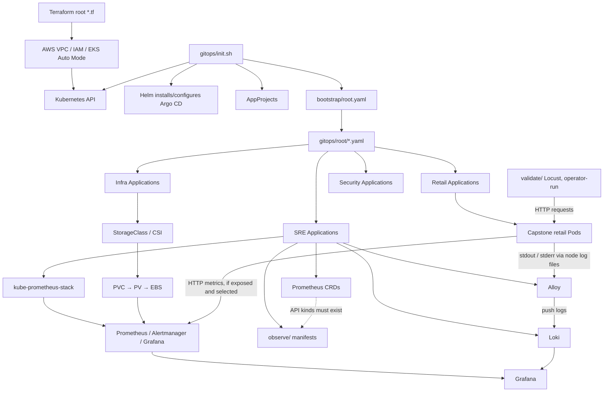

# Part I — GitOps Platform Documentation (TK)

This repository contains the complete **GitOps Infrastructure-as-Code (IaC)** for provisioning and managing the eks cluster on AWS EKS. It leverages **Argo CD** and the **App of Apps** pattern to fully automate the deployment of core infrastructure, observability (SRE) tooling, and business applications.

## 📂 Repository Architecture

The deployment is strictly ordered using Argo CD `sync-wave` annotations to prevent race conditions (e.g., ensuring CRDs and Ingress controllers exist before deploying applications that depend on them).

- **`bootstrap/`**: Contains `init.sh` (bootstrap script), `root.yaml` (the App of Apps entry point), and Argo CD Helm values.
- **`infra/`**: Core cluster infrastructure (Ingress NGINX, Cert-Manager, External-DNS, StorageClass).
- **`sre/`**: Observability stack (kube-prometheus-stack, Grafana Alloy, Prometheus CRDs).
- **`app/`**: Workload microservices (Sample).
- **`destroy.sh`**: A robust teardown script that safely strips finalizers, cleans up AWS resources (NLBs), and purges namespaces.

### Deployment Sequence (Sync Waves)

1. **Wave -5**: Prometheus CRDs (`prometheus-operator-crds`)
2. **Wave -2**: Root Infra App (triggers Ingress, Cert-Manager, External-DNS)
3. **Wave -1**: Root SRE App (triggers Monitoring stack)
4. **Wave 0**: Root App (triggers Business Workloads)
5. **Internal Waves**: Ingress (`-1`) -> Cert-Manager (`0`) -> ClusterIssuer (`1`) -> SRE (`3`) -> Workload microservices (`4`)

---

## 🛠️ Bootstrap the Cluster

To bootstrap the entire cluster from scratch, run the initialization script:

```bash
chmod +x init.sh
./init.sh
```

## Accessing Platform Dashboards

After successfully running `./init.sh`, the core platform UI dashboards will be provisioned. Use the commands below to retrieve your initial admin passwords.

### 1. Argo CD

Argo CD orchestrates our GitOps deployments and provides a UI to monitor application health and sync status.

- **URL:** [https://group2-capstone-argocd.sctp-sandbox.com](https://group2-capstone-argocd.sctp-sandbox.com)
- **Username:** `admin`
- **Retrieve Password:** Run the following command to decode the initial admin password from the Kubernetes secret:

```bash
kubectl -n argocd get secret argocd-initial-admin-secret -o jsonpath="{.data.password}" | base64 -d && echo
```

### 2. Grafana (Prometheus Monitoring Stack)

Grafana provides cluster observability, metrics, and alerting dashboards, deployed via the kube-prometheus-stack.

- **URL:** [https://group2-capstone-grafana.sctp-sandbox.com](https://group2-capstone-grafana.sctp-sandbox.com)
- **Username:** `admin`
- **Retrieve Password:** Run the following command to decode the initial admin password from the Kubernetes secret:

```bash
kubectl -n monitoring get secret kube-prometheus-stack-grafana -o jsonpath="{.data.admin-password}" | base64 -d && echo
```

### The Core Philosophy: GitOps

**Git is the single source of truth** for your cluster's desired state. You do not run `kubectl apply` or `helm install` manually to deploy applications. Instead, you update files in this Git repository, and Argo CD ensures the Kubernetes cluster exactly matches what is in Git.

### The Reconciliation Loop

Argo CD operates on a continuous **Reconciliation Loop**. It constantly asks three questions:

1. **What is the Desired State?** (What does the YAML/Helm chart in this Git repo say?)
2. **What is the Live State?** (What is currently actually running in the Kubernetes cluster?)
3. **Do they match?**
   - If **Yes**: The Application status is marked as **`Synced`** and **`Healthy`**.
   - If **No**: The Application status is marked as **`OutOfSync`**. Depending on the `syncPolicy`, Argo CD will either wait for a manual approval or automatically apply the changes.

### Key Concepts Used in This Repository

#### 1. Applications & AppProjects

- **Application**: A Kubernetes Custom Resource (CRD) that links a Git repository to a target Kubernetes cluster/namespace.
- **AppProject**: A logical grouping that acts as a security boundary. You have `infra-project`, `sre-project`, and `app-project`. These restrict where applications can deploy (e.g., an app in `app-project` cannot accidentally deploy into the `kube-system` namespace).

#### 2. The "App of Apps" Pattern

Instead of manually creating hundreds of Applications, you create one "Root" Application (`root.yaml`) that points to a directory in Git containing *other* Application YAML files.

- `root.yaml` deploys `root-infra.yaml`, `root-sre.yaml`, and `root-app.yaml`.
- Argo CD sees those new applications and deploys them, creating a cascading tree of deployments.

#### 3. Sync Waves (Dependency Management)

Applying files out of order causes errors (e.g., trying to create an Ingress before the Ingress Controller exists). Argo CD solves this using the **`argocd.argoproj.io/sync-wave`** annotation.

- Argo CD sorts all resources by their wave number (lowest to highest) and waits for each wave to become "Healthy" before moving to the next.
- **Example:** The Ingress NGINX is at `Wave -1`, so it is fully provisioned and AWS assigns an NLB *before* Cert-Manager (`Wave 0`) tries to provision SSL certificates through it.

#### 4. Automated Sync Policy (Prune & Self-Heal)

In the Application manifests, you will see:

```yaml
syncPolicy:
  automated:
    prune: true
    selfHeal: true
```

---

# Part II — Capstone End-to-End GitOps, Infrastructure and SRE Code Traceability

> **Scope and evidence:** This section traces the documented Capstone repository layout and the expected semantics of Kubernetes, Argo CD, Terraform and Helm configuration. Paths below are known from the supplied README. **Example code snippets are syntax illustrations, not quotations from verified source files.** Inspect the linked file and its current revision before treating a particular key, value, wave or integration as implemented. A Git commit proves desired-state publication, not cluster health.

## 1. Execution domains: which system reads which file?

| Stage | File(s) to inspect | Interpreter / controller | What it produces | What consumes the result |
|---|---|---|---|---|
| Infrastructure | Root `*.tf` | Terraform AWS provider | VPC, subnets, IAM, EKS, ECR, related infrastructure | AWS APIs, EKS, deployment identities |
| Bootstrap | `gitops/init.sh` | Bash, Helm, `kubectl` | Argo CD installation, AppProjects, root Application | Kubernetes API / Argo CD |
| Root discovery | `gitops/bootstrap/root.yaml` | Argo CD application controller | Rendered resources from `gitops/root/` | Root child Applications |
| Workstream fan-out | `gitops/root/root-{infra,app,sec,sre}.yaml` | Argo CD | Infra, app, security and SRE child Applications | Workstream controllers |
| SRE authorization | `gitops/sre/projects/sre-project.yaml` | Argo CD AppProject validation | Allowed Git sources, destinations, resource kinds | SRE child Applications |
| SRE deployment | `gitops/sre/apps/{prometheus-crds,prometheus-stack,loki,alloy,monitoring-app}.yaml` | Argo CD + Helm | Operators, workloads, Services and custom resources | Kubernetes controllers |
| Observability | `gitops/sre/observe/` | Prometheus Operator / Grafana sidecars or provisioners | Rules, scrape discovery and dashboards, as configured | Prometheus / Grafana |
| Validation | `gitops/sre/validate/` | Operator-run Python / shell / Locust | Synthetic requests and test evidence | Applications and observability backends |

**Boundary rule:** Terraform reconciles AWS infrastructure; Argo CD reconciles Kubernetes desired state. Prometheus and Alloy collect telemetry at runtime. Locust generates traffic when explicitly executed; it is not automatically deployed merely because its files exist in Git.

## 2. Complete control-plane flow



The arrows are **logical dependencies/data flows**, not proof of successful synchronization. Sync waves are evaluated within a sync operation and do not globally serialize independent child Application reconciliation.

## 3. Code-level trace: Terraform → EKS → Kubernetes access

**Source inspection:** Find the actual Terraform root modules and outputs before asserting resource names or exact provider configuration:

```bash
find . -maxdepth 3 -name '*.tf' -print | sort
git grep -n -E 'module "|resource "aws_eks|cluster_name|subnet_ids|access_entries|oidc|aws_iam' -- '*.tf'
```

Illustrative Terraform syntax:

```hcl
module "eks" {
  source = "terraform-aws-modules/eks/aws"
  cluster_name = var.cluster_name
  subnet_ids   = module.vpc.private_subnets
}
```

| Syntax segment | Input → effect | Downstream reference / failure mode |
|---|---|---|
| `module "eks"` | Terraform module instance identifier | Other Terraform expressions may reference `module.eks.*` outputs |
| `source` | Resolves a module package | Changing source/version can alter resource implementation |
| `var.cluster_name` | Reads an input variable | EKS name must match the intended AWS CLI / kubeconfig target |
| `module.vpc.private_subnets` | Consumes VPC module output | Wrong subnets can affect node placement and connectivity |
| EKS access entries / IAM policies | Authorize principals to reach cluster API | Missing access prevents `kubectl` / Argo CD bootstrap |

**Important:** The illustrative snippet above is not a verified quotation from the Capstone Terraform files. EKS Auto Mode configuration, actual module version and outputs must be checked in the repository.

## 4. Code-level trace: `gitops/init.sh` → AppProjects → root Application

Read the exact shell implementation:

```bash
nl -ba gitops/init.sh | sed -n '1,220p'
git grep -n -E 'SCRIPT_DIR|cd "\$SCRIPT_DIR"|helm |kubectl apply|bootstrap/root.yaml|projects/' -- gitops/init.sh
```

Illustrative commands corresponding to the documented bootstrap contract:

```bash
SCRIPT_DIR="$(cd "$(dirname "${BASH_SOURCE[0]}")" && pwd)"
cd "$SCRIPT_DIR"
kubectl apply -f sre/projects/sre-project.yaml
kubectl apply -f bootstrap/root.yaml
```

| Exact syntax | Why it matters | Consumer / resulting state |
|---|---|---|
| `${BASH_SOURCE[0]}` | Locates the running script | Supports invocation from a different working directory |
| `dirname` / `cd` / `pwd` | Resolves the script directory | Makes subsequent relative paths point under `gitops/` |
| `kubectl apply -f ...sre-project.yaml` | Submits an AppProject object | Argo CD authorizes SRE Applications against its rules |
| `kubectl apply -f bootstrap/root.yaml` | Submits the root Application | Argo CD reads its Git `repoURL`, `targetRevision` and `path` |

**Order dependency:** An Application referencing `spec.project: sre-project` cannot be validly reconciled unless the matching AppProject exists and permits its source and destination. Check the script for the actual registration order; do not infer it from README prose.

## 5. Code-level trace: root Application → child Applications

Inspect:

```bash
nl -ba gitops/bootstrap/root.yaml
for f in gitops/root/*.yaml; do echo "===== $f ====="; nl -ba "$f"; done
```

Illustrative Argo CD Application fields:

```yaml
spec:
  project: default
  source:
    repoURL: https://github.com/OWNER/REPOSITORY.git
    targetRevision: main
    path: gitops/root
  destination:
    server: https://kubernetes.default.svc
    namespace: argocd
```

| Field | Reference semantics | If changed incorrectly |
|---|---|---|
| `spec.project` | Names an existing AppProject | Application may fail project authorization |
| `source.repoURL` | Identifies Git source | Wrong URL prevents repository retrieval |
| `source.targetRevision` | Selects branch, tag or commit | Wrong revision deploys different or stale desired state |
| `source.path` | Selects repository-root-relative directory | Wrong path produces missing or unrelated manifests |
| `destination.server` | Selects Kubernetes cluster | Wrong destination targets another cluster |
| `destination.namespace` | Default namespace for namespaced objects | May affect placement; explicit manifest namespaces can override |

**Concrete file chain from the supplied layout:** `gitops/bootstrap/root.yaml` → `gitops/root/root-sre.yaml` → `gitops/sre/apps/` → individual SRE Application definitions. Confirm `source.path` and `targetRevision` in each actual YAML; do not assume all children track `main`.

## 6. Code-level trace: `root-sre.yaml` → SRE Applications → Helm

Inspect the exact application definitions:

```bash
nl -ba gitops/root/root-sre.yaml
for f in gitops/sre/apps/*.yaml; do echo "===== $f ====="; nl -ba "$f"; done
nl -ba gitops/sre/projects/sre-project.yaml
```

Two distinct Argo CD source patterns may be present:

```yaml
# Illustrative pattern A: directory of Kubernetes manifests
source:
  repoURL: https://github.com/OWNER/REPOSITORY.git
  targetRevision: main
  path: gitops/sre/observe
```

```yaml
# Illustrative pattern B: Helm chart from a chart repository
source:
  repoURL: https://prometheus-community.github.io/helm-charts
  chart: kube-prometheus-stack
  targetRevision: CHART_VERSION
  helm:
    valuesObject:
      prometheus:
        prometheusSpec: {}
```

| Syntax | Interpretation | Key dependency |
|---|---|---|
| `path` | Render files from a Git directory | Repository must contain the referenced path |
| `chart` | Fetch and render a named Helm chart | Chart repository must contain the chart/version |
| `targetRevision` with Git | Git revision selector | Branch/commit/tag must exist |
| `targetRevision` with Helm chart | Chart version selector | Chart version must exist |
| `helm.valuesObject` | Inline chart values | Keys must match that chart version's `values.yaml` schema |
| `spec.project: sre-project` | AppProject authorization | Project must permit source, namespace, cluster and resource kinds |

**CRD prerequisite:** Prometheus Operator custom resources such as `Prometheus`, `ServiceMonitor` and `PrometheusRule` require their CRDs to be installed before the API accepts those objects. Check `prometheus-crds.yaml`, `prometheus-stack.yaml`, and `monitoring-app.yaml` to verify their actual dependency strategy. A sync-wave annotation alone does not guarantee cross-Application readiness.

## 7. Code-level trace: Prometheus values → StatefulSet → PVC → EBS

Inspect the real values and infrastructure resources:

```bash
git grep -n -E 'storageSpec|volumeClaimTemplate|storageClassName|20Gi|gp3|ebs.csi.eks.amazonaws.com|reclaimPolicy' -- gitops/ '*.tf'
kubectl get storageclass -o wide
kubectl get pvc -n monitoring
```

Illustrative Helm values (not verified literal Capstone YAML):

```yaml
prometheus:
  prometheusSpec:
    storageSpec:
      volumeClaimTemplate:
        spec:
          storageClassName: gp3
          accessModes: ["ReadWriteOnce"]
          resources:
            requests:
              storage: 20Gi
```

| YAML path | Controller-level effect | Change consequence |
|---|---|---|
| `prometheus.prometheusSpec` | Helm chart configures Prometheus custom resource | Invalid chart key may be ignored or fail validation |
| `storageSpec.volumeClaimTemplate` | Prometheus Operator creates storage claim templates for StatefulSet | Removing persistence can result in ephemeral metrics storage |
| `storageClassName: gp3` | PVC requests a named StorageClass | Wrong/missing class leaves claim pending |
| `accessModes: [ReadWriteOnce]` | Requests access compatible with a single-node writer | Different modes may not be supported by EBS CSI |
| `requests.storage: 20Gi` | Requests capacity | Resizing depends on StorageClass and filesystem capabilities |
| EKS Auto Mode EBS CSI provisioner | Provisions EBS volume for compatible PVC | Provisioner mismatch prevents dynamic volume provisioning |

**Physical runtime chain:** Prometheus custom resource → Operator-managed StatefulSet → PVC → StorageClass → CSI provisioner → PV → EBS volume → mounted Prometheus TSDB. A `Bound` PVC is evidence of binding, not proof of backup, failover or cross-AZ replication.

## 8. Code-level trace: application metrics → ServiceMonitor → Prometheus → Grafana

Inspect:

```bash
find gitops/sre/observe -maxdepth 2 -type f -print | sort
git grep -n -E 'kind: ServiceMonitor|kind: PrometheusRule|namespaceSelector|serviceMonitorSelector|selector:|endpoints:|port:|path:|interval:' -- gitops/sre
```

Illustrative monitoring resource:

```yaml
apiVersion: monitoring.coreos.com/v1
kind: ServiceMonitor
metadata:
  name: capstone-example
spec:
  selector:
    matchLabels:
      app: capstone-example
  endpoints:
    - port: metrics
      path: /metrics
      interval: 30s
```

**Reference chain:** `spec.selector.matchLabels` matches **Service metadata labels**, not arbitrary Pod labels; `endpoints[].port` refers to the named **Service port**. The selected Service routes traffic to matching Pods; its target must expose the metrics endpoint. Prometheus must also select this ServiceMonitor through its own selectors and namespace policy.

| Key | Consumer | Typical failure |
|---|---|---|
| `kind: ServiceMonitor` | Prometheus Operator | CRD missing |
| `spec.selector.matchLabels` | ServiceMonitor discovery | No Service matches labels |
| `spec.endpoints[].port` | Scrape endpoint resolution | Service port name mismatch |
| `spec.endpoints[].path` | HTTP scrape | 404 / non-Prometheus response |
| `spec.endpoints[].interval` | Scrape scheduling | Different load / freshness tradeoff |
| Prometheus `serviceMonitorSelector` | Prometheus Operator | Monitor exists but is not selected |
| Grafana Prometheus datasource | Grafana | Panels cannot query metrics if URL or permissions are wrong |

**Validation:** Check Prometheus Targets and execute a known metric query in Grafana; existence of YAML alone is insufficient.

## 9. Code-level trace: PrometheusRule → Alertmanager → receiver

Illustrative custom resource:

```yaml
apiVersion: monitoring.coreos.com/v1
kind: PrometheusRule
metadata:
  name: capstone-example-alerts
spec:
  groups:
    - name: capstone.rules
      rules:
        - alert: ExampleTargetDown
          expr: up == 0
          for: 5m
          labels:
            severity: warning
```

| Key | Effect | Validation |
|---|---|---|
| `groups[].name` | Groups rule evaluation | Rule visible in Prometheus rules UI |
| `rules[].alert` | Names the alert | Alert appears by expected name |
| `rules[].expr` | PromQL condition | Query evaluates to expected series |
| `rules[].for` | Required sustained condition | Alert transitions pending → firing when appropriate |
| `labels.severity` | Routing metadata | Alertmanager route matches configured labels |
| Alertmanager route / receiver | Delivers notification | Verify test delivery through approved receiver |

The actual Capstone rules and receiver configuration must be inspected; an example alert is not evidence that a production route exists.

## 10. Code-level trace: container logs → Alloy → Loki → Grafana

**Runtime chain:** Application writes stdout/stderr → container runtime writes Kubernetes node log files → Alloy discovers and reads appropriate log targets → Alloy sends entries to Loki → Loki stores/indexes them according to its configuration → Grafana Loki datasource queries logs.

Inspect:

```bash
git grep -n -E 'alloy|loki|/var/log/pods|/var/log/containers|loki.write|loki.source|discovery.kubernetes|datasource|s3' -- gitops/sre
```

| Configuration component | Upstream | Downstream | Failure mode |
|---|---|---|---|
| Alloy DaemonSet or workload | Node/container logs | Alloy processing pipeline | No access to node logs / wrong scheduling |
| Kubernetes discovery / relabeling | Kubernetes metadata | Target selection | Pods or namespaces omitted |
| Alloy log source | Log files / discovered targets | Alloy processing | Incorrect paths or permissions |
| Loki write endpoint | Alloy entries | Loki HTTP ingestion | Wrong Service DNS, port or authentication |
| Loki storage settings | Loki ingestion | Storage backend | IAM/S3 permissions or bucket configuration errors |
| Grafana Loki datasource | Loki query endpoint | Explore and dashboards | Invalid URL or unreachable Service |

Check actual Alloy configuration and Loki chart values before asserting S3 usage, node placement or specific log paths. EKS Auto Mode nodes and DaemonSet behavior must be validated in the live cluster.

## 11. Code-level trace: Locust → retail workload → SRE telemetry

Inspect:

```bash
find gitops/sre/validate -maxdepth 3 -type f -print | sort
git grep -n -E '@task|HttpUser|host|wait_time|users|spawn-rate|headless|csv' -- gitops/sre/validate
```

Illustrative Locust syntax:

```python
from locust import HttpUser, task, between

class RetailUser(HttpUser):
    wait_time = between(1, 3)

    @task
    def view_catalog(self):
        self.client.get("/products")
```

| Code segment | Meaning | What changes |
|---|---|---|
| `HttpUser` | Simulates HTTP client behavior | Other user types support different protocols |
| `wait_time = between(1, 3)` | Simulated user think time | Shorter waits increase request pressure |
| `@task` | Registers a simulated behavior | Adding tasks changes traffic mix |
| `self.client.get(...)` | Issues HTTP request | Path must match deployed application route |
| `--users` | Target concurrent simulated users | Higher value increases concurrency |
| `--spawn-rate` | Ramp-up rate | Higher value creates a faster load increase |
| `--host` | Target application base URL | Wrong host can test another system |

**Safety:** Use approved staging endpoints and a coordinated load profile; do not aim synthetic load at production or shared environments without authorization. Compare baseline and load-window request rate, latency, error rate, resource usage and alert behavior.

## 12. Cross-file consistency checklist

| Reference originating in | Must match | Consequence of mismatch |
|---|---|---|
| `init.sh` relative `-f` path | Real files under `gitops/` | Bootstrap file not found |
| Root Application `source.path` | `gitops/root/` | Child Applications not discovered |
| `root-sre.yaml` `source.path` | `gitops/sre/apps/` | SRE Applications not discovered |
| SRE Application `spec.project` | `sre-project` metadata name | AppProject validation failure |
| Child Application `repoURL` / `targetRevision` | Intended repository and approved revision | Wrong configuration deployed |
| Monitoring Application `source.path` | `gitops/sre/observe/` | Monitoring resources absent |
| Helm chart name / version | Chart repository | Rendering/fetch failure |
| Prometheus Helm `valuesObject` | Chart schema | Incorrect/ignored configuration |
| PVC `storageClassName` | Installed StorageClass metadata.name | PVC Pending |
| StorageClass `provisioner` | Intended EBS CSI driver | Volume provisioning failure |
| ServiceMonitor selector | Service metadata labels | No scrape target |
| ServiceMonitor endpoint port | Named Service port | Scrape failure |
| Prometheus monitor selectors | ServiceMonitor labels/namespace | Target not discovered |
| Grafana datasource URL | Prometheus/Loki Service address | Query failure |
| Alloy Loki write URL | Loki ingestion Service | Logs never reach Loki |
| Alertmanager route labels | Alert rule labels | Alert not routed |
| Locust request paths | Actual application routes | 404s / invalid test |

## 13. Evidence-first, read-only verification

```bash
# A. Repository identity (do not switch branches during documentation review).
git branch --show-current
git rev-parse HEAD
git status --short

# B. Inventory all code and reference points.
git ls-files '*.tf' 'gitops/**' | sort
git grep -n -E 'repoURL:|targetRevision:|path:|project:|sync-wave|valuesObject:|storageClassName:|volumeClaimTemplate:' -- gitops/

# C. Review source files with current line numbers.
for f in gitops/init.sh gitops/bootstrap/root.yaml gitops/root/root-sre.yaml \
  gitops/sre/projects/sre-project.yaml gitops/sre/apps/prometheus-stack.yaml \
  gitops/sre/apps/monitoring-app.yaml; do
  if test -f "$f"; then echo "===== $f ====="; nl -ba "$f"; fi
done

# D. Only after verifying correct AWS account/region/cluster context:
aws sts get-caller-identity
aws configure get region
kubectl config current-context
kubectl get applications.argoproj.io -n argocd \
  -o custom-columns=NAME:.metadata.name,SYNC:.status.sync.status,HEALTH:.status.health.status
kubectl get storageclass
kubectl get pvc,pods -n monitoring
kubectl get prometheuses,servicemonitors,prometheusrules -A
kubectl get pods,svc -n logging
```

**Acceptance evidence:** For each integration, record (1) Git file and commit, (2) reconciled Argo CD Application and sync/health states, (3) Kubernetes resource state, and (4) functional telemetry or application result. Do not mark an integration operational based on the first item alone.

## 14. Change ownership and review boundaries

- **Platform/Terraform:** VPC, EKS, IAM, networking and shared storage infrastructure.
- **GitOps:** Root bootstrap, AppProjects, Application sources, sync policy and pruning lifecycle.
- **Application:** Retail services, exposed endpoints, service labels and workloads.
- **SRE:** Metrics, logs, dashboards, rules, persistent telemetry and authorized load testing.
- **Security:** Admission policy, scanning, least privilege and deployment constraints.

For every cross-workstream change, review both ends of the reference (for example, Service labels **and** ServiceMonitor selectors), not only the edited file.
