# Part I — GitOps Platform Documentation (TK)

This repository contains the complete **GitOps Infrastructure-as-Code (IaC)** for provisioning and managing the eks cluster on AWS EKS. It leverages **Argo CD** and the **App of Apps** pattern to fully automate the deployment of core infrastructure, observability (SRE) tooling, and business applications.

## 📂 Repository Architecture

The deployment is strictly ordered using Argo CD `sync-wave` annotations to prevent race conditions (e.g., ensuring CRDs and Ingress controllers exist before deploying applications that depend on them).

- **`bootstrap/`**: Contains `init.sh` (bootstrap script), `root.yaml` (the App of Apps entry point), and Argo CD Helm values.
- **`infra/`**: Core cluster infrastructure (Ingress NGINX, Cert-Manager, External-DNS, StorageClass).
- **`sre/`**: Observability stack (kube-prometheus-stack, Grafana Alloy, Prometheus CRDs).
- **`app/`**: Workload microservices (Sample).
- **`destroy.sh`**: A robust teardown script that safely strips finalizers, cleans up AWS resources (NLBs), and purges namespaces.

### Deployment Sequence (Sync Waves)

1. **Wave -5**: Prometheus CRDs (`prometheus-operator-crds`)
2. **Wave -2**: Root Infra App (triggers Ingress, Cert-Manager, External-DNS)
3. **Wave -1**: Root SRE App (triggers Monitoring stack)
4. **Wave 0**: Root App (triggers Business Workloads)
5. **Internal Waves**: Ingress (`-1`) -> Cert-Manager (`0`) -> ClusterIssuer (`1`) -> SRE (`3`) -> Workload microservices (`4`)

---

## 🛠️ Bootstrap the Cluster

To bootstrap the entire cluster from scratch, run the initialization script:

```bash
chmod +x init.sh
./init.sh
```

## Accessing Platform Dashboards

After successfully running `./init.sh`, the core platform UI dashboards will be provisioned. Use the commands below to retrieve your initial admin passwords.

### 1. Argo CD

Argo CD orchestrates our GitOps deployments and provides a UI to monitor application health and sync status.

- **URL:** [https://group2-capstone-argocd.sctp-sandbox.com](https://group2-capstone-argocd.sctp-sandbox.com)
- **Username:** `admin`
- **Retrieve Password:** Run the following command to decode the initial admin password from the Kubernetes secret:

```bash
kubectl -n argocd get secret argocd-initial-admin-secret -o jsonpath="{.data.password}" | base64 -d && echo
```

### 2. Grafana (Prometheus Monitoring Stack)

Grafana provides cluster observability, metrics, and alerting dashboards, deployed via the kube-prometheus-stack.

- **URL:** [https://group2-capstone-grafana.sctp-sandbox.com](https://group2-capstone-grafana.sctp-sandbox.com)
- **Username:** `admin`
- **Retrieve Password:** Run the following command to decode the initial admin password from the Kubernetes secret:

```bash
kubectl -n monitoring get secret kube-prometheus-stack-grafana -o jsonpath="{.data.admin-password}" | base64 -d && echo
```

### 3. Application UI

To access UI:
```bash
kubectl get ingress -n retail-store
```


### The Core Philosophy: GitOps

**Git is the single source of truth** for your cluster's desired state. You do not run `kubectl apply` or `helm install` manually to deploy applications. Instead, you update files in this Git repository, and Argo CD ensures the Kubernetes cluster exactly matches what is in Git.

### The Reconciliation Loop

Argo CD operates on a continuous **Reconciliation Loop**. It constantly asks three questions:

1. **What is the Desired State?** (What does the YAML/Helm chart in this Git repo say?)
2. **What is the Live State?** (What is currently actually running in the Kubernetes cluster?)
3. **Do they match?**
   - If **Yes**: The Application status is marked as **`Synced`** and **`Healthy`**.
   - If **No**: The Application status is marked as **`OutOfSync`**. Depending on the `syncPolicy`, Argo CD will either wait for a manual approval or automatically apply the changes.

### Key Concepts Used in This Repository

#### 1. Applications & AppProjects

- **Application**: A Kubernetes Custom Resource (CRD) that links a Git repository to a target Kubernetes cluster/namespace.
- **AppProject**: A logical grouping that acts as a security boundary. You have `infra-project`, `sre-project`, and `app-project`. These restrict where applications can deploy (e.g., an app in `app-project` cannot accidentally deploy into the `kube-system` namespace).

#### 2. The "App of Apps" Pattern

Instead of manually creating hundreds of Applications, you create one "Root" Application (`root.yaml`) that points to a directory in Git containing *other* Application YAML files.

- `root.yaml` deploys `root-infra.yaml`, `root-sre.yaml`, and `root-app.yaml`.
- Argo CD sees those new applications and deploys them, creating a cascading tree of deployments.

#### 3. Sync Waves (Dependency Management)

Applying files out of order causes errors (e.g., trying to create an Ingress before the Ingress Controller exists). Argo CD solves this using the **`argocd.argoproj.io/sync-wave`** annotation.

- Argo CD sorts all resources by their wave number (lowest to highest) and waits for each wave to become "Healthy" before moving to the next.
- **Example:** The Ingress NGINX is at `Wave -1`, so it is fully provisioned and AWS assigns an NLB *before* Cert-Manager (`Wave 0`) tries to provision SSL certificates through it.

#### 4. Automated Sync Policy (Prune & Self-Heal)

In the Application manifests, you will see:

```yaml
syncPolicy:
  automated:
    prune: true
    selfHeal: true
```

---

---

# Part II — Capstone: Verified End-to-End Code Traceability

> **Current implementation baseline — 26 November 2026**
>
> Source revision: `c88875400c4c7049217852b761f76ff5739c1858`.
> Part I is TK's original platform documentation and is preserved
> verbatim. The following sections describe subsequent architectural
> developments and verified SRE implementation.
>
> The historical code review remains available below for traceability.
> Where configurations differ, use the current source files as the
> authoritative desired state.

## A. Current end-to-end platform architecture

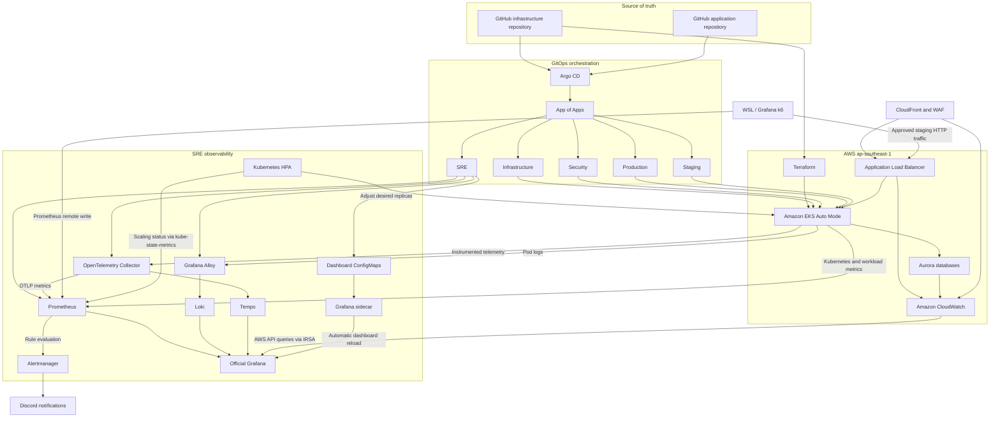

The diagram combines declared architecture with verified runtime
components. It does not imply that every telemetry path, scaling
event or notification has completed end-to-end validation.

## B. Current GitOps root applications

| Application | Sync wave | Source path |
|---|---:|---|
| root-infra | -2 | `gitops/infra/apps` |
| root-sec | -2 | `gitops/sec/apps` |
| root-sre | -1 | `gitops/sre/apps` |
| root-app | 0 | `gitops/app/apps` |
| root-app-staging | 0 | `gitops/app-staging/apps` |

All five root definitions target the infrastructure repository.

Source: [Root Applications](root/).

Sync waves order resources within a synchronization operation.
They do not independently guarantee readiness across separately
reconciled child Applications.

## C. Current environment boundaries

| Environment | Namespace | Storefront |
|---|---|---|
| Production | `retail-store` | [Production UI](https://group2-shop.sctp-sandbox.com/) |
| Staging | `retail-staging` | [Staging UI](https://group2-retail-staging.sctp-sandbox.com/) |
| Monitoring | `monitoring` | [Official Grafana](https://group2-capstone-grafana.sctp-sandbox.com/) |
| Logging | `logging` | Internal telemetry services |
| GitOps | `argocd` | [Argo CD](https://group2-capstone-argocd.sctp-sandbox.com/) |

The retail workloads comprise UI, Catalog, Carts, Orders and
Checkout services. Synthetic load testing is directed to the
approved staging endpoint.

## D. Current SRE source-to-runtime register

| Source | Runtime responsibility |
|---|---|
| [root-sre.yaml](root/root-sre.yaml) | Discovers SRE child Applications |
| [prometheus-crds.yaml](sre/apps/prometheus-crds.yaml) | Monitoring CRDs |
| [prometheus-stack.yaml](sre/apps/prometheus-stack.yaml) | Helm-based monitoring deployment |
| [prometheus.yaml](sre/values/prometheus.yaml) | Prometheus, Grafana and Alertmanager configuration |
| [grafana-dashboards.yaml](sre/values/grafana-dashboards.yaml) | Helm-managed imported dashboards |
| [alloy.yaml](sre/apps/alloy.yaml) | Kubernetes pod log collection |
| [loki.yaml](sre/apps/loki.yaml) | Log aggregation and storage |
| [tempo.yaml](sre/apps/tempo.yaml) | Distributed trace storage |
| [OpenTelemetry manifests](sre/manifests/otel/) | Instrumentation and collector configuration |
| [monitoring-app.yaml](sre/apps/monitoring-app.yaml) | Reconciles observability YAML |
| [grafana-hpa-dashboard.yaml](sre/observe/grafana-hpa-dashboard.yaml) | HPA dashboard |
| [grafana-k6-dashboard.yaml](sre/observe/grafana-k6-dashboard.yaml) | k6 dashboard |
| [capstone-alerts.yaml](sre/monitoring/capstone-alerts.yaml) | Prometheus alert rules |
| [alertmanager-discord.yaml](sre/monitoring/alertmanager-discord.yaml) | Discord notification routing |
| [iam_grafana.tf](../iam_grafana.tf) | Grafana CloudWatch IAM authorization |
| [product-listing.js](sre/validate/k6/product-listing.js) | Synthetic HTTP workload |
| [run.sh](sre/validate/k6/run.sh) | k6 execution and optional remote write |

## E. Current monitoring configuration

| Configuration | Declared implementation |
|---|---|
| Monitoring Helm chart | kube-prometheus-stack 93.1.1 |
| Helm values | External values through Argo CD multi-source |
| Prometheus ingress | Disabled |
| Prometheus remote-write receiver | Enabled |
| Prometheus OTLP receiver | Enabled |
| Prometheus retention | 3 days / 5GB |
| Prometheus storage request | 20Gi gp3 |
| Alloy Helm chart | 1.15.0 |
| Alloy controller | DaemonSet |
| Alloy responsibility | Kubernetes pod logs |
| Loki Helm chart | 7.5.0 |
| Loki storage | S3-backed object storage |
| Grafana CloudWatch authentication | IAM Roles for Service Accounts |
| Grafana dashboard discovery | ConfigMap label `grafana_dashboard: "1"` |

Prometheus handles metrics collection. Alloy handles Kubernetes
pod logs. OpenTelemetry provides instrumented telemetry.
These responsibilities must not be conflated.

## F. Verified dashboard deployment automation

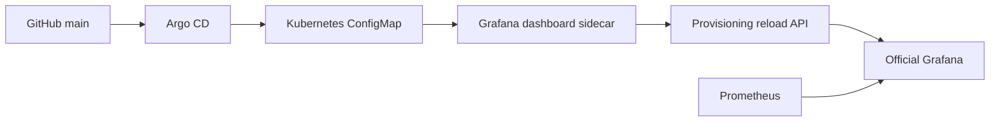

The k6 dashboard deployment was verified on 26 November 2026:

- GitHub revision: `c888754`.
- Argo CD: Synced / Healthy.
- Automatic reconciliation: 21:46:26 SGT.
- ConfigMap: `capstone-k6-dashboard`.
- Dashboard file: `/tmp/dashboards/capstone-k6.json`.
- Grafana reload: HTTP 200 OK.
- Dashboard UID: `capstone-k6`.
- Dashboard provisioning: `true`.
- Datasource UID: `prometheus`.
- Panel count: 24.

No forced synchronization, manual Grafana import or deployment
restart was required.

### Official custom dashboards

| Dashboard | Panels | Status |
|---|---:|---|
| [Kubernetes HPA and Autoscaling](https://group2-capstone-grafana.sctp-sandbox.com/d/capstone-hpa) | 11 | Provisioned |
| [k6 Load Testing and Performance](https://group2-capstone-grafana.sctp-sandbox.com/d/capstone-k6) | 24 | Provisioned |

These dashboards provide 35 additional GitOps-managed panels.

## G. k6 performance and HPA correlation

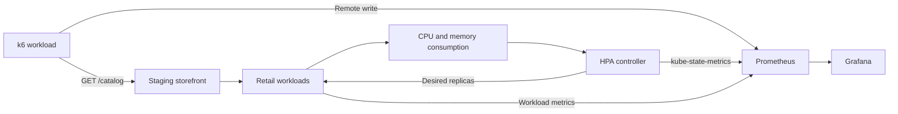

### Validated k6 metrics

| Metric | Meaning |
|---|---|
| `k6_http_reqs_total` | HTTP request counter |
| `k6_http_req_duration_p95` | Exported interval p95 latency in seconds |
| `k6_http_req_failed_rate` | HTTP failure ratio |
| `k6_checks_rate` | Check success ratio |
| `k6_vus` | Active virtual users |
| `k6_vus_max` | Configured maximum virtual users |
| `k6_capstone_product_listing_duration_p95` | Product-listing latency |
| `k6_capstone_product_listing_failed_rate` | Product-listing failure ratio |

The assessment runner adds `namespace` and `assessment_run`
labels to distinguish test executions.

### Example PromQL

```promql
# Product-listing p95 latency in milliseconds
1000 * k6_capstone_product_listing_duration_p95{
  namespace="retail-staging"
}
```

```promql
# Synthetic HTTP throughput
sum(rate(k6_http_reqs_total{
  namespace="retail-staging"
}[1m]))
```

```promql
# HPA current CPU utilization percentage
kube_horizontalpodautoscaler_status_target_metric{
  namespace="retail-staging",
  metric_name="cpu",
  metric_target_type="utilization"
}
```

```promql
# HPA target CPU utilization percentage
kube_horizontalpodautoscaler_spec_target_metric{
  namespace="retail-staging",
  metric_name="cpu",
  metric_target_type="utilization"
}
```

The staging HPAs were observed with a 70% CPU utilization target.
A successful k6 test does not by itself demonstrate autoscaling:
actual current and desired replica changes must be observed.

## H. AWS CloudWatch integration

Grafana is configured to query CloudWatch using AWS API access
through its Kubernetes service account and IAM role.

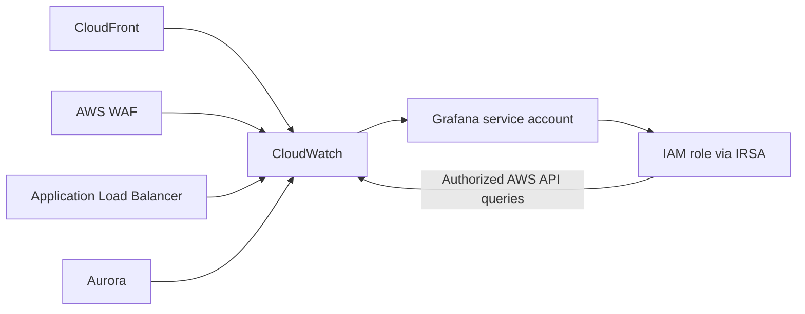

The intended AWS monitoring scope includes CloudFront requests
and errors, WAF allowed and blocked requests, ALB request volume
and target latency, and RDS resource utilization.

CloudFront metrics use `us-east-1`; regional infrastructure
metrics use `ap-southeast-1`.

The existing CloudWatch datasource and IAM configuration should
be reused. No separate Firehose metric stream is required for
the current direct-query architecture.

Dedicated CloudWatch dashboard panels and their live queries
remain subject to operational validation.

## I. Operational validation status

| Capability | Status on 26 November 2026 |
|---|---|
| EKS cluster availability | Verified |
| Kubernetes node readiness | 11 Ready nodes observed |
| Production workloads | Five deployments observed ready |
| Staging workloads | Five deployments observed ready |
| Prometheus scrape targets | 83/83 active targets observed up |
| HPA dashboard queries | 30/30 checks passed across both environments |
| HPA dashboard provisioning | Verified |
| k6 remote-write ingestion | Verified |
| k6 dashboard queries | 24/24 checks passed |
| k6 dashboard provisioning | Verified |
| Alloy and Loki workload readiness | Verified at observation time |
| CloudWatch datasource configuration | Verified |
| Dedicated CloudWatch panel validation | Pending |
| Full trace-to-log correlation | Pending |
| Prometheus rule to Discord delivery | Requires final end-to-end evidence |
| HPA scale-out and recovery | Requires observed scaling evidence |
| Daily infrastructure restoration | Requires final repeatability validation |

These are dated observations, not guarantees of continuous
availability or future cluster state.

## J. Documentation and deployment safeguards

- [SRE implementation documentation](sre/README.md)
- [Validation procedures](sre/validate/README.md)
- [Operational health report](sre/validate/health-report.md)

Active Argo CD source paths must remain stable. In particular,
`gitops/sre/observe` uses a non-recursive YAML directory source.
Relocating manifests without coordinated source changes can
cause resources to be omitted or automatically pruned.

Infrastructure recreation is a team-controlled operation.
Refresh the EKS kubeconfig and verify the current cluster
before performing operational checks.

Do not expose credentials, decoded Kubernetes secrets,
webhook URLs or sensitive Terraform state in assessment
recordings or evidence archives.

## K. Upstream architecture reconciliation — 26 November 2026

**Reconciled source revision:** `4d7cba52913080f342273512180aa18090e90eea` (PR #342).

Sections A-J retain their earlier source baseline `c88875400c4c7049217852b761f76ff5739c1858`.
Where alerting, relay or priority-policy details differ, this
section and SRE Section S.12 describe the newer desired state.

Historical operational observations are not retroactively changed.

### K.1 Upstream implementation changes

| Component | Earlier baseline | Reconciled desired state |
|---|---|---|
| Container CPU warning | Above 50% of CPU limit | Above 85% for 3 minutes |
| OOMKilled | Last termination reason | Last termination reason plus recent restart |
| Default notification receiver | Discord | Null receiver |
| Discord | Default receiver and explicit critical route | Explicit critical or warning route |
| DevOps Agent | Critical webhook route | Eligible critical alerts via Lambda relay |
| Default group wait | 30 seconds | 10 seconds |
| Default group interval | 5 minutes | 1 minute |
| Default repeat interval | 4 hours | 1 hour |
| ExternalSecret | Earlier manifest location | `gitops/sec/apps/devops-agent.yaml` |

The newer grouping keys are alertname, namespace, pod and
deployment. Child routes inherit the configured parent timings.

Sources:

- [`gitops/sre/monitoring/capstone-alerts.yaml:79-93`](https://github.com/eugenewongyj/cloud-ntu-capstone-group2-infra/blob/4d7cba52913080f342273512180aa18090e90eea/gitops/sre/monitoring/capstone-alerts.yaml#L79-L93)
- [`gitops/sre/monitoring/capstone-alerts.yaml:162-174`](https://github.com/eugenewongyj/cloud-ntu-capstone-group2-infra/blob/4d7cba52913080f342273512180aa18090e90eea/gitops/sre/monitoring/capstone-alerts.yaml#L162-L174)
- [`gitops/sre/monitoring/alertmanager-discord.yaml:9-51`](https://github.com/eugenewongyj/cloud-ntu-capstone-group2-infra/blob/4d7cba52913080f342273512180aa18090e90eea/gitops/sre/monitoring/alertmanager-discord.yaml#L9-L51)
- [`gitops/sec/apps/devops-agent.yaml:1-20`](https://github.com/eugenewongyj/cloud-ntu-capstone-group2-infra/blob/4d7cba52913080f342273512180aa18090e90eea/gitops/sec/apps/devops-agent.yaml#L1-L20)

### K.2 Notification and incident architecture

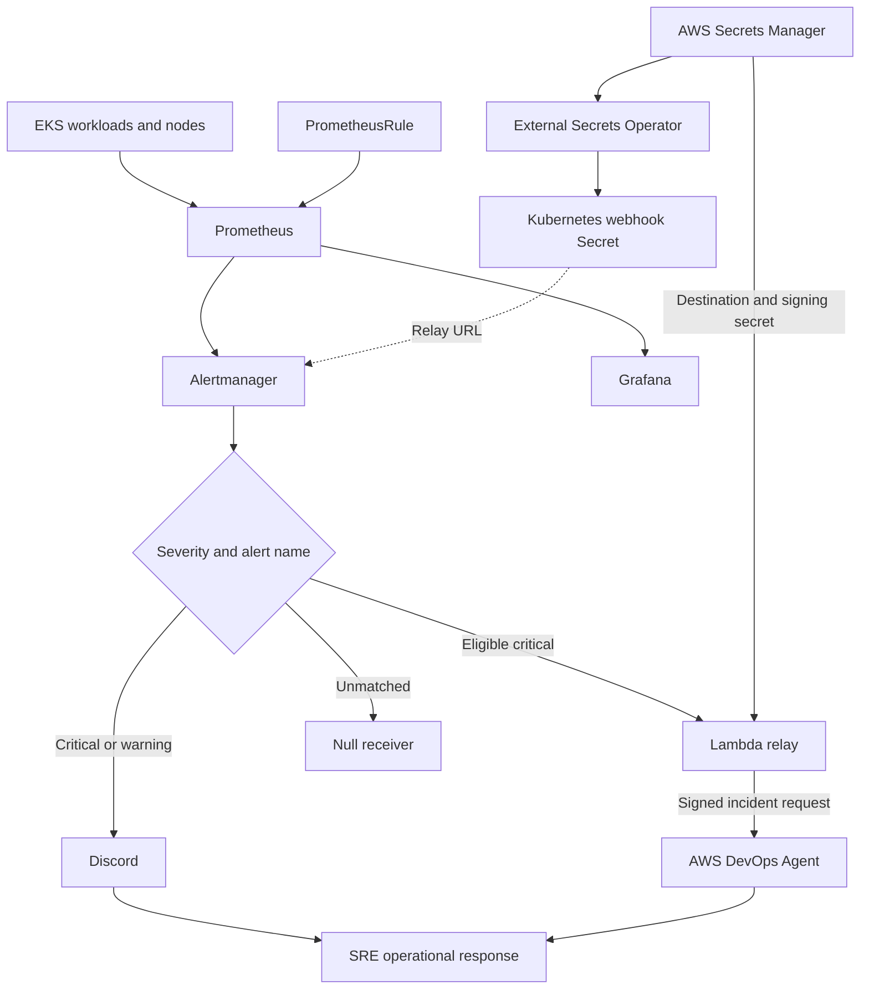

This is a configured architecture. Successful notification
delivery and incident investigation require runtime evidence.

### K.3 Retail workload priority

The Kyverno policy matches Pod CREATE operations:

- `retail-store`: assigns `priorityClassName: prod-critical`.
- `retail-staging`: assigns `priorityClassName: staging-low`.

PriorityClass values and preemption behavior must be verified
from their actual definitions. The mutation does not establish
retroactive changes to existing pods.

The policy uses `failurePolicy: Ignore`; admission webhook
failures may therefore allow creation without mutation.

Source: [`gitops/sec/policies/assign-retail-priority-classes.yaml:1-29`](https://github.com/eugenewongyj/cloud-ntu-capstone-group2-infra/blob/4d7cba52913080f342273512180aa18090e90eea/gitops/sec/policies/assign-retail-priority-classes.yaml#L1-L29)

### K.4 Change isolation

This reconciliation is documentation-only. It does not replace
the team's functional configuration, relocate manifests, alter
Terraform state, change notification receivers or authorize
infrastructure recreation.

See [SRE Section S.12](sre/README.md) for source-level details
and [validation procedures](sre/validate/README.md) for evidence
requirements.


---

## Historical code traceability archive

The following material is retained from the previous Part II
for engineering history and source-level traceability.
Its pinned revisions, proposed configurations, line numbers
and historical observations must not be interpreted as the
current deployment state.


> **Evidence and revision scope:** The original code review is pinned to commit `2c38f631246c2cf9361fd1784c8b14b85b76f0ba` and its line links remain historical evidence. The Alloy subsection and architecture diagrams below describe the **subsequent proposed Alloy log-only consolidation** from the local `refactor/sre-alloy-consolidation` working tree. All other pinned excerpts describe the historical snapshot unless explicitly marked otherwise. **Source declarations are not proof of live cluster health.** TK's Part I is preserved unchanged.

## 1. Source-anchored execution map

### A. Provisioning, bootstrap and Argo CD discovery

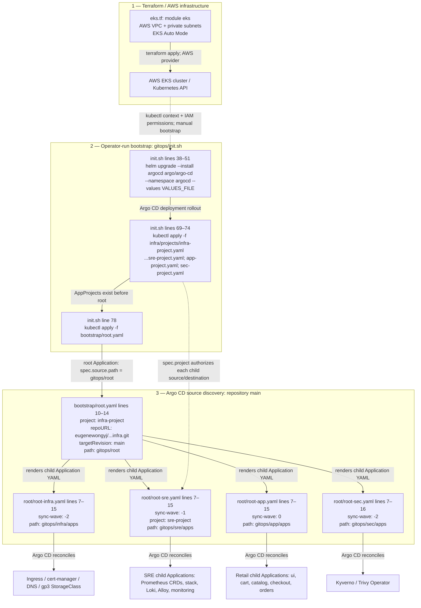

### B. Exact SRE configuration, telemetry and log paths

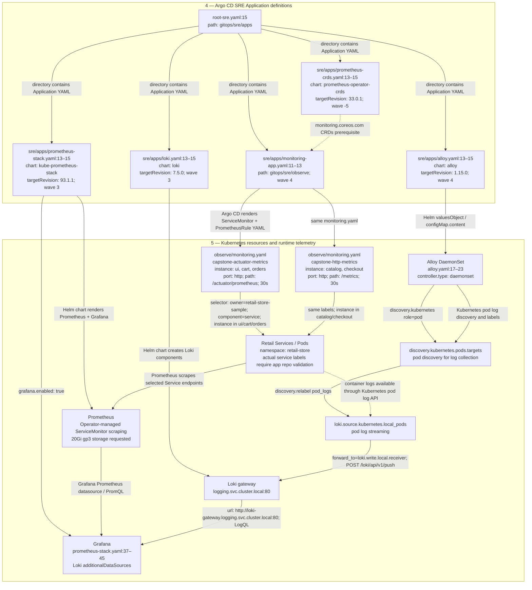

### C. Storage, Loki S3, alerts and load validation

```mermaid
flowchart TB
  subgraph STORAGE["6 — Prometheus persistent storage"]
    SC["infra/apps/gp3-storageclass.yaml<br/>metadata.name: gp3<br/>provisioner: ebs.csi.eks.amazonaws.com<br/>reclaimPolicy: Retain<br/>volumeBindingMode: WaitForFirstConsumer"]
    V["sre/apps/prometheus-stack.yaml:75–82<br/>storageSpec.volumeClaimTemplate.spec<br/>storageClassName: gp3<br/>accessModes: ReadWriteOnce<br/>requests.storage: 20Gi"]
    PVC["Operator-managed StatefulSet → PVC"]
    CSI["EKS Auto Mode EBS CSI → PV / EBS volume"]
    V -->|"volumeClaimTemplate requests 20Gi"| PVC
    PVC -->|"spec.storageClassName: gp3"| SC
    SC -->|"provisioner: ebs.csi.eks.amazonaws.com"| CSI
  end
  subgraph LOGSTORE["7 — Loki object storage"]
    L["sre/apps/loki.yaml:23–42<br/>storage.type: s3<br/>schema: tsdb/v13<br/>region: ap-southeast-1"]
    S3["S3 bucket: group2-capstone-loki-logs-ap-southeast-1"]
    L -->|"bucketNames.chunks / ruler / admin"| S3
  end
  subgraph ALERT["8 — Monitoring alerts"]
    RULE["sre/observe/monitoring.yaml<br/>kind: PrometheusRule<br/>metadata.name: capstone-alerts"]
    P["Prometheus rule evaluation"]
    AM["Alertmanager routing / receiver<br/>receiver delivery not verified from snapshot"]
    RULE -->|"spec.groups[].rules[].expr / for / labels"| P
    P -->|"firing alerts"| AM
  end
  subgraph TEST["9 — Operator-run load validation"]
    RUN["gitops/sre/validate/k6/run.sh<br/>TARGET_HOST / CAPSTONE_PRODUCT_PATH<br/>LOAD_PROFILE / BASE_USERS"]
    PY["gitops/sre/validate/k6/product-listing.js<br/>http.get / ramping-vus<br/>checks / latency and failure thresholds"]
    APP["Approved Capstone staging HTTP endpoint"]
    MET["Application latency, error rate, request rate"]
    RUN -->|"k6 run; approved test profile"| PY
    PY -->|"HTTP GET; product_listing"| APP
    APP -->|"generates measurable traffic"| MET
  end
```

**Arrow semantics:** Solid arrows indicate declared references or intended data paths. The dotted EKS-to-bootstrap arrow is a **manual operator action**, not a Terraform provisioner. Parent-child Application sync waves do not guarantee readiness across independently reconciled Applications. Some runtime arrows depend on chart rendering, external application source, network access and live validation.


**Diagram interpretation and source boundaries:** `gitops/init.sh` is an operator-run bootstrap, not a Terraform execution step. Argo CD sync waves order resources within a sync operation, not all independently reconciling child Applications. Alloy uses Kubernetes pod-log streaming rather than a verified host `/var/log/pods` tail. The retail chart's rendered Service labels and named ports, S3 access, Alertmanager delivery and live scrape success remain unverified.

### Diagram-specific cross-file syntax register

| From | Exact source syntax | To / consequence |
|---|---|---|
| `gitops/bootstrap/root.yaml:14` | `path: gitops/root` | Argo CD reads `gitops/root/*.yaml` |
| `gitops/root/root-sre.yaml:11–15` | `project: sre-project`, `path: gitops/sre/apps` | Argo CD checks `sre-project` and reads SRE child Applications |
| `gitops/sre/apps/prometheus-crds.yaml:13–15` | `chart: prometheus-operator-crds`, `targetRevision: 33.0.1` | CRDs required before Prometheus custom resources can be accepted |
| `gitops/sre/apps/prometheus-stack.yaml:13–15` | `chart: kube-prometheus-stack`, `targetRevision: 93.1.1` | Helm renders Prometheus, Alertmanager, Grafana and related resources |
| `gitops/sre/apps/prometheus-stack.yaml:73` | `enableRemoteWriteReceiver: true` in the pinned snapshot | Receiver is enabled for k6 remote-write testing; consolidated Alloy log-only flow does **not** use it |
| `gitops/sre/apps/alloy.yaml` (proposed local revision) | `discovery.kubernetes` → `discovery.relabel` → `loki.source.kubernetes` → `loki.write` | Alloy collects pod logs only; no Alloy Prometheus scrape or remote-write path |
| `gitops/sre/apps/alloy.yaml` (proposed local revision) | `forward_to = [loki.write.local.receiver]` | Kubernetes pod log pipeline forwards to Loki's `/loki/api/v1/push`; line numbers must be refreshed after merge |
| `gitops/sre/apps/prometheus-stack.yaml:76–82` | `storageClassName: gp3`, `storage: 20Gi` | Requires matching StorageClass `metadata.name: gp3` |
| `gitops/infra/apps/gp3-storageclass.yaml` | `provisioner: ebs.csi.eks.amazonaws.com`, `reclaimPolicy: Retain` | EKS Auto Mode EBS CSI provisions persistent volume; retained PV may outlive PVC |
| `gitops/sre/apps/loki.yaml:23–42` | `storage.type: s3`, `schema: v13` | Declares Loki TSDB object storage in the configured S3 bucket |
| `gitops/sre/observe/monitoring.yaml` | `namespaceSelector.matchNames: [retail-store]`, `selector.matchLabels`, `endpoints.port: http` | Selects retail Services; matching labels and named ports require app chart verification |
| `gitops/sre/validate/k6/product-listing.js` | `CAPSTONE_PRODUCT_PATH`, `http.get`, thresholds | Operator-run HTTP traffic to the explicitly approved endpoint |

**Review cautions:** This is a *source-declared architecture*. Runtime observations from 18 Nov verify five up scrape targets and k6 remote-write ingestion; AWS permissions, S3 write success, and notification delivery are not asserted. The separate retail application repository must be checked before adding exact workload chart line references.


## 2. Exact source-to-consumer register

| Source line(s) | Actual syntax | Consumed by / effect | Consequence if changed |
|---|---|---|---|
| [`vpc.tf:7–10`](https://github.com/eugenewongyj/cloud-ntu-capstone-group2-infra/blob/2c38f631246c2cf9361fd1784c8b14b85b76f0ba/vpc.tf#L7-L10) | `aws_vpc.main` / `var.vpc_cidr` | Terraform creates VPC | Changes network CIDR / replacement implications |
| [`vpc.tf:47–51`](https://github.com/eugenewongyj/cloud-ntu-capstone-group2-infra/blob/2c38f631246c2cf9361fd1784c8b14b85b76f0ba/vpc.tf#L47-L51) | `aws_subnet.private` | `eks.tf` consumes private subnet IDs | EKS node placement changes |
| [`eks.tf:1–14`](https://github.com/eugenewongyj/cloud-ntu-capstone-group2-infra/blob/2c38f631246c2cf9361fd1784c8b14b85b76f0ba/eks.tf#L1-L14) | `module "eks"`, `vpc_id`, `subnet_ids` | EKS module uses VPC and private subnets | Wrong IDs prevent proper cluster networking |
| [`eks.tf:20–23`](https://github.com/eugenewongyj/cloud-ntu-capstone-group2-infra/blob/2c38f631246c2cf9361fd1784c8b14b85b76f0ba/eks.tf#L20-L23) | `cluster_compute_config.enabled = true` | EKS Auto Mode node pools | Different compute management behavior |
| [`gitops/init.sh:4–11`](https://github.com/eugenewongyj/cloud-ntu-capstone-group2-infra/blob/2c38f631246c2cf9361fd1784c8b14b85b76f0ba/gitops/init.sh#L4-L11) | `SCRIPT_DIR`, `CLUSTER_NAME`, `AWS_REGION` | Bash resolves relative paths; AWS CLI selects cluster | Wrong cluster/context risks unintended deployment |
| [`gitops/init.sh:43–48`](https://github.com/eugenewongyj/cloud-ntu-capstone-group2-infra/blob/2c38f631246c2cf9361fd1784c8b14b85b76f0ba/gitops/init.sh#L43-L48) | `helm upgrade --install argocd` | Helm installs Argo CD into `argocd` | Helm values and chart configuration affect controllers |
| [`gitops/init.sh:69–78`](https://github.com/eugenewongyj/cloud-ntu-capstone-group2-infra/blob/2c38f631246c2cf9361fd1784c8b14b85b76f0ba/gitops/init.sh#L69-L78) | `kubectl apply -f ...projects...` and `bootstrap/root.yaml` | Registers projects before root Application | Missing project blocks child authorization |
| [`gitops/bootstrap/root.yaml:10–19`](https://github.com/eugenewongyj/cloud-ntu-capstone-group2-infra/blob/2c38f631246c2cf9361fd1784c8b14b85b76f0ba/gitops/bootstrap/root.yaml#L10-L19) | `targetRevision: main`, `path: gitops/root` | Argo CD discovers four root children | Wrong branch/path changes desired state |
| [`gitops/root/root-sre.yaml:11–18`](https://github.com/eugenewongyj/cloud-ntu-capstone-group2-infra/blob/2c38f631246c2cf9361fd1784c8b14b85b76f0ba/gitops/root/root-sre.yaml#L11-L18) | `project: sre-project`, `path: gitops/sre/apps` | SRE Applications are discovered | Wrong project/path prevents SRE fan-out |
| [`gitops/sre/apps/prometheus-crds.yaml:13–24`](https://github.com/eugenewongyj/cloud-ntu-capstone-group2-infra/blob/2c38f631246c2cf9361fd1784c8b14b85b76f0ba/gitops/sre/apps/prometheus-crds.yaml#L13-L24) | chart `prometheus-operator-crds`, version `33.0.1`, `prune: false` | Installs CRDs for monitoring objects | CRD absence rejects ServiceMonitor/PrometheusRule |
| [`gitops/sre/apps/prometheus-stack.yaml:13–19`](https://github.com/eugenewongyj/cloud-ntu-capstone-group2-infra/blob/2c38f631246c2cf9361fd1784c8b14b85b76f0ba/gitops/sre/apps/prometheus-stack.yaml#L13-L19) | chart `kube-prometheus-stack`, version `93.1.1`, `crds.enabled: false` | Helm deploys monitoring stack, relying on separate CRDs | Chart/CRD incompatibility can break reconciliation |
| [`gitops/sre/apps/prometheus-stack.yaml:73–82`](https://github.com/eugenewongyj/cloud-ntu-capstone-group2-infra/blob/2c38f631246c2cf9361fd1784c8b14b85b76f0ba/gitops/sre/apps/prometheus-stack.yaml#L73-L82) | `enableRemoteWriteReceiver`, `storageClassName: gp3`, `storage: 20Gi` | Prometheus storage and remote write receiver | Missing class affects PVC; disabled receiver prevents k6 remote-write ingestion |
| [`gitops/infra/apps/gp3-storageclass.yaml:4–15`](https://github.com/eugenewongyj/cloud-ntu-capstone-group2-infra/blob/2c38f631246c2cf9361fd1784c8b14b85b76f0ba/gitops/infra/apps/gp3-storageclass.yaml#L4-L15) | `gp3`, `ebs.csi.eks.amazonaws.com`, `Retain` | EKS Auto Mode EBS CSI provisions PV | Retained PV may survive claim deletion |
| [`gitops/sre/apps/alloy.yaml` (historical version)](https://github.com/eugenewongyj/cloud-ntu-capstone-group2-infra/blob/2c38f631246c2cf9361fd1784c8b14b85b76f0ba/gitops/sre/apps/alloy.yaml#L29-L39) | `prometheus.scrape` → `prometheus.remote_write` **(removed in proposed revision)** | Historical Alloy metrics path, **not** part of the consolidated design | Do not restore broad pod scraping; use Operator-managed ServiceMonitors |
| [`gitops/sre/apps/alloy.yaml` (historical log pipeline)](https://github.com/eugenewongyj/cloud-ntu-capstone-group2-infra/blob/2c38f631246c2cf9361fd1784c8b14b85b76f0ba/gitops/sre/apps/alloy.yaml#L60-L70) | `loki.source.kubernetes` → `loki.write.local` **(retained in proposed revision)** | Pod logs forwarded to Loki gateway | Wrong DNS/port prevents log delivery |
| [`gitops/sre/apps/loki.yaml:18–42`](https://github.com/eugenewongyj/cloud-ntu-capstone-group2-infra/blob/2c38f631246c2cf9361fd1784c8b14b85b76f0ba/gitops/sre/apps/loki.yaml#L18-L42) | `SimpleScalable`, `storage.type: s3`, `schema: v13` | Loki uses configured S3 backend | Missing IAM/bucket access prevents storage |
| [`gitops/sre/apps/prometheus-stack.yaml:38–45`](https://github.com/eugenewongyj/cloud-ntu-capstone-group2-infra/blob/2c38f631246c2cf9361fd1784c8b14b85b76f0ba/gitops/sre/apps/prometheus-stack.yaml#L38-L45) | Grafana `additionalDataSources` Loki URL | Grafana queries Loki gateway | Incorrect Service address breaks logs UI |
| [`gitops/sre/apps/monitoring-app.yaml:10–19`](https://github.com/eugenewongyj/cloud-ntu-capstone-group2-infra/blob/2c38f631246c2cf9361fd1784c8b14b85b76f0ba/gitops/sre/apps/monitoring-app.yaml#L10-L19) | `path: gitops/sre/observe`, `include: '*.yaml'` | Argo CD loads monitoring YAML only | JSON/PromQL files are **not** directly deployed by this Application |
| [`gitops/sre/observe/monitoring.yaml:8–33`](https://github.com/eugenewongyj/cloud-ntu-capstone-group2-infra/blob/2c38f631246c2cf9361fd1784c8b14b85b76f0ba/gitops/sre/observe/monitoring.yaml#L8-L33) | `ServiceMonitor` Actuator selectors / `/actuator/prometheus` | Prometheus Operator configures scrape | Labels, named Service port and endpoint must match |
| [`gitops/sre/observe/monitoring.yaml:41–65`](https://github.com/eugenewongyj/cloud-ntu-capstone-group2-infra/blob/2c38f631246c2cf9361fd1784c8b14b85b76f0ba/gitops/sre/observe/monitoring.yaml#L41-L65) | `ServiceMonitor` `/metrics` | Catalog / checkout scrape intent | Missing metrics endpoint causes scrape errors |
| [`gitops/sre/observe/monitoring.yaml:73–95`](https://github.com/eugenewongyj/cloud-ntu-capstone-group2-infra/blob/2c38f631246c2cf9361fd1784c8b14b85b76f0ba/gitops/sre/observe/monitoring.yaml#L73-L95) | `PrometheusRule`, `CapstoneTargetDown` | Prometheus evaluates `up` expression | No matching series means rule may never fire |
| `gitops/sre/validate/k6/run.sh` | `TARGET_HOST`, `CAPSTONE_PRODUCT_PATH`, `LOAD_PROFILE`, `BASE_USERS`, optional remote write | Runs approved k6 test profile | Incorrect target/path or remote-write endpoint invalidates results |
| `gitops/sre/validate/k6/product-listing.js` | `http.get`, `ramping-vus`, `Trend`, `Rate`, thresholds | Generates synthetic HTTP load and measures latency/errors | Changes load profile, measurements and acceptance thresholds |

## 3. Terraform → AWS → bootstrap (actual code)


**Source:** [`vpc.tf:L7–L16`](https://github.com/eugenewongyj/cloud-ntu-capstone-group2-infra/blob/2c38f631246c2cf9361fd1784c8b14b85b76f0ba/vpc.tf#L7-L16) — VPC identity is referenced as `aws_vpc.main.id` by EKS and subnet resources.

```hcl
resource "aws_vpc" "main" {
  cidr_block           = var.vpc_cidr
  enable_dns_hostnames = true
  enable_dns_support   = true

  tags = {
    Name        = "${var.project_name}-vpc"
    environment = "common"
    component   = "infra"
  }
```


**Source:** [`eks.tf:L1–L29`](https://github.com/eugenewongyj/cloud-ntu-capstone-group2-infra/blob/2c38f631246c2cf9361fd1784c8b14b85b76f0ba/eks.tf#L1-L29) — The exact VPC linkage is `vpc_id = aws_vpc.main.id` and `subnet_ids = aws_subnet.private[*].id`.

```hcl
module "eks" {
  source  = "terraform-aws-modules/eks/aws"
  version = "~> 20.31"

  cluster_name    = "${var.project_name}-cluster"
  cluster_version = "1.37"

  # Cluster API endpoint access
  cluster_endpoint_public_access  = true
  cluster_endpoint_private_access = true

  # Connect to VPC created in vpc.tf
  vpc_id     = aws_vpc.main.id
  subnet_ids = aws_subnet.private[*].id

  # -------------------------------------------------------------
  # Compute Mode: EKS Auto Mode
  # Automatically handles node provisioning, patching, and scaling
  # -------------------------------------------------------------
  cluster_compute_config = {
    enabled    = true
    node_pools = ["general-purpose", "system"]
  }

  # Grants cluster admin permissions to the role/user executing Terraform
  enable_cluster_creator_admin_permissions = true

  # Enable IRSA (IAM Roles for Service Accounts)
  enable_irsa = true
```


**Source:** [`gitops/init.sh:L4–L11`](https://github.com/eugenewongyj/cloud-ntu-capstone-group2-infra/blob/2c38f631246c2cf9361fd1784c8b14b85b76f0ba/gitops/init.sh#L4-L11) — Actual cluster name and region are hard-coded in bootstrap; verify against `var.project_name` before running.

```bash
SCRIPT_DIR="$(cd "$(dirname "${BASH_SOURCE[0]}")" && pwd)"
cd "$SCRIPT_DIR"

CLUSTER_NAME="group2-capstone-cluster"
AWS_REGION="ap-southeast-1"
REPO_URL="https://github.com/eugenewongyj/cloud-ntu-capstone-group2-infra.git"
# AWS_SECRET_ID="group2-capstone/argocd/github-pat"
VALUES_FILE="bootstrap/common-infra/argocd-values.yaml"
```


**Source:** [`gitops/init.sh:L18–L28`](https://github.com/eugenewongyj/cloud-ntu-capstone-group2-infra/blob/2c38f631246c2cf9361fd1784c8b14b85b76f0ba/gitops/init.sh#L18-L28) — Kubeconfig update is executed; StorageClass bootstrap lines 23–24 are commented out.

```bash
# 1. Update Kubeconfig
echo "--> [1/9] Updating kubeconfig..."
aws eks update-kubeconfig --region "${AWS_REGION}" --name "${CLUSTER_NAME}"

# 2. Deploy default gp3 StorageClass & Pre-create core namespaces
# echo "--> [2/9] Applying gp3 StorageClass and pre-creating namespaces..."
# kubectl apply -f bootstrap/common-infra/gp3.yaml

for ns in argocd ingress-nginx cert-manager external-dns monitoring logging trivy-system kyverno; do
  kubectl create namespace "${ns}" --dry-run=client -o yaml | kubectl apply -f -
done
```


**Source:** [`gitops/init.sh:L38–L51`](https://github.com/eugenewongyj/cloud-ntu-capstone-group2-infra/blob/2c38f631246c2cf9361fd1784c8b14b85b76f0ba/gitops/init.sh#L38-L51) — Argo CD installation is an imperative bootstrap step, not a GitOps child Application.

```bash
# 4. Bootstrap Argo CD via Helm
echo "--> [4/9] Deploying Argo CD Helm chart with custom values..."
helm repo add argo https://argoproj.github.io/argo-helm 2>/dev/null || true
helm repo update argo

helm upgrade --install argocd argo/argo-cd \
  --namespace argocd \
  --create-namespace \
  --values "${VALUES_FILE}" \
  --wait \
  --timeout 10m

echo "Waiting for Argo CD API server deployment rollout..."
kubectl rollout status deployment/argocd-server -n argocd --timeout=180s
```


**Source:** [`gitops/init.sh:L69–L78`](https://github.com/eugenewongyj/cloud-ntu-capstone-group2-infra/blob/2c38f631246c2cf9361fd1784c8b14b85b76f0ba/gitops/init.sh#L69-L78) — Project registration precedes root Application registration.

```bash
# 6. Apply AppProjects (with destination ingress-nginx whitelisted)
echo "--> [6/9] Applying Argo CD AppProjects..."
kubectl apply -f infra/projects/infra-project.yaml
kubectl apply -f sre/projects/sre-project.yaml
kubectl apply -f app/projects/app-project.yaml
kubectl apply -f sec/projects/sec-project.yaml

# 7. GitOps Handoff (App-of-Apps Root Deployments)
echo "--> [7/9] Applying Root GitOps Applications..."
kubectl apply -f bootstrap/root.yaml
```


**Source discrepancy:** `gitops/init.sh:23–24` comments out direct gp3 application. The `gp3` StorageClass is instead declared at `gitops/infra/apps/gp3-storageclass.yaml`. Also, `REPO_URL` in `init.sh:9` is assigned but the repository credential registration block at lines 53–67 is commented out. Do not claim Secrets Manager credentials are configured by this script.


## 4. Root Argo CD Application → four workstreams


**Source:** [`gitops/bootstrap/root.yaml:L9–L20`](https://github.com/eugenewongyj/cloud-ntu-capstone-group2-infra/blob/2c38f631246c2cf9361fd1784c8b14b85b76f0ba/gitops/bootstrap/root.yaml#L9-L20)

```yaml
spec:
  project: infra-project
  source:
    repoURL: https://github.com/eugenewongyj/cloud-ntu-capstone-group2-infra.git
    targetRevision: main
    path: gitops/root
  destination:
    server: https://kubernetes.default.svc
    namespace: argocd
  syncPolicy:
    automated: { prune: true, selfHeal: true }
    syncOptions: [CreateNamespace=true]
```


**Source:** [`gitops/root/root-infra.yaml:L3–L18`](https://github.com/eugenewongyj/cloud-ntu-capstone-group2-infra/blob/2c38f631246c2cf9361fd1784c8b14b85b76f0ba/gitops/root/root-infra.yaml#L3-L18) — `root-infra` selects its own `spec.project`, Git revision, path and namespace.

```yaml
metadata:
  name: root-infra
  namespace: argocd
  annotations:
    argocd.argoproj.io/sync-wave: "-2"
  finalizers:
    - resources-finalizer.argocd.argoproj.io
spec:
  project: infra-project
  source:
    repoURL: https://github.com/eugenewongyj/cloud-ntu-capstone-group2-infra.git
    targetRevision: main
    path: gitops/infra/apps
  destination:
    server: https://kubernetes.default.svc
    namespace: argocd
```


**Source:** [`gitops/root/root-app.yaml:L3–L18`](https://github.com/eugenewongyj/cloud-ntu-capstone-group2-infra/blob/2c38f631246c2cf9361fd1784c8b14b85b76f0ba/gitops/root/root-app.yaml#L3-L18) — `root-app` selects its own `spec.project`, Git revision, path and namespace.

```yaml
metadata:
  name: root-app
  namespace: argocd
  annotations:
    argocd.argoproj.io/sync-wave: "0"
  finalizers:
    - resources-finalizer.argocd.argoproj.io
spec:
  project: app-project
  source:
    repoURL: https://github.com/eugenewongyj/cloud-ntu-capstone-group2-infra.git
    targetRevision: main
    path: gitops/app/apps
  destination:
    server: https://kubernetes.default.svc
    namespace: argocd
```


**Source:** [`gitops/root/root-sec.yaml:L3–L18`](https://github.com/eugenewongyj/cloud-ntu-capstone-group2-infra/blob/2c38f631246c2cf9361fd1784c8b14b85b76f0ba/gitops/root/root-sec.yaml#L3-L18) — `root-sec` selects its own `spec.project`, Git revision, path and namespace.

```yaml
metadata:
  name: root-sec
  namespace: argocd
  annotations:
    argocd.argoproj.io/sync-wave: "-2"
  finalizers:
    - resources-finalizer.argocd.argoproj.io
spec:
  project: sec-project # Or create a dedicated 'sec-project'
  source:
    repoURL: https://github.com/eugenewongyj/cloud-ntu-capstone-group2-infra.git # Use your infra/sec repo URL
    targetRevision: main
    # Point this to a new directory containing trivy-operator.yaml, etc.
    path: gitops/sec/apps
  destination:
    server: https://kubernetes.default.svc
```


**Source:** [`gitops/root/root-sre.yaml:L3–L18`](https://github.com/eugenewongyj/cloud-ntu-capstone-group2-infra/blob/2c38f631246c2cf9361fd1784c8b14b85b76f0ba/gitops/root/root-sre.yaml#L3-L18) — `root-sre` selects its own `spec.project`, Git revision, path and namespace.

```yaml
metadata:
  name: root-sre
  namespace: argocd
  annotations:
    argocd.argoproj.io/sync-wave: "-1"
  finalizers:
    - resources-finalizer.argocd.argoproj.io
spec:
  project: sre-project
  source:
    repoURL: https://github.com/eugenewongyj/cloud-ntu-capstone-group2-infra.git
    targetRevision: main
    path: gitops/sre/apps
  destination:
    server: https://kubernetes.default.svc
    namespace: argocd
```


**Project authorization:** `gitops/init.sh:71–74` applies all four AppProjects. The root Applications select `infra-project`, `app-project`, `sec-project`, and `sre-project` respectively. `targetRevision: main` means a documentation branch push alone does not alter the GitOps desired state until merged.


## 5. SRE fan-out → Helm chart versions and CRD ordering


**Source:** [`gitops/sre/apps/prometheus-crds.yaml:L1–L24`](https://github.com/eugenewongyj/cloud-ntu-capstone-group2-infra/blob/2c38f631246c2cf9361fd1784c8b14b85b76f0ba/gitops/sre/apps/prometheus-crds.yaml#L1-L24)

```yaml
apiVersion: argoproj.io/v1alpha1
kind: Application
metadata:
  name: prometheus-crds
  namespace: argocd
  annotations:
    argocd.argoproj.io/sync-wave: "-5"
  finalizers:
    - resources-finalizer.argocd.argoproj.io
spec:
  project: sre-project
  source:
    repoURL: https://prometheus-community.github.io/helm-charts
    chart: prometheus-operator-crds
    targetRevision: 33.0.1
  destination:
    server: https://kubernetes.default.svc
    namespace: argocd
  syncPolicy:
    automated:
      prune: false
      selfHeal: true
    syncOptions:
      - ServerSideApply=true
```


**Source:** [`gitops/sre/apps/prometheus-stack.yaml:L1–L35`](https://github.com/eugenewongyj/cloud-ntu-capstone-group2-infra/blob/2c38f631246c2cf9361fd1784c8b14b85b76f0ba/gitops/sre/apps/prometheus-stack.yaml#L1-L35)

```yaml
apiVersion: argoproj.io/v1alpha1
kind: Application
metadata:
  name: kube-prometheus-stack
  namespace: argocd
  annotations:
    argocd.argoproj.io/sync-wave: "3"
  finalizers:
    - resources-finalizer.argocd.argoproj.io
spec:
  project: sre-project
  source:
    repoURL: https://prometheus-community.github.io/helm-charts
    chart: kube-prometheus-stack
    targetRevision: 93.1.1
    helm:
      valuesObject:
        crds:
          enabled: false

        # Disable EKS-managed control plane components
        kubeControllerManager:
          enabled: false
        kubeScheduler:
          enabled: false
        kubeEtcd:
          enabled: false
        kubeProxy:
          enabled: false

        # Keep CoreDNS and Kubelet (these run on your worker nodes)
        coreDns:
          enabled: true
        kubelet:
          enabled: true
```


**Source:** [`gitops/sre/apps/monitoring-app.yaml:L1–L25`](https://github.com/eugenewongyj/cloud-ntu-capstone-group2-infra/blob/2c38f631246c2cf9361fd1784c8b14b85b76f0ba/gitops/sre/apps/monitoring-app.yaml#L1-L25)

```yaml
apiVersion: argoproj.io/v1alpha1
kind: Application
metadata:
  name: capstone-monitoring
  namespace: argocd
  annotations:
    argocd.argoproj.io/sync-wave: "4"
spec:
  project: sre-project
  source:
    repoURL: https://github.com/eugenewongyj/cloud-ntu-capstone-group2-infra.git
    targetRevision: main
    path: gitops/sre/observe
    directory:
      recurse: false
      include: '*.yaml'
  destination:
    server: https://kubernetes.default.svc
    namespace: monitoring
  syncPolicy:
    automated:
      prune: true
      selfHeal: true
    syncOptions:
      - CreateNamespace=true
```


**Ordering caveat:** `prometheus-crds` has wave `-5`, `kube-prometheus-stack` wave `3`, and `capstone-monitoring` wave `4` *as child Application objects*. These annotations do not guarantee that CRDs are established and the operator is ready before a separate child Application reconciles. Validate actual CRDs and Argo CD Application health.


## 6. Persistent metrics: exact PVC ↔ StorageClass linkage


**Source:** [`gitops/sre/apps/prometheus-stack.yaml:L59–L82`](https://github.com/eugenewongyj/cloud-ntu-capstone-group2-infra/blob/2c38f631246c2cf9361fd1784c8b14b85b76f0ba/gitops/sre/apps/prometheus-stack.yaml#L59-L82)

```yaml
        # 2. Prometheus configuration, persistent storage + Ingress
        prometheus:
          enabled: true
          ingress:
            enabled: true
            ingressClassName: nginx
            annotations:
              cert-manager.io/cluster-issuer: letsencrypt-staging
            hosts:
              - group2-capstone-prometheus.sctp-sandbox.com
            tls:
              - secretName: prometheus-tls
                hosts:
                  - group2-capstone-prometheus.sctp-sandbox.com
          prometheusSpec:
            enableRemoteWriteReceiver: true
            storageSpec:
              volumeClaimTemplate:
                spec:
                  storageClassName: gp3
                  accessModes: ["ReadWriteOnce"]
                  resources:
                    requests:
                      storage: 20Gi
```


**Source:** [`gitops/infra/apps/gp3-storageclass.yaml:L1–L15`](https://github.com/eugenewongyj/cloud-ntu-capstone-group2-infra/blob/2c38f631246c2cf9361fd1784c8b14b85b76f0ba/gitops/infra/apps/gp3-storageclass.yaml#L1-L15)

```yaml
apiVersion: storage.k8s.io/v1
kind: StorageClass
metadata:
  name: gp3
  annotations:
    storageclass.kubernetes.io/is-default-class: "true"
provisioner: ebs.csi.eks.amazonaws.com  # Native Auto Mode driver
reclaimPolicy: Retain
volumeBindingMode: WaitForFirstConsumer
allowVolumeExpansion: true
parameters:
  type: gp3
  # Add your sandbox's mandatory tags here to bypass the 403 SCP Explicit Deny
  tagSpecification_1: "Owner=group2-capstone-cluster"
  tagSpecification_2: "Environment=sandbox"
```


**Transitive chain:** Helm values `prometheus.prometheusSpec.storageSpec.volumeClaimTemplate.spec.storageClassName: gp3` → Prometheus Operator-generated StatefulSet/PVC → `StorageClass.metadata.name: gp3` → `provisioner: ebs.csi.eks.amazonaws.com` → EBS-backed PV. `reclaimPolicy: Retain` means PV lifecycle must be handled deliberately. The `20Gi` value is a requested size, not a confirmed live PVC.


## 7. Retail service metrics → ServiceMonitor → Prometheus → Grafana


**Source:** [`gitops/app/apps/ui.yaml:L6–L28`](https://github.com/eugenewongyj/cloud-ntu-capstone-group2-infra/blob/2c38f631246c2cf9361fd1784c8b14b85b76f0ba/gitops/app/apps/ui.yaml#L6-L28)

```yaml
spec:
  project: app-project
  source:
    repoURL: https://github.com/eugenewongyj/cloud-ntu-capstone-group2-app.git
    targetRevision: main
    path: src/ui/chart
    helm:
      releaseName: ui
      valuesObject:
        # Add this block to enable Prometheus scraping
        metrics:
          enabled: true
        serviceMonitor:
          enabled: true
          # This label is critical: it tells Prometheus to pick up this monitor
          additionalLabels:
            release: kube-prometheus-stack
  destination:
    server: https://kubernetes.default.svc
    namespace: retail-store
  syncPolicy:
    syncOptions:
      - CreateNamespace=true
```


**Source:** [`gitops/sre/observe/monitoring.yaml:L8–L33`](https://github.com/eugenewongyj/cloud-ntu-capstone-group2-infra/blob/2c38f631246c2cf9361fd1784c8b14b85b76f0ba/gitops/sre/observe/monitoring.yaml#L8-L33)

```yaml
apiVersion: monitoring.coreos.com/v1            # Prometheus Operator API.
kind: ServiceMonitor                            # Discovers Actuator metrics Services.
metadata:                                       # Identifies the monitoring resource.
  name: capstone-actuator-metrics               # Name of the first ServiceMonitor.
  namespace: monitoring                # Namespace for monitoring resources.
  labels:
    release: kube-prometheus-stack
spec:                                           # Defines metrics discovery.
  namespaceSelector:                            # Selects application namespaces.
    matchNames:                                 # Lists allowed namespaces.
      - retail-store                                 # Namespace configured in Helmfile.
  selector:                                     # Selects matching Kubernetes Services.
    matchLabels:                                # Requires these Service labels.
      app.kubernetes.io/owner: retail-store-sample  # Restricts to retail Services.
      app.kubernetes.io/component: service      # Restricts to application Services.
    matchExpressions:                           # Filters specific Helm releases.
      - key: app.kubernetes.io/instance         # Uses the Helm release-name label.
        operator: In                            # Matches listed values.
        values:                                 # Lists Actuator-enabled releases.
          - ui                                  # UI release.
          - cart                               # Cart release.
          - orders                              # Orders release.
  endpoints:                                    # Defines the metrics scrape endpoint.
    - port: http                                # Named Kubernetes Service port.
      path: /actuator/prometheus                # Spring Actuator metrics.
      interval: 30s                             # Scrapes every 30 seconds.
```


**Source:** [`gitops/sre/observe/monitoring.yaml:L41–L65`](https://github.com/eugenewongyj/cloud-ntu-capstone-group2-infra/blob/2c38f631246c2cf9361fd1784c8b14b85b76f0ba/gitops/sre/observe/monitoring.yaml#L41-L65)

```yaml
apiVersion: monitoring.coreos.com/v1            # Prometheus Operator API.
kind: ServiceMonitor                            # Discovers /metrics Services.
metadata:                                       # Identifies the monitoring resource.
  name: capstone-http-metrics                   # Name of the second ServiceMonitor.
  namespace: monitoring                # Namespace for monitoring resources.
  labels:
    release: kube-prometheus-stack
spec:                                           # Defines metrics discovery.
  namespaceSelector:                            # Selects application namespaces.
    matchNames:                                 # Lists allowed namespaces.
      - retail-store                                 # Application namespace.
  selector:                                     # Selects matching Services.
    matchLabels:                                # Requires these Service labels.
      app.kubernetes.io/owner: retail-store-sample  # Restricts to retail Services.
      app.kubernetes.io/component: service      # Restricts to application Services.
    matchExpressions:                           # Filters specific Helm releases.
      - key: app.kubernetes.io/instance         # Helm release-name label.
        operator: In                            # Matches listed values.
        values:                                 # Services using /metrics.
          - catalog                             # Catalog release.
          - checkout                            # Checkout release.
  endpoints:                                    # Defines scrape endpoint.
    - port: http                                # Named Kubernetes Service port.
      path: /metrics                            # Prometheus-compatible metrics.
      interval: 30s                             # Scrapes every 30 seconds.
```


**Source:** [`gitops/sre/observe/monitoring.yaml:L73–L95`](https://github.com/eugenewongyj/cloud-ntu-capstone-group2-infra/blob/2c38f631246c2cf9361fd1784c8b14b85b76f0ba/gitops/sre/observe/monitoring.yaml#L73-L95)

```yaml
apiVersion: monitoring.coreos.com/v1            # Prometheus Operator API.
kind: PrometheusRule                            # Defines Prometheus alerting rules.
metadata:                                       # Identifies the alerting resource.
  name: capstone-alerts                         # PrometheusRule resource name.
  namespace: monitoring                # Monitoring namespace.
  labels:
    release: kube-prometheus-stack
spec:                                           # Defines alert evaluation.
  groups:                                       # Organises related rules.
    - name: capstone.rules                      # Alert group name.
      rules:                                    # Individual alert definitions.

        # ----------------------------------------------------
        # ALERT 1 — PROMETHEUS TARGET DOWN
        # ----------------------------------------------------

        - alert: CapstoneTargetDown             # Detects failed metrics scrapes.
          expr: up{namespace="retail-store"} == 0    # Failed scrapes in default namespace.
          for: 2m                               # Failure persists for 2 minutes.
          labels:                               # Alert classification.
            severity: warning                   # Warning-level incident.
          annotations:                          # Incident context.
            summary: "Capstone metrics target unavailable"
```


**Source:** [`gitops/sre/observe/grafana-dashboard.yaml:L1–L36`](https://github.com/eugenewongyj/cloud-ntu-capstone-group2-infra/blob/2c38f631246c2cf9361fd1784c8b14b85b76f0ba/gitops/sre/observe/grafana-dashboard.yaml#L1-L36)

```yaml
apiVersion: v1
kind: ConfigMap
metadata:
  name: capstone-sre-dashboard
  namespace: monitoring
  labels:
    grafana_dashboard: "1"
data:
  capstone-health.json: |
    {
      "title": "Capstone — SRE Health Dashboard",
      "uid": "capstone-sre-health",
      "schemaVersion": 39,
      "version": 1,
      "refresh": "30s",
      "time": {
        "from": "now-1h",
        "to": "now"
      },
      "templating": {
        "list": []
      },
      "panels": [
        {
          "id": 1,
          "title": "Prometheus Scrape Availability",
          "type": "timeseries",
          "datasource": {
            "type": "prometheus",
            "uid": "prometheus"
          },
          "targets": [
            {
              "expr": "up{namespace=\"retail-store\"}",
              "refId": "A",
              "legendFormat": "{{namespace}} / {{pod}} / {{deployment}} / {{instance}}"
```


**Critical two-sided match:** The `ServiceMonitor.spec.selector.matchLabels` at `monitoring.yaml:19–22` selects **Service** labels, and `matchExpressions` at lines 23–29 selects release instances. The `endpoints.port: http` at line 31 must match the **Service port name**, not merely a container port. The application charts are in a **different repository** (`cloud-ntu-capstone-group2-app`), so their rendered Services and labels are **not present in this ZIP**; do not mark the match verified. The UI Application declares `serviceMonitor.enabled: true` and `release: kube-prometheus-stack`, but the actual chart template and resulting ServiceMonitor must be inspected for duplication or label mismatch. `monitoring-app.yaml:14–16` includes only YAML files, not `capstone-health.json` or `.promql` directly.


## 8. Consolidated telemetry: Prometheus metrics; Alloy logs → Loki → Grafana

**Revision note:** The pinned historical Alloy manifest includes a `prometheus.scrape` / `prometheus.remote_write` path. The proposed local consolidation removes both components to avoid redundant broad pod scraping. This section describes the **intended local change**, not a verified merge or deployment. The pinned historical links in earlier sections remain valid as historical references, not evidence of the updated file.

### Metrics — Prometheus Operator, not Alloy

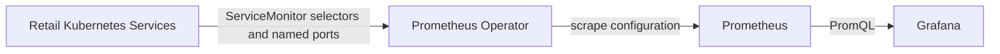

`gitops/sre/observe/monitoring.yaml` defines `ServiceMonitor` objects for `/actuator/prometheus` and `/metrics`. Prometheus discovers matching Service endpoints through the Operator. This requires correct Service labels, named ports, namespace selection, network reachability and a functioning metrics endpoint; these are **not yet verified** from the source snapshot. `enableRemoteWriteReceiver: true` is present in the pinned `prometheus-stack.yaml`, but the proposed Alloy configuration does **not** send data to it. Disabling that receiver would be a separate configuration change and is **not** asserted here.

### Logs — Alloy DaemonSet to Loki

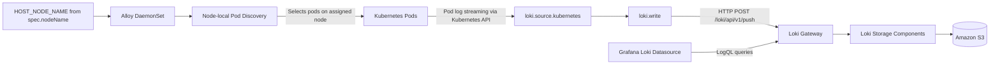

**Relevant Alloy configuration (retained conceptual blocks from the local log-only revision):**

```yaml
controller:
  type: daemonset

alloy:
  extraEnv:
    - name: HOST_NODE_NAME
      valueFrom:
        fieldRef:
          fieldPath: spec.nodeName

  configMap:
    create: true
    content: |
      discovery.kubernetes "pods" {
        role = "pod"

        selectors {
          role  = "pod"
          field = "spec.nodeName=" + sys.env("HOST_NODE_NAME")
        }
      }

      discovery.relabel "pod_logs" {
        targets = discovery.kubernetes.pods.targets

        rule {
          source_labels = ["__meta_kubernetes_namespace"]
          target_label  = "namespace"
        }
        rule {
          source_labels = ["__meta_kubernetes_pod_name"]
          target_label  = "pod"
        }
        rule {
          source_labels = ["__meta_kubernetes_pod_container_name"]
          target_label  = "container"
        }
      }

      loki.source.kubernetes "local_pods" {
        targets    = discovery.relabel.pod_logs.output
        forward_to = [loki.write.local.receiver]
      }

      loki.write "local" {
        endpoint {
          url = "http://loki-gateway.logging.svc.cluster.local:80/loki/api/v1/push"
        }
      }
```

This is a documentation excerpt of the intended retained pipeline, **not a byte-for-byte assertion of the uncommitted local YAML**. Confirm the actual `gitops/sre/apps/alloy.yaml` diff before merging. No `prometheus.scrape "pod_metrics"` or `prometheus.remote_write "local"` is included in the proposed Alloy design.

**Source:** [`gitops/sre/apps/loki.yaml:L17–L42`](https://github.com/eugenewongyj/cloud-ntu-capstone-group2-infra/blob/2c38f631246c2cf9361fd1784c8b14b85b76f0ba/gitops/sre/apps/loki.yaml#L17-L42)

```yaml
      valuesObject:
        deploymentMode: SimpleScalable

        loki:
          auth_enabled: false

          # Configure Loki to use AWS S3 directly
          storage:
            bucketNames:
              chunks: group2-capstone-loki-logs-ap-southeast-1
              ruler: group2-capstone-loki-logs-ap-southeast-1
              admin: group2-capstone-loki-logs-ap-southeast-1
            type: s3
            s3:
              region: ap-southeast-1
              s3ForcePathStyle: false

          schemaConfig:
            configs:
              - from: "2024-01-01"
                store: tsdb
                object_store: s3
                schema: v13
                index:
                  prefix: index_
                  period: 24h
```


**Source:** [`gitops/sre/apps/prometheus-stack.yaml:L37–L57`](https://github.com/eugenewongyj/cloud-ntu-capstone-group2-infra/blob/2c38f631246c2cf9361fd1784c8b14b85b76f0ba/gitops/sre/apps/prometheus-stack.yaml#L37-L57)

```yaml
        # 1. Grafana configuration + Ingress
        grafana:
          enabled: true
          additionalDataSources:
            - name: Loki
              type: loki
              access: proxy
              url: http://loki-gateway.logging.svc.cluster.local:80
              jsonData:
                maxLines: 1000
          ingress:
            enabled: true
            ingressClassName: nginx
            annotations:
              cert-manager.io/cluster-issuer: letsencrypt-staging
            hosts:
              - group2-capstone-grafana.sctp-sandbox.com
            tls:
              - secretName: grafana-tls
                hosts:
                  - group2-capstone-grafana.sctp-sandbox.com
```


**Metrics (proposed revision):** Prometheus Operator-managed ServiceMonitors handle application metrics scraping. The Alloy `prometheus.scrape` and `prometheus.remote_write` blocks were removed in the local consolidation. The historical Prometheus `enableRemoteWriteReceiver: true` setting is not evidence that Alloy still uses remote write.

**Logs:** Alloy `discovery.kubernetes "pods"` → `discovery.relabel "pod_logs"` → `loki.source.kubernetes "local_pods"` → `loki.write "local"` → Loki gateway `/loki/api/v1/push`. Loki is configured for S3 (`loki.yaml:23–42`), but source alone does not demonstrate pod IAM permissions, bucket existence or successful ingestion. Grafana adds a Loki datasource at `prometheus-stack.yaml:40–45`.


## 8A. Code-to-Grafana traceability — live k6 demonstration (18 Nov 2026)

This diagram connects **repository source**, **runtime components**, and **Grafana observations**. Solid arrows indicate configured or observed data flow; dashed arrows represent a required validation or evidence step. This is a local documentation addition, not a deployment change.

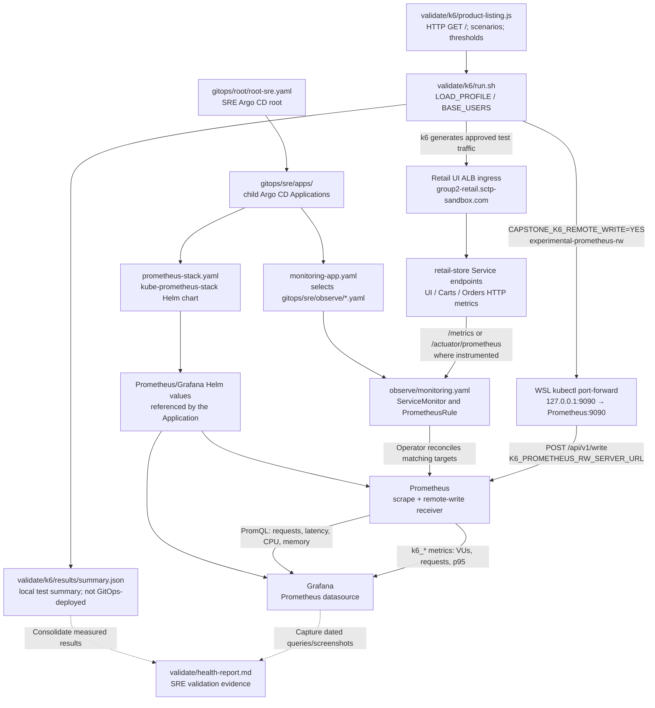

### Code → runtime → observation register

| Source file / setting | Logical transition | Grafana or test evidence | Validation state (18 Nov) |
|---|---|---|---|
| `gitops/root/root-sre.yaml` → `gitops/sre/apps/` | Argo CD discovers SRE Applications | Observability workloads available | Previously verified in cluster; not revalidated by this diagram |
| `gitops/sre/apps/prometheus-stack.yaml` + referenced Helm values | Helm renders Prometheus and Grafana; receiver accepts remote write when enabled | Prometheus ready endpoint returned HTTP 200 via port-forward | Verified runtime reachability |
| `gitops/sre/apps/monitoring-app.yaml` → `gitops/sre/observe/monitoring.yaml` | ServiceMonitor selects matching Service endpoints; Operator configures scrape | Five `up` targets in `retail-store`; HTTP request series observed for instrumented services | Scrape target connectivity verified; **not** HTTP instrumentation for all five services |
| `gitops/sre/validate/k6/product-listing.js` | One product-listing HTTP request per iteration; smoke/baseline profiles and thresholds | Smoke: 5 requests, 100% checks, 0% failures, HTTP p95 **14.85 ms** | Smoke test passed |
| `gitops/sre/validate/k6/run.sh` + `K6_PROMETHEUS_RW_SERVER_URL` | k6 remote-write exporter → forwarded Prometheus `/api/v1/write` | `k6_vus`, `k6_http_reqs_total`, `k6_*_p95` visible in Grafana | Remote-write ingestion verified |
| `gitops/sre/validate/k6/results/summary.json` | Local k6 summary → manually curated evidence | 1-VU baseline metrics visible; screenshot included cumulative request series reaching **132** | Final baseline results not yet consolidated; 132 is a **counter**, not requests/sec |
| `gitops/sre/validate/health-report.md` | Correlate traffic, p95, errors, CPU/memory and pod/HPA state | Baseline/peak/recovery comparison | Pending evidence update |

**Important measurement distinctions:** `up=1` establishes scrape connectivity, not application health; `k6_http_reqs_total` is a cumulative counter, not throughput; HTTP metrics were observed for UI/Carts/Orders, while five service scrape targets were up. Grafana plots should separate requests/sec, p95 milliseconds, VUs and cumulative counters by unit. The screenshot does **not** establish HPA scaling, peak-load recovery, alert notification delivery, S3 persistence or Tempo tracing.

**Reproducible query examples** (select the relevant test time range; use separate panels):

```promql
# k6 product-listing p95 latency in milliseconds (remote-write duration in seconds)
1000 * k6_capstone_product_listing_duration_p95{project="Capstone",test_profile="baseline"}

# Retail application HTTP throughput (requests/second; instrumented endpoints)
sum(rate(http_server_requests_seconds_count{namespace="retail-store"}[2m]))

# k6 baseline virtual users
k6_vus{test_profile="baseline"}
```

**Source-of-truth note:** The checked repository archive predates some subsequently shared `gitops/sre/values/` reorganisation. Confirm the current Helm `valueFiles` paths on your branch before copying this section into `main`; do not assume an older snapshot's inline values match the current deployment.

---

## 8B. Detailed GitOps-to-Grafana architecture — TK platform and SRE runtime

> **Scope and evidence:** This is a code-level explanation of the repository configuration reviewed on 18 Nov 2026, supplemented by the SRE runtime checks described in Section 8A. It explains **intended reconciliation and data flows**; arrows are not proof that every component is currently healthy. TK's platform/GitOps responsibilities are represented as the platform workstream, not an assertion of individual authorship for each file. Exact paths and rendered Helm output must be rechecked against the latest branch.

### 8B.1 GitOps orchestration — from Git commit to Kubernetes resources

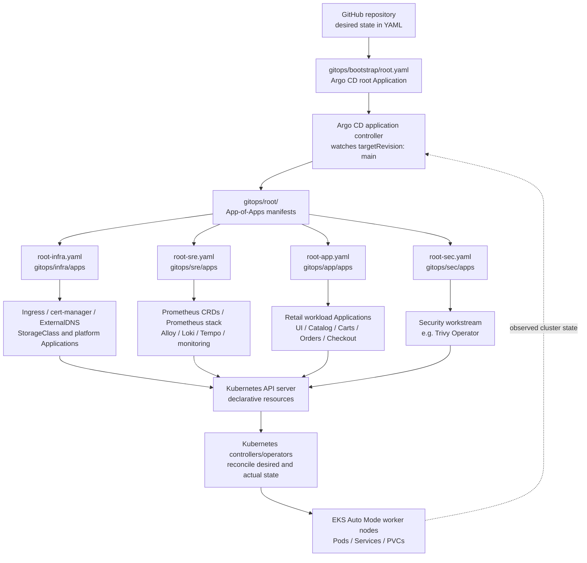

**Transitivity:** `bootstrap/root.yaml.spec.source.path = gitops/root` → Argo CD reads the four root Application YAMLs → `root-sre.yaml.spec.source.path = gitops/sre/apps` → Argo CD reads SRE child Applications → each child resolves its chart or manifest source → Kubernetes API stores resources → controllers create workloads. Argo CD **reconciles** Kubernetes resources; it does not itself scrape metrics. The `sync-wave` annotations order selected Argo CD resources, but they do not guarantee runtime readiness or prevent every race.

### 8B.2 Why CRDs come before Helm/ServiceMonitors

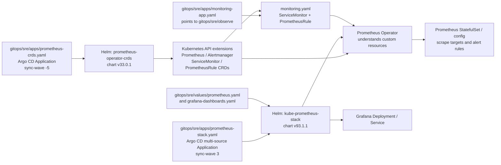

**CRD vs CR:** A **CustomResourceDefinition** teaches Kubernetes the schema of a new object type (`ServiceMonitor`, `PrometheusRule`, etc.). The `monitoring.yaml` **custom resources** are instances of those types. Helm templates and applies Kubernetes manifests; the Prometheus Operator then translates custom resources into Prometheus scrape/alert configuration. A Helm chart is **not** a CRD, and a ServiceMonitor is **not** a running scraper.

**Exact file linkage:** `prometheus-stack.yaml.spec.sources[0].helm.valueFiles` refers to `$values/gitops/sre/values/prometheus.yaml` and `$values/gitops/sre/values/grafana-dashboards.yaml`; the second Git source with `ref: values` supplies those files. These are Helm overrides, not separate Argo CD Applications. Verify paths after any folder restructuring.

### 8B.3 Metrics — retail Pods and EKS nodes through Prometheus to Grafana

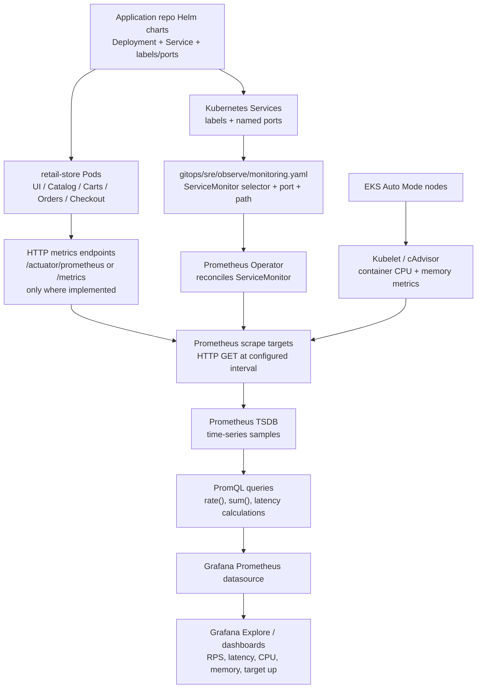

**Important:** Prometheus scrapes configured endpoints, not every Pod automatically. The ServiceMonitor's selector must match **Service metadata labels**, and its endpoint `port` must match a **Service port name**. `up=1` proves scrape connectivity; it does not prove application business health. Five service targets were observed up, but application HTTP request counters were observed for UI/Carts/Orders only. The CPU/memory metrics are container telemetry, not proof of EKS control-plane monitoring.

### 8B.4 k6 synthetic traffic — two distinct paths to Grafana

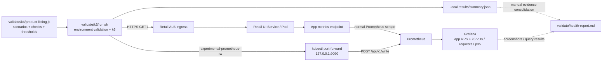

The **first path** creates load on the application; Prometheus observes the application's instrumented metrics. The **second path** sends k6's own test metrics directly to Prometheus via remote write. The `kubectl port-forward` runs on the test machine and is **not** a permanent in-cluster Service or a GitOps-managed resource. The smoke test passed at **p95 14.85 ms**, 0% failures, 100% checks; the later screenshot's **132** is a cumulative request counter, **not** 132 RPS. The baseline's final threshold outcome remains to be consolidated.

### 8B.5 Logs, storage, alerts and traces — different paths, different validation states

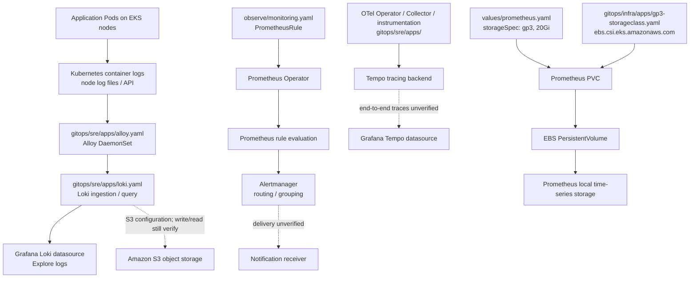

**Separate the storage concepts:** EBS-backed PVCs provide Kubernetes block storage for persistent workloads; Loki's S3 object-storage configuration is a separate backend. A bound PVC does **not** prove successful S3 persistence. Likewise, a running Alertmanager does **not** prove notification delivery, and deployed Tempo/OTel resources do **not** prove traces reach Grafana. These remain validation tasks.

### 8B.6 File-to-runtime verification matrix

| Repository source | Key configuration / Kubernetes resource | Runtime responsibility | What to verify |
|---|---|---|---|
| `gitops/bootstrap/root.yaml` | Argo CD `Application.spec.source.path` | Discover root workstreams | Root Application Synced/Healthy |
| `gitops/root/root-sre.yaml` | `path: gitops/sre/apps`, `project: sre-project` | Discover SRE child Applications | Child Applications and sync state |
| `gitops/sre/apps/prometheus-crds.yaml` | CRD Helm chart, wave -5 | Register Prometheus Operator API kinds | CRDs exist before CR instances |
| `gitops/sre/apps/prometheus-stack.yaml` | Multi-source Helm Application | Render stack components | Rendered chart, sources, namespace |
| `gitops/sre/values/prometheus.yaml` | Prometheus receiver, persistence, Grafana overrides | Configure Prometheus/Grafana | Receiver ready, PVC, datasource |
| `gitops/sre/values/grafana-dashboards.yaml` | Grafana dashboard Helm values | Provision dashboards | Dashboard available after sync |
| `gitops/sre/apps/monitoring-app.yaml` | `path: gitops/sre/observe` | Apply monitoring YAML | YAML resources reconciled |
| `gitops/sre/observe/monitoring.yaml` | `ServiceMonitor`, `PrometheusRule` | Scrape targets / alert expressions | Targets up; rule evaluates |
| `gitops/sre/observe/grafana-dashboard.yaml` | Grafana dashboard ConfigMap | Dashboard discovery | Dashboard loaded by Grafana |
| `gitops/infra/apps/gp3-storageclass.yaml` | EBS CSI StorageClass | Provision EBS-backed PVs | PVC Bound and PV details |
| `gitops/sre/apps/alloy.yaml` + `loki.yaml` | Log collection / backend | Collect and query pod logs | Fresh logs in Grafana Loki |
| `gitops/sre/apps/tempo.yaml` + OTel resources | Trace collection / backend | Distributed tracing | Actual trace IDs visible |
| `gitops/sre/validate/k6/run.sh` + `product-listing.js` | Local Bash / JS (not deployed by Argo CD) | Synthetic load and k6 metrics | Smoke, baseline, peak/recovery evidence |
| `gitops/sre/validate/health-report.md` | Human-authored report | Evidence and handover | Dated results and screenshots |

**TK/SRE boundary:** The platform GitOps workstream establishes orchestration, bootstrap, dependencies and shared cluster services; the SRE workstream supplies observability configuration and evidence. Both meet at Argo CD child Applications, Kubernetes resources, and runtime telemetry. Do not equate the file owner with an individual contributor without Git history or team confirmation.

---

## 9. Load testing: current k6 execution and code-to-runtime flow

The **current active workflow uses k6**. Superseded load-test examples and commands have been removed from this current-state README. The files below are **operator-run local tests**, not Kubernetes workloads deployed by Argo CD.

| File | Code / configuration | Runtime consequence |
|---|---|---|
| `gitops/sre/validate/k6/run.sh` | `TARGET_HOST`, `CAPSTONE_PRODUCT_PATH`, `LOAD_PROFILE`, `BASE_USERS`, `CAPSTONE_K6_REMOTE_WRITE`, `K6_PROMETHEUS_RW_SERVER_URL` | Validates inputs, launches k6 and optionally sends k6 metrics to Prometheus Remote Write |
| `gitops/sre/validate/k6/product-listing.js` | `http.get`, `ramping-vus`, `Trend`, `Rate`, checks and thresholds | Generates HTTP traffic and records request latency, failures and VU stages |
| `gitops/sre/validate/README.md` | Safety instructions and test procedure | Documents target approval, metrics and evidence expectations |
| `gitops/sre/validate/health-report.md` | Test findings and screenshots/references | Human-reviewed evidence; does not deploy resources |

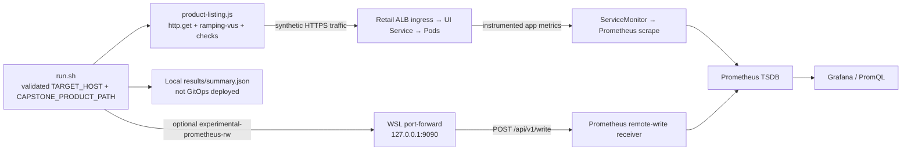

**Execution semantics:** The `smoke` profile uses one VU; the `baseline` profile runs approximately five minutes; `flash-demo` requires explicit approval via `CAPSTONE_LOAD_APPROVED=YES`. Remote write is opt-in using `CAPSTONE_K6_REMOTE_WRITE=YES` and a configured `K6_PROMETHEUS_RW_SERVER_URL`. A port-forward is a temporary local connection, not a permanent GitOps-managed service. Do not run load tests against shared or production targets without team authorization.

**Observed on 18 Nov 2026:** Smoke test: 5 HTTP requests, p95 **14.85 ms**, **0%** failures and **100%** checks passed. k6 metrics appeared in Grafana via remote write. A later baseline screenshot showed a **132 cumulative HTTP-request counter**; it is not 132 requests/second and does not alone prove baseline threshold success, peak-load recovery or HPA scaling.

```promql
# k6 baseline p95 latency (seconds → milliseconds)
1000 * k6_capstone_product_listing_duration_p95{project="Capstone",test_profile="baseline"}

# k6 baseline active virtual users
k6_vus{test_profile="baseline"}

# Application HTTP request rate (requests per second)
sum(rate(http_server_requests_seconds_count{namespace="retail-store"}[2m]))
```

**Source freshness:** Historical code links elsewhere in this README may point to an earlier repository commit. Validate the current `gitops/sre/values/` paths, chart revisions and actual live resources before merging or treating source-declared configuration as runtime evidence.


## 10. Verification and outstanding source gaps

| Question | Source-backed answer | Additional evidence required |
|---|---|---|
| Is the cluster EKS Auto Mode? | `eks.tf:20–23` declares it | AWS EKS API / actual node state |
| Is Prometheus persistent? | `prometheus-stack.yaml:73–82` requests 20Gi gp3 | Bound PVC and actual mounted volume |
| Is Loki configured for S3? | `loki.yaml:23–42` declares S3 backend | Bucket exists, IAM access and successful writes |
| Are all five retail Services scrapeable? | `monitoring.yaml:8–65` declares selectors and endpoints | External app repo templates and live target status |
| Are alerts delivered? | `monitoring.yaml` declares rules | Alertmanager route/receiver and delivery test |
| Is the proposed Alloy log-only change deployed? | The local working-tree change removes Alloy metrics scraping and remote write | Merged commit, rendered Argo CD Application and Alloy runtime configuration |
| Is Grafana dashboard auto-loaded? | `grafana-dashboard.yaml:1–9` declares labelled ConfigMap | Grafana sidecar/chart settings and UI dashboard presence |
| Are sync waves sufficient? | Waves exist on Applications | Child Application readiness and CRD establishment |
| Does k6 test the real product listing? | `validate/k6/product-listing.js` requests the configured path | Approved host and verified application route; smoke HTTP 200 observed |

**Read-only checks (after confirming AWS account and context):**

```bash
# Work from your existing docs branch; do not switch branches.
git rev-parse HEAD
git grep -n -E 'repoURL:|targetRevision:|path:|sync-wave|storageClassName:|ServiceMonitor' -- gitops/
aws sts get-caller-identity
aws configure get region
kubectl config current-context
kubectl get applications.argoproj.io -n argocd -o custom-columns=NAME:.metadata.name,SYNC:.status.sync.status,HEALTH:.status.health.status
kubectl get storageclass,pv,pvc -A
kubectl get servicemonitors,prometheusrules -A
```

**Review rule:** Historical commit links remain intentionally pinned; proposed revision references should be checked against the final merged commit. When changing a reference, review *both ends* of the dependency. All source links above are pinned to the exported commit, so they remain stable as `main` evolves.

<!-- CAPSTONE-SRE-INTERACTIVE-START -->

## Interactive SRE assessment automation

The implementation extends the existing Capstone
GitOps and observability architecture.

- Normal Sale: five minutes at baseline traffic.
- 11:11 Flash Sale: five minutes with 10x and 20x stages.
- Recovery: five to ten minutes at baseline traffic.
- Application recovery target: within five minutes.
- Product listing p95 target: below 500 ms.
- HTTP and content failure targets: below 1%.
- Shared production target: retail-store via CloudFront.
- Shared Grafana controls and run-specific telemetry.
- Existing Prometheus, Alertmanager and Discord routing.
- Bounded recurrence and authenticated Start/Stop controls.

### Engineering traceability

- [Exact source-line map](sre/validate/docs/engineering-source-map.md)
- [Detailed code transitivity and Mermaid diagrams](sre/validate/docs/code-transitivity.md)

### Implementation status

Source implementation and local validation are distinct
from deployment readiness.

Signing, ECR publication, secure Helm provisioning,
Argo CD activation and shared runtime validation remain
pending. No production load or infrastructure mutation
is performed by the local validation script.

<!-- CAPSTONE-SRE-INTERACTIVE-END -->
