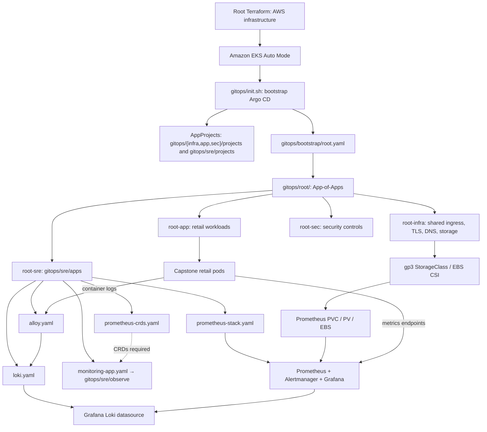

This repository contains the complete **GitOps Infrastructure-as-Code (IaC)** for provisioning and managing the eks cluster on AWS EKS. It leverages **Argo CD** and the **App of Apps** pattern to fully automate the deployment of core infrastructure, observability (SRE) tooling, and business applications.

## 📂 Repository Architecture

The deployment is strictly ordered using Argo CD `sync-wave` annotations to prevent race conditions (e.g., ensuring CRDs and Ingress controllers exist before deploying applications that depend on them).

*   **`bootstrap/`**: Contains `init.sh` (bootstrap script), `root.yaml` (the App of Apps entry point), and Argo CD Helm values.
*   **`infra/`**: Core cluster infrastructure (Ingress NGINX, Cert-Manager, External-DNS, StorageClass).
*   **`sre/`**: Observability stack (kube-prometheus-stack, Grafana Alloy, Prometheus CRDs).
*   **`app/`**: Workload microservices (Sample).
*   **`destroy.sh`**: A robust teardown script that safely strips finalizers, cleans up AWS resources (NLBs), and purges namespaces.

### Deployment Sequence (Sync Waves)
1.  **Wave -5**: Prometheus CRDs (`prometheus-operator-crds`)
2.  **Wave -2**: Root Infra App (triggers Ingress, Cert-Manager, External-DNS)
3.  **Wave -1**: Root SRE App (triggers Monitoring stack)
4.  **Wave 0**: Root App (triggers Business Workloads)
5.  **Internal Waves**: Ingress (`-1`) -> Cert-Manager (`0`) -> ClusterIssuer (`1`) -> SRE (`3`) -> Workload microservices (`4`)

---

## 🛠️ Bootstrap the Cluster

To bootstrap the entire cluster from scratch, run the initialization script:

```bash
chmod +x init.sh
./init.sh
```
## Accessing Platform Dashboards

After successfully running `./init.sh`, the core platform UI dashboards will be provisioned. Use the commands below to retrieve your initial admin passwords.

### 1. Argo CD
Argo CD orchestrates our GitOps deployments and provides a UI to monitor application health and sync status.

* **URL:** [https://group2-capstone-argocd.sctp-sandbox.com](https://group2-capstone-argocd.sctp-sandbox.com)
* **Username:** `admin`
* **Retrieve Password:**
  Run the following command to decode the initial admin password from the Kubernetes secret:
  ```bash
  kubectl -n argocd get secret argocd-initial-admin-secret -o jsonpath="{.data.password}" | base64 -d && echo


### 2. Grafana (Prometheus Monitoring Stack)
Grafana provides cluster observability, metrics, and alerting dashboards, deployed via the kube-prometheus-stack.

* **URL:** [https://group2-capstone-grafana.sctp-sandbox.com](https://group2-capstone-grafana.sctp-sandbox.com)
* **Username:** `admin`
* **Retrieve Password:**
  Run the following command to decode the initial admin password from the Kubernetes secret:
  ```bash
  kubectl -n monitoring get secret kube-prometheus-stack-grafana -o jsonpath="{.data.admin-password}" | base64 -d && echo


### The Core Philosophy: GitOps
**Git is the single source of truth** for your cluster's desired state. You do not run `kubectl apply` or `helm install` manually to deploy applications. Instead, you update files in this Git repository, and Argo CD ensures the Kubernetes cluster exactly matches what is in Git.

### The Reconciliation Loop
Argo CD operates on a continuous **Reconciliation Loop**. It constantly asks three questions:
1. **What is the Desired State?** (What does the YAML/Helm chart in this Git repo say?)
2. **What is the Live State?** (What is currently actually running in the Kubernetes cluster?)
3. **Do they match?**
   * If **Yes**: The Application status is marked as **`Synced`** and **`Healthy`**.
   * If **No**: The Application status is marked as **`OutOfSync`**. Depending on the `syncPolicy`, Argo CD will either wait for a manual approval or automatically apply the changes.

### Key Concepts Used in This Repository

#### 1. Applications & AppProjects
*   **Application**: A Kubernetes Custom Resource (CRD) that links a Git repository to a target Kubernetes cluster/namespace.
*   **AppProject**: A logical grouping that acts as a security boundary. You have `infra-project`, `sre-project`, and `app-project`. These restrict where applications can deploy (e.g., an app in `app-project` cannot accidentally deploy into the `kube-system` namespace).

#### 2. The "App of Apps" Pattern
Instead of manually creating hundreds of Applications, you create one "Root" Application (`root.yaml`) that points to a directory in Git containing *other* Application YAML files.
*   `root.yaml` deploys `root-infra.yaml`, `root-sre.yaml`, and `root-app.yaml`.
*   Argo CD sees those new applications and deploys them, creating a cascading tree of deployments.

#### 3. Sync Waves (Dependency Management)
Applying files out of order causes errors (e.g., trying to create an Ingress before the Ingress Controller exists). Argo CD solves this using the **`argocd.argoproj.io/sync-wave`** annotation. 
*   Argo CD sorts all resources by their wave number (lowest to highest) and waits for each wave to become "Healthy" before moving to the next. 
*   **Example:** The Ingress NGINX is at `Wave -1`, so it is fully provisioned and AWS assigns an NLB *before* Cert-Manager (`Wave 0`) tries to provision SSL certificates through it.

#### 4. Automated Sync Policy (Prune & Self-Heal)
In the Application manifests, you will see:
```yaml
syncPolicy:
  automated:
    prune: true
    selfHeal: true

---

---

## 🔗 Integrated GitOps Pipeline — Code-to-Code Traceability

> **Additive documentation:** This section extends the existing platform README without replacing the original explanation of architecture, bootstrap, dashboards, GitOps, sync waves, or automated synchronization. Paths below are repository-root relative. Verify live YAML values against the checked-out `main` branch; this document describes the intended control and data flow, not confirmed runtime health.

### 1. Source-of-truth and execution boundaries

| Layer | Authoritative location | Reads / creates | Next dependency |
|---|---|---|---|
| AWS infrastructure | Root Terraform (`*.tf`) | VPC, EKS, IAM, network and platform dependencies | Accessible Kubernetes API and AWS identities |
| One-time bootstrap | `gitops/init.sh` | Installs/configures Argo CD, applies AppProjects, then submits `gitops/bootstrap/root.yaml` | Argo CD root Application |
| Root Application | `gitops/bootstrap/root.yaml` | Points Argo CD at `gitops/root/` | Root child Applications |
| Root fan-out | `gitops/root/root-{infra,app,sec,sre}.yaml` | Each Application selects a dedicated GitOps subtree | Workstream Applications |
| SRE fan-out | `gitops/root/root-sre.yaml` | `spec.source.path: gitops/sre/apps` | SRE child Application manifests |
| SRE authorization | `gitops/sre/projects/sre-project.yaml` | `AppProject` controls permitted source repositories, destinations and resource types | Child Applications referencing `spec.project: sre-project` |
| SRE child Applications | `gitops/sre/apps/*.yaml` | Helm charts and monitoring manifests | Prometheus, Grafana, Loki, Alloy and monitoring custom resources |
| SRE monitoring manifests | `gitops/sre/observe/` | PrometheusRule, ServiceMonitor and dashboard resources where defined | Operator reconciliation and Grafana discovery |
| SRE validation | `gitops/sre/validate/` | Locust scenarios and validation scripts | Explicit operator-run tests; **not** part of automatic GitOps sync |
| SRE reference | `gitops/sre/reference/` | Example/reference Helm values | Not automatically deployed unless referenced by a live Application |

**Critical distinction:** `gitops/init.sh` performs the *initial bootstrap* and is an intentional exception to the normal “do not manually apply applications” GitOps rule. After bootstrapping, Argo CD reconciles the declared Applications. The script's `kubectl apply` of AppProjects and the root manifest is not the same as manually deploying each application.

### 2. How the files communicate — execution order



Arrows show dependency or data movement, **not** proof that cross-Application readiness is automatically enforced. Argo CD sync waves order resources **within the same synchronization operation**. Separate child Applications reconcile independently; use health checks and runtime verification for cross-Application dependencies.

### 3. Key-by-key YAML interpretation and cross-references

| YAML key / shell expression | File to inspect | Meaning and downstream effect |
|---|---|---|
| `SCRIPT_DIR=...` and `cd "$SCRIPT_DIR"` | `gitops/init.sh` | Makes relative `bootstrap/` and project paths resolve from the script directory, regardless of the caller's working directory |
| `kubectl apply -f sre/projects/sre-project.yaml` | `gitops/init.sh` | Registers SRE AppProject **relative to `gitops/`**, not repository root |
| `kubectl apply -f bootstrap/root.yaml` | `gitops/init.sh` | Creates/updates the root Argo CD Application, which initiates ongoing Git reconciliation |
| `spec.source.repoURL` | `gitops/bootstrap/root.yaml` | Selects the Git repository; a typo or wrong repository prevents desired-state retrieval |
| `spec.source.targetRevision` | Root and child Applications | Selects the branch/tag/commit; `main` follows approved merged changes, while pinned commits do not move automatically |
| `spec.source.path` | Root and directory-based Applications | Selects the **repository-root-relative** directory to render; wrong paths yield missing or incorrect manifests |
| `spec.project` | Every Argo CD Application | Selects the AppProject security boundary; the project must exist and permit its source/destination |
| `spec.destination.namespace` | Child Applications | Default destination namespace; namespaced manifests can also specify their own namespace |
| `metadata.annotations.argocd.argoproj.io/sync-wave` | Application/resource manifests | Controls ordering in an applicable sync operation; it does not globally serialize independent Applications |
| `spec.syncPolicy.automated.prune` | Root/child Applications | Allows deletion of resources removed from desired state; review path migrations and finalizers carefully |
| `spec.syncPolicy.automated.selfHeal` | Root/child Applications | Allows Argo CD to correct drift from the Git-declared state |
| `spec.source.chart` + `targetRevision` | Helm-based SRE Applications | Selects Helm chart and chart version; this is distinct from a Git source `path` |
| `spec.source.helm.valuesObject` | `gitops/sre/apps/prometheus-stack.yaml` and other Helm Applications | Supplies chart-specific configuration directly to Helm rendering |
| `prometheus.prometheusSpec.storageSpec.volumeClaimTemplate` | Prometheus Helm values | Requests persistent storage for Prometheus; check the actual chart values and resulting StatefulSet/PVC |
| `storageClassName: gp3` | Prometheus PVC template | Selects shared gp3 StorageClass, which should use the EKS Auto Mode EBS CSI provisioner |
| `spec.source.path: gitops/sre/observe` | `gitops/sre/apps/monitoring-app.yaml` | Tells Argo CD to render monitoring resources from the observability directory |
| `metadata.name` / `spec.selector` | ServiceMonitor/PrometheusRule resources | Identifies resources and matches monitored Services; incorrect labels can produce zero scrape targets |
| Loki datasource URL | Grafana Helm values | Grafana queries Loki through its Service endpoint; verify namespace, Service name, port and readiness |
| Alloy output endpoint | Alloy configuration | Forwards collected logs to Loki; validate log discovery, permissions and delivery |

### 4. Metrics, logs, alerting and persistence — runtime data paths

**Metrics:** Capstone pod/service endpoint → Prometheus ServiceMonitor or scrape configuration → Prometheus scrape → TSDB on persistent EBS volume → PromQL query → Grafana panel. The existence of a ServiceMonitor alone does not prove that the Prometheus instance selects it or that the endpoint is reachable.

**Alerting:** PrometheusRule → Prometheus rule evaluation → firing alert → Alertmanager routing/grouping → configured receiver. A rule file is not evidence of a working notification route; verify the receiver and test delivery safely.

**Logs:** Container stdout/stderr → Kubernetes node log files → Alloy discovery/collection → Loki ingestion → Loki storage/backend → Grafana Explore. Verify Alloy is running on appropriate nodes, its permissions and relabeling, Loki's AWS IAM/S3 integration, and that real log lines are queryable.

**Storage:** Prometheus StatefulSet/Operator-managed workload → PVC (`20Gi` in the documented Capstone configuration) → `gp3` StorageClass → EKS Auto Mode EBS CSI (`ebs.csi.eks.amazonaws.com`) → PV/EBS volume mounted into Prometheus. A `Bound` PVC and restart recovery are necessary checks; EBS persistence is not a substitute for backup or cross-AZ replication. Verify the actual `reclaimPolicy` before deleting PVCs.

### 5. Read-only code cross-reference commands (run from repository root)

```bash
# Ensure local code matches approved main before interpreting paths.
git fetch origin
git switch main
git pull --ff-only origin main

# Display actual file paths (avoid relying on stale README references).
git ls-files gitops/
git ls-files sre/             # Should be empty after full consolidation.

# Show exact numbered source lines for review and README citations.
nl -ba gitops/init.sh | sed -n '1,160p'
nl -ba gitops/bootstrap/root.yaml
nl -ba gitops/root/root-sre.yaml
nl -ba gitops/sre/apps/monitoring-app.yaml
nl -ba gitops/sre/apps/prometheus-stack.yaml
nl -ba gitops/sre/projects/sre-project.yaml

# Search for cross-file pointers and important settings.
git grep -n -E 'source:|repoURL:|targetRevision:|path:|project:|sync-wave|prune:|selfHeal:|storageClassName:|volumeClaimTemplate:' -- gitops/

# Confirm actual SRE manifests and compare declared paths with tracked files.
find gitops/sre -maxdepth 3 -type f | sort
```

**Why no fixed line numbers here?** Line numbers move with every commit. The `nl -ba` and `git grep -n` commands above generate exact line references from the current checked-out revision. Do not copy line numbers from screenshots or an older branch into permanent documentation.

### 6. Read-only operational acceptance checks (only after verifying AWS context)

```bash
# First confirm the intended Capstone EKS context and AWS region.
kubectl config current-context
aws configure get region

# Argo CD: synchronization and health are separate fields.
kubectl get applications.argoproj.io -n argocd \
  -o custom-columns=NAME:.metadata.name,SYNC:.status.sync.status,HEALTH:.status.health.status

# Storage and monitoring workload readiness.
kubectl get storageclass
kubectl get pvc,pods -n monitoring
kubectl get prometheuses,servicemonitors,prometheusrules -A

# Logging resources and pod status.
kubectl get pods,svc -n logging
```

These commands inspect state only. They do not validate end-to-end scraping, dashboard queries, S3 access or alert delivery by themselves. Do not run `gitops/init.sh`, `gitops/destroy.sh`, `kubectl apply`, or a manual Argo CD sync merely to inspect the merged configuration.

### 7. Change management and ownership

- **Terraform/platform owner:** AWS cluster, IAM, VPC and shared infrastructure; coordinate any `gp3` StorageClass changes.
- **GitOps owner:** Root bootstrap, Application hierarchy, AppProjects, sync policies and resource lifecycle.
- **Application owners:** Retail services, exposed metrics endpoints, service labels and workload health.
- **SRE owner:** Prometheus, Grafana, Loki, Alloy, SLIs/SLOs, alerts, dashboards, load testing and incident evidence.
- **Security owners:** Security policies and validation of least-privilege permissions.

A merged pull request proves that the desired configuration entered `main`. It does **not** prove that Argo CD synchronized it or that the cluster's SRE data paths are healthy. Record both Git commit evidence and Kubernetes/runtime evidence before marking a component operational.
