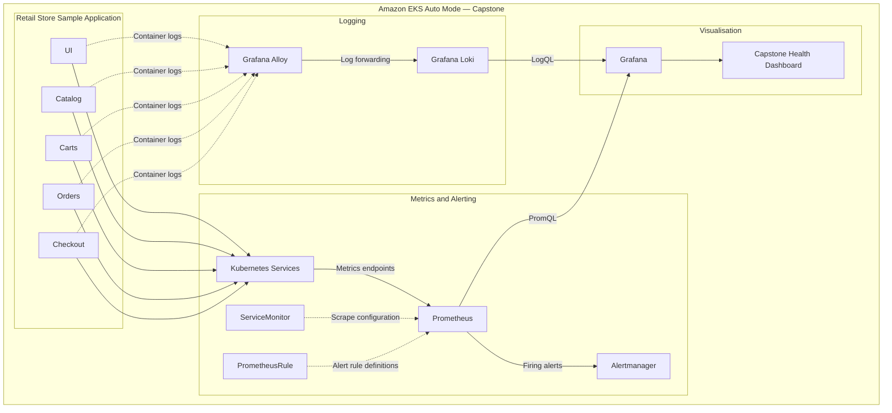
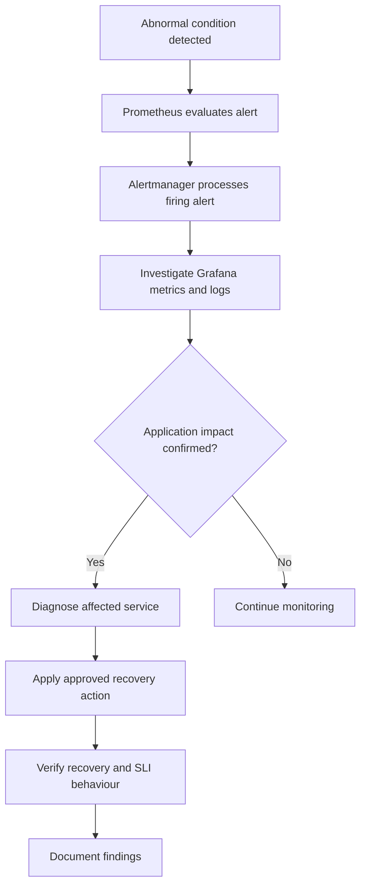
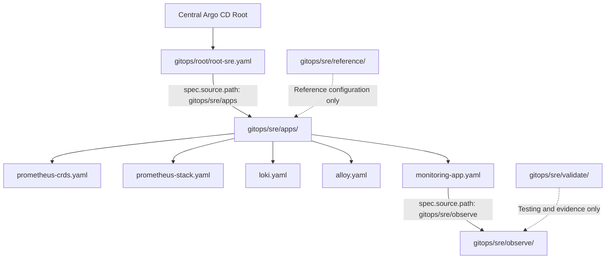
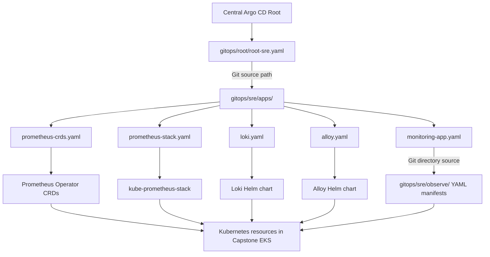

# Site Reliability Engineering (SRE)

**Capstone Group 2 | AWS Retail Store Sample | Amazon EKS Auto Mode**

This directory contains the Site Reliability Engineering (SRE) workstream for **Capstone**, a microservices-based retail application deployed on Amazon Elastic Kubernetes Service (EKS) Auto Mode.

The SRE implementation establishes an observability and reliability engineering framework encompassing application health monitoring, metrics collection, centralised logging, service-level indicators (SLIs), service-level objectives (SLOs), alerting, performance validation, and incident response.

The SRE workstream integrates with the existing Argo CD GitOps architecture while maintaining a clear separation between central deployment orchestration and SRE-owned observability configuration.

---

## 1. Objectives

The primary objective is to establish measurable, reproducible, and operationally useful reliability engineering practices for the Capstone application.

The SRE workstream aims to:

1. Establish baseline infrastructure, Kubernetes workload, and application health.
2. Centralise application and container logs for investigation.
3. Collect application and Kubernetes metrics using Prometheus.
4. Define and evaluate SLIs and SLOs.
5. Monitor request latency, availability, error rates, and resource utilisation.
6. Implement actionable alerts using Prometheus and Alertmanager.
7. Provide Grafana dashboards for operational visibility.
8. Validate application performance through controlled load testing.
9. Support incident diagnosis, escalation, and recovery.
10. Preserve the stability of the shared AWS infrastructure.

### Engineering Principles

| Principle | Implementation |
|---|---|
| Reliability first | Establish baseline health before performance or security testing |
| Observability | Combine metrics, logs, dashboards, and alerts |
| Declarative configuration | Maintain deployment and monitoring definitions in Git |
| Separation of concerns | Separate GitOps orchestration, observability, and validation |
| Minimal disruption | Avoid unnecessary changes to shared infrastructure |
| Reproducibility | Version-control configuration, tests, and validation evidence |
| Measurable outcomes | Evaluate reliability using SLIs, SLOs, and recorded results |
| Operational readiness | Support investigation, alerting, and incident response |

---

## 2. Technology Stack

| Layer | Technology | Responsibility |
|---|---|---|
| Cloud infrastructure | Amazon Web Services | Underlying cloud infrastructure |
| Container orchestration | Amazon EKS Auto Mode | Kubernetes workload orchestration |
| Infrastructure as Code | Terraform | AWS resource provisioning |
| GitOps | Argo CD | Declarative deployment and reconciliation |
| Package management | Helm | Observability component deployment |
| Metrics | Prometheus | Time-series metrics collection and querying |
| Metrics discovery | Prometheus Operator / ServiceMonitor | Kubernetes-native scrape configuration |
| Alert evaluation | Prometheus / PrometheusRule | Reliability condition evaluation |
| Alert routing | Alertmanager | Alert grouping and notification routing |
| Log collection | Grafana Alloy | Kubernetes log collection and forwarding |
| Log aggregation | Grafana Loki | Centralised log storage and querying |
| Visualisation | Grafana | Metrics, logs, and dashboards |
| Load testing | Locust | Controlled HTTP traffic generation |
| Version control | Git / GitHub | Configuration and change history |
| Operational tooling | AWS CLI / kubectl | Infrastructure and Kubernetes inspection |

The initial SRE monitoring scope focuses on application services, Kubernetes workloads, Pods, and supporting infrastructure.

Direct monitoring of the EKS-managed Kubernetes control plane is outside the initial scope.

---

## 3. Monitoring and Reliability Approach

The reliability engineering lifecycle follows:

**Baseline → Metrics & Logging → SLIs & SLOs → Alerting → Dashboards → Load Validation → Incident Response**

| Stage | Purpose | Evidence |
|---|---|---|
| Baseline | Establish initial infrastructure and application health | Pod readiness, deployments, service reachability |
| Metrics | Collect operational measurements | Prometheus targets and metric series |
| Logging | Centralise diagnostic information | Searchable application logs |
| Reliability | Define measurable objectives | SLI queries and SLO definitions |
| Alerting | Detect operational degradation | Alert rules and notification tests |
| Visualisation | Support operational investigation | Grafana dashboards |
| Load validation | Assess performance under traffic | Locust results and correlated metrics |
| Incident response | Support diagnosis and recovery | Health reports and incident evidence |

### Reliability Measurement

The implementation considers four principal categories:

- **Availability:** Whether eligible application requests complete successfully.
- **Latency:** How long application requests take to complete.
- **Errors:** How frequently eligible requests fail.
- **Saturation:** Whether resource pressure threatens application performance.

These measurements provide the foundation for reliability assessment and operational decision-making.

---

## 4. Observability Architecture

The Capstone observability architecture separates metrics collection, logging, alert evaluation, and visualisation.



**Architecture status:** The observability Applications were previously reported as `Synced / Healthy` through Argo CD. End-to-end telemetry ingestion, dashboard accuracy, alert delivery, and operational resilience remain pending verification.

The diagram represents intended logical data flows. It does not independently establish that every application currently exposes compatible metrics or that every pipeline is operational.

### 4.1 Metrics Pipeline

**Application → Kubernetes Service → Prometheus → Grafana**

1. Application workloads expose metrics through eligible endpoints.
2. Kubernetes Services provide stable access to those endpoints.
3. ServiceMonitor resources define scrape discovery and configuration.
4. Prometheus discovers eligible targets and collects metrics.
5. PrometheusRule resources supply alerting and recording rules.
6. Prometheus evaluates those rules against collected metrics.
7. Firing alerts are forwarded to Alertmanager.
8. Grafana queries Prometheus using PromQL.

A ServiceMonitor configures discovery; it does not independently collect or store metrics.

Successful target discovery and scraping must be verified separately.

### 4.2 Logging Pipeline

**Application Pods → Grafana Alloy → Loki → Grafana**

1. Application containers generate logs.
2. Grafana Alloy discovers selected Kubernetes log sources.
3. Alloy collects and processes log entries.
4. Alloy forwards log entries to Loki.
5. Loki stores log streams and indexes associated labels.
6. Grafana queries Loki using LogQL.
7. Engineers correlate log events with metrics to investigate failures.

**Technical decision:** Grafana Alloy was selected instead of legacy Promtail because of its supported architecture, Kubernetes integration, and extensibility.

The initial Alloy configuration uses a single replica. Collection resilience and high availability require further evaluation.

### 4.3 Alerting Pipeline

**PrometheusRule → Prometheus → Alertmanager → Notification Receiver**

Prometheus evaluates configured alert rules. When a condition satisfies its threshold and required duration, Prometheus marks the alert as firing.

Alertmanager then handles grouping, routing, silencing, and delivery to configured notification receivers.

Operational validation must confirm rule loading, firing behaviour, routing, notification delivery, and resolution.

### 4.4 Dashboard Pipeline

**Prometheus / Loki → Grafana → Capstone Health Dashboard**

Grafana provides a unified interface for metrics and log investigation.

The repository contains:

- `observe/capstone-health.json` — dashboard definition.
- `observe/grafana-dashboard.yaml` — Kubernetes ConfigMap used for dashboard provisioning.

Both files should remain consistent.

The presence of a dashboard ConfigMap does not independently confirm that Grafana has loaded the dashboard or that its queries return valid data.

---

## 5. Application Monitoring Scope

The monitoring scope covers the five Capstone microservices.

| Service | Monitoring focus |
|---|---|
| UI | User-facing availability, latency, and HTTP errors |
| Catalog | Product retrieval performance and availability |
| Carts | Cart operations and service failures |
| Orders | Order processing and transaction failures |
| Checkout | Checkout performance and availability |

### Kubernetes Workload Monitoring

Supporting workload indicators include:

- Pod readiness and availability.
- Deployment replica status.
- Container restarts and failures.
- CPU and memory utilisation.
- Resource saturation.
- Workload scaling behaviour.
- Service connectivity.
- Persistent storage health where applicable.

---

## 6. Service-Level Indicators and Objectives

SLIs provide quantitative measurements of service behaviour. SLOs define the desired reliability level over a specified observation period.

### 6.1 Availability SLI

Availability measures the proportion of eligible requests completed successfully.

$$
\text{Availability} =
\frac{\text{Successful eligible requests}}
{\text{Total eligible requests}}
\times 100\%
$$

A candidate availability SLO should define a minimum successful-request percentage over an agreed measurement window.

The exact target, eligible request population, and measurement period must be defined before the SLO can be considered operational.

### 6.2 Latency SLI

Latency measures the time required to complete eligible requests.

The Capstone performance requirement includes:

**Product listing p95 latency: 500 ms**

Validation should determine whether the 95th-percentile product-listing latency remains at or below 500 ms under the specified flash-sale workload.

This is a performance requirement to test, not a claim that the application currently meets the target.

### 6.3 Error Rate SLI

Error rate measures the proportion of eligible requests that fail.

$$
\text{Error Rate} =
\frac{\text{Failed eligible requests}}
{\text{Total eligible requests}}
\times 100\%
$$

Failure classification should distinguish expected client errors from application or infrastructure failures.

Availability and error rate are complementary only when they use the same request population and success/failure classification.

### 6.4 Saturation Indicators

Saturation indicators provide evidence of workload resource pressure.

Relevant measurements include CPU utilisation, memory consumption, replica availability, container restarts, and resource-related throttling.

These indicators support operational diagnosis but are not automatically equivalent to user-facing SLOs.

### 6.5 SLO Implementation Status

At least two measurable SLOs are required for the Capstone reliability framework.

Final targets, measurement windows, metric availability, and achieved compliance remain pending operational validation.

The repository includes supporting queries:

`observe/prometheus-sli-queries.promql`

---

## 7. Alerting and Incident Response

### 7.1 Alerting Objectives

The initial requirements include implementing and validating at least two actionable, routed alerts.

Candidate conditions include:

- Application or workload unavailability.
- Sustained elevated error rates.
- Request latency degradation.
- Pod readiness or restart failures.
- Resource saturation affecting application health.

The exact implemented rules must be confirmed against the committed PrometheusRule configuration.

### 7.2 Alert Validation

| Validation | Requirement |
|---|---|
| Rule loading | Prometheus recognises the rule |
| Expression | The query evaluates against available metrics |
| Threshold | The condition represents meaningful degradation |
| Duration | Transient conditions do not cause unnecessary alerts |
| Firing | The rule transitions correctly |
| Routing | Alertmanager selects the intended receiver |
| Delivery | The receiver receives the notification |
| Recovery | The alert resolves when the condition clears |

### 7.3 Incident Response Workflow



Recovery procedures must respect shared infrastructure ownership and avoid uncontrolled changes to unrelated workloads.

---

## 8. Load Testing and Reliability Validation

The SRE validation workstream uses **Locust** to generate controlled HTTP application traffic.

The purpose is to establish performance baselines and correlate application behaviour with observability data.

### 8.1 Test Objectives

- Establish initial performance baselines.
- Generate representative HTTP requests.
- Measure throughput, latency, and failure rates.
- Observe Kubernetes workload behaviour.
- Assess product-listing p95 latency against 500 ms.
- Investigate application errors.
- Observe scaling behaviour where supported.
- Record reproducible reliability evidence.

### 8.2 Load-Testing Files

| File | Purpose |
|---|---|
| `validate/locustfile.py` | Locust HTTP test scenarios |
| `validate/requirements.txt` | Python dependencies |
| `validate/run.sh` | Test execution helper |
| `validate/.gitignore` | Local artifact exclusions |
| `validate/README.md` | Test setup and instructions |
| `validate/health-report.md` | Reliability findings and evidence |

### 8.3 Test Execution

Before running a load test:

1. Verify the target application and Kubernetes cluster.
2. Confirm baseline application health.
3. Agree on traffic intensity and duration.
4. Verify that observability components are available.
5. Ensure the test will not disrupt other teams.
6. Execute the documented Locust scenario.
7. Record throughput, latency, and errors.
8. Correlate results with Prometheus, Grafana, and Kubernetes observations.
9. Document findings and limitations.

The existence of test scripts does not establish that a test has been successfully executed against the shared environment.

### 8.4 Validation Evidence

A complete test record should include the test date, environment, application revision, traffic configuration, duration, concurrent users, throughput, failure rate, latency distribution, Kubernetes observations, relevant logs, and follow-up actions.

---

## 9. GitOps Integration — Code-Level Relationships

The Capstone repository uses a central **Argo CD App-of-Apps architecture**.

The `gitops/` directory contains central deployment integration, while `sre/` contains SRE-owned observability definitions, monitoring resources, dashboards, and validation artifacts.

These directories are complementary rather than separate or competing GitOps implementations.

### 9.1 Repository Ownership and Source-of-Truth Boundaries

| Repository path | Responsibility | Relationship |
|---|---|---|
| `gitops/root/root-sre.yaml` | Defines the root SRE Argo CD Application | References `gitops/sre/apps/` |
| `gitops/sre/apps/` | SRE child Applications | Read by `root-sre` |
| `gitops/sre/apps/monitoring-app.yaml` | Defines the monitoring child Application | References `gitops/sre/observe/` |
| `gitops/sre/observe/monitoring.yaml` | Kubernetes monitoring manifests | Selected by `capstone-monitoring` |
| `gitops/sre/observe/grafana-dashboard.yaml` | Grafana dashboard ConfigMap | Selected by `capstone-monitoring` |
| `gitops/sre/observe/capstone-health.json` | Dashboard source JSON | Supporting artifact |
| `gitops/sre/observe/prometheus-sli-queries.promql` | Reliability queries | Supporting artifact |
| `gitops/sre/validate/` | Load testing and reliability evidence | Not automatically deployed |
| `gitops/sre/reference/helm/` | Standalone Helm values | Reference unless explicitly linked |

The central GitOps workstream remains responsible for root orchestration. The SRE workstream maintains the observability configuration integrated into that architecture.

### 9.2 SRE Deployment Hierarchy



These arrows describe deployment configuration relationships, not metrics or log traffic.

The actual observability data pipelines are documented in Section 4.

### 9.3 First Code Relationship: GitOps Root to SRE Deployment

**Source file:** `gitops/root/root-sre.yaml`

The relevant configuration follows this pattern:

```yaml
apiVersion: argoproj.io/v1alpha1
kind: Application

metadata:
  name: root-sre
  namespace: argocd

spec:
  project: sre-project

  source:
    repoURL: https://github.com/eugenewongyj/cloud-ntu-capstone-group2-infra.git
    targetRevision: main
    path: gitops/sre/apps

  destination:
    server: https://kubernetes.default.svc
    namespace: argocd

  syncPolicy:
    automated:
      prune: true
      selfHeal: true
```

This is an explanatory excerpt, not a replacement for the complete committed Application.

#### YAML Syntax Explained

| YAML field | Meaning | Operational effect |
|---|---|---|
| `apiVersion` | Argo CD API version | Identifies the custom resource API |
| `kind: Application` | Resource type | Defines an Argo CD Application |
| `metadata.name` | Application name | Identifies `root-sre` |
| `metadata.namespace` | Resource namespace | Stores the Application in `argocd` |
| `spec.project` | AppProject association | Applies project permissions |
| `source.repoURL` | Git repository | Defines where Argo CD reads configuration |
| `source.targetRevision` | Git revision | Tracks the configured branch or revision |
| `source.path` | Repository directory | Selects `gitops/sre/apps/` |
| `destination.server` | Kubernetes destination | Selects the target cluster |
| `destination.namespace` | Default resource namespace | Applies to namespaced resources without an explicit namespace |
| `automated.prune` | Automated pruning | Allows removal of resources absent from desired state |
| `automated.selfHeal` | Drift correction | Reconciles changes against Git |

#### Key Relationship

```text
gitops/root/root-sre.yaml
        │
        │ spec.source.repoURL
        │ spec.source.targetRevision: main
        │ spec.source.path: gitops/sre/apps
        ▼
gitops/sre/apps/
        │
        ├── prometheus-crds.yaml
        ├── prometheus-stack.yaml
        ├── loki.yaml
        ├── alloy.yaml
        ├── monitoring-app.yaml
        └── sre-project.yaml
```

The `root-sre` Application reads the selected directory from the configured Git revision.

The YAML files in that directory define the SRE child Applications and associated AppProject configuration.

### 9.4 Second Code Relationship: SRE Deployment to Monitoring Resources

**Source file:** `gitops/sre/apps/monitoring-app.yaml`

The monitoring child Application uses the following relevant source-selection pattern:

```yaml
spec:
  source:
    repoURL: https://github.com/eugenewongyj/cloud-ntu-capstone-group2-infra.git
    targetRevision: main
    path: gitops/sre/observe

    directory:
      recurse: false
      include: '*.yaml'
```

This is a source-selection excerpt rather than the complete Application definition.

#### YAML Syntax Explained

| YAML field | Meaning |
|---|---|
| `repoURL` | Repository containing monitoring configuration |
| `targetRevision: main` | Git revision being monitored |
| `path: gitops/sre/observe` | Directory containing monitoring resources |
| `directory.recurse: false` | Do not traverse nested directories |
| `directory.include: '*.yaml'` | Select matching YAML files |

The selection means that the monitoring Application can load:

```text
gitops/sre/observe/
├── monitoring.yaml              # Selected Kubernetes YAML
├── grafana-dashboard.yaml       # Selected Kubernetes YAML
├── capstone-health.json         # Not directly applied
└── prometheus-sli-queries.promql # Not directly applied
```

The `.json` and `.promql` files are supporting artifacts rather than standalone Kubernetes manifests.

The resulting relationship is:

```text
root-sre
   │
   ▼
gitops/sre/apps/monitoring-app.yaml
   │
   │ spec.source.path: gitops/sre/observe
   │ directory.include: '*.yaml'
   ▼
gitops/sre/observe/
   │
   ├── monitoring.yaml
   └── grafana-dashboard.yaml
           │
           ▼
      Kubernetes resources
```

A successfully applied ConfigMap does not independently prove that Grafana has provisioned the corresponding dashboard.

### 9.5 Helm-Based Observability Applications

The Capstone SRE deployment integrates four Helm-based observability components into the existing Argo CD App-of-Apps architecture.

Rather than manually installing each Helm chart, the SRE workstream defines Argo CD Applications that instruct Argo CD which Helm charts to retrieve, which values to apply, and where to reconcile the rendered Kubernetes resources.

#### 9.5.1 Capstone Helm Deployment Components

| Capstone source file | Helm component | Primary responsibility |
|---|---|---|
| `gitops/sre/apps/prometheus-crds.yaml` | Prometheus Operator CRDs | Registers monitoring-related Kubernetes resource types |
| `gitops/sre/apps/prometheus-stack.yaml` | kube-prometheus-stack | Deploys Prometheus, Grafana, and supporting monitoring components |
| `gitops/sre/apps/loki.yaml` | Grafana Loki | Deploys centralised log storage |
| `gitops/sre/apps/alloy.yaml` | Grafana Alloy | Deploys Kubernetes log collection and forwarding |

Two additional SRE deployment files support these components:

| File | Responsibility |
|---|---|
| `gitops/sre/apps/monitoring-app.yaml` | Deploys selected monitoring YAML manifests from `gitops/sre/observe/` |
| `gitops/sre/projects/sre-project.yaml` | Defines SRE Argo CD AppProject permissions |

The first four files are Helm-backed Argo CD Applications. The monitoring Application reads Kubernetes manifests directly from Git.

#### 9.5.2 GitOps-to-Helm Deployment Architecture



The central GitOps hierarchy selects the SRE deployment definitions. The SRE Applications specify which observability components and monitoring resources Argo CD manages.

#### 9.5.3 Prometheus and Grafana — `prometheus-stack.yaml`

**Source file:** `gitops/sre/apps/prometheus-stack.yaml`

The Prometheus stack Application uses the kube-prometheus-stack Helm chart.

The relevant chart-source structure is:

```yaml
spec:
  source:
    repoURL: https://prometheus-community.github.io/helm-charts
    chart: kube-prometheus-stack
    targetRevision: CHART_VERSION_FROM_COMMITTED_FILE

    helm:
      valuesObject:
        # Capstone-specific chart values
```

The exact chart version and inline values must be read from the committed Capstone Application.

| YAML field | Capstone significance |
|---|---|
| `repoURL` | Prometheus Community Helm repository |
| `chart` | Selects kube-prometheus-stack |
| `targetRevision` | Pins the Helm chart version |
| `helm.valuesObject` | Supplies Capstone-specific configuration |

Depending on the actual enabled values, the chart can manage Prometheus, Grafana, Alertmanager, Prometheus Operator, Services, and supporting resources.

**Relationship to `gitops/sre/observe/`:**

```text
gitops/sre/apps/prometheus-stack.yaml
    │
    └── Deploys kube-prometheus-stack
            │
            ├── Prometheus
            ├── Grafana
            ├── Prometheus Operator
            └── Other enabled components

gitops/sre/apps/monitoring-app.yaml
    │
    └── Reads gitops/sre/observe/
            │
            ├── monitoring.yaml
            └── grafana-dashboard.yaml
```

The Helm chart provides the monitoring platform, while the monitoring Application supplies additional SRE-managed Kubernetes resources.

These resources must use compatible API versions, labels, selectors, namespaces, and provisioning settings.

#### 9.5.4 Loki — `loki.yaml`

**Source file:** `gitops/sre/apps/loki.yaml`

The Loki Application defines the log aggregation platform.

The relevant Helm source structure is:

```yaml
spec:
  source:
    repoURL: https://grafana.github.io/helm-charts
    chart: loki
    targetRevision: CHART_VERSION_FROM_COMMITTED_FILE

    helm:
      valuesObject:
        # Capstone Loki chart configuration
```

The exact chart version and inline values must be confirmed from the committed file.

Loki receives log streams from Alloy and makes them available through LogQL.

```text
Application Pods
    │
    │ Container logs
    ▼
Grafana Alloy
    │
    │ Log forwarding
    ▼
Grafana Loki
    │
    │ LogQL queries
    ▼
Grafana
```

Relevant Helm values may affect:

- Deployment mode.
- Storage backend and persistence.
- Resource requests and limits.
- Service exposure.
- Replication and availability.
- Log retention.

The active Capstone deployment mode and storage configuration must be verified before being described as operational.

#### 9.5.5 Grafana Alloy — `alloy.yaml`

**Source file:** `gitops/sre/apps/alloy.yaml`

Grafana Alloy provides Kubernetes-aware log discovery, collection, processing, and forwarding.

The relevant Helm source structure is:

```yaml
spec:
  source:
    repoURL: https://grafana.github.io/helm-charts
    chart: alloy
    targetRevision: CHART_VERSION_FROM_COMMITTED_FILE

    helm:
      valuesObject:
        # Capstone Alloy chart configuration
```

The exact chart version and inline values must be confirmed from the committed file.

Alloy configuration determines:

- Controller type and replica count.
- Kubernetes discovery behaviour.
- Log collection configuration.
- Kubernetes access permissions.
- Resource requests and limits.
- Log forwarding destinations.
- Collection availability and resilience.

The initial Capstone Alloy configuration uses a single replica. High availability and recovery behaviour require further validation.

#### 9.5.6 Prometheus Operator CRDs — `prometheus-crds.yaml`

**Source file:** `gitops/sre/apps/prometheus-crds.yaml`

Prometheus Operator CustomResourceDefinitions extend the Kubernetes API with monitoring-related resource types.

These include:

- `ServiceMonitor`
- `PodMonitor`
- `PrometheusRule`
- `Prometheus`
- `Alertmanager`

CRDs must be available before Kubernetes can accept corresponding custom resources.

```text
Prometheus Operator CRDs
    │
    │ Register Kubernetes API types
    ▼
ServiceMonitor / PrometheusRule
    │
    │ Define scrape discovery and alert rules
    ▼
Prometheus Operator / Prometheus
```

The dedicated CRD Application separates this prerequisite from the remaining monitoring resources.

The exact Helm chart repository, chart name, and version must be read from `gitops/sre/apps/prometheus-crds.yaml`.

#### 9.5.7 Understanding `helm.valuesObject`

The `helm.valuesObject` field supplies inline Helm configuration values to Argo CD.

The following is a conceptual example of kube-prometheus-stack values, not a copy of the committed Capstone configuration:

```yaml
helm:
  valuesObject:
    grafana:
      enabled: true

    prometheus:
      prometheusSpec:
        retention: 7d
```

| Configuration | Meaning | Potential effect |
|---|---|---|
| `grafana.enabled: true` | Enables chart-managed Grafana | Grafana resources are rendered |
| `grafana.enabled: false` | Disables chart-managed Grafana | Existing chart-managed resources may be removed during reconciliation |
| `prometheus.prometheusSpec.retention: 7d` | Sets Prometheus retention duration | Retains eligible metrics according to the configured duration |
| Changing `targetRevision` | Changes Helm chart version | May change templates, defaults, or compatibility |
| Changing resource requests | Changes workload resource allocation | May affect scheduling and performance |
| Changing persistence settings | Changes storage behaviour | May affect data retention and resource lifecycle |

The actual supported settings depend on the selected Helm chart and version.

Changes must be reviewed against the shared Capstone cluster's resource constraints and operational requirements.

#### 9.5.8 Inline Helm Values vs. Reference Files

Active observability Helm configurations are maintained in the Argo CD
Application manifests under `gitops/sre/apps/`.

| Component | Active configuration |
|---|---|
| Prometheus and Grafana | `gitops/sre/apps/prometheus-stack.yaml` |
| Loki | `gitops/sre/apps/loki.yaml` |
| Grafana Alloy | `gitops/sre/apps/alloy.yaml` |

Each Application supplies its deployment configuration through
`spec.source.helm.valuesObject`.

The former standalone Helm values examples have been retired to avoid
duplicated configuration sources.

The `gitops/sre/reference/helm/` directory retains supporting documentation.

#### 9.5.9 End-to-End Deployment Relationship

```text
1. Capstone Git repository
   │
   ▼
2. gitops/root/root-sre.yaml
   │
   │ Reads gitops/sre/apps/
   ▼
3. SRE child Argo CD Applications
   │
   ├── Prometheus Operator CRDs
   ├── kube-prometheus-stack
   ├── Loki
   ├── Alloy
   └── capstone-monitoring
           │
           │ Reads selected YAML files
           ▼
4. gitops/sre/observe/
   │
   ├── monitoring.yaml
   └── grafana-dashboard.yaml
           │
           ▼
5. Kubernetes resources in Capstone EKS
   │
   ▼
6. Runtime observability
   │
   ├── Prometheus → Metrics and alerts
   ├── Alloy → Loki → Logs
   └── Grafana → Dashboards
```

This is a logical deployment and dependency relationship. Actual reconciliation order depends on the committed Argo CD configuration, including any sync waves or dependency controls.

#### 9.5.10 Verify the Exact Capstone Helm Configuration

From the repository root:

```bash
git fetch origin

git show origin/main:gitops/sre/apps/prometheus-crds.yaml
git show origin/main:gitops/sre/apps/prometheus-stack.yaml
git show origin/main:gitops/sre/apps/loki.yaml
git show origin/main:gitops/sre/apps/alloy.yaml
```

To inspect chart sources and inline values:

```bash
git grep -n -E \
  'repoURL:|chart:|targetRevision:|valuesObject:|path:' \
  origin/main -- gitops/sre/apps/
```

These commands inspect committed configuration without modifying the EKS cluster.

Chart versions, namespaces, and deployed values should be verified against the committed files before being represented as exact live configuration.

### 9.6 GitOps Deployment vs. SRE Observability

GitOps and observability operate at different layers.

| GitOps deployment relationship | Observability runtime relationship |
|---|---|
| Argo CD reads Git configuration | Prometheus collects metrics |
| `root-sre` reads `gitops/sre/apps/` | Grafana queries Prometheus |
| Child Applications deploy Helm charts | Alloy collects container logs |
| `capstone-monitoring` reads YAML from `gitops/sre/observe/` | Loki stores log streams |
| Git defines desired configuration | Prometheus evaluates alert rules |
| Argo CD reconciles Kubernetes resources | Alertmanager routes firing alerts |

**GitOps manages what should be deployed. SRE observability measures how the deployed application behaves.**

A `Synced / Healthy` Argo CD status confirms reported reconciliation and health at the time of inspection. It does not independently confirm successful metrics scraping, log ingestion, alert delivery, or SLO compliance.

### 9.7 Read-Only Git Verification

The following commands inspect repository configuration without changing the Kubernetes cluster.

```bash
git fetch origin

git show origin/main:gitops/root/root-sre.yaml

git show origin/main:gitops/sre/apps/monitoring-app.yaml

git ls-tree -r --name-only origin/main gitops/ sre/
```

To locate repository source-path references:

```bash
git grep -n -E \
  'path: (gitops/sre/apps|gitops/sre/observe|gitops/sre/apps|sre/kubernetes)' \
  origin/main -- gitops/ sre/
```

These commands inspect Git only. They do not apply Kubernetes manifests or manually synchronize Argo CD.

---

## 10. Implementation Status

### Phase 1 — SRE Workspace: Completed

Established the SRE workstream, monitoring requirements, reliability objectives, documentation, and initial architecture.

### Phase 2 — Observability Configuration: Locally Validated

Prepared and locally validated Helm configuration references, monitoring manifests, Grafana dashboards, Loki, and Grafana Alloy.

Standalone reference configuration and deployed Argo CD `valuesObject` definitions may differ.

### Phase 3 — Argo CD Integration: Previously Reconciled

The following Applications were previously verified as `Synced / Healthy` on the shared Capstone EKS cluster:

- `root-sre`
- `prometheus-crds`
- `kube-prometheus-stack`
- `loki`
- `alloy`
- `capstone-monitoring`

These observations describe the state at the time of inspection, before confirmation of live reconciliation against the updated repository paths.

They do not establish complete end-to-end observability readiness.

### Phase 4 — Repository Consolidation: Completed

The SRE repository was consolidated into four functional directories:

- `deploy/`
- `observe/`
- `validate/`
- `reference/`

The restructuring is recorded in commit:

`228e1f5 — refactor(sre): consolidate observability into deploy observe validate`

The repository paths have been updated on `main`; live Argo CD reconciliation against those paths remains unverified.

### Phase 5 — Operational Validation: Pending Verification

| Validation area | Outstanding verification |
|---|---|
| Application metrics | Confirm endpoints and successful scraping |
| Prometheus | Verify targets and metric series |
| SLIs and SLOs | Validate queries and compliance |
| Loki | Confirm log ingestion |
| Grafana | Verify dashboards using live data |
| Alertmanager | Confirm notification delivery |
| Load testing | Execute approved scenarios |
| Scaling | Observe workload behaviour |
| Storage | Verify persistence and retention |
| Incident response | Validate investigation and recovery |

No unverified capability should be represented as production-ready.

---

## 11. Repository Structure

```text
sre/
├── README.md
│
├── deploy/
│   ├── alloy.yaml
│   ├── loki.yaml
│   ├── monitoring-app.yaml
│   ├── prometheus-crds.yaml
│   ├── prometheus-stack.yaml
│   └── sre-project.yaml
│
├── observe/
│   ├── monitoring.yaml
│   ├── grafana-dashboard.yaml
│   ├── capstone-health.json
│   └── prometheus-sli-queries.promql
│
├── validate/
│   ├── .gitignore
│   ├── README.md
│   ├── locustfile.py
│   ├── requirements.txt
│   ├── run.sh
│   └── health-report.md
│
└── reference/
    ├── helm/
    │   ├── README.md
    └── monitoring-README.md
```

### Directory Responsibilities

| Directory | Responsibility | Primary artifacts |
|---|---|---|
| `deploy/` | Declarative observability deployment | Argo CD Applications and AppProject |
| `observe/` | Monitoring and visualisation | Kubernetes YAML, dashboard JSON, PromQL |
| `validate/` | Reliability testing | Locust scripts, reports, documentation |
| `reference/` | Supporting technical documentation | Monitoring references and Helm configuration guidance |

The central `gitops/` directory remains separate from the SRE workstream and provides shared deployment orchestration.

---

## 12. Operational Verification

The following commands are intended for read-only verification of the Capstone environment.

### 12.1 Verify the Correct Cluster Context

Use the dedicated Capstone kubeconfig rather than assuming the default Kubernetes context points to the correct cluster.

```bash
kubectl \
  --kubeconfig "$HOME/.kube/capstone-group2-config" \
  --context capstone-group2 \
  cluster-info
```

If the context does not exist, inspect the available contexts:

```bash
kubectl \
  --kubeconfig "$HOME/.kube/capstone-group2-config" \
  config get-contexts
```

### 12.2 Verify Argo CD Applications

```bash
kubectl \
  --kubeconfig "$HOME/.kube/capstone-group2-config" \
  --context capstone-group2 \
  get applications.argoproj.io -n argocd
```

Inspect the SRE Applications for synchronization and health status.

### 12.3 Verify Application Source Paths

```bash
kubectl \
  --kubeconfig "$HOME/.kube/capstone-group2-config" \
  --context capstone-group2 \
  get applications.argoproj.io -n argocd \
  root-sre capstone-monitoring \
  -o custom-columns='NAME:.metadata.name,PATH:.spec.source.path,SYNC:.status.sync.status,HEALTH:.status.health.status'
```

The intended paths are:

| Application | Expected path |
|---|---|
| `root-sre` | `gitops/sre/apps` |
| `capstone-monitoring` | `gitops/sre/observe` |

These are expected configuration values, not independently verified live results.

### 12.4 Verify Monitoring Workloads

```bash
kubectl \
  --kubeconfig "$HOME/.kube/capstone-group2-config" \
  --context capstone-group2 \
  get pods -n monitoring
```

Check Pod readiness, restart counts, and unexpected failures.

### 12.5 Verify Logging Workloads

```bash
kubectl \
  --kubeconfig "$HOME/.kube/capstone-group2-config" \
  --context capstone-group2 \
  get pods -n logging
```

Confirm the availability of logging workloads.

### 12.6 Inspect Monitoring Resources

```bash
kubectl \
  --kubeconfig "$HOME/.kube/capstone-group2-config" \
  --context capstone-group2 \
  get servicemonitors,prometheusrules -n monitoring
```

Resource existence does not independently establish successful metrics collection or alert delivery.

### 12.7 Inspect Persistent Storage

```bash
kubectl \
  --kubeconfig "$HOME/.kube/capstone-group2-config" \
  --context capstone-group2 \
  get pvc -n monitoring
```

Verify persistent volume claim status and investigate unexpected storage conditions.

---

## 13. Deployment Safeguards

All SRE changes must preserve application availability, respect shared EKS resource constraints, and avoid disrupting unrelated workloads.

Changes to deployment paths, Application ownership, Helm configuration, persistent storage, and shared Kubernetes resources require appropriate coordination and review.

Operational safeguards include:

1. Avoid uncontrolled changes to shared infrastructure.
2. Validate configuration before deployment.
3. Use approved infrastructure and Kubernetes access.
4. Preserve observability availability during changes.
5. Maintain clear recovery procedures.
6. Coordinate load testing with the relevant teams.
7. Record deployment and validation outcomes.
8. Distinguish successful GitOps synchronization from demonstrated application reliability.

---

## 14. Future Improvements

Potential future enhancements include:

- Formalised availability and latency SLOs.
- Error-budget monitoring.
- Burn-rate alerting.
- Validated notification receivers.
- Automated monitoring configuration checks.
- Improved observability configuration consistency.
- Log retention and storage capacity policies.
- Additional reliability testing scenarios.
- Automated performance baseline comparisons.
- High-availability assessment for observability components.
- Incident runbooks and post-incident reviews.
- Additional application instrumentation where required.

These are proposed improvements, not claims of current implementation.

---

## 15. Current Project Status

**SRE configuration:** Prepared and locally validated.

**Argo CD deployment:** Observability Applications previously verified as `Synced / Healthy`.

**Repository organisation:** Consolidated into `deploy/`, `observe/`, `validate/`, and `reference/`.

**GitOps integration:** SRE deployment definitions are connected to the existing Capstone Argo CD architecture through repository source paths. Live reconciliation against the updated paths remains unverified.

**Operational readiness:** End-to-end metrics, logs, alerts, SLO compliance, and reliability testing remain pending verification.

The SRE workstream prioritises measurable application reliability, reproducible engineering practices, and safe integration with the shared Capstone infrastructure.


# SOP: OpenTelemetry Webhook x509 Certificate Mismatch

## Overview
This SOP details the resolution for a recurring race condition between `cert-manager`, Argo CD, and the `opentelemetry-operator`. 

### Symptom
Argo CD reports an `OutOfSync` or `SyncFailed` status for `OpenTelemetryCollector` or `Instrumentation` resources. The Argo CD UI or controller logs display the following error:
> `tls: failed to verify certificate: x509: certificate signed by unknown authority (possibly because of "crypto/rsa: verification error" while trying to verify candidate authority certificate "opentelemetry-operator-operator-ca")`

### Root Cause
A "split-brain" certificate mismatch involving cluster-scoped resources. 
If `cert-manager` is uninstalled, upgraded, or its pods cycle, the previous Certificate Authority (CA) bundle is invalidated. However, the `MutatingWebhookConfiguration` and `ValidatingWebhookConfiguration` for OpenTelemetry are **cluster-scoped** and retain the dead `caBundle` string. When the API Server attempts to validate new OpenTelemetry manifests, it checks the Operator's fresh TLS certificate against the stale CA bundle in the webhook configuration, resulting in a rejected connection.

---

## Resolution Steps

### 1. Identify the Stale Webhooks
List the cluster-scoped webhooks belonging to the OpenTelemetry Operator:
```bash
kubectl get mutatingwebhookconfigurations,validatingwebhookconfigurations | grep opentelemetry