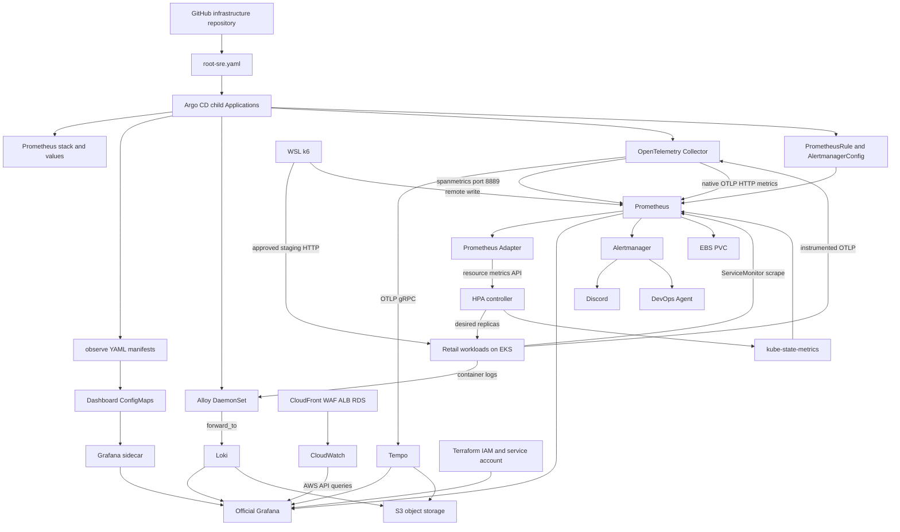
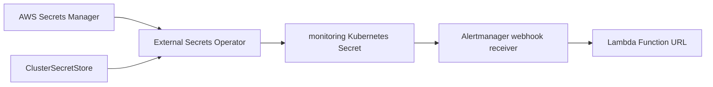
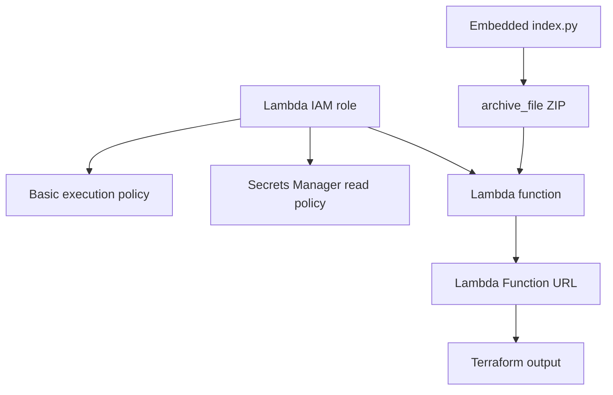
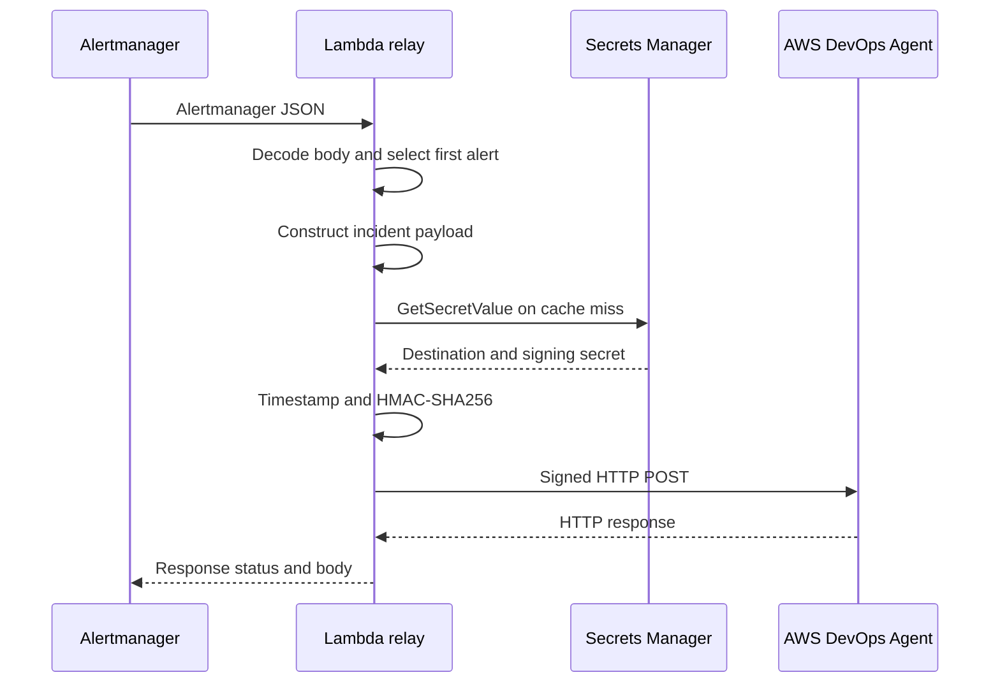
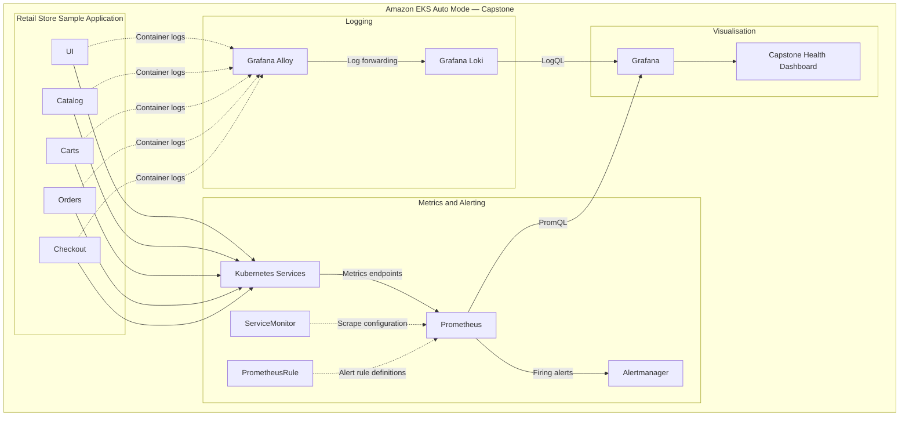
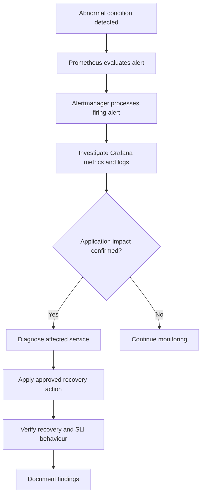
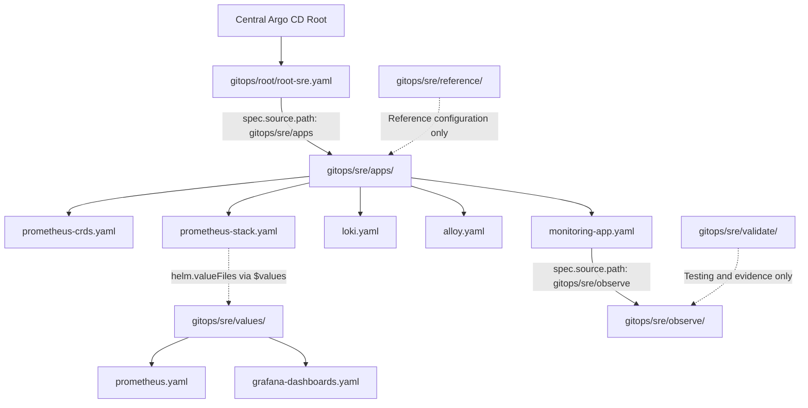
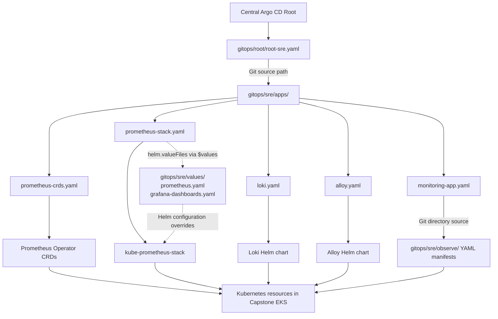

# Site Reliability Engineering (SRE)

**Capstone Group 2 | AWS Retail Store Sample | Amazon EKS Auto Mode**

This directory contains the Site Reliability Engineering (SRE) workstream for **Capstone**, a microservices-based retail application deployed on Amazon Elastic Kubernetes Service (EKS) Auto Mode.

The SRE implementation establishes an observability and reliability engineering framework encompassing application health monitoring, metrics collection, centralised logging, service-level indicators (SLIs), service-level objectives (SLOs), alerting, performance validation, and incident response.

The SRE workstream integrates with the existing Argo CD GitOps architecture while maintaining a clear separation between central deployment orchestration and SRE-owned observability configuration.

---

## Section S — Current SRE architecture and end-to-end code transitivity

Baseline: 26 November 2026. Source revision: `c88875400c4c7049217852b761f76ff5739c1858`. This current implementation guide supplements the historical documentation below; where they differ, consult the pinned configuration and live runtime evidence. Configuration is not proof of successful ingestion, scaling, delivery or recovery.



Solid arrows represent logical dependencies or telemetry paths, not proof of live traffic. GitOps reconciles desired state; Grafana queries data; HPA controls replicas independently of Grafana.


### S.1 — GitOps and Helm dependency resolution

`root-sre` discovers child Applications. The chart version is pinned, while the values source uses HEAD; the documentation revision is not a deployment pin. The observe Application selects top-level YAML only. Prune and selfHeal make moving active files risky.


Source: [`gitops/root/root-sre.yaml:10-25`](https://github.com/eugenewongyj/cloud-ntu-capstone-group2-infra/blob/c88875400c4c7049217852b761f76ff5739c1858/gitops/root/root-sre.yaml#L10-L25)

```yaml
spec:
  project: sre-project
  source:
    repoURL: https://github.com/eugenewongyj/cloud-ntu-capstone-group2-infra.git
    targetRevision: main
    path: gitops/sre/apps
  destination:
    server: https://kubernetes.default.svc
    namespace: argocd
  syncPolicy:
    automated:
      prune: true
      selfHeal: true
    syncOptions:
      - CreateNamespace=true
      - ServerSideApply=true
```


Source: [`gitops/sre/apps/prometheus-stack.yaml:12-35`](https://github.com/eugenewongyj/cloud-ntu-capstone-group2-infra/blob/c88875400c4c7049217852b761f76ff5739c1858/gitops/sre/apps/prometheus-stack.yaml#L12-L35)

```yaml
  sources:
    # 1. Pull the remote Helm chart from Prometheus Community
    - repoURL: https://prometheus-community.github.io/helm-charts
      chart: kube-prometheus-stack
      targetRevision: 93.1.1
      helm:
        valueFiles:
          - $values/gitops/sre/values/prometheus.yaml
          - $values/gitops/sre/values/grafana-dashboards.yaml
    # 2. Pull your values files from your GitHub repository (matching your 'gitops' folder structure)
    - repoURL: https://github.com/eugenewongyj/cloud-ntu-capstone-group2-infra.git
      targetRevision: HEAD
      ref: values
  destination:
    server: https://kubernetes.default.svc
    namespace: monitoring
  syncPolicy:
    automated:
      prune: true
      selfHeal: true
    syncOptions:
      - CreateNamespace=true
      - ServerSideApply=true
      - RespectIgnoreDifferences=true # <-- REQUIRED so ArgoCD doesn't overwrite the Secret during syncs
```


Source: [`gitops/sre/apps/monitoring-app.yaml:10-25`](https://github.com/eugenewongyj/cloud-ntu-capstone-group2-infra/blob/c88875400c4c7049217852b761f76ff5739c1858/gitops/sre/apps/monitoring-app.yaml#L10-L25)

```yaml
  source:
    repoURL: https://github.com/eugenewongyj/cloud-ntu-capstone-group2-infra.git
    targetRevision: main
    path: gitops/sre/observe
    directory:
      recurse: false
      include: '*.yaml'
  destination:
    server: https://kubernetes.default.svc
    namespace: monitoring
  syncPolicy:
    automated:
      prune: true
      selfHeal: true
    syncOptions:
      - CreateNamespace=true
```


### S.2 — Metrics collection and storage

ServiceMonitor selectors must match actual Service labels and named ports. Spring UI/cart/orders use Actuator; catalog/checkout use /metrics. Both supplied monitors select production only. Prometheus also accepts remote write and OTLP; these are separate ingestion mechanisms. A successful scrape is not customer availability. Retention is 3 days or 5GB, with a 20Gi gp3 claim.


Source: [`gitops/sre/observe/monitoring.yaml:15-33`](https://github.com/eugenewongyj/cloud-ntu-capstone-group2-infra/blob/c88875400c4c7049217852b761f76ff5739c1858/gitops/sre/observe/monitoring.yaml#L15-L33)

```yaml
spec:                                           # Defines metrics discovery.
  namespaceSelector:                            # Selects application namespaces.
    matchNames:                                 # Lists allowed namespaces.
      - retail-store                                 # Namespace configured in Helmfile.
  selector:                                     # Selects matching Kubernetes Services.
    matchLabels:                                # Requires these Service labels.
      app.kubernetes.io/owner: retail-store-sample  # Restricts to retail Services.
      app.kubernetes.io/component: service      # Restricts to application Services.
    matchExpressions:                           # Filters specific Helm releases.
      - key: app.kubernetes.io/instance         # Uses the Helm release-name label.
        operator: In                            # Matches listed values.
        values:                                 # Lists Actuator-enabled releases.
          - ui                                  # UI release.
          - cart                               # Cart release.
          - orders                              # Orders release.
  endpoints:                                    # Defines the metrics scrape endpoint.
    - port: http                                # Named Kubernetes Service port.
      path: /actuator/prometheus                # Spring Actuator metrics.
      interval: 30s                             # Scrapes every 30 seconds.
```


Source: [`gitops/sre/observe/monitoring.yaml:48-65`](https://github.com/eugenewongyj/cloud-ntu-capstone-group2-infra/blob/c88875400c4c7049217852b761f76ff5739c1858/gitops/sre/observe/monitoring.yaml#L48-L65)

```yaml
spec:                                           # Defines metrics discovery.
  namespaceSelector:                            # Selects application namespaces.
    matchNames:                                 # Lists allowed namespaces.
      - retail-store                                 # Application namespace.
  selector:                                     # Selects matching Services.
    matchLabels:                                # Requires these Service labels.
      app.kubernetes.io/owner: retail-store-sample  # Restricts to retail Services.
      app.kubernetes.io/component: service      # Restricts to application Services.
    matchExpressions:                           # Filters specific Helm releases.
      - key: app.kubernetes.io/instance         # Helm release-name label.
        operator: In                            # Matches listed values.
        values:                                 # Services using /metrics.
          - catalog                             # Catalog release.
          - checkout                            # Checkout release.
  endpoints:                                    # Defines scrape endpoint.
    - port: http                                # Named Kubernetes Service port.
      path: /metrics                            # Prometheus-compatible metrics.
      interval: 30s                             # Scrapes every 30 seconds.
```


Source: [`gitops/sre/values/prometheus.yaml:128-143`](https://github.com/eugenewongyj/cloud-ntu-capstone-group2-infra/blob/c88875400c4c7049217852b761f76ff5739c1858/gitops/sre/values/prometheus.yaml#L128-L143)

```yaml
  prometheusSpec:
    enableOTLPReceiver: true
    enableRemoteWriteReceiver: true
    additionalScrapeConfigs: []
    # For Prometheus v3+ / kube-prometheus-stack supporting otlp config:
    otlp:
      keepIdentifyingResourceAttributes: true
      promoteResourceAttributes:
        - service.instance.id
        - service.name
        - service.namespace
        - deployment.environment.name
        - service.version
        - k8s.cluster.name
        - k8s.namespace.name
        - k8s.pod.name
```


Source: [`gitops/sre/values/prometheus.yaml:153-169`](https://github.com/eugenewongyj/cloud-ntu-capstone-group2-infra/blob/c88875400c4c7049217852b761f76ff5739c1858/gitops/sre/values/prometheus.yaml#L153-L169)

```yaml
    retention: 3d
    retentionSize: 5GB
    resources:
      requests:
        cpu: 250m
        memory: 768Mi
      limits:
        cpu: 1000m
        memory: 1152Mi
    storageSpec:
      volumeClaimTemplate:
        spec:
          storageClassName: gp3
          accessModes: ["ReadWriteOnce"]
          resources:
            requests:
              storage: 20Gi
```


### S.3 — Alloy to Loki

Node identity is injected from spec.nodeName; discovery filters pods on that node. Relabel output becomes the log source targets; forward_to references the Loki writer receiver. LogQL example: `{namespace="retail-store",container="ui"}`. Loki uses TSDB schema v13 and S3, with replication factor 1; do not claim high availability or tested recovery.


Source: [`gitops/sre/apps/alloy.yaml:18-72`](https://github.com/eugenewongyj/cloud-ntu-capstone-group2-infra/blob/c88875400c4c7049217852b761f76ff5739c1858/gitops/sre/apps/alloy.yaml#L18-L72)

```yaml
        controller:
          type: daemonset
          tolerations:
            - operator: Exists
        alloy:
          extraEnv:
            - name: HOST_NODE_NAME
              valueFrom:
                fieldRef:
                  fieldPath: spec.nodeName
          configMap:
            create: true
            content: |
              // 1. Discover pods scheduled on this Alloy instance's node
              discovery.kubernetes "pods" {
                role = "pod"
                selectors {
                  role  = "pod"
                  field = "spec.nodeName=" + sys.env("HOST_NODE_NAME")
                }
              }

              // Application metrics are scraped by Prometheus via ServiceMonitors.
              // Avoid broad, duplicate Alloy metrics scraping.

              // 4. COLLECT LOGS: Extract Kubernetes metadata to use as log labels
              discovery.relabel "pod_logs" {
                targets = discovery.kubernetes.pods.targets

                rule {
                  source_labels = ["__meta_kubernetes_namespace"]
                  target_label  = "namespace"
                }
                rule {
                  source_labels = ["__meta_kubernetes_pod_name"]
                  target_label  = "pod"
                }
                rule {
                  source_labels = ["__meta_kubernetes_pod_container_name"]
                  target_label  = "container"
                }
              }

              // 5. Scrape the logs from the discovered pods
              loki.source.kubernetes "local_pods" {
                targets    = discovery.relabel.pod_logs.output
                forward_to = [loki.write.local.receiver]
              }

              // 6. Ship the logs to your internal in-cluster Loki destination
              loki.write "local" {
                endpoint {
                  url = "http://loki-gateway.logging.svc.cluster.local:80/loki/api/v1/push"
                }
              }
```


Source: [`gitops/sre/apps/loki.yaml:46-74`](https://github.com/eugenewongyj/cloud-ntu-capstone-group2-infra/blob/c88875400c4c7049217852b761f76ff5739c1858/gitops/sre/apps/loki.yaml#L46-L74)

```yaml
        loki:
          auth_enabled: false
          commonConfig:
            replication_factor: 1

          # Configure Loki to use AWS S3 directly
          storage:
            bucketNames:
              chunks: group2-capstone-loki-logs-ap-southeast-1
              ruler: group2-capstone-loki-logs-ap-southeast-1
              admin: group2-capstone-loki-logs-ap-southeast-1
            type: s3
            s3:
              region: ap-southeast-1
              s3ForcePathStyle: false

          schemaConfig:
            configs:
              - from: "2024-01-01"
                store: tsdb
                object_store: s3
                schema: v13
                index:
                  prefix: index_
                  period: 24h

        # Disable the local MinIO sandbox
        minio:
          enabled: false
```


### S.4 — OpenTelemetry and Tempo

Instrumentation config is production-scoped and requires actual workload injection. HTTP/protobuf goes to collector port 4318. Traces go to Tempo gRPC 4317 and spanmetrics connector; span-derived metrics are scraped on 8889; native SDK metrics use Prometheus OTLP HTTP. Verify the effective exporter URL and successful ingestion rather than assuming the configured endpoint is sufficient. Tempo stores traces in S3. Trace-to-log correlation is not established merely by configuring both sources.


Source: [`gitops/sre/manifests/otel/otel-instrumentation.yaml:9-24`](https://github.com/eugenewongyj/cloud-ntu-capstone-group2-infra/blob/c88875400c4c7049217852b761f76ff5739c1858/gitops/sre/manifests/otel/otel-instrumentation.yaml#L9-L24)

```yaml
spec:
  exporter:
    endpoint: "http://retail-store-collector-collector.opentelemetry-system.svc.cluster.local:4318"
  propagators:
    - tracecontext
    - baggage
  sampler:
    type: parentbased_traceidratio
    argument: "1.0"
  env:
    - name: OTEL_METRICS_EXPORTER
      value: "otlp"
    - name: OTEL_EXPORTER_OTLP_PROTOCOL
      value: "http/protobuf"
    - name: OTEL_RESOURCE_ATTRIBUTES
      value: "service.namespace=retail-store,deployment.environment.name=capstone"
```


Source: [`gitops/sre/manifests/otel/otel-collector.yaml:47-93`](https://github.com/eugenewongyj/cloud-ntu-capstone-group2-infra/blob/c88875400c4c7049217852b761f76ff5739c1858/gitops/sre/manifests/otel/otel-collector.yaml#L47-L93)

```yaml
  config:
    receivers:
      otlp:
        protocols:
          grpc:
            endpoint: 0.0.0.0:4317
          http:
            endpoint: 0.0.0.0:4318
    processors:
      batch: {}
    connectors:
      spanmetrics:
        dimensions:
          - name: http.status_code
          - name: http.response.status_code
          - name: http.method
          - name: http.request.method
        histogram:
          explicit:
            buckets: [5ms, 10ms, 25ms, 50ms, 100ms, 250ms, 500ms, 1s, 2.5s, 5s]
    exporters:
      otlp:
        endpoint: "tempo.logging.svc.cluster.local:4317"
        tls:
          insecure: true
      prometheus:
        endpoint: 0.0.0.0:8889
      # NEW: Forward native OTel SDK metrics to Prometheus OTLP endpoint
      otlphttp/prometheus:
        endpoint: http://kube-prometheus-stack-prometheus.monitoring.svc.cluster.local:9090/api/v1/otlp
        tls:
          insecure: true
    service:
      pipelines:
        traces:
          receivers: [otlp]
          processors: [batch]
          exporters: [otlp, spanmetrics]
        metrics:
          receivers: [spanmetrics]
          processors: [batch]
          exporters: [prometheus]
        # NEW: Native OTel metrics pipeline for Dashboard 22784
        metrics/otlp:
          receivers: [otlp]
          processors: [batch]
          exporters: [otlphttp/prometheus]
```


Source: [`gitops/sre/manifests/otel/otel-servicemonitor.yaml:35-47`](https://github.com/eugenewongyj/cloud-ntu-capstone-group2-infra/blob/c88875400c4c7049217852b761f76ff5739c1858/gitops/sre/manifests/otel/otel-servicemonitor.yaml#L35-L47)

```yaml
spec:
  namespaceSelector:
    matchNames:
      - opentelemetry-system
  selector:
    matchLabels:
      app.kubernetes.io/component: opentelemetry-collector
      app.kubernetes.io/instance: opentelemetry-system.retail-store-collector
      app.kubernetes.io/name: retail-store-collector-collector
  endpoints:
    - port: prometheus
      interval: 30s
      path: /metrics
```


Source: [`gitops/sre/apps/tempo.yaml:54-61`](https://github.com/eugenewongyj/cloud-ntu-capstone-group2-infra/blob/c88875400c4c7049217852b761f76ff5739c1858/gitops/sre/apps/tempo.yaml#L54-L61)

```yaml
          storage:
            trace:
              backend: s3
              s3:
                bucket: "group2-capstone-tempo-traces-ap-southeast-1"
                endpoint: "s3.ap-southeast-1.amazonaws.com"
                region: "ap-southeast-1"
                insecure: false
```


### S.5 — HPA resource metrics feedback loop

Adapter queries Prometheus CPU rates and memory working set, maps labels to Kubernetes resources and exposes resource metrics. Confirm the registered APIService actually points to the adapter. HPA compares utilization against resource requests, not limits; kube-state-metrics exposes HPA status for Grafana. The observed staging target was 70%; actual scale-out requires runtime evidence.


Source: [`gitops/sre/apps/prometheus-adapter.yaml:25-73`](https://github.com/eugenewongyj/cloud-ntu-capstone-group2-infra/blob/c88875400c4c7049217852b761f76ff5739c1858/gitops/sre/apps/prometheus-adapter.yaml#L25-L73)

```yaml
        prometheus:
          # Points to your kube-prometheus-stack Prometheus service in the monitoring namespace
          url: http://kube-prometheus-stack-prometheus.monitoring.svc.cluster.local
          port: 9090
        rules:
          default: true
          # Exposes standard CPU & Memory metrics from Prometheus to the Kubernetes HPA API
          resource:
            cpu:
              containerQuery: |
                sum by (<<.GroupBy>>) (
                  rate(container_cpu_usage_seconds_total{container!="",<<.LabelMatchers>>}[3m])
                )
              nodeQuery: |
                sum by (<<.GroupBy>>) (
                  rate(node_cpu_seconds_total{mode!="idle",mode!="iowait",mode!="steal"}[3m])
                  * on(instance) group_left(node)
                  label_replace(kube_node_info{<<.LabelMatchers>>}, "instance", "$1:9100", "internal_ip", "(.*)")
                )
              resources:
                overrides:
                  node:
                    resource: node
                  namespace:
                    resource: namespace
                  pod:
                    resource: pod
              containerLabel: container
            memory:
              containerQuery: |
                sum by (<<.GroupBy>>) (
                  container_memory_working_set_bytes{container!="",<<.LabelMatchers>>}
                )
              nodeQuery: |
                sum by (<<.GroupBy>>) (
                  (node_memory_MemTotal_bytes - node_memory_MemAvailable_bytes)
                  * on(instance) group_left(node)
                  label_replace(kube_node_info{<<.LabelMatchers>>}, "instance", "$1:9100", "internal_ip", "(.*)")
                )
              resources:
                overrides:
                  node:
                    resource: node
                  namespace:
                    resource: namespace
                  pod:
                    resource: pod
              containerLabel: container
          window: 3m
```


### S.6 — k6 load and performance telemetry

The JavaScript validates host/path, gates flash-demo, checks HTTP status and optional content, and records latency/failure. Smoke 40s, baseline 5m, flash-demo 10m; at BASE_USERS=1 the flash peak is 20 VUs. VUs are not requests per second. The runner writes summary.json and optionally remote-writes interval p95. The stock runner does not add the namespace and assessment_run tags used by the local assessment runner; check dashboard filters. Interval p95 cannot be averaged into whole-run p95.


Source: [`gitops/sre/validate/k6/product-listing.js:5-39`](https://github.com/eugenewongyj/cloud-ntu-capstone-group2-infra/blob/c88875400c4c7049217852b761f76ff5739c1858/gitops/sre/validate/k6/product-listing.js#L5-L39)

```javascript
const path = __ENV.CAPSTONE_PRODUCT_PATH || '';
if (!path.startsWith('/') || path.startsWith('//')) throw new Error('Set CAPSTONE_PRODUCT_PATH to a verified path starting with one /');
const host = __ENV.TARGET_HOST || '';
if (!/^https?:\/\//.test(host)) throw new Error('Set TARGET_HOST to an approved staging URL');
const baseUsers = Number(__ENV.BASE_USERS || 1);
const profile = __ENV.LOAD_PROFILE || 'smoke';
if (!Number.isInteger(baseUsers) || baseUsers < 1 || baseUsers > 10) throw new Error('BASE_USERS must be 1–10 for this demo');
const profiles = {
  smoke: [{duration:'30s',target:1},{duration:'10s',target:0}],
  baseline: [{duration:'30s',target:baseUsers},{duration:'4m',target:baseUsers},{duration:'30s',target:0}],
  'flash-demo': [{duration:'30s',target:baseUsers},{duration:'1m30s',target:baseUsers},{duration:'1m',target:baseUsers*10},{duration:'2m',target:baseUsers*10},{duration:'1m',target:baseUsers*20},{duration:'2m',target:baseUsers*20},{duration:'1m',target:baseUsers},{duration:'1m',target:0}],
};
if (!profiles[profile]) throw new Error('Invalid LOAD_PROFILE');
if (profile === 'flash-demo' && __ENV.CAPSTONE_LOAD_APPROVED !== 'YES') throw new Error('Flash demo requires CAPSTONE_LOAD_APPROVED=YES after team approval');
const productLatency = new Trend('capstone_product_listing_duration', true);
const productFailure = new Rate('capstone_product_listing_failed');
export const options = {
  scenarios: { product_listing: { executor:'ramping-vus', startVUs:0, stages:profiles[profile], gracefulRampDown:'10s', gracefulStop:'15s' } },
  thresholds: {
    'http_req_duration{scenario:product_listing}':['p(95)<500'],
    'http_req_failed{scenario:product_listing}':['rate<0.01'],
    capstone_product_listing_failed:['rate<0.01'],
  },
  tags: { project:'Capstone', test_profile:profile },
  discardResponseBodies: false,
};
export default function () {
  const response = http.get(host.replace(/\/+$/,'') + path, {timeout:'10s',tags:{name:'product_listing'}});
  const marker = __ENV.CAPSTONE_EXPECT_TEXT || '';
  const ok = response.status >= 200 && response.status < 300 && (!marker || response.body.includes(marker));
  check(response, {'product_listing valid': () => ok});
  productLatency.add(response.timings.duration, {name:'product_listing'});
  productFailure.add(!ok, {name:'product_listing'});
  sleep(1 + Math.random()*2);
}
```


Source: [`gitops/sre/validate/k6/run.sh:8-38`](https://github.com/eugenewongyj/cloud-ntu-capstone-group2-infra/blob/c88875400c4c7049217852b761f76ff5739c1858/gitops/sre/validate/k6/run.sh#L8-L38)

```bash
: "${LOAD_PROFILE:=smoke}"
: "${BASE_USERS:=1}"
if [[ "$LOAD_PROFILE" == flash-demo && "${CAPSTONE_LOAD_APPROVED:-}" != YES ]]; then
  echo "Flash demo requires CAPSTONE_LOAD_APPROVED=YES after team approval" >&2; exit 2
fi
mkdir -p results
export TARGET_HOST CAPSTONE_PRODUCT_PATH LOAD_PROFILE BASE_USERS
if [[ "${CAPSTONE_K6_REMOTE_WRITE:-}" == YES ]]; then
  : "${K6_PROMETHEUS_RW_SERVER_URL:?Set an authorized, reachable Prometheus remote-write URL}"
  export K6_PROMETHEUS_RW_SERVER_URL
  export K6_PROMETHEUS_RW_TREND_STATS="p(95)"
  k6 run -o experimental-prometheus-rw \
  -e "TARGET_HOST=$TARGET_HOST" \
  -e "CAPSTONE_PRODUCT_PATH=$CAPSTONE_PRODUCT_PATH" \
  -e "LOAD_PROFILE=$LOAD_PROFILE" \
  -e "BASE_USERS=$BASE_USERS" \
  -e "CAPSTONE_LOAD_APPROVED=${CAPSTONE_LOAD_APPROVED:-}" \
  -e "CAPSTONE_EXPECT_TEXT=${CAPSTONE_EXPECT_TEXT:-}" \
  --summary-export results/summary.json \
  product-listing.js
else
  k6 run \
  -e "TARGET_HOST=$TARGET_HOST" \
  -e "CAPSTONE_PRODUCT_PATH=$CAPSTONE_PRODUCT_PATH" \
  -e "LOAD_PROFILE=$LOAD_PROFILE" \
  -e "BASE_USERS=$BASE_USERS" \
  -e "CAPSTONE_LOAD_APPROVED=${CAPSTONE_LOAD_APPROVED:-}" \
  -e "CAPSTONE_EXPECT_TEXT=${CAPSTONE_EXPECT_TEXT:-}" \
  --summary-export results/summary.json \
  product-listing.js
fi
```


#### Live HPA resource metrics verification

On 26 November 2026, APIService v1beta1.metrics.k8s.io reported Available=True with monitoring/prometheus-adapter as its active provider. Staging pod CPU and memory metrics were retrieved successfully. All ten retail HPAs reported CPU utilization against a 70% target. This verifies resource metrics availability, not load-induced scale-out. Grafana observes autoscaling rather than controlling it.

**Verified production autoscaling lifecycle (26 November 2026):** The carts HPA in retail-store automatically scaled from 2 to 3, 5 and 6 replicas because CPU utilization exceeded its 70% target. After downscale stabilization, SuccessfulRescale events confirmed scale-in from 6 to 5, 3 and 2 replicas because all metrics were below target. Final CPU utilization was 1%, with 2/2 replicas ready and available. ScalingLimited=True with TooFewReplicas confirmed minimum replica enforcement. Initial metric retrieval warnings recovered before successful scaling. The initiating traffic source was not established; this event is not attributed to k6.

### S.7 — CloudWatch IAM and Grafana

Terraform policy grants metric discovery and reads, with scoped log access. OIDC trust binds the role to the Grafana service account; the Helm annotation supplies the role and authType default uses the AWS credential chain. Grafana queries CloudWatch directly, not via Prometheus. CloudFront metrics use us-east-1 and Region=Global; regional ALB/RDS metrics use ap-southeast-1. Discover current resource dimensions after rebuild. Shared ALB metrics are not staging-only.


Source: [`iam_grafana.tf:14-28`](https://github.com/eugenewongyj/cloud-ntu-capstone-group2-infra/blob/c88875400c4c7049217852b761f76ff5739c1858/iam_grafana.tf#L14-L28)

```hcl
      {
        # Block 1: Actions that AWS forces to be Resource: "*"
        Sid    = "UnscopableCloudWatchMetrics"
        Effect = "Allow"
        Action = [
          "cloudwatch:ListMetrics",
          "cloudwatch:GetMetricData",
          "cloudwatch:GetInsightRuleReport",
          "ec2:DescribeTags",
          "ec2:DescribeInstances",
          "ec2:DescribeRegions",
          "tag:GetResources"
        ]
        Resource = "*"
      },
```


Source: [`iam_grafana.tf:65-108`](https://github.com/eugenewongyj/cloud-ntu-capstone-group2-infra/blob/c88875400c4c7049217852b761f76ff5739c1858/iam_grafana.tf#L65-L108)

```hcl

# 2. OIDC Trust Policy mapped to the Grafana ServiceAccount
data "aws_iam_policy_document" "grafana_trust" {
  statement {
    actions = ["sts:AssumeRoleWithWebIdentity"]
    effect  = "Allow"

    condition {
      test     = "StringEquals"
      variable = "${replace(module.eks.cluster_oidc_issuer_url, "https://", "")}:sub"
      # This explicitly locks the role to the Grafana pod in the monitoring namespace
      values = ["system:serviceaccount:monitoring:kube-prometheus-stack-grafana"]
    }

    condition {
      test     = "StringEquals"
      variable = "${replace(module.eks.cluster_oidc_issuer_url, "https://", "")}:aud"
      values   = ["sts.amazonaws.com"]
    }

    principals {
      identifiers = [module.eks.oidc_provider_arn]
      type        = "Federated"
    }
  }
}

# 3. The IAM Role itself
resource "aws_iam_role" "grafana_cloudwatch" {
  name               = "${var.project_name}-grafana-cloudwatch-role"
  assume_role_policy = data.aws_iam_policy_document.grafana_trust.json
}

# 4. Attach the policy to the role
resource "aws_iam_role_policy_attachment" "grafana_cloudwatch" {
  policy_arn = aws_iam_policy.grafana_cloudwatch.arn
  role       = aws_iam_role.grafana_cloudwatch.name
}

# 5. Output the ARN to use in your GitOps values.yaml
output "grafana_cloudwatch_role_arn" {
  description = "The ARN of the Grafana CloudWatch IAM role for IRSA"
  value       = aws_iam_role.grafana_cloudwatch.arn
}
```


Source: [`gitops/sre/values/prometheus.yaml:57-87`](https://github.com/eugenewongyj/cloud-ntu-capstone-group2-infra/blob/c88875400c4c7049217852b761f76ff5739c1858/gitops/sre/values/prometheus.yaml#L57-L87)

```yaml
  serviceAccount:
    create: true
    name: "kube-prometheus-stack-grafana"
    annotations:
      eks.amazonaws.com/role-arn: "arn:aws:iam::255945442255:role/group2-capstone-grafana-cloudwatch-role"
  additionalDataSources:
    - name: Loki
      type: loki
      access: proxy
      url: http://loki-gateway.logging.svc.cluster.local:80
      jsonData:
        maxLines: 1000
    - name: Tempo
      type: tempo
      access: proxy
      url: http://tempo.logging.svc.cluster.local:3200
      jsonData:
        tracesToLogsV2:
          datasourceUid: 'Loki'
          spanStartTimeShift: '1h'
          spanEndTimeShift: '1h'
          filterByTraceID: false
          filterBySpanID: false
          customQuery: true
          query: '{app="%s"} |= "%s"'
    - name: CloudWatch
      type: cloudwatch
      # authType "default" tells Grafana to use the EKS IAM Role
      jsonData:
        authType: default
        defaultRegion: ap-southeast-1
```


### S.8 — Alert evaluation and notification routing

The release label links AlertmanagerConfig discovery to the stack. Watchdog routes to null; critical alerts route to DevOps Agent and continue to Discord; resolved delivery is enabled. Secret references are not webhook values. Production workload alerts do not automatically cover staging. A direct Alertmanager injection tests routing, not Prometheus rule evaluation. The deployment comparison returns desired replicas, not the deficit; restart rate is not proof of CrashLoopBackOff. The CPU rule threshold and annotation differ; preserve configuration and review separately.


Source: [`gitops/sre/values/prometheus.yaml:31-38`](https://github.com/eugenewongyj/cloud-ntu-capstone-group2-infra/blob/c88875400c4c7049217852b761f76ff5739c1858/gitops/sre/values/prometheus.yaml#L31-L38)

```yaml
    webConfig:
      tlsConfig: null
    alertmanagerConfigSelector:
      matchLabels:
        release: kube-prometheus-stack
    alertmanagerConfigNamespaceSelector: {}
    alertmanagerConfigMatcherStrategy:
      type: None
```


Source: [`gitops/sre/monitoring/capstone-alerts.yaml:15-46`](https://github.com/eugenewongyj/cloud-ntu-capstone-group2-infra/blob/c88875400c4c7049217852b761f76ff5739c1858/gitops/sre/monitoring/capstone-alerts.yaml#L15-L46)

```yaml
        - alert: RetailStorePodCrashLooping
          expr: rate(kube_pod_container_status_restarts_total{namespace="retail-store"}[5m]) > 0
          for: 1m
          labels:
            severity: critical
          annotations:
            summary: "Pod {{ $labels.pod }} is crash-looping in retail-store"
            description: "Container {{ $labels.container }} in pod {{ $labels.pod }} has restarted repeatedly over the last 1 minutes."

        - alert: RetailStoreDeploymentUnavailable
          expr: |
            kube_deployment_spec_replicas{namespace="retail-store"}
            >
            kube_deployment_status_replicas_available{namespace="retail-store"}
          for: 2m
          labels:
            severity: critical
          annotations:
            summary: "Deployment {{ $labels.deployment }} has unavailable replicas"
            description: "Deployment {{ $labels.deployment }} in retail-store has {{ $value }} fewer available replicas than desired for 2 minutes."

        - alert: RetailStorePodNotReady
          expr: |
            sum by (pod) (
              kube_pod_status_phase{namespace="retail-store", phase=~"Pending|Unknown|Failed"}
            ) > 0
          for: 2m
          labels:
            severity: critical
          annotations:
            summary: "Pod {{ $labels.pod }} stuck in non-Running phase"
            description: "Pod {{ $labels.pod }} in retail-store has been Pending, Failed, or Unknown for more than 2 minutes."
```


Source: [`gitops/sre/monitoring/alertmanager-discord.yaml:8-64`](https://github.com/eugenewongyj/cloud-ntu-capstone-group2-infra/blob/c88875400c4c7049217852b761f76ff5739c1858/gitops/sre/monitoring/alertmanager-discord.yaml#L8-L64)

```yaml
spec:
  route:
    groupBy: ['namespace', 'severity']
    groupWait: 30s
    groupInterval: 5m
    repeatInterval: 4h
    receiver: 'discord-notifications'
    routes:
      - matchers:
          - name: alertname
            value: Watchdog
            matchType: '='
        receiver: 'null-receiver'

      # 1. Trigger AWS DevOps Agent RCA within 10s, then continue to Discord
      - matchers:
          - name: severity
            value: critical
            matchType: '='
        groupBy: ['alertname', 'namespace', 'pod', 'deployment']
        groupWait: 10s
        groupInterval: 1m
        repeatInterval: 1h
        receiver: 'devops-agent-webhook'
        continue: true

      # 2. Send immediate Discord notification for critical alerts
      - matchers:
          - name: severity
            value: critical
            matchType: '='
        groupBy: ['namespace', 'alertname']
        groupWait: 10s
        repeatInterval: 1h
        receiver: 'discord-notifications'

  receivers:
    - name: 'null-receiver'
    - name: 'devops-agent-webhook'
      webhookConfigs:
        - urlSecret:
            name: devops-agent-webhook
            key: webhook-url
          sendResolved: true
    - name: 'discord-notifications'
      discordConfigs:
        - apiURL:
            name: sre-monitoring-discord-webhook
            key: url
          sendResolved: true
          title: '[{{ .Status | toUpper }}] {{ .CommonLabels.alertname }} ({{ .CommonLabels.namespace }})'
          message: >-
            {{ range .Alerts }}
            **Severity:** `{{ .Labels.severity }}`
            **Summary:** {{ .Annotations.summary }}
            **Details:** {{ .Annotations.description }}
            {{ end }}
```


#### Live alert delivery verification - 26 November 2026

Discord received genuine FIRING and RESOLVED notifications for RetailStoreCPUThrottlingHigh, AlertmanagerFailedToSendAlerts and AlertmanagerClusterFailedToSendAlerts. This verifies operational alert evaluation and Discord notification delivery, including recovery notifications. KubeDeploymentReplicasMismatch warnings were also received for production ui and orders. Their subsequent recovery was not verified at this observation point. Webhook delivery failures require receiver-specific investigation; successful Discord delivery does not independently establish successful DevOps Agent incident processing.

### S.9 — Dashboard provisioning and query traceability

Two provisioning paths coexist: Helm-imported Favourite dashboards and observe ConfigMaps discovered by the sidecar. The following excerpts link dashboard JSON targets to actual PromQL. A populated panel proves query results, not necessarily the intended service-level semantics.


Source: [`gitops/sre/values/grafana-dashboards.yaml:1-35`](https://github.com/eugenewongyj/cloud-ntu-capstone-group2-infra/blob/c88875400c4c7049217852b761f76ff5739c1858/gitops/sre/values/grafana-dashboards.yaml#L1-L35)

```yaml
grafana:
  dashboards:
    favourite:
      Kyverno:
        gnetId: 25743
        revision: 2
        datasource: Prometheus
      Trivy Operator Dashboard:
        gnetId: 17813
        revision: 2
        datasource: Prometheus
      ArgoCD:
        gnetId: 14584
        revision: 1
        datasource: Prometheus
      Node Exporter Full:
        gnetId: 1860
        revision: 46
        datasource: Prometheus
      AWS CloudWatch Logs:
        gnetId: 11266
        revision: 1
        datasource: CloudWatch
      AWS ALB Cloudwatch Metrics:
        gnetId: 14361
        revision: 1
        datasource: CloudWatch
      AWS CloudWatch Logs Dashboard:
        gnetId: 24331
        revision: 1
        datasource: CloudWatch
      Alertmanager:
        gnetId: 9578
        revision: 4
        datasource: Prometheus
```


Dashboard source: [`gitops/sre/observe/grafana-hpa-dashboard.yaml`](https://github.com/eugenewongyj/cloud-ntu-capstone-group2-infra/blob/c88875400c4c7049217852b761f76ff5739c1858/gitops/sre/observe/grafana-hpa-dashboard.yaml)

| Source line | Query expression (JSON syntax) |
|---|---|
| [L72](https://github.com/eugenewongyj/cloud-ntu-capstone-group2-infra/blob/c88875400c4c7049217852b761f76ff5739c1858/gitops/sre/observe/grafana-hpa-dashboard.yaml#L72) | `"expr": "max by (namespace, horizontalpodautoscaler) (kube_horizontalpodautoscaler_status_target_metric{namespace=~\"${namespace:regex}\",metric_name=\"cpu\",metric_target_type=\"utilization\"})",` |
| [L149](https://github.com/eugenewongyj/cloud-ntu-capstone-group2-infra/blob/c88875400c4c7049217852b761f76ff5739c1858/gitops/sre/observe/grafana-hpa-dashboard.yaml#L149) | `"expr": "max by (namespace, horizontalpodautoscaler) (kube_horizontalpodautoscaler_spec_target_metric{namespace=~\"${namespace:regex}\",metric_name=\"cpu\",metric_target_type=\"utilization\"})",` |
| [L222](https://github.com/eugenewongyj/cloud-ntu-capstone-group2-infra/blob/c88875400c4c7049217852b761f76ff5739c1858/gitops/sre/observe/grafana-hpa-dashboard.yaml#L222) | `"expr": "1000 * max by (namespace, horizontalpodautoscaler) (kube_horizontalpodautoscaler_status_target_metric{namespace=~\"${namespace:regex}\",metric_name=\"cpu\",metric_target_type=\"average\"})",` |
| [L295](https://github.com/eugenewongyj/cloud-ntu-capstone-group2-infra/blob/c88875400c4c7049217852b761f76ff5739c1858/gitops/sre/observe/grafana-hpa-dashboard.yaml#L295) | `"expr": "max by (namespace, horizontalpodautoscaler) (kube_horizontalpodautoscaler_status_current_replicas{namespace=~\"${namespace:regex}\"})",` |
| [L368](https://github.com/eugenewongyj/cloud-ntu-capstone-group2-infra/blob/c88875400c4c7049217852b761f76ff5739c1858/gitops/sre/observe/grafana-hpa-dashboard.yaml#L368) | `"expr": "max by (namespace, horizontalpodautoscaler) (kube_horizontalpodautoscaler_status_desired_replicas{namespace=~\"${namespace:regex}\"})",` |
| [L441](https://github.com/eugenewongyj/cloud-ntu-capstone-group2-infra/blob/c88875400c4c7049217852b761f76ff5739c1858/gitops/sre/observe/grafana-hpa-dashboard.yaml#L441) | `"expr": "max by (namespace, horizontalpodautoscaler) (kube_horizontalpodautoscaler_status_desired_replicas{namespace=~\"${namespace:regex}\"}) - max by (namespace, horizontalpodautoscaler) (kube_horizontalpodautoscaler_status_current_replicas{namespace=~\"${namespace:regex}\"})",` |
| [L514](https://github.com/eugenewongyj/cloud-ntu-capstone-group2-infra/blob/c88875400c4c7049217852b761f76ff5739c1858/gitops/sre/observe/grafana-hpa-dashboard.yaml#L514) | `"expr": "max by (namespace, horizontalpodautoscaler) (kube_horizontalpodautoscaler_spec_min_replicas{namespace=~\"${namespace:regex}\"})",` |
| [L587](https://github.com/eugenewongyj/cloud-ntu-capstone-group2-infra/blob/c88875400c4c7049217852b761f76ff5739c1858/gitops/sre/observe/grafana-hpa-dashboard.yaml#L587) | `"expr": "max by (namespace, horizontalpodautoscaler) (kube_horizontalpodautoscaler_spec_max_replicas{namespace=~\"${namespace:regex}\"})",` |
| [L660](https://github.com/eugenewongyj/cloud-ntu-capstone-group2-infra/blob/c88875400c4c7049217852b761f76ff5739c1858/gitops/sre/observe/grafana-hpa-dashboard.yaml#L660) | `"expr": "\n100 *\nsum by (namespace, container) (\n  max by (namespace, pod, container) (\n    rate(container_cpu_usage_seconds_total{\n      namespace=~\"${namespace:regex}\",\n      container=~\"ui&#124;catalog&#124;carts&#124;orders&#124;checkout\",\n      job=\"kubelet\",\n      metrics_path=\"/metrics/cadvisor\"\n    }[2m])\n  )\n)\n/\nsum by (namespace, container) (\n  max by (namespace, pod, container) (\n    kube_pod_container_resource_requests{\n      namespace=~\"${namespace:regex}\",\n      container=~\"ui&#124;catalog&#124;carts&#124;orders&#124;checkout\",\n      resource=\"cpu\",\n      unit=\"core\"\n    }\n  )\n)\n",` |
| [L737](https://github.com/eugenewongyj/cloud-ntu-capstone-group2-infra/blob/c88875400c4c7049217852b761f76ff5739c1858/gitops/sre/observe/grafana-hpa-dashboard.yaml#L737) | `"expr": "max by (namespace, horizontalpodautoscaler) (kube_horizontalpodautoscaler_status_target_metric{namespace=~\"${namespace:regex}\",metric_name=\"cpu\",metric_target_type=\"utilization\"})",` |
| [L748](https://github.com/eugenewongyj/cloud-ntu-capstone-group2-infra/blob/c88875400c4c7049217852b761f76ff5739c1858/gitops/sre/observe/grafana-hpa-dashboard.yaml#L748) | `"expr": "max by (namespace, horizontalpodautoscaler) (kube_horizontalpodautoscaler_spec_target_metric{namespace=~\"${namespace:regex}\",metric_name=\"cpu\",metric_target_type=\"utilization\"})",` |
| [L825](https://github.com/eugenewongyj/cloud-ntu-capstone-group2-infra/blob/c88875400c4c7049217852b761f76ff5739c1858/gitops/sre/observe/grafana-hpa-dashboard.yaml#L825) | `"expr": "max by (namespace, horizontalpodautoscaler) (kube_horizontalpodautoscaler_status_current_replicas{namespace=~\"${namespace:regex}\"})",` |
| [L836](https://github.com/eugenewongyj/cloud-ntu-capstone-group2-infra/blob/c88875400c4c7049217852b761f76ff5739c1858/gitops/sre/observe/grafana-hpa-dashboard.yaml#L836) | `"expr": "max by (namespace, horizontalpodautoscaler) (kube_horizontalpodautoscaler_status_desired_replicas{namespace=~\"${namespace:regex}\"})",` |
| [L847](https://github.com/eugenewongyj/cloud-ntu-capstone-group2-infra/blob/c88875400c4c7049217852b761f76ff5739c1858/gitops/sre/observe/grafana-hpa-dashboard.yaml#L847) | `"expr": "max by (namespace, horizontalpodautoscaler) (kube_horizontalpodautoscaler_spec_min_replicas{namespace=~\"${namespace:regex}\"})",` |
| [L858](https://github.com/eugenewongyj/cloud-ntu-capstone-group2-infra/blob/c88875400c4c7049217852b761f76ff5739c1858/gitops/sre/observe/grafana-hpa-dashboard.yaml#L858) | `"expr": "max by (namespace, horizontalpodautoscaler) (kube_horizontalpodautoscaler_spec_max_replicas{namespace=~\"${namespace:regex}\"})",` |


Dashboard source: [`gitops/sre/observe/grafana-k6-dashboard.yaml`](https://github.com/eugenewongyj/cloud-ntu-capstone-group2-infra/blob/c88875400c4c7049217852b761f76ff5739c1858/gitops/sre/observe/grafana-k6-dashboard.yaml)

| Source line | Query expression (JSON syntax) |
|---|---|
| [L104](https://github.com/eugenewongyj/cloud-ntu-capstone-group2-infra/blob/c88875400c4c7049217852b761f76ff5739c1858/gitops/sre/observe/grafana-k6-dashboard.yaml#L104) | `"expr": "1000 * max(last_over_time(k6_http_req_duration_p95{namespace=~\"${namespace:regex}\",assessment_run=~\"${assessment_run:regex}\"}[$__range]))",` |
| [L170](https://github.com/eugenewongyj/cloud-ntu-capstone-group2-infra/blob/c88875400c4c7049217852b761f76ff5739c1858/gitops/sre/observe/grafana-k6-dashboard.yaml#L170) | `"expr": "100 * max(last_over_time(k6_http_req_failed_rate{namespace=~\"${namespace:regex}\",assessment_run=~\"${assessment_run:regex}\"}[$__range]))",` |
| [L237](https://github.com/eugenewongyj/cloud-ntu-capstone-group2-infra/blob/c88875400c4c7049217852b761f76ff5739c1858/gitops/sre/observe/grafana-k6-dashboard.yaml#L237) | `"expr": "100 * min(last_over_time(k6_checks_rate{namespace=~\"${namespace:regex}\",assessment_run=~\"${assessment_run:regex}\"}[$__range]))",` |
| [L304](https://github.com/eugenewongyj/cloud-ntu-capstone-group2-infra/blob/c88875400c4c7049217852b761f76ff5739c1858/gitops/sre/observe/grafana-k6-dashboard.yaml#L304) | `"expr": "max(max_over_time(k6_vus{namespace=~\"${namespace:regex}\",assessment_run=~\"${assessment_run:regex}\"}[$__range]))",` |
| [L366](https://github.com/eugenewongyj/cloud-ntu-capstone-group2-infra/blob/c88875400c4c7049217852b761f76ff5739c1858/gitops/sre/observe/grafana-k6-dashboard.yaml#L366) | `"expr": "k6_vus{namespace=~\"${namespace:regex}\",assessment_run=~\"${assessment_run:regex}\"}",` |
| [L445](https://github.com/eugenewongyj/cloud-ntu-capstone-group2-infra/blob/c88875400c4c7049217852b761f76ff5739c1858/gitops/sre/observe/grafana-k6-dashboard.yaml#L445) | `"expr": "k6_vus_max{namespace=~\"${namespace:regex}\",assessment_run=~\"${assessment_run:regex}\"}",` |
| [L524](https://github.com/eugenewongyj/cloud-ntu-capstone-group2-infra/blob/c88875400c4c7049217852b761f76ff5739c1858/gitops/sre/observe/grafana-k6-dashboard.yaml#L524) | `"expr": "sum by (assessment_run) (rate(k6_http_reqs_total{namespace=~\"${namespace:regex}\",assessment_run=~\"${assessment_run:regex}\"}[1m]))",` |
| [L603](https://github.com/eugenewongyj/cloud-ntu-capstone-group2-infra/blob/c88875400c4c7049217852b761f76ff5739c1858/gitops/sre/observe/grafana-k6-dashboard.yaml#L603) | `"expr": "sum by (assessment_run) (k6_http_reqs_total{namespace=~\"${namespace:regex}\",assessment_run=~\"${assessment_run:regex}\"})",` |
| [L682](https://github.com/eugenewongyj/cloud-ntu-capstone-group2-infra/blob/c88875400c4c7049217852b761f76ff5739c1858/gitops/sre/observe/grafana-k6-dashboard.yaml#L682) | `"expr": "1000 * k6_capstone_product_listing_duration_p95{namespace=~\"${namespace:regex}\",assessment_run=~\"${assessment_run:regex}\"}",` |
| [L765](https://github.com/eugenewongyj/cloud-ntu-capstone-group2-infra/blob/c88875400c4c7049217852b761f76ff5739c1858/gitops/sre/observe/grafana-k6-dashboard.yaml#L765) | `"expr": "100 * k6_capstone_product_listing_failed_rate{namespace=~\"${namespace:regex}\",assessment_run=~\"${assessment_run:regex}\"}",` |
| [L849](https://github.com/eugenewongyj/cloud-ntu-capstone-group2-infra/blob/c88875400c4c7049217852b761f76ff5739c1858/gitops/sre/observe/grafana-k6-dashboard.yaml#L849) | `"expr": "100 * k6_http_req_failed_rate{namespace=~\"${namespace:regex}\",assessment_run=~\"${assessment_run:regex}\"}",` |
| [L933](https://github.com/eugenewongyj/cloud-ntu-capstone-group2-infra/blob/c88875400c4c7049217852b761f76ff5739c1858/gitops/sre/observe/grafana-k6-dashboard.yaml#L933) | `"expr": "100 * k6_checks_rate{namespace=~\"${namespace:regex}\",assessment_run=~\"${assessment_run:regex}\"}",` |
| [L1017](https://github.com/eugenewongyj/cloud-ntu-capstone-group2-infra/blob/c88875400c4c7049217852b761f76ff5739c1858/gitops/sre/observe/grafana-k6-dashboard.yaml#L1017) | `"expr": "1000 * k6_http_req_waiting_p95{namespace=~\"${namespace:regex}\",assessment_run=~\"${assessment_run:regex}\"}",` |
| [L1096](https://github.com/eugenewongyj/cloud-ntu-capstone-group2-infra/blob/c88875400c4c7049217852b761f76ff5739c1858/gitops/sre/observe/grafana-k6-dashboard.yaml#L1096) | `"expr": "1000 * k6_http_req_connecting_p95{namespace=~\"${namespace:regex}\",assessment_run=~\"${assessment_run:regex}\"}",` |
| [L1175](https://github.com/eugenewongyj/cloud-ntu-capstone-group2-infra/blob/c88875400c4c7049217852b761f76ff5739c1858/gitops/sre/observe/grafana-k6-dashboard.yaml#L1175) | `"expr": "1000 * k6_http_req_tls_handshaking_p95{namespace=~\"${namespace:regex}\",assessment_run=~\"${assessment_run:regex}\"}",` |
| [L1254](https://github.com/eugenewongyj/cloud-ntu-capstone-group2-infra/blob/c88875400c4c7049217852b761f76ff5739c1858/gitops/sre/observe/grafana-k6-dashboard.yaml#L1254) | `"expr": "1000 * k6_http_req_blocked_p95{namespace=~\"${namespace:regex}\",assessment_run=~\"${assessment_run:regex}\"}",` |
| [L1333](https://github.com/eugenewongyj/cloud-ntu-capstone-group2-infra/blob/c88875400c4c7049217852b761f76ff5739c1858/gitops/sre/observe/grafana-k6-dashboard.yaml#L1333) | `"expr": "1000 * k6_http_req_receiving_p95{namespace=~\"${namespace:regex}\",assessment_run=~\"${assessment_run:regex}\"}",` |
| [L1412](https://github.com/eugenewongyj/cloud-ntu-capstone-group2-infra/blob/c88875400c4c7049217852b761f76ff5739c1858/gitops/sre/observe/grafana-k6-dashboard.yaml#L1412) | `"expr": "k6_iteration_duration_p95{namespace=~\"${namespace:regex}\",assessment_run=~\"${assessment_run:regex}\"}",` |
| [L1491](https://github.com/eugenewongyj/cloud-ntu-capstone-group2-infra/blob/c88875400c4c7049217852b761f76ff5739c1858/gitops/sre/observe/grafana-k6-dashboard.yaml#L1491) | `"expr": "sum by (assessment_run) (rate(k6_data_received_total{namespace=~\"${namespace:regex}\",assessment_run=~\"${assessment_run:regex}\"}[1m]))",` |
| [L1570](https://github.com/eugenewongyj/cloud-ntu-capstone-group2-infra/blob/c88875400c4c7049217852b761f76ff5739c1858/gitops/sre/observe/grafana-k6-dashboard.yaml#L1570) | `"expr": "sum by (assessment_run) (rate(k6_data_sent_total{namespace=~\"${namespace:regex}\",assessment_run=~\"${assessment_run:regex}\"}[1m]))",` |
| [L1649](https://github.com/eugenewongyj/cloud-ntu-capstone-group2-infra/blob/c88875400c4c7049217852b761f76ff5739c1858/gitops/sre/observe/grafana-k6-dashboard.yaml#L1649) | `"expr": "max by (namespace,horizontalpodautoscaler) (kube_horizontalpodautoscaler_status_target_metric{namespace=~\"${namespace:regex}\",metric_name=\"cpu\",metric_target_type=\"utilization\"})",` |
| [L1728](https://github.com/eugenewongyj/cloud-ntu-capstone-group2-infra/blob/c88875400c4c7049217852b761f76ff5739c1858/gitops/sre/observe/grafana-k6-dashboard.yaml#L1728) | `"expr": "max by (namespace,horizontalpodautoscaler) (kube_horizontalpodautoscaler_spec_target_metric{namespace=~\"${namespace:regex}\",metric_name=\"cpu\",metric_target_type=\"utilization\"})",` |
| [L1807](https://github.com/eugenewongyj/cloud-ntu-capstone-group2-infra/blob/c88875400c4c7049217852b761f76ff5739c1858/gitops/sre/observe/grafana-k6-dashboard.yaml#L1807) | `"expr": "max by (namespace,horizontalpodautoscaler) (kube_horizontalpodautoscaler_status_current_replicas{namespace=~\"${namespace:regex}\"})",` |
| [L1886](https://github.com/eugenewongyj/cloud-ntu-capstone-group2-infra/blob/c88875400c4c7049217852b761f76ff5739c1858/gitops/sre/observe/grafana-k6-dashboard.yaml#L1886) | `"expr": "max by (namespace,horizontalpodautoscaler) (kube_horizontalpodautoscaler_status_desired_replicas{namespace=~\"${namespace:regex}\"})",` |


### S.10 — Read-only operational validation

```bash
kubectl get applications -n argocd
kubectl get pods,pvc -n monitoring
kubectl get pods,pvc -n logging
kubectl get servicemonitors,prometheusrules,alertmanagerconfigs -n monitoring
kubectl get hpa -n retail-staging
kubectl get hpa -n retail-store
kubectl get apiservice v1beta1.metrics.k8s.io
kubectl top pods -n retail-staging
kubectl get cm -n monitoring -l grafana_dashboard=1
```

Use an authorized Prometheus port-forward to inspect `/api/v1/targets`, `/api/v1/rules` and `/api/v1/query`. Example queries: `up`, `kube_horizontalpodautoscaler_status_target_metric{namespace="retail-staging",metric_name="cpu",metric_target_type="utilization"}`, `k6_http_req_duration_p95`. Use Grafana Explore for Loki and Tempo, and CloudWatch datasource queries for current AWS dimensions. Missing series are not zero. Record timestamps, namespace, run labels and actual results.

### S.11 — Evidence and known limitations

Previously observed on 26 November: 83/83 scrape targets up, Alloy 11/11, HPA 30/30 query checks and k6 24/24 query checks. HPA and k6 dashboard provisioning was confirmed. These are historical observations, not guarantees after AWS rebuild. Actual scale-out, full trace correlation, S3 recovery, dedicated CloudWatch panels and Prometheus-rule-to-Discord firing/resolved lifecycle require separate evidence. The supplied SLI reference file still uses namespace `default`; it is historical, not the current retail namespace. The local master runner is not established as a Git-managed file by this source export. No infrastructure changes are implied by this documentation.

### S.12 — Upstream alerting and incident relay reconciliation

**Source revision:** `4d7cba52913080f342273512180aa18090e90eea`.

Section S.8 retains its earlier pinned source excerpts.
Use this section for the newer alerting configuration.
The earlier CPU expression/annotation mismatch is corrected
in the newer source revision, not by this documentation change.

#### S.12.1 CPU saturation

Source: [`gitops/sre/monitoring/capstone-alerts.yaml:162-174`](https://github.com/eugenewongyj/cloud-ntu-capstone-group2-infra/blob/4d7cba52913080f342273512180aa18090e90eea/gitops/sre/monitoring/capstone-alerts.yaml#L162-L174)

```promql
(
  sum by (namespace, pod, container) (
    rate(container_cpu_usage_seconds_total{
      namespace="retail-store",
      container!="",
      container!="POD"
    }[5m])
  )
  /
  sum by (namespace, pod, container) (
    kube_pod_container_resource_limits{
      namespace="retail-store",
      resource="cpu"
    }
  )
) > 0.85
```

The expression divides CPU consumption in cores by the
configured CPU limit in cores, matching namespace, pod and
container after aggregation.

The warning condition must remain active for three minutes.
This is CPU-limit saturation, not the HPA CPU utilization
percentage, which is relative to CPU requests.

Example: 425m usage against a 500m limit equals 85%.
The strict greater-than comparison requires a value above 85%.

Missing or zero CPU limits require separate interpretation.
An absent series must not be interpreted as healthy.

#### S.12.2 OOMKilled detection

Source: [`gitops/sre/monitoring/capstone-alerts.yaml:79-93`](https://github.com/eugenewongyj/cloud-ntu-capstone-group2-infra/blob/4d7cba52913080f342273512180aa18090e90eea/gitops/sre/monitoring/capstone-alerts.yaml#L79-L93)

```promql
(
  kube_pod_container_status_last_terminated_reason{
    namespace="retail-store",
    reason="OOMKilled"
  } == 1
)
and on(namespace, pod, container)
(
  increase(
    kube_pod_container_status_restarts_total{
      namespace="retail-store"
    }[5m]
  ) > 0
)
```

The left expression identifies the last recorded termination
reason. The right expression identifies a recent increase in
the restart counter.

`and on(namespace, pod, container)` retains matching left-hand
series only when the right-hand condition is also present.

The alert is critical and requires the condition to persist
for one minute. This reduces stale termination alerts but does
not establish exact causality between every recent restart and
the last recorded termination reason.

#### S.12.3 Current alert inventory

| Alert | Condition | Duration | Severity |
|---|---|---|---|
| RetailStorePodCrashLooping | Positive restart rate over 5m | 1m | Critical |
| RetailStoreDeploymentUnavailable | Desired exceeds available replicas | 2m | Critical |
| RetailStorePodNotReady | Pending, Unknown or Failed phase | 2m | Critical |
| RetailStoreHPAMaxedOut | Current replicas equal maximum | 1m | Warning |
| RetailStoreHighMemoryUsage | Above 85% of memory limit | 1m | Warning |
| RetailStoreContainerOOMKilled | OOMKilled reason and recent restart | 1m | Critical |
| RetailStoreExposedSecretDetected | Exposed secret count above zero | 2m | Critical |
| OTelCollectorDown | No matching available replica series >= 1 | 1m | Critical |
| PrometheusTargetDown | Selected scrape target up equals zero | 1m | Warning |
| KubernetesNodeNotReady | Ready=true condition equals zero | 1m | Critical |
| RetailStoreHighCPUUsage | Above 85% of CPU limit | 3m | Warning |
| RetailStoreCPUThrottlingHigh | Above 25% throttled CFS periods | 3m | Warning |
| KubernetesNodeHighCPU | Above 85% non-idle CPU | 3m | Warning |
| KubernetesNodeHighMemory | Above 85% memory usage | 1m | Warning |
| KubernetesNodeCriticalMemory | Above 95% memory usage | 3m | Critical |

This inventory covers the 15 active rules in
`capstone-alerts.yaml`, not every rule installed by the stack.
The critical vulnerability rule is commented out.

Retail workload rules explicitly selecting `retail-store`
do not automatically cover staging.

The restart-rate rule is not direct CrashLoopBackOff detection.
The deployment comparison returns the desired replica value,
not the numerical replica deficit. The CFS ratio measures
throttled periods, not the fraction of wall-clock time throttled.

Source: [`gitops/sre/monitoring/capstone-alerts.yaml:9-224`](https://github.com/eugenewongyj/cloud-ntu-capstone-group2-infra/blob/4d7cba52913080f342273512180aa18090e90eea/gitops/sre/monitoring/capstone-alerts.yaml#L9-L224)

#### S.12.4 Alertmanager routing

Source: [`gitops/sre/monitoring/alertmanager-discord.yaml:9-51`](https://github.com/eugenewongyj/cloud-ntu-capstone-group2-infra/blob/4d7cba52913080f342273512180aa18090e90eea/gitops/sre/monitoring/alertmanager-discord.yaml#L9-L51)

```yaml
route:
  groupBy: ['alertname', 'namespace', 'pod', 'deployment']
  groupWait: 10s
  groupInterval: 1m
  repeatInterval: 1h
  receiver: 'null-receiver'
  routes:
    - receiver: 'devops-agent-webhook'
      matchers:
        - name: severity
          value: critical
          matchType: '='
        - name: alertname
          value: AlertmanagerClusterFailedToSendAlerts
          matchType: '!='
      continue: true
    - receiver: 'discord-notifications'
      matchers:
        - name: severity
          value: 'critical|warning'
          matchType: '=~'
```

| Alert classification | Discord | DevOps Agent relay |
|---|---|---|
| Critical, not excluded | Yes | Yes |
| Critical AlertmanagerClusterFailedToSendAlerts | Yes | No |
| Warning | Yes | No |
| Other unmatched severity | No | No |

The table describes this AlertmanagerConfig subtree.
Other merged Alertmanager routes require independent review.

`continue: true` permits evaluation of the following sibling
route after the DevOps Agent route matches.

The first group notification waits 10 seconds. Subsequent
group changes use the one-minute group interval. Repeated
unchanged notifications use the one-hour repeat interval.

These are scheduling settings, not guaranteed delivery latency.
Both configured notification receivers use `sendResolved: true`.

#### S.12.5 External Secrets integration

Source: [`gitops/sec/apps/devops-agent.yaml:1-20`](https://github.com/eugenewongyj/cloud-ntu-capstone-group2-infra/blob/4d7cba52913080f342273512180aa18090e90eea/gitops/sec/apps/devops-agent.yaml#L1-L20)



| Field | Configured value |
|---|---|
| ExternalSecret name | devops-agent-webhook |
| Namespace | monitoring |
| Sync wave | 2 |
| Refresh interval | 1h |
| Store kind | ClusterSecretStore |
| Store name | aws-secrets-manager |
| Remote secret | group2-capstone/sre/devops-agent-webhook |
| Remote property | relay-url |
| Target Secret | devops-agent-webhook |
| Target key | webhook-url |
| Creation policy | Owner |

The Kubernetes key `webhook-url` contains the relay URL.
The Lambda reads the destination `webhook-url` and
`hmac-secret` properties from Secrets Manager separately.

The matching property names must not be confused with the
different values used at each stage.

#### S.12.6 Terraform resource transitivity

Source: [`devops-agent-relay.tf:5-43`](https://github.com/eugenewongyj/cloud-ntu-capstone-group2-infra/blob/4d7cba52913080f342273512180aa18090e90eea/devops-agent-relay.tf#L5-L43)



| Terraform resource | Responsibility |
|---|---|
| aws_iam_role.devops_agent_webhook_relay | Lambda execution identity |
| aws_iam_role_policy_attachment.devops_agent_relay_basic | Basic Lambda execution permissions |
| aws_iam_role_policy.devops_agent_relay_secrets | Scoped GetSecretValue permission |
| archive_file.devops_agent_relay_zip | Packages embedded index.py |
| aws_lambda_function.devops_agent_relay | Executes Python relay |
| aws_lambda_function_url.devops_agent_relay | HTTP ingress endpoint |
| devops_agent_relay_url output | Exposes configured Function URL |

Lambda settings:

- Runtime: Python 3.12.
- Handler: `index.handler`.
- Function timeout: 15 seconds.
- Outbound HTTP timeout: 10 seconds.
- Environment variable: `SECRET_ARN`.
- Code update tracking: archive SHA256 hash.
- Function URL authorization: `NONE`.

Source: [`devops-agent-relay.tf:149-186`](https://github.com/eugenewongyj/cloud-ntu-capstone-group2-infra/blob/4d7cba52913080f342273512180aa18090e90eea/devops-agent-relay.tf#L149-L186)

The supplied relay file outputs the URL but does not itself
establish automatic writing of the Secrets Manager `relay-url`
property. Verify the provisioning handover separately.

#### S.12.7 Incident transformation and signing

Source: [`devops-agent-relay.tf:54-157`](https://github.com/eugenewongyj/cloud-ntu-capstone-group2-infra/blob/4d7cba52913080f342273512180aa18090e90eea/devops-agent-relay.tf#L54-L157)



| Incoming value | Relay transformation |
|---|---|
| Alertmanager status firing | Incident action created |
| Alertmanager status resolved | Incident action resolved |
| First alert fingerprint | Incident identifier |
| Missing fingerprint | Namespace-alertname fallback |
| Summary annotation | Incident title |
| Description and Kubernetes labels | Enriched incident description |
| Deployment label | Service identifier |
| Missing deployment label | Namespace fallback |
| Incident priority | CRITICAL |

The handler decodes a base64 body when indicated and parses
the Alertmanager JSON. It selects the first alert from the
grouped payload and constructs an incident object.

The payload is serialized using compact JSON separators.
The signing input is the timestamp, a colon and the exact
serialized payload. The HMAC-SHA256 digest is base64 encoded.

The outgoing request includes Content-Type,
x-amzn-event-timestamp and x-amzn-event-signature headers.

No credential values are included in this documentation.

#### S.12.8 Engineering review boundaries

| Observation | Review implication |
|---|---|
| Function URL authorization NONE | Inbound authentication is not established by the supplied handler |
| Outbound HMAC | Authenticates the outbound payload; not inbound access |
| First alert only | Grouped alerts may not receive individual incident representation |
| Cached secret | Warm Lambda environments may retain earlier secret values |
| Hardcoded group2-capstone-eks | Verify against the actual cluster identifier |
| Relay URL output | Verify Secrets Manager property population |
| Response body logging | Review log contents for sensitive information |
| HTTP success | Does not independently prove successful RCA completion |

These are review observations, not authorization to modify
the relay, IAM policy, Secrets Manager or notification routing.

#### S.12.9 Retail scheduling policy

Source: [`gitops/sec/policies/assign-retail-priority-classes.yaml:1-29`](https://github.com/eugenewongyj/cloud-ntu-capstone-group2-infra/blob/4d7cba52913080f342273512180aa18090e90eea/gitops/sec/policies/assign-retail-priority-classes.yaml#L1-L29)

Kyverno assigns `prod-critical` to newly created production
pods and `staging-low` to newly created staging pods.

Priority influences scheduling and potentially preemption,
subject to the actual PriorityClass definitions and scheduler
conditions. It is not a resource reservation or an availability
guarantee.

The policy matches CREATE operations and uses failurePolicy
Ignore. Verify actual pod priority and policy readiness.


---

## 1. Objectives

The primary objective is to establish measurable, reproducible, and operationally useful reliability engineering practices for the Capstone application.

The SRE workstream aims to:

1. Establish baseline infrastructure, Kubernetes workload, and application health.
2. Centralise application and container logs for investigation.
3. Collect application and Kubernetes metrics using Prometheus.
4. Define and evaluate SLIs and SLOs.
5. Monitor request latency, availability, error rates, and resource utilisation.
6. Implement actionable alerts using Prometheus and Alertmanager.
7. Provide Grafana dashboards for operational visibility.
8. Validate application performance through controlled load testing.
9. Support incident diagnosis, escalation, and recovery.
10. Preserve the stability of the shared AWS infrastructure.

### Engineering Principles

| Principle | Implementation |
|---|---|
| Reliability first | Establish baseline health before performance or security testing |
| Observability | Combine metrics, logs, dashboards, and alerts |
| Declarative configuration | Maintain deployment and monitoring definitions in Git |
| Separation of concerns | Separate GitOps orchestration, observability, and validation |
| Minimal disruption | Avoid unnecessary changes to shared infrastructure |
| Reproducibility | Version-control configuration, tests, and validation evidence |
| Measurable outcomes | Evaluate reliability using SLIs, SLOs, and recorded results |
| Operational readiness | Support investigation, alerting, and incident response |

---

## 2. Technology Stack

| Layer | Technology | Responsibility |
|---|---|---|
| Cloud infrastructure | Amazon Web Services | Underlying cloud infrastructure |
| Container orchestration | Amazon EKS Auto Mode | Kubernetes workload orchestration |
| Infrastructure as Code | Terraform | AWS resource provisioning |
| GitOps | Argo CD | Declarative deployment and reconciliation |
| Package management | Helm | Observability component deployment |
| Metrics | Prometheus | Time-series metrics collection and querying |
| Metrics discovery | Prometheus Operator / ServiceMonitor | Kubernetes-native scrape configuration |
| Alert evaluation | Prometheus / PrometheusRule | Reliability condition evaluation |
| Alert routing | Alertmanager | Alert grouping and notification routing |
| Log collection | Grafana Alloy | Kubernetes log collection and forwarding |
| Log aggregation | Grafana Loki | Centralised log storage and querying |
| Visualisation | Grafana | Metrics, logs, and dashboards |
| Load testing | Grafana k6 | Controlled HTTP traffic generation |
| Version control | Git / GitHub | Configuration and change history |
| Operational tooling | AWS CLI / kubectl | Infrastructure and Kubernetes inspection |

The initial SRE monitoring scope focuses on application services, Kubernetes workloads, Pods, and supporting infrastructure.

Direct monitoring of the EKS-managed Kubernetes control plane is outside the initial scope.

---

## 3. Monitoring and Reliability Approach

The reliability engineering lifecycle follows:

**Baseline → Metrics & Logging → SLIs & SLOs → Alerting → Dashboards → Load Validation → Incident Response**

| Stage | Purpose | Evidence |
|---|---|---|
| Baseline | Establish initial infrastructure and application health | Pod readiness, deployments, service reachability |
| Metrics | Collect operational measurements | Prometheus targets and metric series |
| Logging | Centralise diagnostic information | Searchable application logs |
| Reliability | Define measurable objectives | SLI queries and SLO definitions |
| Alerting | Detect operational degradation | Alert rules and notification tests |
| Visualisation | Support operational investigation | Grafana dashboards |
| Load validation | Assess performance under traffic | k6 results and correlated metrics |
| Incident response | Support diagnosis and recovery | Health reports and incident evidence |

### Reliability Measurement

The implementation considers four principal categories:

- **Availability:** Whether eligible application requests complete successfully.
- **Latency:** How long application requests take to complete.
- **Errors:** How frequently eligible requests fail.
- **Saturation:** Whether resource pressure threatens application performance.

These measurements provide the foundation for reliability assessment and operational decision-making.

---

## 4. Observability Architecture

The Capstone observability architecture separates metrics collection, logging, alert evaluation, and visualisation.



**Architecture status:** The observability Applications were previously reported as `Synced / Healthy` through Argo CD. End-to-end telemetry ingestion, dashboard accuracy, alert delivery, and operational resilience remain pending verification.

The diagram represents intended logical data flows. It does not independently establish that every application currently exposes compatible metrics or that every pipeline is operational.

### 4.1 Metrics Pipeline

**Application → Kubernetes Service → Prometheus → Grafana**

1. Application workloads expose metrics through eligible endpoints.
2. Kubernetes Services provide stable access to those endpoints.
3. ServiceMonitor resources define scrape discovery and configuration.
4. Prometheus discovers eligible targets and collects metrics.
5. PrometheusRule resources supply alerting and recording rules.
6. Prometheus evaluates those rules against collected metrics.
7. Firing alerts are forwarded to Alertmanager.
8. Grafana queries Prometheus using PromQL.

A ServiceMonitor configures discovery; it does not independently collect or store metrics.

Successful target discovery and scraping must be verified separately.

### 4.2 Logging Pipeline

**Application Pods → Grafana Alloy → Loki → Grafana**

1. Application containers generate logs.
2. Grafana Alloy discovers selected Kubernetes log sources.
3. Alloy collects and processes log entries.
4. Alloy forwards log entries to Loki.
5. Loki stores log streams and indexes associated labels.
6. Grafana queries Loki using LogQL.
7. Engineers correlate log events with metrics to investigate failures.

**Technical decision:** Grafana Alloy was selected instead of legacy Promtail because of its supported architecture, Kubernetes integration, and extensibility.

The initial Alloy configuration uses a single replica. Collection resilience and high availability require further evaluation.

### 4.3 Alerting Pipeline

**PrometheusRule → Prometheus → Alertmanager → Notification Receiver**

Prometheus evaluates configured alert rules. When a condition satisfies its threshold and required duration, Prometheus marks the alert as firing.

Alertmanager then handles grouping, routing, silencing, and delivery to configured notification receivers.

Operational validation must confirm rule loading, firing behaviour, routing, notification delivery, and resolution.

### 4.4 Dashboard Pipeline

**Prometheus / Loki → Grafana → Capstone Health Dashboard**

Grafana provides a unified interface for metrics and log investigation.

The repository contains:

- `observe/capstone-health.json` — dashboard definition.
- `observe/grafana-dashboard.yaml` — Kubernetes ConfigMap used for dashboard provisioning.

Both files should remain consistent.

The presence of a dashboard ConfigMap does not independently confirm that Grafana has loaded the dashboard or that its queries return valid data.

---

## 5. Application Monitoring Scope

The monitoring scope covers the five Capstone microservices.

| Service | Monitoring focus |
|---|---|
| UI | User-facing availability, latency, and HTTP errors |
| Catalog | Product retrieval performance and availability |
| Carts | Cart operations and service failures |
| Orders | Order processing and transaction failures |
| Checkout | Checkout performance and availability |

### Kubernetes Workload Monitoring

Supporting workload indicators include:

- Pod readiness and availability.
- Deployment replica status.
- Container restarts and failures.
- CPU and memory utilisation.
- Resource saturation.
- Workload scaling behaviour.
- Service connectivity.
- Persistent storage health where applicable.

---

## 6. Service-Level Indicators and Objectives

SLIs provide quantitative measurements of service behaviour. SLOs define the desired reliability level over a specified observation period.

### 6.1 Availability SLI

Availability measures the proportion of eligible requests completed successfully.

$$
\text{Availability} =
\frac{\text{Successful eligible requests}}
{\text{Total eligible requests}}
\times 100\%
$$

A candidate availability SLO should define a minimum successful-request percentage over an agreed measurement window.

The exact target, eligible request population, and measurement period must be defined before the SLO can be considered operational.

### 6.2 Latency SLI

Latency measures the time required to complete eligible requests.

The Capstone performance requirement includes:

**Product listing p95 latency: 500 ms**

Validation should determine whether the 95th-percentile product-listing latency remains at or below 500 ms under the specified flash-sale workload.

This is a performance requirement to test, not a claim that the application currently meets the target.

### 6.3 Error Rate SLI

Error rate measures the proportion of eligible requests that fail.

$$
\text{Error Rate} =
\frac{\text{Failed eligible requests}}
{\text{Total eligible requests}}
\times 100\%
$$

Failure classification should distinguish expected client errors from application or infrastructure failures.

Availability and error rate are complementary only when they use the same request population and success/failure classification.

### 6.4 Saturation Indicators

Saturation indicators provide evidence of workload resource pressure.

Relevant measurements include CPU utilisation, memory consumption, replica availability, container restarts, and resource-related throttling.

These indicators support operational diagnosis but are not automatically equivalent to user-facing SLOs.

### 6.5 SLO Implementation Status

At least two measurable SLOs are required for the Capstone reliability framework.

Final targets, measurement windows, metric availability, and achieved compliance remain pending operational validation.

The repository includes supporting queries:

`observe/prometheus-sli-queries.promql`

---

## 7. Alerting and Incident Response

### 7.1 Alerting Objectives

The initial requirements include implementing and validating at least two actionable, routed alerts.

Candidate conditions include:

- Application or workload unavailability.
- Sustained elevated error rates.
- Request latency degradation.
- Pod readiness or restart failures.
- Resource saturation affecting application health.

The exact implemented rules must be confirmed against the committed PrometheusRule configuration.

### 7.2 Alert Validation

| Validation | Requirement |
|---|---|
| Rule loading | Prometheus recognises the rule |
| Expression | The query evaluates against available metrics |
| Threshold | The condition represents meaningful degradation |
| Duration | Transient conditions do not cause unnecessary alerts |
| Firing | The rule transitions correctly |
| Routing | Alertmanager selects the intended receiver |
| Delivery | The receiver receives the notification |
| Recovery | The alert resolves when the condition clears |

### 7.3 Incident Response Workflow



Recovery procedures must respect shared infrastructure ownership and avoid uncontrolled changes to unrelated workloads.

---

## 8. Load Testing and Reliability Validation

The SRE validation workstream uses **Grafana k6** to generate controlled HTTP application traffic.

The purpose is to establish performance baselines and correlate application behaviour with observability data.

### 8.1 Test Objectives

- Establish initial performance baselines.
- Generate representative HTTP requests.
- Measure throughput, latency, and failure rates.
- Observe Kubernetes workload behaviour.
- Assess product-listing p95 latency against 500 ms.
- Investigate application errors.
- Observe scaling behaviour where supported.
- Record reproducible reliability evidence.

### 8.2 Load-Testing Files

| File | Purpose |
|---|---|
| `validate/k6/product-listing.js` | k6 product-listing test scenarios |
| `validate/k6/run.sh` | k6 execution helper |
| `validate/.gitignore` | Local artifact exclusions |
| `validate/README.md` | Test setup and instructions |
| `validate/health-report.md` | Reliability findings and evidence |

### 8.3 Test Execution

Before running a load test:

1. Verify the target application and Kubernetes cluster.
2. Confirm baseline application health.
3. Agree on traffic intensity and duration.
4. Verify that observability components are available.
5. Ensure the test will not disrupt other teams.
6. Execute the approved k6 profile using `validate/k6/run.sh`.
7. Record throughput, latency, and errors.
8. Correlate results with Prometheus, Grafana, and Kubernetes observations.
9. Document findings and limitations.

The existence of test scripts does not establish that a test has been successfully executed against the shared environment.

### 8.4 Validation Evidence

A complete test record should include the test date, environment, application revision, traffic configuration, duration, concurrent users, throughput, failure rate, latency distribution, Kubernetes observations, relevant logs, and follow-up actions.

---

## 9. GitOps Integration — Code-Level Relationships

The Capstone repository uses a central **Argo CD App-of-Apps architecture**.

The `gitops/` directory contains central deployment integration, while `sre/` contains SRE-owned observability definitions, monitoring resources, dashboards, and validation artifacts.

These directories are complementary rather than separate or competing GitOps implementations.

### 9.1 Repository Ownership and Source-of-Truth Boundaries

| Repository path | Responsibility | Relationship |
|---|---|---|
| `gitops/root/root-sre.yaml` | Defines the root SRE Argo CD Application | References `gitops/sre/apps/` |
| `gitops/sre/apps/` | SRE child Applications | Read by `root-sre` |
| `gitops/sre/apps/monitoring-app.yaml` | Defines the monitoring child Application | References `gitops/sre/observe/` |
| `gitops/sre/observe/monitoring.yaml` | Kubernetes monitoring manifests | Selected by `capstone-monitoring` |
| `gitops/sre/observe/grafana-dashboard.yaml` | Grafana dashboard ConfigMap | Selected by `capstone-monitoring` |
| `gitops/sre/observe/capstone-health.json` | Dashboard source JSON | Supporting artifact |
| `gitops/sre/observe/prometheus-sli-queries.promql` | Reliability queries | Supporting artifact |
| `gitops/sre/validate/` | Load testing and reliability evidence | Not automatically deployed |
| `gitops/sre/reference/helm/` | Standalone Helm values | Reference unless explicitly linked |

The central GitOps workstream remains responsible for root orchestration. The SRE workstream maintains the observability configuration integrated into that architecture.

### 9.2 SRE Deployment Hierarchy



These arrows describe deployment configuration relationships, not metrics or log traffic.

The actual observability data pipelines are documented in Section 4.

### 9.3 First Code Relationship: GitOps Root to SRE Deployment

**Source file:** `gitops/root/root-sre.yaml`

The relevant configuration follows this pattern:

```yaml
apiVersion: argoproj.io/v1alpha1
kind: Application

metadata:
  name: root-sre
  namespace: argocd

spec:
  project: sre-project

  source:
    repoURL: https://github.com/eugenewongyj/cloud-ntu-capstone-group2-infra.git
    targetRevision: main
    path: gitops/sre/apps

  destination:
    server: https://kubernetes.default.svc
    namespace: argocd

  syncPolicy:
    automated:
      prune: true
      selfHeal: true
```

This is an explanatory excerpt, not a replacement for the complete committed Application.

#### YAML Syntax Explained

| YAML field | Meaning | Operational effect |
|---|---|---|
| `apiVersion` | Argo CD API version | Identifies the custom resource API |
| `kind: Application` | Resource type | Defines an Argo CD Application |
| `metadata.name` | Application name | Identifies `root-sre` |
| `metadata.namespace` | Resource namespace | Stores the Application in `argocd` |
| `spec.project` | AppProject association | Applies project permissions |
| `source.repoURL` | Git repository | Defines where Argo CD reads configuration |
| `source.targetRevision` | Git revision | Tracks the configured branch or revision |
| `source.path` | Repository directory | Selects `gitops/sre/apps/` |
| `destination.server` | Kubernetes destination | Selects the target cluster |
| `destination.namespace` | Default resource namespace | Applies to namespaced resources without an explicit namespace |
| `automated.prune` | Automated pruning | Allows removal of resources absent from desired state |
| `automated.selfHeal` | Drift correction | Reconciles changes against Git |

#### Key Relationship

```text
gitops/root/root-sre.yaml
        │
        │ spec.source.repoURL
        │ spec.source.targetRevision: main
        │ spec.source.path: gitops/sre/apps
        ▼
gitops/sre/apps/
        │
        ├── prometheus-crds.yaml
        ├── prometheus-stack.yaml
        ├── loki.yaml
        ├── alloy.yaml
        ├── monitoring-app.yaml
        └── sre-project.yaml
```

The `root-sre` Application reads the selected directory from the configured Git revision.

The YAML files in that directory define the SRE child Applications and associated AppProject configuration.

### 9.4 Second Code Relationship: SRE Deployment to Monitoring Resources

**Source file:** `gitops/sre/apps/monitoring-app.yaml`

The monitoring child Application uses the following relevant source-selection pattern:

```yaml
spec:
  source:
    repoURL: https://github.com/eugenewongyj/cloud-ntu-capstone-group2-infra.git
    targetRevision: main
    path: gitops/sre/observe

    directory:
      recurse: false
      include: '*.yaml'
```

This is a source-selection excerpt rather than the complete Application definition.

#### YAML Syntax Explained

| YAML field | Meaning |
|---|---|
| `repoURL` | Repository containing monitoring configuration |
| `targetRevision: main` | Git revision being monitored |
| `path: gitops/sre/observe` | Directory containing monitoring resources |
| `directory.recurse: false` | Do not traverse nested directories |
| `directory.include: '*.yaml'` | Select matching YAML files |

The selection means that the monitoring Application can load:

```text
gitops/sre/observe/
├── monitoring.yaml              # Selected Kubernetes YAML
├── grafana-dashboard.yaml       # Selected Kubernetes YAML
├── capstone-health.json         # Not directly applied
└── prometheus-sli-queries.promql # Not directly applied
```

The `.json` and `.promql` files are supporting artifacts rather than standalone Kubernetes manifests.

The resulting relationship is:

```text
root-sre
   │
   ▼
gitops/sre/apps/monitoring-app.yaml
   │
   │ spec.source.path: gitops/sre/observe
   │ directory.include: '*.yaml'
   ▼
gitops/sre/observe/
   │
   ├── monitoring.yaml
   └── grafana-dashboard.yaml
           │
           ▼
      Kubernetes resources
```

A successfully applied ConfigMap does not independently prove that Grafana has provisioned the corresponding dashboard.

### 9.5 Helm-Based Observability Applications

The Capstone SRE deployment integrates four Helm-based observability components into the existing Argo CD App-of-Apps architecture.

Rather than manually installing each Helm chart, the SRE workstream defines Argo CD Applications that instruct Argo CD which Helm charts to retrieve, which values to apply, and where to reconcile the rendered Kubernetes resources.

#### 9.5.1 Capstone Helm Deployment Components

| Capstone source file | Helm component | Primary responsibility |
|---|---|---|
| `gitops/sre/apps/prometheus-crds.yaml` | Prometheus Operator CRDs | Registers monitoring-related Kubernetes resource types |
| `gitops/sre/apps/prometheus-stack.yaml` | kube-prometheus-stack | Deploys Prometheus, Grafana, and supporting monitoring components |
| `gitops/sre/apps/loki.yaml` | Grafana Loki | Deploys centralised log storage |
| `gitops/sre/apps/alloy.yaml` | Grafana Alloy | Deploys Kubernetes log collection and forwarding |

Two additional SRE deployment files support these components:

| File | Responsibility |
|---|---|
| `gitops/sre/apps/monitoring-app.yaml` | Deploys selected monitoring YAML manifests from `gitops/sre/observe/` |
| `gitops/sre/projects/sre-project.yaml` | Defines SRE Argo CD AppProject permissions |

The first four files are Helm-backed Argo CD Applications. The monitoring Application reads Kubernetes manifests directly from Git.

#### 9.5.2 GitOps-to-Helm Deployment Architecture



The central GitOps hierarchy selects the SRE deployment definitions. The SRE Applications specify which observability components and monitoring resources Argo CD manages.

#### 9.5.3 Prometheus and Grafana — `prometheus-stack.yaml`

**Source file:** `gitops/sre/apps/prometheus-stack.yaml`

The Prometheus stack Application uses the kube-prometheus-stack Helm chart.

The relevant chart-source structure is:

```yaml
spec:
  sources:
    - repoURL: https://prometheus-community.github.io/helm-charts
      chart: kube-prometheus-stack
      targetRevision: 93.1.1
      helm:
        valueFiles:
          - $values/gitops/sre/values/prometheus.yaml
          - $values/gitops/sre/values/grafana-dashboards.yaml

    - repoURL: https://github.com/eugenewongyj/cloud-ntu-capstone-group2-infra.git
      targetRevision: HEAD
      ref: values
```

The Argo CD Application pins the Helm chart version and references two external values files. The `$values` prefix resolves through the Git source identified by `ref: values`. Helm applies the values files in the declared order, with later values overriding earlier values when keys overlap.

| YAML field | Capstone significance |
|---|---|
| `spec.sources` | Defines the Helm chart source and the Git repository containing values |
| `repoURL` | Identifies the Prometheus Community Helm repository or the Capstone Git repository |
| `chart` | Selects `kube-prometheus-stack` |
| `targetRevision: 93.1.1` | Pins the Helm chart version |
| `helm.valueFiles` | Loads the Prometheus and Grafana overrides from `gitops/sre/values/` |
| `ref: values` | Makes the Git source available through the `$values` reference |
| `targetRevision: HEAD` | Selects the configured Git revision; its resolution should be verified before deployment |

Depending on the actual enabled values, the chart can manage Prometheus, Grafana, Alertmanager, Prometheus Operator, Services, and supporting resources.

**Relationship to `gitops/sre/observe/`:**

```text
gitops/sre/apps/prometheus-stack.yaml
    │
    └── Deploys kube-prometheus-stack
            │
            ├── Prometheus
            ├── Grafana
            ├── Prometheus Operator
            └── Other enabled components

gitops/sre/apps/monitoring-app.yaml
    │
    └── Reads gitops/sre/observe/
            │
            ├── monitoring.yaml
            └── grafana-dashboard.yaml
```

The Helm chart provides the monitoring platform, while the monitoring Application supplies additional SRE-managed Kubernetes resources.

These resources must use compatible API versions, labels, selectors, namespaces, and provisioning settings.

#### 9.5.4 Loki — `loki.yaml`

**Source file:** `gitops/sre/apps/loki.yaml`

The Loki Application defines the log aggregation platform.

The relevant Helm source structure is:

```yaml
spec:
  source:
    repoURL: https://grafana.github.io/helm-charts
    chart: loki
    targetRevision: CHART_VERSION_FROM_COMMITTED_FILE

    helm:
      valuesObject:
        # Capstone Loki chart configuration
```

The exact chart version and inline values must be confirmed from the committed file.

Loki receives log streams from Alloy and makes them available through LogQL.

```text
Application Pods
    │
    │ Container logs
    ▼
Grafana Alloy
    │
    │ Log forwarding
    ▼
Grafana Loki
    │
    │ LogQL queries
    ▼
Grafana
```

Relevant Helm values may affect:

- Deployment mode.
- Storage backend and persistence.
- Resource requests and limits.
- Service exposure.
- Replication and availability.
- Log retention.

The active Capstone deployment mode and storage configuration must be verified before being described as operational.

#### 9.5.5 Grafana Alloy — `alloy.yaml`

**Source file:** `gitops/sre/apps/alloy.yaml`

Grafana Alloy provides Kubernetes-aware log discovery, collection, processing, and forwarding.

The relevant Helm source structure is:

```yaml
spec:
  source:
    repoURL: https://grafana.github.io/helm-charts
    chart: alloy
    targetRevision: CHART_VERSION_FROM_COMMITTED_FILE

    helm:
      valuesObject:
        # Capstone Alloy chart configuration
```

The exact chart version and inline values must be confirmed from the committed file.

Alloy configuration determines:

- Controller type and replica count.
- Kubernetes discovery behaviour.
- Log collection configuration.
- Kubernetes access permissions.
- Resource requests and limits.
- Log forwarding destinations.
- Collection availability and resilience.

The initial Capstone Alloy configuration uses a single replica. High availability and recovery behaviour require further validation.

#### 9.5.6 Prometheus Operator CRDs — `prometheus-crds.yaml`

**Source file:** `gitops/sre/apps/prometheus-crds.yaml`

Prometheus Operator CustomResourceDefinitions extend the Kubernetes API with monitoring-related resource types.

These include:

- `ServiceMonitor`
- `PodMonitor`
- `PrometheusRule`
- `Prometheus`
- `Alertmanager`

CRDs must be available before Kubernetes can accept corresponding custom resources.

```text
Prometheus Operator CRDs
    │
    │ Register Kubernetes API types
    ▼
ServiceMonitor / PrometheusRule
    │
    │ Define scrape discovery and alert rules
    ▼
Prometheus Operator / Prometheus
```

The dedicated CRD Application separates this prerequisite from the remaining monitoring resources.

The exact Helm chart repository, chart name, and version must be read from `gitops/sre/apps/prometheus-crds.yaml`.

#### 9.5.7 Understanding `helm.valuesObject`

The `helm.valuesObject` field supplies inline Helm configuration values to Argo CD.

The following is a conceptual example of kube-prometheus-stack values, not a copy of the committed Capstone configuration:

```yaml
helm:
  valuesObject:
    grafana:
      enabled: true

    prometheus:
      prometheusSpec:
        retention: 7d
```

| Configuration | Meaning | Potential effect |
|---|---|---|
| `grafana.enabled: true` | Enables chart-managed Grafana | Grafana resources are rendered |
| `grafana.enabled: false` | Disables chart-managed Grafana | Existing chart-managed resources may be removed during reconciliation |
| `prometheus.prometheusSpec.retention: 7d` | Sets Prometheus retention duration | Retains eligible metrics according to the configured duration |
| Changing `targetRevision` | Changes Helm chart version | May change templates, defaults, or compatibility |
| Changing resource requests | Changes workload resource allocation | May affect scheduling and performance |
| Changing persistence settings | Changes storage behaviour | May affect data retention and resource lifecycle |

The actual supported settings depend on the selected Helm chart and version.

Changes must be reviewed against the shared Capstone cluster's resource constraints and operational requirements.

#### 9.5.8 Inline Helm Values vs. Reference Files

Active observability deployment definitions are maintained in the Argo CD
Application manifests under `gitops/sre/apps/`. Helm configuration may be
supplied through external values files or inline values, depending on the
component.

| Component | Argo CD Application | Helm configuration |
|---|---|---|
| Prometheus and Grafana | `gitops/sre/apps/prometheus-stack.yaml` | `gitops/sre/values/prometheus.yaml` and `gitops/sre/values/grafana-dashboards.yaml` |
| Loki | `gitops/sre/apps/loki.yaml` | Inline Helm values in the Application |
| Grafana Alloy | `gitops/sre/apps/alloy.yaml` | Inline Helm values in the Application |

The Prometheus Application uses `spec.sources` and `helm.valueFiles`.
Its `$values` references resolve to the Git source declared with
`ref: values`. The external values files are configuration inputs,
not standalone Kubernetes resources or Argo CD Applications.

Loki and Grafana Alloy retain their existing inline Helm configuration.
Their configuration should not be relocated without a separate review
and validation.

The `gitops/sre/reference/helm/` directory retains supporting documentation
and reference material rather than serving as the active Prometheus
configuration source.

#### 9.5.9 End-to-End Deployment Relationship

```text
1. Capstone Git repository
   │
   ▼
2. gitops/root/root-sre.yaml
   │
   │ Reads gitops/sre/apps/
   ▼
3. SRE child Argo CD Applications
   │
   ├── Prometheus Operator CRDs
   ├── kube-prometheus-stack
   ├── Loki
   ├── Alloy
   └── capstone-monitoring
           │
           │ Reads selected YAML files
           ▼
4. gitops/sre/observe/
   │
   ├── monitoring.yaml
   └── grafana-dashboard.yaml
           │
           ▼
5. Kubernetes resources in Capstone EKS
   │
   ▼
6. Runtime observability
   │
   ├── Prometheus → Metrics and alerts
   ├── Alloy → Loki → Logs
   └── Grafana → Dashboards
```

This is a logical deployment and dependency relationship. Actual reconciliation order depends on the committed Argo CD configuration, including any sync waves or dependency controls.

#### 9.5.10 Verify the Exact Capstone Helm Configuration

From the repository root:

```bash
git fetch origin

git show origin/main:gitops/sre/apps/prometheus-crds.yaml
git show origin/main:gitops/sre/apps/prometheus-stack.yaml
git show origin/main:gitops/sre/apps/loki.yaml
git show origin/main:gitops/sre/apps/alloy.yaml
```

To inspect chart sources and inline values:

```bash
git grep -n -E \
  'repoURL:|chart:|targetRevision:|valuesObject:|path:' \
  origin/main -- gitops/sre/apps/
```

These commands inspect committed configuration without modifying the EKS cluster.

Chart versions, namespaces, and deployed values should be verified against the committed files before being represented as exact live configuration.

### 9.6 GitOps Deployment vs. SRE Observability

GitOps and observability operate at different layers.

| GitOps deployment relationship | Observability runtime relationship |
|---|---|
| Argo CD reads Git configuration | Prometheus collects metrics |
| `root-sre` reads `gitops/sre/apps/` | Grafana queries Prometheus |
| Child Applications deploy Helm charts | Alloy collects container logs |
| `capstone-monitoring` reads YAML from `gitops/sre/observe/` | Loki stores log streams |
| Git defines desired configuration | Prometheus evaluates alert rules |
| Argo CD reconciles Kubernetes resources | Alertmanager routes firing alerts |

**GitOps manages what should be deployed. SRE observability measures how the deployed application behaves.**

A `Synced / Healthy` Argo CD status confirms reported reconciliation and health at the time of inspection. It does not independently confirm successful metrics scraping, log ingestion, alert delivery, or SLO compliance.

### 9.7 Read-Only Git Verification

The following commands inspect repository configuration without changing the Kubernetes cluster.

```bash
git fetch origin

git show origin/main:gitops/root/root-sre.yaml

git show origin/main:gitops/sre/apps/monitoring-app.yaml

git ls-tree -r --name-only origin/main gitops/ sre/
```

To locate repository source-path references:

```bash
git grep -n -E \
  'path: (gitops/sre/apps|gitops/sre/observe|gitops/sre/apps|sre/kubernetes)' \
  origin/main -- gitops/ sre/
```

These commands inspect Git only. They do not apply Kubernetes manifests or manually synchronize Argo CD.

---

## 10. Implementation Status

### Phase 1 — SRE Workspace: Completed

Established the SRE workstream, monitoring requirements, reliability objectives, documentation, and initial architecture.

### Phase 2 — Observability Configuration: Locally Validated

Prepared and locally validated Helm configuration references, monitoring manifests, Grafana dashboards, Loki, and Grafana Alloy.

Standalone reference configuration and deployed Argo CD `valuesObject` definitions may differ.

### Phase 3 — Argo CD Integration: Previously Reconciled

The following Applications were previously verified as `Synced / Healthy` on the shared Capstone EKS cluster:

- `root-sre`
- `prometheus-crds`
- `kube-prometheus-stack`
- `loki`
- `alloy`
- `capstone-monitoring`

These observations describe the state at the time of inspection, before confirmation of live reconciliation against the updated repository paths.

They do not establish complete end-to-end observability readiness.

### Phase 4 — Repository Consolidation: Completed

The SRE repository was consolidated into four functional directories:

- `deploy/`
- `observe/`
- `validate/`
- `reference/`

The restructuring is recorded in commit:

`228e1f5 — refactor(sre): consolidate observability into deploy observe validate`

The repository paths have been updated on `main`; live Argo CD reconciliation against those paths remains unverified.

### Phase 5 — Operational Validation: Pending Verification

| Validation area | Outstanding verification |
|---|---|
| Application metrics | Confirm endpoints and successful scraping |
| Prometheus | Verify targets and metric series |
| SLIs and SLOs | Validate queries and compliance |
| Loki | Confirm log ingestion |
| Grafana | Verify dashboards using live data |
| Alertmanager | Confirm notification delivery |
| Load testing | Execute approved scenarios |
| Scaling | Observe workload behaviour |
| Storage | Verify persistence and retention |
| Incident response | Validate investigation and recovery |

No unverified capability should be represented as production-ready.

---

## 11. Repository Structure

```text
gitops/sre/
├── README.md
│
├── apps/
│   ├── alloy.yaml
│   ├── loki.yaml
│   ├── monitoring-app.yaml
│   ├── otel-collector.yaml
│   ├── otel-instrumentation.yaml
│   ├── otel-operator.yaml
│   ├── prometheus-adapter.yaml
│   ├── prometheus-crds.yaml
│   ├── prometheus-stack.yaml
│   └── tempo.yaml
│
├── values/
│   ├── grafana-dashboards.yaml
│   └── prometheus.yaml
│
├── projects/
│   └── sre-project.yaml
│
├── observe/
│   ├── capstone-health.json
│   ├── grafana-dashboard.yaml
│   ├── monitoring.yaml
│   └── prometheus-sli-queries.promql
│
├── validate/
│   ├── .gitignore
│   ├── README.md
│   ├── health-report.md
│   └── k6/
│       ├── product-listing.js
│       └── run.sh
│
└── reference/
    ├── helm/
    │   └── README.md
    ├── monitoring-README.md
    └── otel-crds.yaml
```

### Directory Responsibilities

| Directory | Responsibility | Primary artifacts |
|---|---|---|
| `apps/` | Declarative observability deployment definitions | Argo CD Applications and Kubernetes resource manifests |
| `values/` | External Helm configuration inputs | Prometheus and Grafana dashboard values files |
| `projects/` | Argo CD project configuration | SRE AppProject manifest |
| `observe/` | Monitoring and visualisation | Kubernetes YAML, dashboard JSON, PromQL |
| `validate/` | Reliability testing and evidence | k6 scripts, health reports, validation documentation |
| `reference/` | Supporting technical documentation and reference manifests | Helm guidance, monitoring references, OpenTelemetry CRD reference |

The central `gitops/` directory remains separate from the SRE workstream and provides shared deployment orchestration.

---

## 12. Operational Verification

The following commands are intended for read-only verification of the Capstone environment.

### 12.1 Verify the Correct Cluster Context

Use the dedicated Capstone kubeconfig rather than assuming the default Kubernetes context points to the correct cluster.

```bash
kubectl \
  --kubeconfig "$HOME/.kube/capstone-group2-config" \
  --context capstone-group2 \
  cluster-info
```

If the context does not exist, inspect the available contexts:

```bash
kubectl \
  --kubeconfig "$HOME/.kube/capstone-group2-config" \
  config get-contexts
```

### 12.2 Verify Argo CD Applications

```bash
kubectl \
  --kubeconfig "$HOME/.kube/capstone-group2-config" \
  --context capstone-group2 \
  get applications.argoproj.io -n argocd
```

Inspect the SRE Applications for synchronization and health status.

### 12.3 Verify Application Source Paths

```bash
kubectl \
  --kubeconfig "$HOME/.kube/capstone-group2-config" \
  --context capstone-group2 \
  get applications.argoproj.io -n argocd \
  root-sre capstone-monitoring \
  -o custom-columns='NAME:.metadata.name,PATH:.spec.source.path,SYNC:.status.sync.status,HEALTH:.status.health.status'
```

The intended paths are:

| Application | Expected path |
|---|---|
| `root-sre` | `gitops/sre/apps` |
| `capstone-monitoring` | `gitops/sre/observe` |

These are expected configuration values, not independently verified live results.

### 12.4 Verify Monitoring Workloads

```bash
kubectl \
  --kubeconfig "$HOME/.kube/capstone-group2-config" \
  --context capstone-group2 \
  get pods -n monitoring
```

Check Pod readiness, restart counts, and unexpected failures.

### 12.5 Verify Logging Workloads

```bash
kubectl \
  --kubeconfig "$HOME/.kube/capstone-group2-config" \
  --context capstone-group2 \
  get pods -n logging
```

Confirm the availability of logging workloads.

### 12.6 Inspect Monitoring Resources

```bash
kubectl \
  --kubeconfig "$HOME/.kube/capstone-group2-config" \
  --context capstone-group2 \
  get servicemonitors,prometheusrules -n monitoring
```

Resource existence does not independently establish successful metrics collection or alert delivery.

### 12.7 Inspect Persistent Storage

```bash
kubectl \
  --kubeconfig "$HOME/.kube/capstone-group2-config" \
  --context capstone-group2 \
  get pvc -n monitoring
```

Verify persistent volume claim status and investigate unexpected storage conditions.

---

## 13. Deployment Safeguards

All SRE changes must preserve application availability, respect shared EKS resource constraints, and avoid disrupting unrelated workloads.

Changes to deployment paths, Application ownership, Helm configuration, persistent storage, and shared Kubernetes resources require appropriate coordination and review.

Operational safeguards include:

1. Avoid uncontrolled changes to shared infrastructure.
2. Validate configuration before deployment.
3. Use approved infrastructure and Kubernetes access.
4. Preserve observability availability during changes.
5. Maintain clear recovery procedures.
6. Coordinate load testing with the relevant teams.
7. Record deployment and validation outcomes.
8. Distinguish successful GitOps synchronization from demonstrated application reliability.

---

## 14. Future Improvements

Potential future enhancements include:

- Formalised availability and latency SLOs.
- Error-budget monitoring.
- Burn-rate alerting.
- Validated notification receivers.
- Automated monitoring configuration checks.
- Improved observability configuration consistency.
- Log retention and storage capacity policies.
- Additional reliability testing scenarios.
- Automated performance baseline comparisons.
- High-availability assessment for observability components.
- Incident runbooks and post-incident reviews.
- Additional application instrumentation where required.

These are proposed improvements, not claims of current implementation.

---

## 15. Current Project Status

**SRE configuration:** Prepared and locally validated.

**Argo CD deployment:** Observability Applications previously verified as `Synced / Healthy`.

**Repository organisation:** Consolidated into `deploy/`, `observe/`, `validate/`, and `reference/`.

**GitOps integration:** SRE deployment definitions are connected to the existing Capstone Argo CD architecture through repository source paths. Live reconciliation against the updated paths remains unverified.

**Operational readiness:** End-to-end metrics, logs, alerts, SLO compliance, and reliability testing remain pending verification.

The SRE workstream prioritises measurable application reliability, reproducible engineering practices, and safe integration with the shared Capstone infrastructure.


# SOP: OpenTelemetry Webhook x509 Certificate Mismatch

## Overview
This SOP details the resolution for a recurring race condition between `cert-manager`, Argo CD, and the `opentelemetry-operator`. 

### Symptom
Argo CD reports an `OutOfSync` or `SyncFailed` status for `OpenTelemetryCollector` or `Instrumentation` resources. The Argo CD UI or controller logs display the following error:
> `tls: failed to verify certificate: x509: certificate signed by unknown authority (possibly because of "crypto/rsa: verification error" while trying to verify candidate authority certificate "opentelemetry-operator-operator-ca")`

### Root Cause
A "split-brain" certificate mismatch involving cluster-scoped resources. 
If `cert-manager` is uninstalled, upgraded, or its pods cycle, the previous Certificate Authority (CA) bundle is invalidated. However, the `MutatingWebhookConfiguration` and `ValidatingWebhookConfiguration` for OpenTelemetry are **cluster-scoped** and retain the dead `caBundle` string. When the API Server attempts to validate new OpenTelemetry manifests, it checks the Operator's fresh TLS certificate against the stale CA bundle in the webhook configuration, resulting in a rejected connection.

---

## Resolution Steps

### 1. Identify the Stale Webhooks
List the cluster-scoped webhooks belonging to the OpenTelemetry Operator:
```bash
kubectl get mutatingwebhookconfigurations,validatingwebhookconfigurations | grep opentelemetry