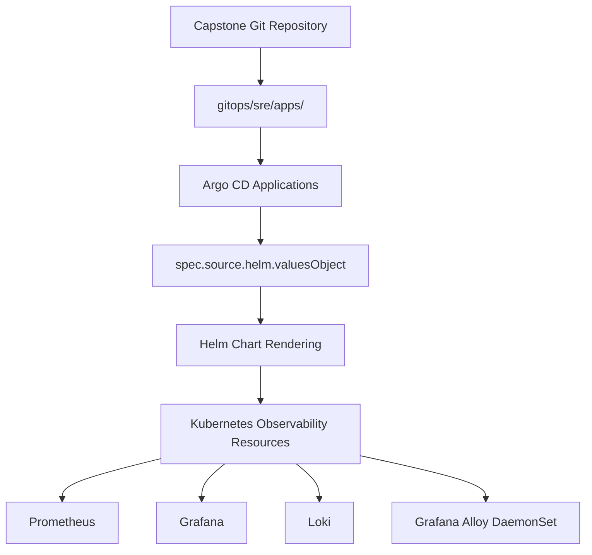
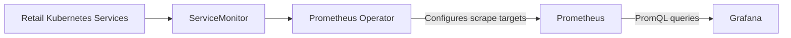
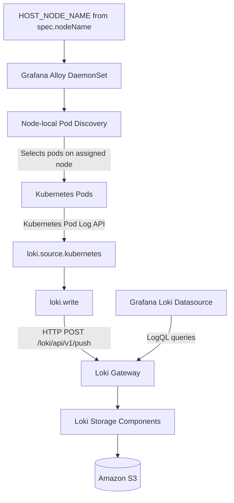

# Capstone SRE — Helm Configuration References

## Overview

The Capstone observability stack is managed declaratively through **Argo CD, Helm, and Kubernetes**, with Git serving as the source of truth for the desired configuration.

Active Helm configurations are maintained directly within the Argo CD Application manifests under `gitops/sre/apps/`, using `spec.source.helm.valuesObject`.

This directory retains supporting documentation rather than duplicate Helm values files.

## Observability Components

| Component | Responsibility | Active Configuration |
|---|---|---|
| Prometheus | Scrapes application and Kubernetes workload metrics through Operator-managed monitoring resources | `gitops/sre/apps/prometheus-stack.yaml` |
| Grafana | Visualises Prometheus metrics, Loki logs, dashboards, and service health | `gitops/sre/apps/prometheus-stack.yaml` |
| Loki | Ingests, stores, and serves application logs, with Amazon S3 configured for object storage | `gitops/sre/apps/loki.yaml` |
| Grafana Alloy | Runs as a DaemonSet, discovers node-local Kubernetes pods, and forwards logs to Loki | `gitops/sre/apps/alloy.yaml` |

## Configuration Architecture

The following diagram illustrates how GitOps manages the observability stack.



**Configuration flow:** Git defines the desired state, Argo CD reconciles Application resources, and Helm renders the configured charts into Kubernetes resources.

## Runtime Observability Architecture

Configuration management and runtime telemetry collection are separate processes.

### Metrics — Prometheus to Grafana



Prometheus scrapes metrics from matching Kubernetes Service endpoints using configuration generated by the Prometheus Operator.

Grafana queries Prometheus to visualise workload health, availability, and performance.

Alloy's consolidated configuration is dedicated to log collection rather than duplicate Prometheus metrics scraping.

### Logs — Kubernetes to Alloy to Loki



Each Alloy DaemonSet instance receives its assigned Kubernetes node name through the Downward API.

The `HOST_NODE_NAME` environment variable is used to restrict pod discovery to that node, reducing duplicate log collection across Alloy instances.

The logging pipeline is:

`discovery.kubernetes` → `discovery.relabel` → `loki.source.kubernetes` → `loki.write` → Loki gateway → Loki storage components → Amazon S3.

Grafana queries Loki through its configured datasource. It does not receive logs directly from Alloy.

### Node-local Alloy Configuration

The following excerpt illustrates the node-local discovery configuration.

```yaml
controller:
  type: daemonset

alloy:
  extraEnv:
    - name: HOST_NODE_NAME
      valueFrom:
        fieldRef:
          fieldPath: spec.nodeName

  configMap:
    create: true
    content: |
      discovery.kubernetes "pods" {
        role = "pod"

        selectors {
          role  = "pod"
          field = "spec.nodeName=" + sys.env("HOST_NODE_NAME")
        }
      }
```

The complete log-processing and forwarding configuration is maintained in `gitops/sre/apps/alloy.yaml`.

## Storage Architecture

| Component | Storage Mechanism | Purpose |
|---|---|---|
| Prometheus | Kubernetes PVC backed by Amazon EBS gp3 | Persistent metrics data |
| Loki | Amazon S3 object storage | Persistent log storage |
| Grafana | Configured Prometheus and Loki datasources | Queries and visualises telemetry |
| Alloy | Kubernetes API-based pod log streaming | Collects and forwards logs |

The Prometheus configuration requests a 20Gi EBS-backed persistent volume. Loki declares an S3 storage backend in `ap-southeast-1`.

These declarations do not independently confirm that volumes are bound, S3 permissions are valid, or logs have been successfully persisted.

## Configuration Management

- **Single source of truth:** Active Helm settings are maintained within their respective Argo CD Application manifests.
- **No duplicated values:** Retired standalone Helm values files must not be treated as active deployment configuration.
- **Documentation ownership:** This directory retains supporting architecture and configuration references only.
- **Change control:** Configuration changes should undergo static validation, Helm rendering checks, and pull-request review before merge.
- **GitOps reconciliation:** Argo CD reconciles the desired configuration according to each Application's sync policy.
- **Operational boundaries:** Changes to shared EKS resources require appropriate coordination and approval.

## Deployment and Validation

The following validation activities have been performed locally for the Alloy configuration.

| Validation | Status |
|---|---|
| YAML syntax parsing | Passed |
| Helm chart rendering | Passed |
| DaemonSet resource generation | Verified |
| `HOST_NODE_NAME` environment variable injection | Verified in rendered manifests |
| Node-local discovery configuration presence | Verified in rendered configuration |
| Alloy River executable syntax validation | Pending |
| Argo CD synchronization and runtime health | Not verified |
| Loki log ingestion and S3 persistence | Not verified |

Static validation establishes that the configuration can be parsed and rendered. It does not establish successful deployment, runtime log ingestion, or observability service health.

Production or shared-cluster validation should be performed only after review and approval.

## Source of Truth

The following documents provide additional context:

- **`gitops/README.md`** — End-to-end GitOps architecture, source traceability, and telemetry pipelines.
- **`gitops/sre/README.md`** — SRE-specific monitoring, logging, alerting, storage, and operational documentation.
- **`gitops/sre/apps/`** — Active Argo CD Application manifests and inline Helm configuration.

This README serves as a supporting reference for the Capstone observability stack. It is not an independent deployment configuration source.
