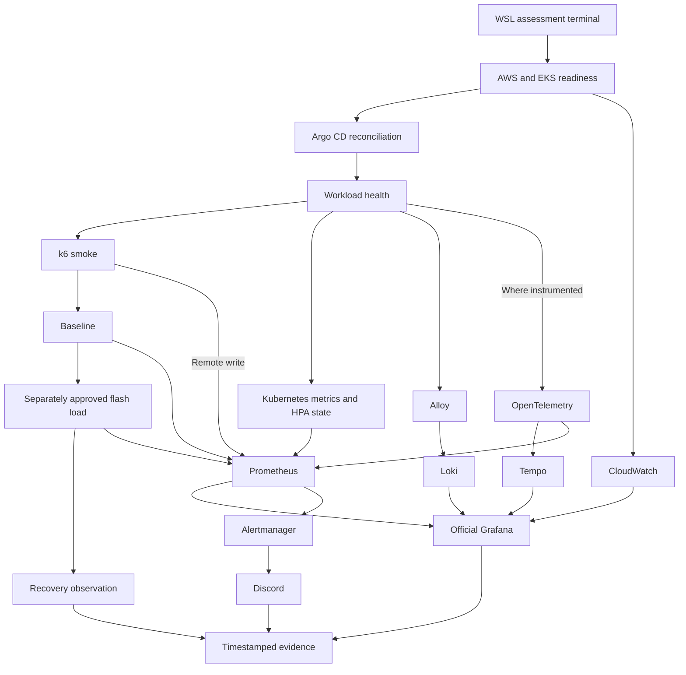
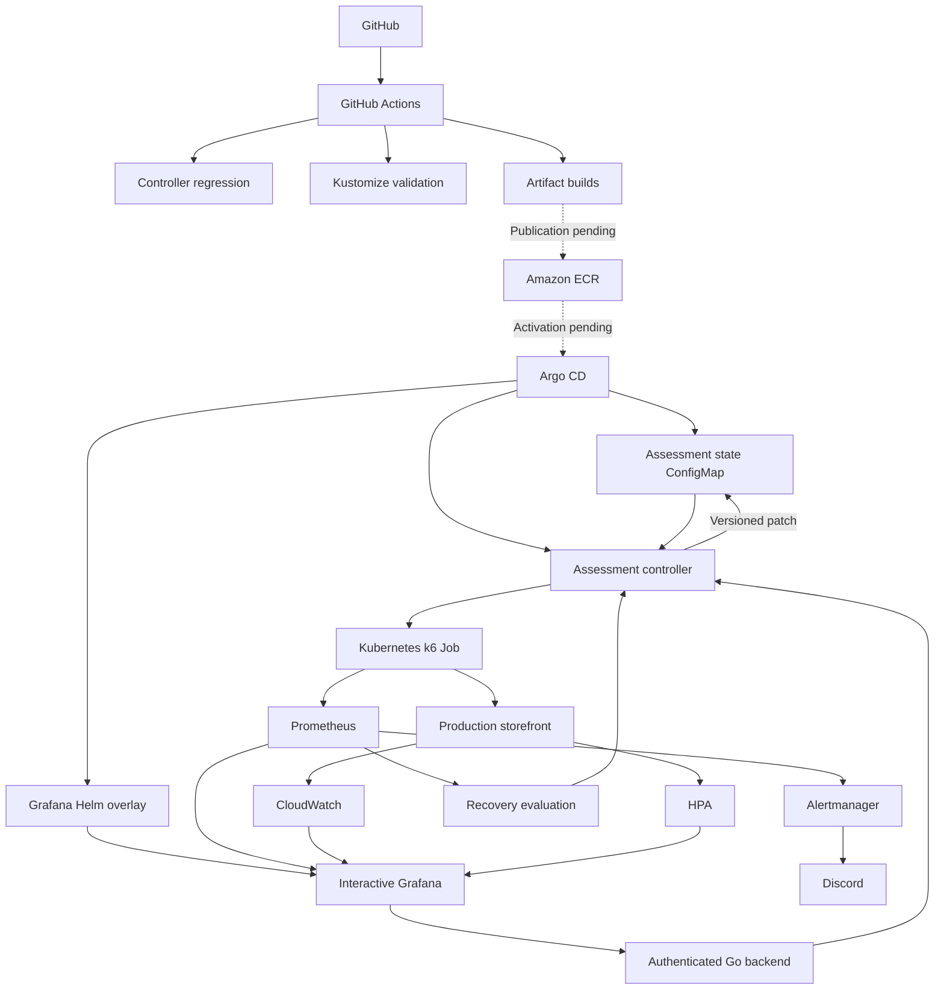

# Capstone SRE — k6 Load Testing

## Current assessment execution guide — 26 November 2026

Source baseline: `c88875400c4c7049217852b761f76ff5739c1858`.
See [platform architecture](../../README.md), [SRE code transitivity](../README.md) and [health report](health-report.md).
The original validation instructions remain below. Commands are operational examples, not automatically executed by this documentation generator.

### 1. Assessment workflow



### 2. Environment and safety

Region `ap-southeast-1`; cluster `group2-capstone-cluster`; production `retail-store`; staging `retail-staging`; monitoring `monitoring`; logging `logging`.
Production: https://group2-shop.sctp-sandbox.com/ ; staging: https://group2-retail-staging.sctp-sandbox.com/ .
Use approved staging only for load; obtain teammate authorization before testing and separate approval before flash load. Stop on instability, unexpected errors or cost increases. No Terraform apply/destroy or workload changes as part of read-only preflight.

### 3. Daily preflight

```bash
aws sts get-caller-identity
aws eks describe-cluster --name group2-capstone-cluster --region ap-southeast-1 --query 'cluster.{status:status,version:version}'
aws eks update-kubeconfig --name group2-capstone-cluster --region ap-southeast-1
kubectl config current-context
kubectl get nodes -o wide
kubectl get applications.argoproj.io -n argocd
kubectl get deploy,pods,svc,hpa -n retail-store
kubectl get deploy,pods,svc,hpa -n retail-staging
kubectl get deploy,sts,ds,pods,pvc -n monitoring
kubectl get deploy,sts,ds,pods,pvc -n logging
kubectl get pods -n opentelemetry-system
kubectl get externalsecrets -A
```

Refresh local kubeconfig after cluster rebuild. Stop if the cluster is unavailable; coordinate with infrastructure owner. Record sync and health independently, including degraded resources, readiness, restarts and PVC binding.

### 4. Storefront checks

```bash
curl -fsS -o /dev/null -w 'HTTP=%{http_code} duration=%{time_total}s\n' https://group2-shop.sctp-sandbox.com/
curl -fsS -o /dev/null -w 'HTTP=%{http_code} duration=%{time_total}s\n' https://group2-retail-staging.sctp-sandbox.com/catalog
```

Manually verify browser rendering and catalog content. HTTP 200 alone does not prove a complete customer journey.

### 5. Prometheus connectivity

In a separate terminal:

```bash
kubectl port-forward -n monitoring svc/kube-prometheus-stack-prometheus 19090:9090 --address 127.0.0.1
```

```bash
curl -fsS http://127.0.0.1:19090/-/ready
curl -fsS http://127.0.0.1:19090/api/v1/status/flags | jq '.data["web.enable-remote-write-receiver"]'
curl -fsS http://127.0.0.1:19090/api/v1/targets | jq '[.data.activeTargets[].health] | group_by(.) | map({health:.[0],count:length})'
```

### 6. Controlled k6 testing

| Profile | Duration | Purpose |
|---|---|---|
| smoke | 40s | Connectivity and content |
| baseline | 5m | Reference performance |
| flash-demo | 10m | Approved baseline, 10x, 20x and recovery |

From repository root, after approval and endpoint verification:

```bash
export TARGET_HOST=https://group2-retail-staging.sctp-sandbox.com
export CAPSTONE_PRODUCT_PATH=/catalog
export CAPSTONE_EXPECT_TEXT='These products are for demonstration purposes only'
export BASE_USERS=1
export K6_PROMETHEUS_RW_SERVER_URL=http://127.0.0.1:19090/api/v1/write
export K6_PROMETHEUS_RW_TREND_STATS='p(95)'
export ASSESSMENT_RUN="$(date +%Y%m%d-%H%M%S)"
export EVIDENCE="$HOME/capstone-demo-evidence/$ASSESSMENT_RUN"
mkdir -p "$EVIDENCE"
```

Direct invocation adds dashboard-compatible labels and separate summaries, unlike the stock runner. Reconfirm content marker before testing.

```bash
LOAD_PROFILE=smoke k6 run -o experimental-prometheus-rw --tag namespace=retail-staging --tag assessment_run="$ASSESSMENT_RUN-smoke" --summary-export="$EVIDENCE/k6-smoke-summary.json" gitops/sre/validate/k6/product-listing.js
```

Check thresholds and ingestion before proceeding:

```bash
curl -fsSG http://127.0.0.1:19090/api/v1/query --data-urlencode "query=k6_http_reqs_total{assessment_run=\"$ASSESSMENT_RUN-smoke\"}" | jq '.data.result'
```

If smoke passes and baseline is authorized:

```bash
LOAD_PROFILE=baseline k6 run -o experimental-prometheus-rw --tag namespace=retail-staging --tag assessment_run="$ASSESSMENT_RUN-baseline" --summary-export="$EVIDENCE/k6-baseline-summary.json" gitops/sre/validate/k6/product-listing.js
```

For flash use the existing approval-gated runner or reviewed local master runner only after separate authorization. Do not automatically escalate after failure. Stock runner overwrites `results/summary.json` and does not supply assessment-run tags; archive each result separately. VU multipliers do not guarantee RPS multipliers.

### 7. Performance evidence

```bash
curl -fsS http://127.0.0.1:19090/api/v1/label/__name__/values | jq -r '.data[] | select(startswith("k6_"))'
```

| Metric | Meaning |
|---|---|
| k6_http_reqs_total | Cumulative requests |
| k6_http_req_duration_p95 | Interval p95 in seconds |
| k6_http_req_failed_rate | HTTP failure ratio |
| k6_checks_rate | Check success ratio |
| k6_vus / k6_vus_max | Active / configured maximum VUs |
| k6_capstone_product_listing_duration_p95 | Product interval p95 |
| k6_capstone_product_listing_failed_rate | Product failure ratio |

PromQL examples (select actual run labels):

```promql
sum(rate(k6_http_reqs_total{namespace="retail-staging"}[1m]))
1000 * k6_http_req_duration_p95{namespace="retail-staging"}
100 * k6_http_req_failed_rate{namespace="retail-staging"}
```

Use whole-run k6 summary for threshold evaluation: HTTP p95 below 500ms, HTTP and product failure ratios below 1%. Interval p95 is not whole-run p95. Missing samples are not zero.

### 8. HPA and recovery

```bash
kubectl get hpa -n retail-staging
kubectl get pods -n retail-staging -o wide
kubectl top pods -n retail-staging
kubectl top nodes
```

Compare `kube_horizontalpodautoscaler_status_target_metric` and `kube_horizontalpodautoscaler_spec_target_metric` with `namespace="retail-staging",metric_name="cpu",metric_target_type="utilization"`; compare current and desired replicas using `kube_horizontalpodautoscaler_status_current_replicas` and `kube_horizontalpodautoscaler_status_desired_replicas`. CPU utilization is relative to requests, not limits. Record baseline, peak and recovery. Actual scale-out is not guaranteed; no scale-out below threshold can be valid.

### 9. Official Grafana

- [Health](https://group2-capstone-grafana.sctp-sandbox.com/d/capstone-sre-health)
- [HPA](https://group2-capstone-grafana.sctp-sandbox.com/d/capstone-hpa)
- [k6](https://group2-capstone-grafana.sctp-sandbox.com/d/capstone-k6)
- [All dashboards](https://group2-capstone-grafana.sctp-sandbox.com/dashboards)

Select correct namespace, assessment run and time range. Inspect Kubernetes, Loki, OTel, CloudWatch and Alertmanager dashboards. Capture actual results, not just dashboard existence.

### 10. Logs and traces

Loki Explore: `{namespace="retail-staging"}` or `{namespace="retail-store"}`. Tempo Explore: discover actual resource attributes and query traces for instrumented services. The supplied application ServiceMonitors and Instrumentation resource select production; staging coverage requires independent verification. Timestamp correlation does not prove trace-ID correlation.

### 11. CloudWatch

```bash
aws cloudfront list-distributions --query 'DistributionList.Items[].{Id:Id,Domain:DomainName}'
aws elbv2 describe-load-balancers --region ap-southeast-1 --query 'LoadBalancers[].{Name:LoadBalancerName,ARN:LoadBalancerArn}'
aws rds describe-db-instances --region ap-southeast-1 --query 'DBInstances[].{Id:DBInstanceIdentifier,Status:DBInstanceStatus}'
aws cloudwatch list-metrics --namespace AWS/ApplicationELB --metric-name RequestCount --region ap-southeast-1
aws cloudwatch list-metrics --namespace AWS/CloudFront --metric-name Requests --region us-east-1
```

Use current dimensions: CloudFront Requests and error rates (us-east-1, Region=Global); ALB RequestCount, TargetResponseTime, HealthyHostCount; WAF AllowedRequests and BlockedRequests; RDS CPUUtilization, DatabaseConnections, FreeableMemory. Discover WAF scope and region. Shared ALB metrics can aggregate environments; staging need not traverse production CloudFront. CLI discovery is not proof of Grafana IRSA metric retrieval. Verify actual datasource queries.

### 12. Alerts and Discord

```bash
kubectl get prometheusrules,alertmanagerconfigs -n monitoring
curl -fsS http://127.0.0.1:19090/api/v1/rules | jq '.data.groups[] | {name,rules:[.rules[] | {name,state,health}]}'
```

Prove rule evaluation -> pending -> firing -> Alertmanager -> Discord -> resolved notification (where enabled). Direct synthetic Alertmanager injection bypasses rule evaluation. Obtain approval for any synthetic alert or temporary rule; never deliberately destabilize shared workloads. Production-scoped rules need not fire during staging tests.

### 13. Evidence and automation

Record Git revision, timestamps, preflight, workload health, k6 summaries, current-run Prometheus samples, HPA observations, dashboard screenshots, Loki/Tempo/CloudWatch query results, alert lifecycle and recovery. Sanitize credentials, tokens, webhook URLs and sensitive logs before archiving.

```bash
tar -czf "$HOME/capstone-demo-evidence/Capstone-SRE-$ASSESSMENT_RUN.tar.gz" -C "$EVIDENCE" .
```

The separate local `$HOME/capstone-sre-master.sh` is not established as Git-managed at this revision. Review it and obtain authorization before invoking `bash "$HOME/capstone-sre-master.sh"`. Its intended ZIP output and execution stages must be verified from actual results. Stop local port-forwards when finished.

### 14. Completion register

| Capability | Evidence required |
|---|---|
| Infrastructure / GitOps | Active cluster, Ready nodes, revision, sync and health |
| Storefront | HTTP and manual content checks |
| Performance | k6 summaries and thresholds |
| Metrics | Current-run queryable samples |
| Autoscaling | CPU, target, replica and recovery observations |
| Logs / traces | Relevant streams and spans where instrumented |
| AWS monitoring | Actual Grafana CloudWatch query results |
| Notifications | Firing and resolved delivery, with test type identified |
| Reproducibility | Sanitized timestamped archive |

Use PASS, FAIL, REVIEW or SKIP based on evidence. Never mark an untested capability PASS.

### 15. Reconciled notification and incident validation

**Source revision:** `4d7cba52913080f342273512180aa18090e90eea`.

The newer routing configuration is documented in
[SRE Section S.12](../README.md). Earlier assessment evidence
remains associated with its original observation time.

#### 15.1 Read-only configuration and readiness checks

```bash
kubectl get prometheusrules -n monitoring
kubectl get alertmanagerconfigs -n monitoring
kubectl get externalsecret devops-agent-webhook -n monitoring
kubectl get clustersecretstore aws-secrets-manager

kubectl get externalsecret devops-agent-webhook -n monitoring \
  -o jsonpath='{.status.conditions}'

kubectl get secret devops-agent-webhook -n monitoring \
  -o custom-columns=NAME:.metadata.name,TYPE:.type

kubectl get secret sre-monitoring-discord-webhook -n monitoring \
  -o custom-columns=NAME:.metadata.name,TYPE:.type

kubectl get priorityclass prod-critical staging-low

kubectl get pods -n retail-store \
  -o custom-columns=NAME:.metadata.name,PRIORITY:.spec.priorityClassName

kubectl get pods -n retail-staging \
  -o custom-columns=NAME:.metadata.name,PRIORITY:.spec.priorityClassName
```

Do not decode or print webhook credentials.

Inspect the deployed rule expression and receiver matchers
without retrieving secret values:

```bash
kubectl get prometheusrule capstone-sre-alerts -n monitoring \
  -o json | jq '.spec.groups[].rules[] |
  select(.alert == "RetailStoreHighCPUUsage" or
         .alert == "RetailStoreContainerOOMKilled") |
  {alert,expr,for,labels}'

kubectl get alertmanagerconfig capstone-discord-routing \
  -n monitoring -o json | jq '.spec.route'
```

#### 15.2 AWS Lambda configuration checks

Use the authorized AWS account and region.

```bash
aws lambda get-function-configuration \
  --function-name group2-capstone-devops-agent-relay \
  --region ap-southeast-1 \
  --query '{Runtime:Runtime,Handler:Handler,Timeout:Timeout,State:State,LastUpdateStatus:LastUpdateStatus}'

aws lambda get-function-url-config \
  --function-name group2-capstone-devops-agent-relay \
  --region ap-southeast-1 \
  --query '{AuthType:AuthType,InvokeMode:InvokeMode}'
```

These queries intentionally omit environment variables and
the actual Function URL.

Check approved CloudWatch Lambda invocation, error and
duration metrics. Review sanitized logs only when authorized.

#### 15.3 Notification evidence matrix

| Test | Required observation |
|---|---|
| Warning | Discord delivery |
| Eligible critical | Discord delivery and relay invocation |
| Excluded critical alert name | Discord without DevOps Agent routing |
| Unmatched severity | No delivery through this configuration subtree |
| Resolved alert | Corresponding resolved notification where enabled |
| DevOps Agent | Actual incident receipt and investigation evidence |
| Recovery | Alert cleared and workload health restored |

These are expected outcomes from configuration, not test results.

Any synthetic alert requires explicit approval because a
critical test may create a real DevOps Agent incident.

Direct Alertmanager injection validates routing only.
A complete rule-driven demonstration must establish the
Prometheus expression, pending state, firing state,
Alertmanager receipt, delivered notification and resolution.

Do not deliberately destabilize production workloads.

#### 15.4 Evidence interpretation

Record the Git revision, current deployment revision,
alert name, severity, timestamps, receiver outcome,
Lambda invocation evidence and incident status.

Distinguish:

- Configuration present.
- Rule evaluated.
- Alert fired.
- Notification delivered.
- Incident accepted.
- Investigation completed.
- Recovery verified.

Mark each stage independently as PASS, FAIL, REVIEW or SKIP.
Do not infer successful RCA from an HTTP response alone.


---

## Original k6 validation documentation


## Architecture

k6 generates HTTP traffic against the approved Capstone retail application.
The existing Prometheus stack can receive k6 metrics through Remote Write when explicitly enabled and correctly configured. Successful ingestion must be verified.
The existing Grafana dashboard visualizes application performance.

## Scripts

- `k6/product-listing.js` — product-listing scenario and thresholds.
- `k6/run.sh` — test runner with optional Prometheus Remote Write.
- `k6/results/` — local test evidence; do not commit.

## Load Profiles

| Profile | Description |
|---|---|
| smoke | 1 virtual user, approximately 40 seconds |
| baseline | Configurable baseline, approximately 5 minutes |
| flash-demo | Baseline, 10x, 20x, recovery; approximately 10 minutes |

BASE_USERS defaults to 1 and must be between 1 and 10.
Virtual-user multipliers do not guarantee equivalent RPS multipliers.

## Configuration

- TARGET_HOST: approved staging application URL.
- CAPSTONE_PRODUCT_PATH: verified product-listing route.
- LOAD_PROFILE: smoke, baseline or flash-demo.
- BASE_USERS: baseline virtual users.
- CAPSTONE_LOAD_APPROVED=YES: required for flash-demo.
- CAPSTONE_K6_REMOTE_WRITE=YES: enable Prometheus export.
- K6_PROMETHEUS_RW_SERVER_URL: authorized remote-write endpoint.
- K6_PROMETHEUS_RW_TREND_STATS: runner exports p(95) when remote write is enabled.

## Execution

From this directory, after verifying the target and obtaining approval:

    export TARGET_HOST=https://YOUR-APPROVED-STAGING-HOST
    export CAPSTONE_PRODUCT_PATH=/YOUR-VERIFIED-PATH
    LOAD_PROFILE=smoke BASE_USERS=1 ./k6/run.sh

For an approved flash-sale demonstration:

    CAPSTONE_LOAD_APPROVED=YES LOAD_PROFILE=flash-demo BASE_USERS=1 ./k6/run.sh

## Monitoring and Evidence

- Actual requests per second and achieved load multiplier.
- Product-listing p95 latency below 500 milliseconds.
- HTTP failure rate below 1 percent.
- Baseline, peak and recovery measurements.
- HPA desired/current replicas when HPA is enabled.
- Pod readiness, node capacity, CPU and memory.
- Timestamped evidence of recovery after peak load.

Verify exported Prometheus metric names before adding Grafana queries.
Configuration validation alone does not prove successful metrics ingestion.

## Safety

Run only against approved staging endpoints with teammate authorization.
Start with one virtual user. Use synthetic data.
Stop immediately if unexpected errors, instability or cost increases occur.
Do not commit credentials, sensitive data or generated test results.

## Interactive SRE Mission Control — engineering traceability

The [engineering code transitivity guide](docs/code-transitivity.md) maps the current working-tree source from infrastructure and GitOps through Grafana controls, controller execution, k6 instrumentation, Prometheus, recovery and alerting. It includes exact source lines, syntax and subsystem Mermaid diagrams.

Normal: five minutes at baseline concurrency. 11:11: five minutes of staged 10× and 20× concurrency. Recovery: five to ten minutes at baseline concurrency. These are catalog-only assessments, not purchase simulations. The shared Grafana instance is the intended operator interface; local build validation does not establish shared runtime readiness.

See the guide's release blockers before activation. Existing historical evidence remains unchanged.

<!-- CAPSTONE-SRE-INTERACTIVE-START -->

## Interactive SRE assessment automation

The implementation extends the existing Capstone
GitOps and observability architecture.

- Normal Sale: five minutes at baseline traffic.
- 11:11 Flash Sale: five minutes with 10x and 20x stages.
- Recovery: five to ten minutes at baseline traffic.
- Application recovery target: within five minutes.
- Product listing p95 target: below 500 ms.
- HTTP and content failure targets: below 1%.
- Shared production target: retail-store via CloudFront.
- Shared Grafana controls and run-specific telemetry.
- Existing Prometheus, Alertmanager and Discord routing.
- Bounded recurrence and authenticated Start/Stop controls.

### Engineering traceability

- [Exact source-line map](docs/engineering-source-map.md)
- [Detailed code transitivity and Mermaid diagrams](docs/code-transitivity.md)

### Implementation status

Source implementation and local validation are distinct
from deployment readiness.

Signing, ECR publication, secure Helm provisioning,
Argo CD activation and shared runtime validation remain
pending. No production load or infrastructure mutation
is performed by the local validation script.

<!-- CAPSTONE-SRE-INTERACTIVE-END -->

<!-- CAPSTONE-ADR-ALIGNMENT -->

## Group 2 architecture alignment

The interactive assessment implementation extends the existing
Capstone architecture without replacing shared Grafana access,
authentication, ingress, Prometheus or alert routing.

Authoritative architecture decisions:

- [SRE and Observability ADR](../../../../docs/adr/0002-sre-architecture.md)
- [Infrastructure CI/CD ADR](../../../../docs/adr/0003-infra-cicd.md)

Normal Sale and 11:11 assessments retain Argo CD self-healing.
No fault injection or application configuration mutation is required.

Container distribution uses immutable image tags and ECR lifecycle
policies. CI publication remains separate from GitOps activation.

Existing Discord and AWS DevOps Agent routing remains authoritative.
Notifications depend on actual alert conditions.

The interactive dashboard remains isolated until its controller
and Grafana plugins are installed and validated.

Source validation does not constitute live deployment evidence.

<!-- BEGIN FINAL SECURITY ARCHITECTURE -->

## Final security and GitOps architecture



### Operational contracts

- Existing Grafana credentials and URL remain unchanged.
- Original Mission Control dashboard is preserved.
- Interactive automation uses an independent dashboard.
- Argo CD provisions initial assessment state.
- Controller state uses named patch permissions.
- Concurrent writes use resourceVersion protection.
- Runtime state is excluded from Argo CD reconciliation.
- Arbitrary ConfigMap creation is prohibited.
- Existing infrastructure IAM permissions are unchanged.
- Artifact publication remains disabled.
- Namespace-wide Job creation requires admission review.

### Assessment parameters

| Parameter | Configuration |
|---|---|
| Normal Sale | 5 minutes at baseline |
| 11.11 Flash Sale | 5 minutes, 10x and 20x stages |
| Recovery observation | 5-10 minutes |
| Recovery objective | Within 5 minutes |
| Product listing p95 | Below 500 ms |
| HTTP failure rate | Below 1% |
| Content failure rate | Below 1% |
| Concurrent assessments | One cluster-wide |
| Maximum recurrence | 3 cycles |
| Production target | group2-shop.sctp-sandbox.com/catalog |

### Deployment evidence boundary

Local regression and source validation do not prove live deployment.
Hosted CI, signing, ECR publication, plugin activation,
live load execution and alert delivery remain pending.

- [Final security source map](docs/final-security-source-map.md)

<!-- END FINAL SECURITY ARCHITECTURE -->
