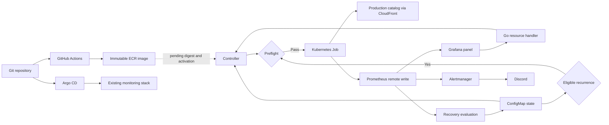
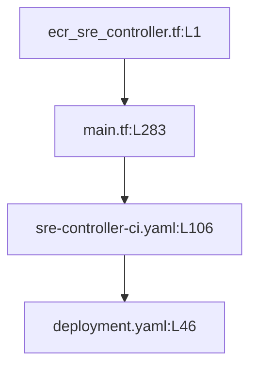
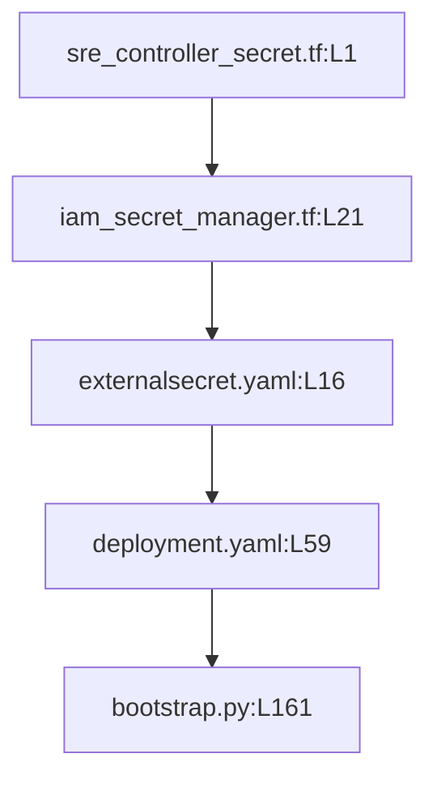
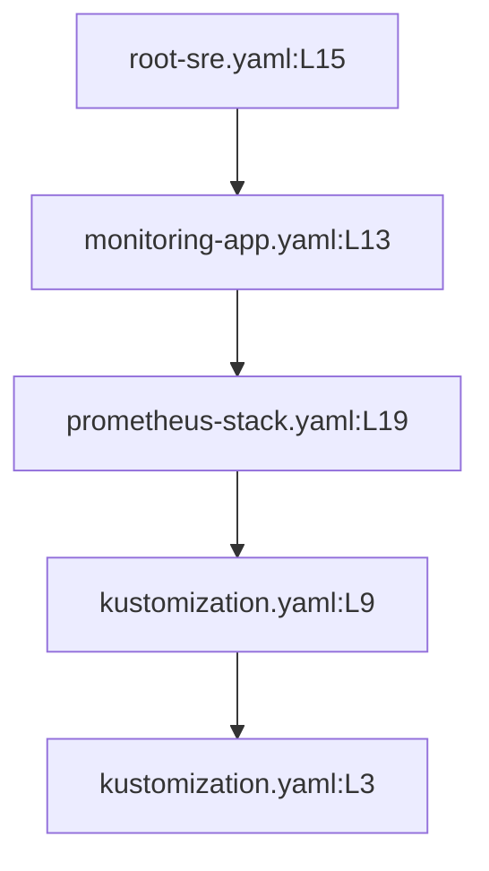
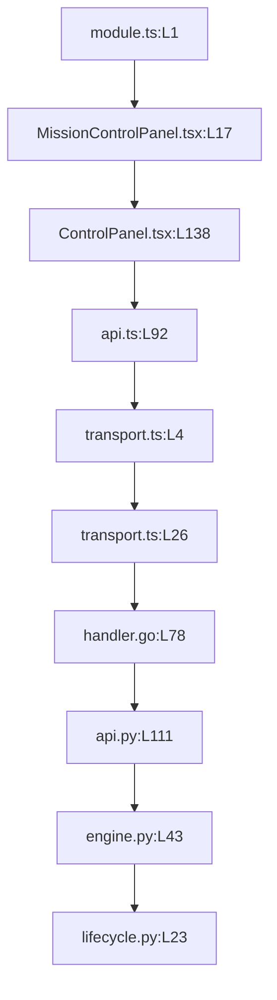
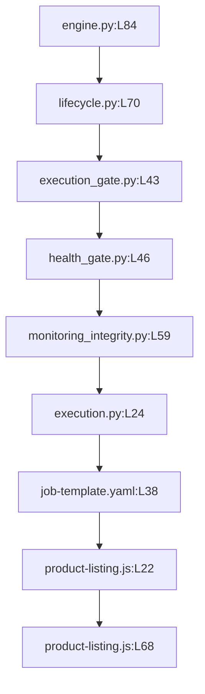
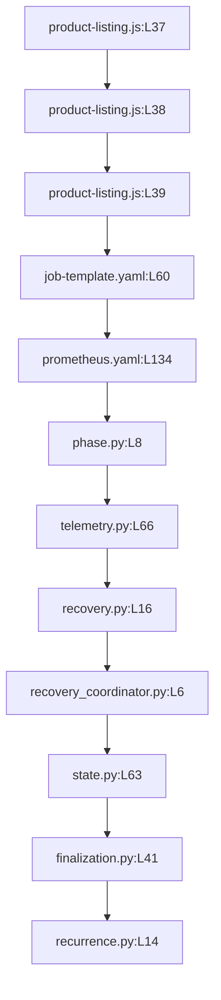
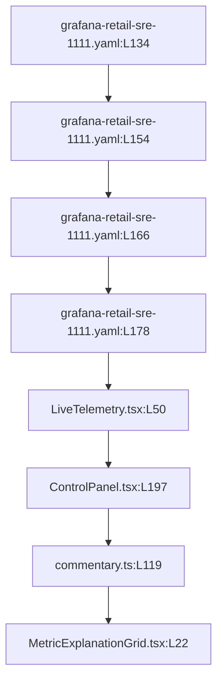
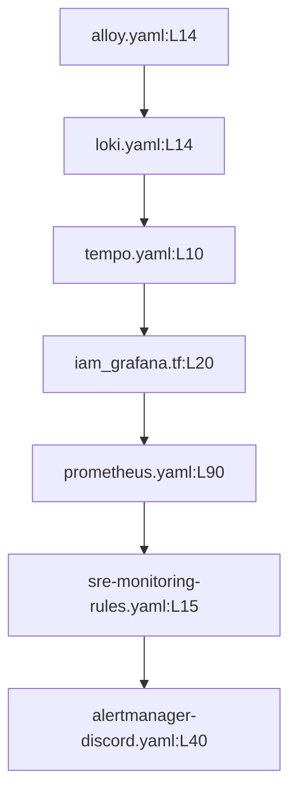

# Capstone — Engineering code transitivity

Snapshot: `fc286fd880ad723815cd0b8c367b6db278e78cbb` plus uncommitted branch changes. All line numbers refer to the supplied numbered source snapshot, not upstream main. Relative links assume this file is installed at `gitops/sre/validate/docs/code-transitivity.md`.

## Architecture and activation boundary

Solid arrows describe code contracts, not proof of live deployment. Dotted arrow marks a missing activation step.

## Infrastructure and publication

| Step | Source and exact syntax | Contract and downstream consequence |
|---|---|---|
| 1 | [`ecr_sre_controller.tf:1`](../../../../ecr_sre_controller.tf#L1) — `resource "aws_ecr_repository" "sre_controller" {` | Dedicated immutable registry |
| 2 | [`github-oidc-bootstrap/main.tf:283`](../../../../github-oidc-bootstrap/main.tf#L283) — `Sid    = "SREControllerECRPublishing"` | Scoped image publication permission; PR trust also inherits it |
| 3 | [`.github/workflows/sre-controller-ci.yaml:106`](../../../../.github/workflows/sre-controller-ci.yaml#L106) — `docker push "$IMAGE"` | Publish SHA-tagged image |
| 4 | [`gitops/sre/validate/manifests/deployment.yaml:46`](../manifests/deployment.yaml#L46) — `image: capstone-assessment-controller:dev` | Consumer still uses local placeholder; publication is not deployment |

The diagram is an inspection sequence; adjacent steps may be configuration dependencies or parallel checks rather than direct function calls.

## Secret delivery

| Step | Source and exact syntax | Contract and downstream consequence |
|---|---|---|
| 1 | [`sre_controller_secret.tf:1`](../../../../sre_controller_secret.tf#L1) — `resource "aws_secretsmanager_secret" "sre_controller_auth" {` | Secret metadata, not value |
| 2 | [`iam_secret_manager.tf:21`](../../../../iam_secret_manager.tf#L21) — `"arn:aws:secretsmanager:${var.aws_region}:${data.aws_caller_identity.current.account_id}:secret:${var.project_name}/sre/controller-auth-??????"` | ESO read permission |
| 3 | [`gitops/sre/validate/manifests/externalsecret.yaml:16`](../manifests/externalsecret.yaml#L16) — `remoteRef:` | Fetch token into Kubernetes Secret |
| 4 | [`gitops/sre/validate/manifests/deployment.yaml:59`](../manifests/deployment.yaml#L59) — `secretKeyRef:` | Inject controller credential |
| 5 | [`gitops/sre/validate/controller/bootstrap.py:161`](../controller/bootstrap.py#L161) — `"CAPSTONE_CONTROLLER_TOKEN", ""` | Read server-side token |

The diagram is an inspection sequence; adjacent steps may be configuration dependencies or parallel checks rather than direct function calls.

## GitOps ownership

| Step | Source and exact syntax | Contract and downstream consequence |
|---|---|---|
| 1 | [`gitops/root/root-sre.yaml:15`](../../../root/root-sre.yaml#L15) — `path: gitops/sre/apps` | Root application discovers child applications |
| 2 | [`gitops/sre/apps/monitoring-app.yaml:13`](../../apps/monitoring-app.yaml#L13) — `path: gitops/sre/observe` | Deploy dashboard ConfigMaps |
| 3 | [`gitops/sre/apps/prometheus-stack.yaml:19`](../../apps/prometheus-stack.yaml#L19) — `- $values/gitops/sre/values/prometheus.yaml` | Helm consumes values |
| 4 | [`gitops/sre/validate/kustomization.yaml:9`](../kustomization.yaml#L9) — `configMapGenerator:` | Package workload script and template; separate from controller manifests |
| 5 | [`gitops/sre/validate/manifests/kustomization.yaml:3`](../manifests/kustomization.yaml#L3) — `resources:` | Render controller resources; no owning Argo application shown |

The diagram is an inspection sequence; adjacent steps may be configuration dependencies or parallel checks rather than direct function calls.

## Interactive request

| Step | Source and exact syntax | Contract and downstream consequence |
|---|---|---|
| 1 | [`gitops/sre/validate/grafana-plugin/src/module.ts:1`](../grafana-plugin/src/module.ts#L1) — `import { PanelPlugin } from '@grafana/data';` | Register panel |
| 2 | [`gitops/sre/validate/grafana-plugin/src/MissionControlPanel.tsx:17`](../grafana-plugin/src/MissionControlPanel.tsx#L17) — `() => new AssessmentAPI(grafanaTransport),` | Construct API client |
| 3 | [`gitops/sre/validate/grafana-plugin/src/ControlPanel.tsx:138`](../grafana-plugin/src/ControlPanel.tsx#L138) — `function start(profile: Profile) {` | Construct request |
| 4 | [`gitops/sre/validate/grafana-plugin/src/api.ts:92`](../grafana-plugin/src/api.ts#L92) — `'/api/v1/start',` | Send start request |
| 5 | [`gitops/sre/validate/grafana-plugin/src/transport.ts:4`](../grafana-plugin/src/transport.ts#L4) — `const RESOURCE_BASE =` | Grafana resource route |
| 6 | [`gitops/sre/validate/grafana-plugin/src/transport.ts:26`](../grafana-plugin/src/transport.ts#L26) — `url: &#96;${RESOURCE_BASE}${path}&#96;,` | Join fixed route with allowed path |
| 7 | [`gitops/sre/validate/grafana-backend/handler.go:78`](../grafana-backend/handler.go#L78) — `func (a *App) CallResource(` | Authorize Grafana user and proxy |
| 8 | [`gitops/sre/validate/controller/api.py:111`](../controller/api.py#L111) — `@app.post("/api/v1/start")` | Validate authenticated request |
| 9 | [`gitops/sre/validate/controller/engine.py:43`](../controller/engine.py#L43) — `def start_assessment(` | Serialize lifecycle operation |
| 10 | [`gitops/sre/validate/controller/lifecycle.py:23`](../controller/lifecycle.py#L23) — `def start(self, profile, base_users=1,` | Reserve assessment state |

The diagram is an inspection sequence; adjacent steps may be configuration dependencies or parallel checks rather than direct function calls.

## Preflight and execution

| Step | Source and exact syntax | Contract and downstream consequence |
|---|---|---|
| 1 | [`gitops/sre/validate/controller/engine.py:84`](../controller/engine.py#L84) — `def reconcile_once(self):` | Dispatch lifecycle state |
| 2 | [`gitops/sre/validate/controller/lifecycle.py:70`](../controller/lifecycle.py#L70) — `def reconcile_start(self):` | Evaluate before execution |
| 3 | [`gitops/sre/validate/controller/execution_gate.py:43`](../controller/execution_gate.py#L43) — `def evaluate(self):` | Combine health and monitoring checks |
| 4 | [`gitops/sre/validate/controller/health_gate.py:46`](../controller/health_gate.py#L46) — `class InfrastructureHealthGate:` | Inspect production and storefront |
| 5 | [`gitops/sre/validate/controller/monitoring_integrity.py:59`](../controller/monitoring_integrity.py#L59) — `class MonitoringIntegrityGate:` | Inspect scrape and rule integrity |
| 6 | [`gitops/sre/validate/controller/execution.py:24`](../controller/execution.py#L24) — `def start(self, profile, base_users=1,` | Instantiate Job from template |
| 7 | [`gitops/sre/validate/k6/job-template.yaml:38`](../k6/job-template.yaml#L38) — `image: grafana/k6:2.4.0` | Run k6 container |
| 8 | [`gitops/sre/validate/k6/product-listing.js:22`](../k6/product-listing.js#L22) — `const profiles = {` | Normal and flash schedules |
| 9 | [`gitops/sre/validate/k6/product-listing.js:68`](../k6/product-listing.js#L68) — `const response = http.get(host.replace(/\/+$/,'') + path, {timeout:'10s',redirects:0,tags:{name:'product_listing',assessment_phase:phase}});` | Read catalog only |

The diagram is an inspection sequence; adjacent steps may be configuration dependencies or parallel checks rather than direct function calls.

## Telemetry and recovery

| Step | Source and exact syntax | Contract and downstream consequence |
|---|---|---|
| 1 | [`gitops/sre/validate/k6/product-listing.js:37`](../k6/product-listing.js#L37) — `const productLatency = new Trend('capstone_product_listing_duration', true);` | Latency instrumentation |
| 2 | [`gitops/sre/validate/k6/product-listing.js:38`](../k6/product-listing.js#L38) — `const productFailure = new Rate('capstone_product_listing_failed');` | Content failure instrumentation |
| 3 | [`gitops/sre/validate/k6/product-listing.js:39`](../k6/product-listing.js#L39) — `const executionStart = new Gauge(` | Execution start instrumentation |
| 4 | [`gitops/sre/validate/k6/job-template.yaml:60`](../k6/job-template.yaml#L60) — `- name: K6_PROMETHEUS_RW_SERVER_URL` | Remote write destination |
| 5 | [`gitops/sre/values/prometheus.yaml:134`](../../values/prometheus.yaml#L134) — `enableRemoteWriteReceiver: true` | Enable receiver |
| 6 | [`gitops/sre/validate/controller/phase.py:8`](../controller/phase.py#L8) — `class PhaseDetector:` | Determine phase from actual start |
| 7 | [`gitops/sre/validate/controller/telemetry.py:66`](../controller/telemetry.py#L66) — `def recovery_observation(self, run_id, now=None):` | Read recovery-only samples |
| 8 | [`gitops/sre/validate/controller/recovery.py:16`](../controller/recovery.py#L16) — `class RecoveryEvaluator:` | Evaluate sustained health |
| 9 | [`gitops/sre/validate/controller/recovery_coordinator.py:6`](../controller/recovery_coordinator.py#L6) — `class RecoveryCoordinator:` | Persist recovery decision |
| 10 | [`gitops/sre/validate/controller/state.py:63`](../controller/state.py#L63) — `resource_version=resource_version,` | Optimistic concurrency |
| 11 | [`gitops/sre/validate/controller/finalization.py:41`](../controller/finalization.py#L41) — `def archive_assessment(state, now):` | Archive outcome |
| 12 | [`gitops/sre/validate/controller/recurrence.py:14`](../controller/recurrence.py#L14) — `def eligible_for_repeat(state):` | Recurrence decision |

The diagram is an inspection sequence; adjacent steps may be configuration dependencies or parallel checks rather than direct function calls.

## Dashboard and explanation

| Step | Source and exact syntax | Contract and downstream consequence |
|---|---|---|
| 1 | [`gitops/sre/observe/grafana-retail-sre-1111.yaml:134`](../../observe/grafana-retail-sre-1111.yaml#L134) — `"type": "capstone-sremissioncontrol-panel",` | Custom panel placement |
| 2 | [`gitops/sre/observe/grafana-retail-sre-1111.yaml:154`](../../observe/grafana-retail-sre-1111.yaml#L154) — `"expr": "1000 * max(k6_capstone_product_listing_duration_p95{project=\"Capstone\",namespace=\"retail-store\",assessment_run=~\"${assessment_run:regex}\"} and (time() - timestamp(k6_capstone_product_listing_duration_p95{project=\"Capstone\",namespace=\"retail-store\",assessment_run=~\"${assessment_run:regex}\"}) <= 15))",` | A: latency milliseconds |
| 3 | [`gitops/sre/observe/grafana-retail-sre-1111.yaml:166`](../../observe/grafana-retail-sre-1111.yaml#L166) — `"expr": "100 * max(k6_http_req_failed_rate{project=\"Capstone\",namespace=\"retail-store\",assessment_run=~\"${assessment_run:regex}\"} and (time() - timestamp(k6_http_req_failed_rate{project=\"Capstone\",namespace=\"retail-store\",assessment_run=~\"${assessment_run:regex}\"}) <= 15))",` | B: HTTP failure percent |
| 4 | [`gitops/sre/observe/grafana-retail-sre-1111.yaml:178`](../../observe/grafana-retail-sre-1111.yaml#L178) — `"expr": "100 * max(k6_capstone_product_listing_failed_rate{project=\"Capstone\",namespace=\"retail-store\",assessment_run=~\"${assessment_run:regex}\"} and (time() - timestamp(k6_capstone_product_listing_failed_rate{project=\"Capstone\",namespace=\"retail-store\",assessment_run=~\"${assessment_run:regex}\"}) <= 15))",` | C: content failure percent |
| 5 | [`gitops/sre/validate/grafana-plugin/src/LiveTelemetry.tsx:50`](../grafana-plugin/src/LiveTelemetry.tsx#L50) — `frame => frame.refId === refId` | Bind data frame to metric |
| 6 | [`gitops/sre/validate/grafana-plugin/src/ControlPanel.tsx:197`](../grafana-plugin/src/ControlPanel.tsx#L197) — `locationService.partial({` | Update current browser dashboard parameters |
| 7 | [`gitops/sre/validate/grafana-plugin/src/commentary.ts:119`](../grafana-plugin/src/commentary.ts#L119) — `export function describeRecovery(` | Explain verified recovery |
| 8 | [`gitops/sre/validate/grafana-plugin/src/MetricExplanationGrid.tsx:22`](../grafana-plugin/src/MetricExplanationGrid.tsx#L22) — `{Object.entries(metricDefinitions).map(` | Render technical and layman definitions |

The diagram is an inspection sequence; adjacent steps may be configuration dependencies or parallel checks rather than direct function calls.

## Supporting observability

| Step | Source and exact syntax | Contract and downstream consequence |
|---|---|---|
| 1 | [`gitops/sre/apps/alloy.yaml:14`](../../apps/alloy.yaml#L14) — `chart: alloy` | Log collector Helm chart |
| 2 | [`gitops/sre/apps/loki.yaml:14`](../../apps/loki.yaml#L14) — `chart: loki` | Log storage Helm chart |
| 3 | [`gitops/sre/apps/tempo.yaml:10`](../../apps/tempo.yaml#L10) — `chart: tempo` | Trace backend |
| 4 | [`iam_grafana.tf:20`](../../../../iam_grafana.tf#L20) — `"cloudwatch:GetMetricData",` | CloudWatch metric read |
| 5 | [`gitops/sre/values/prometheus.yaml:90`](../../values/prometheus.yaml#L90) — `authType: default` | CloudWatch datasource authentication |
| 6 | [`gitops/sre/apps/sre-monitoring-rules.yaml:15`](../../apps/sre-monitoring-rules.yaml#L15) — `path: gitops/sre/monitoring # Match the exact folder containing alertmanager-discord.yaml & capstone-alerts.yaml` | Deploy rules and routing |
| 7 | [`gitops/sre/monitoring/alertmanager-discord.yaml:40`](../../monitoring/alertmanager-discord.yaml#L40) — `discordConfigs:` | Discord receiver configuration |

The diagram is an inspection sequence; adjacent steps may be configuration dependencies or parallel checks rather than direct function calls.

## Release blockers and evidence boundaries

- Controller Deployment still references `capstone-assessment-controller:dev`; immutable ECR digest and GitOps activation are pending.
- Grafana app/panel signing, secure app configuration and installation on the existing shared instance require runtime verification.
- Existing infra OIDC trust includes pull requests; main-only workflow condition does not restrict IAM credentials themselves. Review role boundary.
- Eight moderate npm findings remain; do not force downgrade Grafana dependencies.
- Existing dashboard purchase metrics are historical/unsupported by the catalog-only workload; do not present them as current measurements.
- HPA scaling and Discord notifications are conditional outcomes, not guaranteed results. CloudFront requests may be cached.
- No shared live assessment, actual alert delivery or recovery acceptance is established by this source snapshot.
- Original traceability generator fails on ambiguous RESOURCE_BASE anchor; declaration and template-literal usage are separate references above.

## Source inventory

| File | Numbered lines | SHA256 supplied in report |
|---|---:|---|
| `.github/workflows/infra-ci.yaml` | 169 | `77952237b8e4b81bed6cdfe36f8e976f8cb5c0bd8a289aec17f2f5af44aaa76b` |
| `.github/workflows/sre-controller-ci.yaml` | 120 | `bb895dd295d4a82264941e970c28fb63b19ee96b72066cfd30a44dffc2df9a47` |
| `.github/workflows/tf-cd.yaml` | 62 | `1347f09f7d2f321e707f6d87fb4a63b85116fe6344125424d691c2e337ca2552` |
| `ecr.tf` | 53 | `76d9ff905c2c2708bf97d89fbebdd03841a4572848d01f52c95f833aee47295e` |
| `ecr_sre_controller.tf` | 23 | `28a1c35f9b99c371e2f91eb9d7ff789df32a0061e1f45269e9a266cfeeee08d3` |
| `github-oidc-bootstrap/main.tf` | 1107 | `3607cd458335ce8f992c737e7c13b933c52d5389d9dbb4530be75b09352837a2` |
| `gitops/root/root-sre.yaml` | 31 | `21701482f82d6f27be8e580c5489b9d6f580aa7004c5412de3f8646f86d57512` |
| `gitops/sre/apps/alloy.yaml` | 81 | `e2e2bf0d13bbf24d6d7a514cecc30ae7fc73df98bb3164af5f18a15545c50c50` |
| `gitops/sre/apps/loki.yaml` | 162 | `2802fef22057536b42c6daca576060177c060671d9ac2bafd1d0aec59bf518e0` |
| `gitops/sre/apps/monitoring-app.yaml` | 25 | `d63906055e95cf6f62bc85abd14099cefaaf4a4f083dea2c20d4090260952cf3` |
| `gitops/sre/apps/otel-config.yaml` | 25 | `d3b6a19195accdcfa8aa68547ebea79258eb678204480065d0527deca8ad28f3` |
| `gitops/sre/apps/otel-operator.yaml` | 62 | `0f597babaa6c7b75719cb2b3ce91999f103980d9f9d73e87473aaaa3929e5102` |
| `gitops/sre/apps/prometheus-adapter.yaml` | 83 | `3f4a019e43330c1a3bc91f6309f1e3ad9d0f671f4a16adae941bd8f8abc013e6` |
| `gitops/sre/apps/prometheus-crds.yaml` | 24 | `f66a30c36d537319a93f76dcf932e785d0f5a6c0279d1e4c5521d4e124ec6cee` |
| `gitops/sre/apps/prometheus-stack.yaml` | 46 | `1c05749525037c9416360c8405d1d2dd9642729cc1e95fba7474866b23f834ce` |
| `gitops/sre/apps/sre-monitoring-rules.yaml` | 27 | `9e7614b3ab6b9360851e2cb6a2d5b77bf41469a9e542c032e9e35142e7a1d457` |
| `gitops/sre/apps/tempo.yaml` | 71 | `f807ef5a2659eea9472d42a7e9d39c019f0ccbbd825456314d88ff7d8b7a3d33` |
| `gitops/sre/monitoring/alertmanager-discord.yaml` | 51 | `d578cd0f62e6a182ba6e9fd56d4663d14b64df15d43b3d20dbddeaba426fcdbc` |
| `gitops/sre/monitoring/capstone-alerts.yaml` | 224 | `df7a6fe82d50d6438a3d70b8a40ce629e46d2d227354683f367b9a8139039fb8` |
| `gitops/sre/observe/grafana-dashboard.yaml` | 135 | `27bf727c1d944ce287f7e1cf14ded077797f0d75ecafa330af039d8cbfdac943` |
| `gitops/sre/observe/grafana-hpa-dashboard.yaml` | 910 | `085217b363ce68b7c629be2c7b2a0d4ce265b179a68b7fa25832bdc9a8944118` |
| `gitops/sre/observe/grafana-k6-dashboard.yaml` | 1957 | `e89d3c696f72c4bc95bd26f1e565d267b3ad53186bac0c335335f556400ee1ff` |
| `gitops/sre/observe/grafana-retail-sre-1111.yaml` | 3878 | `30e6e9365d3f7c3f19952b9a1d6dbcfa9be093db244184c6e7025971f94227a2` |
| `gitops/sre/observe/k8s-cluster-overview.yaml` | 284 | `b2b47c5e39acf058252b0f9d330b756c58646dbcd21e7bcf6b9f3091ba7eeebf` |
| `gitops/sre/observe/lightweight-apm-opentelemetry.yaml` | 2247 | `f4801f579563015124cdfa2984c4c2760a4847ed89e077fc6e4fe2e3acb5c7a0` |
| `gitops/sre/observe/logging-dashboard-via-loki.yaml` | 670 | `c74b3dc4aa79866fc40e268059e655453e2827922288be2ae28ef895ac703686` |
| `gitops/sre/observe/monitoring.yaml` | 117 | `07a0c852937317d6356b3b0036cc4cd05561f50a39424f841ab54c674232dbfd` |
| `gitops/sre/observe/opentelemetry-apm.yaml` | 567 | `034c5e367ae750637a02829ef130edbbf114dbc36a7ccee22680c10b68928ae0` |
| `gitops/sre/observe/otel-collector-dataflow-dashboard.yaml` | 477 | `d0fea46667b10139daab0e627346b2b4ad05d39f962715dd41e015d49ea354fa` |
| `gitops/sre/observe/otel-lgtm-observability.yaml` | 1519 | `14e02983a6d65a4660a47efd05b5386677b4a405ee033a5541205e9c59504c5c` |
| `gitops/sre/observe/p95-slo-dashboard.yaml` | 108 | `812cb22e6b1958290fd6a21b4b96b476edd0ab6c35981ba6c71722efc7a1ec59` |
| `gitops/sre/observe/prometheus-sli-queries.promql` | 23 | `ee8a893fd28e30844b3bfcabc3f7b3e7944a6cd2466a8fee5826cd90aaca2917` |
| `gitops/sre/projects/sre-project.yaml` | 50 | `63ba8bb79c944dc77b9017e40ca9c9a36f0d307b2eb83bb8a2dea88eb4baf6fc` |
| `gitops/sre/validate/README.md` | 414 | `b27b08b4293e43da9f96af83098b9b5b88cbad442f898c78ef01d9d5602388d1` |
| `gitops/sre/validate/controller/Dockerfile` | 30 | `8a5533e0dc443d5fe9f58762d6066ee14736de9e6a67253c39be66e858b2e7b0` |
| `gitops/sre/validate/controller/api.py` | 197 | `93a3648918ab21578609b2ea9ca4a1944a299f2cae78b73657e613cedccccc70` |
| `gitops/sre/validate/controller/bootstrap.py` | 186 | `0da2fda845728e0986bb0ba1bdad7a99ff0d4f7c37536251b74fde41569a4377` |
| `gitops/sre/validate/controller/engine.py` | 201 | `782b9d5eed4da7b1a0c0bfd045301eed5f9aaf706018fd9cd5e256619dd531cf` |
| `gitops/sre/validate/controller/execution.py` | 186 | `1b52b8018bef229f8a08070642075a6dff893304471db63f780845dd6b86ff90` |
| `gitops/sre/validate/controller/execution_gate.py` | 120 | `7684274aa2a8c4fb90ec93a914f3e6465d83475bdc12196ad41ee19fdca55d13` |
| `gitops/sre/validate/controller/finalization.py` | 216 | `9de0e4bbb55201e4ebf7e0cf89d49d8ea2245c720439eb28dd40c51e1bbf17f3` |
| `gitops/sre/validate/controller/health_gate.py` | 306 | `f356395a15c686e1ba2fabf31ef8660b0bf77b9fb148cf8f37dcffda066b1d6d` |
| `gitops/sre/validate/controller/lifecycle.py` | 368 | `d138bb3d0d21805e9b2ba638adb066cb33d78cb0d5958abac5642226eec2690a` |
| `gitops/sre/validate/controller/monitoring_integrity.py` | 299 | `2ed5cbef9069d17aaf5ee77d78a84596d109680cca8d077d52d6ae70947e38cf` |
| `gitops/sre/validate/controller/phase.py` | 83 | `a2be502ac10c0995c3ede1345af1a031c06e964cb3ed5ae2967887e26d1a1083` |
| `gitops/sre/validate/controller/recovery.py` | 112 | `f4be7a5e9f5918c69e69a6c38e3ec57f7887f02dff4a184189f14c634e3baa7e` |
| `gitops/sre/validate/controller/recovery_coordinator.py` | 94 | `36e47708e5996fc24dd024653770c0c0f4a8c5ff9f1110b0076ed7b677afa5da` |
| `gitops/sre/validate/controller/recurrence.py` | 57 | `c7755662ce461be7bf8100df5cc4ccb81b026eb2896ee1b1c5827692114a62d2` |
| `gitops/sre/validate/controller/requirements.txt` | 5 | `7ec5fd41edc3ee0a1150b0b237e9685e4a2786a86e9aa68421ebf1ed77f48286` |
| `gitops/sre/validate/controller/server.py` | 66 | `57ba3050c4ba67c8241a8affa2e1601ee5d74991de0b0fa31eef191ab1363160` |
| `gitops/sre/validate/controller/state.py` | 104 | `fc46681d31ead7851a6007e082093c606dadbff61ea1b82288121f44c81fc3d8` |
| `gitops/sre/validate/controller/telemetry.py` | 147 | `b788eb74fe1923c2ac356ba031a6983bd662a0875d8995efa03debbb4ebb338a` |
| `gitops/sre/validate/controller/tests/test_api.py` | 355 | `7fd5981e36c0253fe32f05f2067a8e1b7157bcbe9eb4b9dfdc7e869f40ba7581` |
| `gitops/sre/validate/controller/tests/test_bootstrap.py` | 229 | `ae812b28deb569f3fefa00e0efba1e5c4c872e96c3395b99b7eacc1964c46306` |
| `gitops/sre/validate/controller/tests/test_deployment_limits.py` | 77 | `4f8c42fce36b3818487f14307407d7a41ecea77cc5dd9cc2d42dc5ee91d9171d` |
| `gitops/sre/validate/controller/tests/test_engine.py` | 196 | `54ea72d271fded0ae911ce1e50c0470a5d593b2479d4235f138615255bad39b3` |
| `gitops/sre/validate/controller/tests/test_execution.py` | 237 | `73955258aba9b53f2bda658f30dc8b9cce82eb72d9bd8fa8c25d4f554fe5a7cb` |
| `gitops/sre/validate/controller/tests/test_execution_gate.py` | 240 | `9b75f9d56736bdf667c338b5a2ce9e6fa61c8bc0cc44963c7eca906940e2341c` |
| `gitops/sre/validate/controller/tests/test_finalization.py` | 263 | `5e3b3d52c206c0691c22284de3a04cb8100a20fb2ef4562be906485fc38fa862` |
| `gitops/sre/validate/controller/tests/test_health_gate.py` | 365 | `4a86de665beaea9b6bf7e96823bea4ceb441b18c35e42cb4362e047e61562871` |
| `gitops/sre/validate/controller/tests/test_lifecycle.py` | 154 | `7b613e0614cda2592da1d735c7f555b81e4966ce4777b69f51a1d5dcc4f732d1` |
| `gitops/sre/validate/controller/tests/test_monitoring_integrity.py` | 267 | `9730195d255e0a55858bae43b366fdfb5f7cca90cfb53e678b366537c92aaea7` |
| `gitops/sre/validate/controller/tests/test_phase.py` | 75 | `e7474f0c151b591f940c1e027c13445a25ab8b6652da4eb156c4b78531aaceed` |
| `gitops/sre/validate/controller/tests/test_recovery.py` | 121 | `b87dc895e950706c3d74168d5b541ff294b0fce301ba282f3a7e127854c3cb7c` |
| `gitops/sre/validate/controller/tests/test_recovery_coordinator.py` | 162 | `df4a26f9d3b260893cfad1a97a408869b40de0ff42b69ee57f5663510726567b` |
| `gitops/sre/validate/controller/tests/test_recurrence.py` | 162 | `f88cb2ee899c6ca89f423cbdc81cec5d4e36a8629c652dff2a3f049f37dc6808` |
| `gitops/sre/validate/controller/tests/test_repository_contract.py` | 210 | `2af99ff39bd316c3daefec37a66c4583a7b51b9fc4bb1dd4e7cee7d65cddc510` |
| `gitops/sre/validate/controller/tests/test_running_lifecycle.py` | 194 | `819f0fd6ab3411a97174ead645bbf7a89f6eddfd15d6cc163ebcba1a92619d07` |
| `gitops/sre/validate/controller/tests/test_state.py` | 133 | `b1a38114e8326106089c7f025d5b41a017a9d0320bba0fb4fbaab48d16102147` |
| `gitops/sre/validate/controller/tests/test_stop_lifecycle.py` | 168 | `d77fdca46afd58468ab1854a1b7e4f901fdfa53b08430737a3d1853446c8b976` |
| `gitops/sre/validate/controller/tests/test_telemetry.py` | 99 | `4206328116ca59ba2baeb55f2a72599f48d2ecbc599f5d4223bbde33a9bfa2cb` |
| `gitops/sre/validate/docs/generate-traceability.py` | 308 | `a50ccab07b18ea3e90b2708869f940f9fde1336443a2051fcdc991c9cf56b59e` |
| `gitops/sre/validate/grafana-backend/go-dev.sh` | 27 | `92fc020713df9cd7981dc9eba6310ba1a65d7c84e11ede3bafcd63d3c203466a` |
| `gitops/sre/validate/grafana-backend/handler.go` | 224 | `d5813e72ab164a361bf8b1f4c7704bc76279dc7ec7719e9daf0d5788682912c2` |
| `gitops/sre/validate/grafana-backend/handler_test.go` | 190 | `e6c8942eb5ac77242385b0d5dcb02222b9e112350855487deb5b83eef768b0b1` |
| `gitops/sre/validate/grafana-backend/main.go` | 32 | `eabd821eb704c9ba38caeae353a4dc3fafe5df8fe6e4c1fc5c5bd803e2675c70` |
| `gitops/sre/validate/grafana-backend/src/module.ts` | 3 | `ef552222dbd8b637bfb9b9f52432fb1584c2aac8debc6a024f2a548b014cf931` |
| `gitops/sre/validate/grafana-backend/src/plugin.json` | 23 | `73123790fbabc9a3d1ea38014d37fa856ab28161a3bce86118086c432924eb59` |
| `gitops/sre/validate/grafana-plugin/SECURITY-DECISION.md` | 48 | `a9b56e92ff128d5fa61459fb1ad518d57f203235afe8b4dffc53ab98da40028e` |
| `gitops/sre/validate/grafana-plugin/app-typescript-loader.cjs` | 27 | `48767e6af421d27bc686af1c6c472acbf45e1d66434d3bad999e562743c2a9d1` |
| `gitops/sre/validate/grafana-plugin/package.json` | 28 | `f42c63193e7581ef01c44044175bfa219b196a7cd33c6379f703ef944872f7f8` |
| `gitops/sre/validate/grafana-plugin/src/ControlPanel.tsx` | 415 | `b2fd83edfdec4c21b050742aabbeb41dcde9286c028f51acf88b7ae655ae378f` |
| `gitops/sre/validate/grafana-plugin/src/LiveTelemetry.tsx` | 184 | `30e2f179d8b28c4786cd19bb2037643bf95bfcbe085f9de373e16cf11e109d0f` |
| `gitops/sre/validate/grafana-plugin/src/MetricDefinitions.ts` | 90 | `7769e0f49e8e8826619f7626cc74703b1c0dc1cd4979ee6aec3e4d2f419c49a4` |
| `gitops/sre/validate/grafana-plugin/src/MetricExplanation.tsx` | 105 | `da93373ddf04c68e5af1cce6b1b7e7b9db1170119cfbc1cd0e86fa9fb88a5cd0` |
| `gitops/sre/validate/grafana-plugin/src/MetricExplanationGrid.tsx` | 47 | `b857681e8ef3ed8015d1fb4918f18fedeb04e29fe672dffe7140e86fa21d8a91` |
| `gitops/sre/validate/grafana-plugin/src/MissionControlPanel.tsx` | 33 | `e59fd369949c32f4919bbc3a9063095c8c73919ede237803f10e20a54fcc2db4` |
| `gitops/sre/validate/grafana-plugin/src/api.ts` | 108 | `e215e063f2fff138bcee8754cca0c309364bc24a6a364529fcc7f6ebaf254ea7` |
| `gitops/sre/validate/grafana-plugin/src/commentary.ts` | 151 | `2305a7ff3238ceb9654b4b19ef763369a77efa334e43cfd1b9921e5957e4e702` |
| `gitops/sre/validate/grafana-plugin/src/dashboardLinks.ts` | 39 | `eb003a0436eec88723071766db21e485b6cf6ef953e7a4aa1aa4c2301c2fac8b` |
| `gitops/sre/validate/grafana-plugin/src/module.ts` | 5 | `5af8183c06267b261d9e2f3f339a1ce64e6616e07217a011fae0f1b991047f09` |
| `gitops/sre/validate/grafana-plugin/src/plugin.json` | 22 | `e37e3283dea3cbe58b1ad5cdcd912f2d093655f22af1add0274cffc1fa331661` |
| `gitops/sre/validate/grafana-plugin/src/transport.ts` | 35 | `b298ff24fb9bb14f45121965b9b8bd22b1da32f77622d86a2eebdb97651ef5f5` |
| `gitops/sre/validate/grafana-plugin/tsconfig.json` | 14 | `651e98447638d9e28b48a9463cf9d9bd75d756ea922661683147c812abd1fdac` |
| `gitops/sre/validate/grafana-plugin/webpack.app.config.cjs` | 48 | `0199aaea759020e00c9b82b2e50a1d388b6cded6e16769ba58c717893def624b` |
| `gitops/sre/validate/grafana-plugin/webpack.config.cjs` | 66 | `860dd1c7073a8551876e1e11b137d28d52f8eb467d92d1f07a54b7c7a58598b7` |
| `gitops/sre/validate/health-report.md` | 408 | `c604e934e150e697bf752335ec746201da231d239aea4058c3975eca26010663` |
| `gitops/sre/validate/k6/job-template.yaml` | 85 | `6cf68f921b0083d12d917d44ca96eff75ce3ee15d30239ba8e8b4c913c56615e` |
| `gitops/sre/validate/k6/product-listing.js` | 75 | `fed28475bd75d1fc2c9f1e391308946be1cee69f615534f2857482b768069e06` |
| `gitops/sre/validate/k6/run.sh` | 42 | `c01a62f7d03d526d0c925e131396f891cbbe825e1586d2f3cfa4d584374ec67c` |
| `gitops/sre/validate/kustomization.yaml` | 13 | `b7390e1b75567ea13fca877534b1ab03c1989bd32c657567e58717019b77d1b4` |
| `gitops/sre/validate/manifests/deployment.yaml` | 105 | `b65c05ddddf3e3074aadcecadf06ffa1c978f4ec3262003706cb4e54beee92ac` |
| `gitops/sre/validate/manifests/externalsecret.yaml` | 18 | `e627cb5e1643b8a33f76e5d07777737c903230079e481798ce72729b93764dc6` |
| `gitops/sre/validate/manifests/kustomization.yaml` | 10 | `239ada962180b73898468a4983d1dd7081c03fa27080de86137acd91329ac493` |
| `gitops/sre/validate/manifests/production-reader.yaml` | 39 | `33bdb46de9eab060e1b7bf1ff560bf22acf1810f6564b8ea6be8a15361237b06` |
| `gitops/sre/validate/manifests/role.yaml` | 31 | `415ec5629fa916c27c9e4610aec42919f0479894060c5c2cda0540aff8f40911` |
| `gitops/sre/validate/manifests/rolebinding.yaml` | 13 | `edc10bdeaa8e369278eb1f88c8767733e93f1496653e0eb84f223ba9465ab575` |
| `gitops/sre/validate/manifests/service.yaml` | 17 | `9d4664484875a52e75c43d6be2c208ae5eda8c6a855467a840fb1597e17bd1dc` |
| `gitops/sre/validate/manifests/serviceaccount.yaml` | 9 | `ebb28d44d78a74044c5b978649bf444093dab20129c8eea7cdc0f00fb381d920` |
| `gitops/sre/validate/retail-sre-1111-dashboard-integration.md` | 105 | `3821fab038d440b65df3f5516c79e2b5adb329ab7da444b4081f64cb6ff7c3f3` |
| `gitops/sre/values/grafana-dashboards.yaml` | 35 | `32d39c50ba783c84701ca1887a3acc678b22f8e79d2e9e064d730bcb39ba8d4d` |
| `gitops/sre/values/prometheus.yaml` | 205 | `751e5c281c3b49db492afd48b9eebeeea1a31e122103b904b1ca7b7398a9a7cd` |
| `iam_external_dns.tf` | 74 | `b24fc47c3b3a9b1c155bd3f38814527026e777c4c34c30deb3e3d7137c151a1c` |
| `iam_grafana.tf` | 108 | `4b61f666cf2d57682b637ddeab1b9db943049e111b42a2417d9ab3419c4e727b` |
| `iam_secret_manager.tf` | 38 | `0670ee7eaf3ad2bf149c385e9c252c747f764be711d8298bc408a85c9786fbf5` |
| `sre_controller_secret.tf` | 10 | `9772997b489631b6d9efe301a0e203721b5d812c5121171e5491577d3ce2a5e2` |
