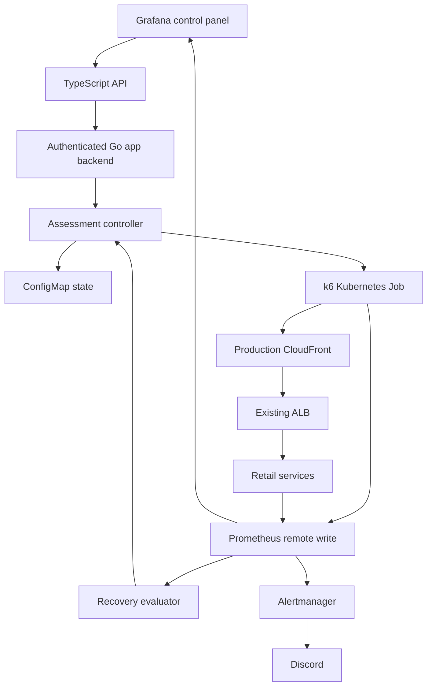
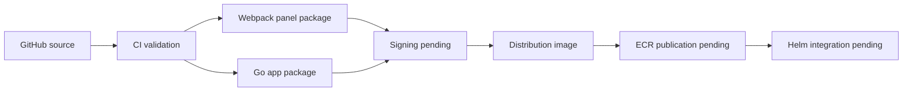

# Capstone — Engineering Source Map

Generated from the current working-tree source.

Line references identify actual syntax occurrences.
They do not independently prove runtime execution.

## End-to-end control and telemetry flow

## Build and distribution

## Grafana interaction

### `gitops/sre/validate/grafana-plugin/src/ControlPanel.tsx`

SHA256: `b2fd83edfdec4c21b050742aabbeb41dcde9286c028f51acf88b7ae655ae378f`

- [Line 144](../grafana-plugin/src/ControlPanel.tsx#L144): `api.start({`
- [Line 166](../grafana-plugin/src/ControlPanel.tsx#L166): `void execute(() => api.stop(runId));`
- [Line 197](../grafana-plugin/src/ControlPanel.tsx#L197): `locationService.partial({`

### `gitops/sre/validate/grafana-plugin/src/transport.ts`

SHA256: `b298ff24fb9bb14f45121965b9b8bd22b1da32f77622d86a2eebdb97651ef5f5`

- [Line 4](../grafana-plugin/src/transport.ts#L4): `const RESOURCE_BASE =`
- [Line 26](../grafana-plugin/src/transport.ts#L26): `url: '${RESOURCE_BASE}${path}',`
- [Line 25](../grafana-plugin/src/transport.ts#L25): `await getBackendSrv().datasourceRequest({`

### `gitops/sre/validate/grafana-plugin/src/commentary.ts`

SHA256: `2305a7ff3238ceb9654b4b19ef763369a77efa334e43cfd1b9921e5957e4e702`

- [Line 8](../grafana-plugin/src/commentary.ts#L8): `export function describeAssessment(`
- [Line 119](../grafana-plugin/src/commentary.ts#L119): `export function describeRecovery(`

## Authenticated backend

### `gitops/sre/validate/grafana-backend/handler.go`

SHA256: `d5813e72ab164a361bf8b1f4c7704bc76279dc7ec7719e9daf0d5788682912c2`

- [Line 59](../grafana-backend/handler.go#L59): `sender backend.CallResourceResponseSender,`
- [Line 67](../grafana-backend/handler.go#L67): `return sender.Send(&backend.CallResourceResponse{`
- [Line 78](../grafana-backend/handler.go#L78): `func (a *App) CallResource(`
- [Line 80](../grafana-backend/handler.go#L80): `req *backend.CallResourceRequest,`
- [Line 81](../grafana-backend/handler.go#L81): `sender backend.CallResourceResponseSender,`
- [Line 209](../grafana-backend/handler.go#L209): `return sender.Send(&backend.CallResourceResponse{`
- [Line 224](../grafana-backend/handler.go#L224): `var _ backend.CallResourceHandler = (*App)(nil)`
- [Line 156](../grafana-backend/handler.go#L156): `"Authorization", "Bearer "+a.token,`
- [Line 19](../grafana-backend/handler.go#L19): `controllerURL = "http://capstone-assessment-controller.monitoring.svc.cluster.local:8080"`
- [Line 39](../grafana-backend/handler.go#L39): `baseURL: controllerURL,`

### `gitops/sre/validate/grafana-backend/main.go`

SHA256: `eabd821eb704c9ba38caeae353a4dc3fafe5df8fe6e4c1fc5c5bd803e2675c70`

- [Line 17](../grafana-backend/main.go#L17): `token := settings.DecryptedSecureJSONData["controllerToken"]`
- [Line 23](../grafana-backend/main.go#L23): `err := app.Manage(`
- [Line 26](../grafana-backend/main.go#L26): `app.ManageOpts{},`

## Controller lifecycle

### `gitops/sre/validate/controller/api.py`

SHA256: `93a3648918ab21578609b2ea9ca4a1944a299f2cae78b73657e613cedccccc70`

- [Line 111](../controller/api.py#L111): `@app.post("/api/v1/start")`
- [Line 174](../controller/api.py#L174): `@app.post("/api/v1/stop")`

### `gitops/sre/validate/controller/lifecycle.py`

SHA256: `d138bb3d0d21805e9b2ba638adb066cb33d78cb0d5958abac5642226eec2690a`

- [Line 70](../controller/lifecycle.py#L70): `def reconcile_start(self):`
- [Line 162](../controller/lifecycle.py#L162): `def reconcile_running(self, now=None):`
- [Line 274](../controller/lifecycle.py#L274): `def request_stop(self, run_id):`

### `gitops/sre/validate/controller/execution.py`

SHA256: `1b52b8018bef229f8a08070642075a6dff893304471db63f780845dd6b86ff90`

- [Line 100](../controller/execution.py#L100): `self.batch.create_namespaced_job(`
- [Line 172](../controller/execution.py#L172): `self.batch.delete_namespaced_job(`

### `gitops/sre/validate/controller/state.py`

SHA256: `fc46681d31ead7851a6007e082093c606dadbff61ea1b82288121f44c81fc3d8`

- [Line 52](../controller/state.py#L52): `return state, resource.metadata.resource_version`
- [Line 54](../controller/state.py#L54): `def write(self, state, resource_version):`
- [Line 56](../controller/state.py#L56): `if not resource_version:`
- [Line 63](../controller/state.py#L63): `resource_version=resource_version,`
- [Line 88](../controller/state.py#L88): `return result.metadata.resource_version`

## Load testing and recovery

### `gitops/sre/validate/k6/product-listing.js`

SHA256: `fed28475bd75d1fc2c9f1e391308946be1cee69f615534f2857482b768069e06`

- [Line 39](../k6/product-listing.js#L39): `const executionStart = new Gauge(`
- [Line 62](../k6/product-listing.js#L62): `executionStart.add(`
- [Line 68](../k6/product-listing.js#L68): `const response = http.get(host.replace(/\/+$/,'') + path, {timeout:'10s',redirects:0,tags:{name:'product_listing',assessment_phase:phase}});`
- [Line 72](../k6/product-listing.js#L72): `productLatency.add(response.timings.duration, {name:'product_listing',assessment_phase:phase});`
- [Line 73](../k6/product-listing.js#L73): `productFailure.add(!ok, {name:'product_listing',assessment_phase:phase});`
- [Line 45](../k6/product-listing.js#L45): `thresholds: {`

### `gitops/sre/validate/controller/recovery.py`

SHA256: `f4be7a5e9f5918c69e69a6c38e3ec57f7887f02dff4a184189f14c634e3baa7e`

- [Line 16](../controller/recovery.py#L16): `class RecoveryEvaluator:`

### `gitops/sre/validate/controller/telemetry.py`

SHA256: `b788eb74fe1923c2ac356ba031a6983bd662a0875d8995efa03debbb4ebb338a`

- [Line 66](../controller/telemetry.py#L66): `def recovery_observation(self, run_id, now=None):`

### `gitops/sre/validate/controller/recurrence.py`

SHA256: `c7755662ce461be7bf8100df5cc4ccb81b026eb2896ee1b1c5827692114a62d2`

- [Line 14](../controller/recurrence.py#L14): `def eligible_for_repeat(state):`
- [Line 20](../controller/recurrence.py#L20): `state.get("repeat") is True`
- [Line 37](../controller/recurrence.py#L37): `if not eligible_for_repeat(state):`
- [Line 48](../controller/recurrence.py#L48): `"repeat": True,`

## Build and publication

### `.github/workflows/sre-controller-ci.yaml`

SHA256: `bb895dd295d4a82264941e970c28fb63b19ee96b72066cfd30a44dffc2df9a47`

- [Line 30](../../../../.github/workflows/sre-controller-ci.yaml#L30): `docker build \`
- [Line 101](../../../../.github/workflows/sre-controller-ci.yaml#L101): `docker build \`
- [Line 106](../../../../.github/workflows/sre-controller-ci.yaml#L106): `docker push "$IMAGE"`
- [Line 113](../../../../.github/workflows/sre-controller-ci.yaml#L113): `--query 'imageDetails[0].imageDigest' \`

### `.github/workflows/sre-plugins-ci.yaml`

SHA256: `05b9fbe02fd8d311a9ece15c33133f60e8ca93f867bbbedef6f1ca992ffb954d`

- [Line 42](../../../../.github/workflows/sre-plugins-ci.yaml#L42): `npm run build`
- [Line 53](../../../../.github/workflows/sre-plugins-ci.yaml#L53): `run: bash build.sh`
- [Line 71](../../../../.github/workflows/sre-plugins-ci.yaml#L71): `uses: actions/upload-artifact@v4`

### `gitops/sre/validate/grafana-backend/build.sh`

SHA256: `0d52c538b133dc20950d6452b3bf3767d83ee6ed499afdaf669b4e7f796e58de`

- [Line 9](../grafana-backend/build.sh#L9): `go test ./...`
- [Line 17](../grafana-backend/build.sh#L17): `go build \`

### `gitops/sre/validate/plugin-distribution/sign.sh`

SHA256: `03726bcbfc86de151437edb7d0fe8a313676f1cd48ba46fef33d7d7b180b566b`

- [Line 20](../plugin-distribution/sign.sh#L20): `--rootUrls "$ROOT_URL"`
- [Line 22](../plugin-distribution/sign.sh#L22): `test -s dist/MANIFEST.txt`

### `gitops/sre/validate/plugin-distribution/Dockerfile`

SHA256: `74399c832988753884ee9e0d9ebd36416d6d667aa24a8dcabd8e786516109f5e`

- [Line 3](../plugin-distribution/Dockerfile#L3): `COPY grafana-plugin/dist/ /opt/capstone/plugins/capstone-sremissioncontrol-panel/`
- [Line 4](../plugin-distribution/Dockerfile#L4): `COPY grafana-backend/dist/ /opt/capstone/plugins/capstone-srecontrol-app/`
- [Line 6](../plugin-distribution/Dockerfile#L6): `RUN test -s /opt/capstone/plugins/capstone-sremissioncontrol-panel/MANIFEST.txt`
- [Line 7](../plugin-distribution/Dockerfile#L7): `RUN test -s /opt/capstone/plugins/capstone-srecontrol-app/MANIFEST.txt`
- [Line 11](../plugin-distribution/Dockerfile#L11): `USER 472:472`

## Infrastructure

### `ecr_sre_controller.tf`

SHA256: `28a1c35f9b99c371e2f91eb9d7ff789df32a0061e1f45269e9a266cfeeee08d3`

- [Line 1](../../../../ecr_sre_controller.tf#L1): `resource "aws_ecr_repository" "sre_controller" {`
- [Line 22](../../../../ecr_sre_controller.tf#L22): `value       = aws_ecr_repository.sre_controller.repository_url`
- [Line 3](../../../../ecr_sre_controller.tf#L3): `image_tag_mutability = "IMMUTABLE"`

### `ecr_sre_plugins.tf`

SHA256: `df778170b5fd896f60bfb28652070dd408bd60a2771a57471208357f5b8f01bd`

- [Line 1](../../../../ecr_sre_plugins.tf#L1): `resource "aws_ecr_repository" "sre_plugins" {`
- [Line 22](../../../../ecr_sre_plugins.tf#L22): `value       = aws_ecr_repository.sre_plugins.repository_url`
- [Line 3](../../../../ecr_sre_plugins.tf#L3): `image_tag_mutability = "IMMUTABLE"`

### `sre_controller_secret.tf`

SHA256: `9772997b489631b6d9efe301a0e203721b5d812c5121171e5491577d3ce2a5e2`

- [Line 1](../../../../sre_controller_secret.tf#L1): `resource "aws_secretsmanager_secret" "sre_controller_auth" {`

### `github-oidc-bootstrap/main.tf`

SHA256: `68ae103f018e2c2f2227798df5e4fc986ab7c6f60c6eab79483c45eff88e30a2`

- [Line 283](../../../../github-oidc-bootstrap/main.tf#L283): `Sid    = "SREArtifactECRPublishing"`
- [Line 297](../../../../github-oidc-bootstrap/main.tf#L297): `"arn:aws:ecr:${var.aws_region}:${data.aws_caller_identity.current.account_id}:repository/${var.prefix}-sre-plugins"`

### `gitops/sre/values/prometheus.yaml`

SHA256: `751e5c281c3b49db492afd48b9eebeeea1a31e122103b904b1ca7b7398a9a7cd`

- [Line 134](../../values/prometheus.yaml#L134): `enableRemoteWriteReceiver: true`
- [Line 86](../../values/prometheus.yaml#L86): `- name: CloudWatch`

## Deployment evidence boundary

- Controller and plugin source prepared locally.
- Plugin signatures and ECR publication remain pending.
- Grafana Helm installation remains pending.
- Controller Argo CD activation remains pending.
- No production load was generated by this script.
- No AWS or Kubernetes resource was modified.
- Eight moderate npm findings remain documented.
- IAM pull-request trust requires team review.
