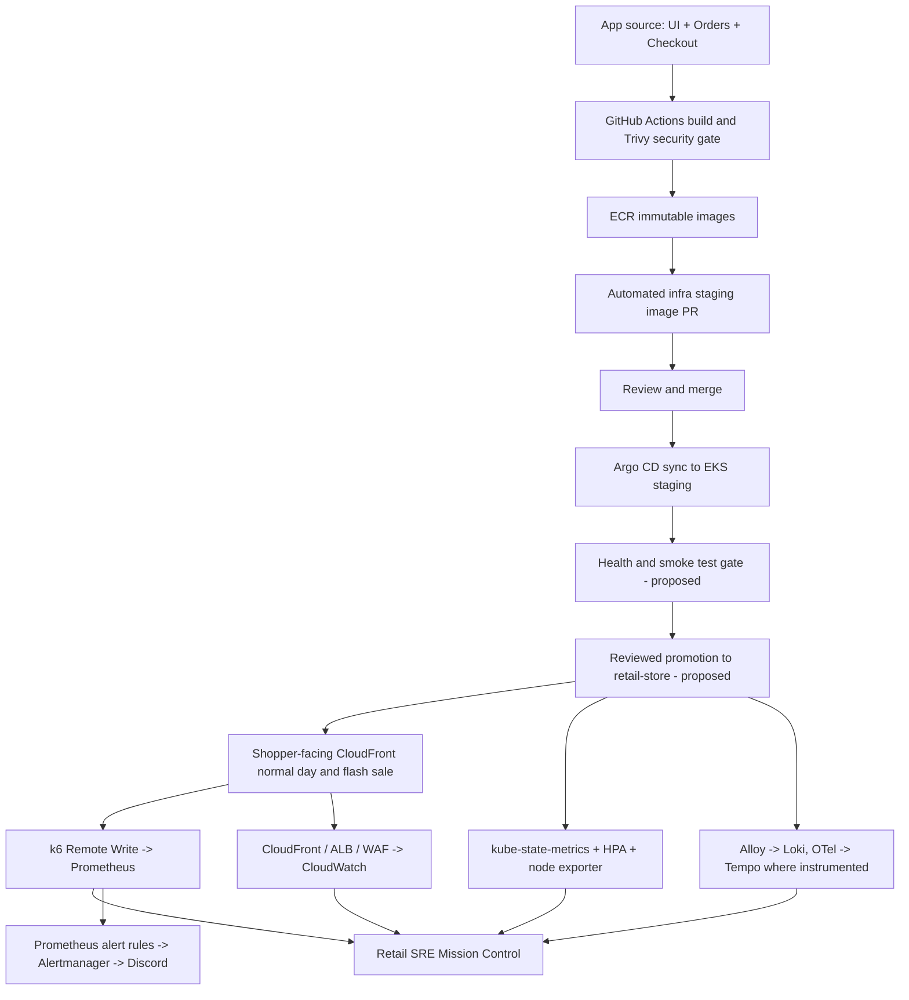

# Capstone — Retail SRE Mission Control | GitOps integration

## Verified repository architecture

- Application: https://github.com/eugenewongyj/cloud-ntu-capstone-group2-app
- Infrastructure: https://github.com/eugenewongyj/cloud-ntu-capstone-group2-infra
- `app/.github/workflows/build-ui.yaml`: push/dispatch builds UI image, pushes to ECR, opens **staging** image-update PR in infrastructure repo; `build-orders-checkout.yaml` builds orders and checkout, security-scans images and opens staging image-update PR.
- `app/src/load-generator/scenario.yml` implements **GET `/home`, `/catalog` and product**, **POST `/cart`**, **GET `/cart`**, **GET `/checkout`**, **POST `/checkout`, `/checkout/delivery`, `/checkout/payment`**. Cypress tests at `src/e2e/cypress/e2e/cart.cy.js` and `checkout.cy.js` define a browser purchase journey. The current k6 script in infra `gitops/sre/validate/k6/product-listing.js` sends only **GET `/catalog`**, not a real purchase.
- Production customer entry point: `https://group2-shop.sctp-sandbox.com`, **CloudFront distribution `EG61F5PSVL6LX`**, routing to ALB origin `group2-retail.sctp-sandbox.com`. Direct ALB returns **HTTP 403 by design** because the CloudFront-origin security header is missing; do not bypass WAF.
- `infra/gitops/sre/apps/monitoring-app.yaml`: Argo CD `capstone-monitoring` tracks **main** `/gitops/sre/observe` non-recursively and applies `*.yaml`, auto-sync/self-heal. `grafana_dashboard: "1"` selects ConfigMaps for dashboard sidecar. `infra/gitops/sre/values/prometheus.yaml` includes the Grafana CloudWatch, Loki and Tempo data sources, Prometheus remote-write receiver, **3-day retention**.

## Artifacts

- `gitops/sre/observe/grafana-retail-sre-1111.yaml`: complete provisioned Grafana ConfigMap, dashboard UID **`capstone-retail-sre-1111`**.
- `Capstone-Retail-SRE-1111-Dashboard.json`: manual Grafana import / inspection preview.

## Dashboard sections

1. **LIVE** EKS nodes, available/desired app replicas, restart/alert indicators, per-service and per-node health visuals.
2. **DEMAND** test-profile VUs, observed HTTP p95, failure ratio, checks, throughput and time-series trends (normal vs flash filters).
3. **PURCHASE** order confirmation success, checkout p95, and purchase funnel. **No data expected until the actual synthetic purchase test is implemented and verified.**
4. **USER EXPERIENCE** existing browser metrics: LCP, FCP, TTFB, CLS, navigation rate, failed resources.
5. **ELASTICITY** HPA current/desired/max replicas, native CPU utilization target and current values, scale timeline.
6. **AWS EDGE** CloudFront requests and 5xx error-rate via CloudWatch **us-east-1, Region=Global**. Data-source permissions and panel rendering must be tested live; these are total CloudFront requests, not solely k6 traffic.
7. **INCIDENT** critical alerts, unready replicas, HPA saturation, links to k6, HPA, Kubernetes, Loki/Tempo dashboards.

## Copy into existing feature branch, validate, and integrate

1. Download `Capstone-Retail-SRE-1111-GitOps.zip` from ChatGPT and place it in Windows Downloads.
2. On WSL, **stay on `feat/sre-automated-assessment`** and ensure the expected destination file does not already exist.
3. Run:

```bash
cd ~/capstone-sync/cloud-ntu-capstone-group2-infra
pwd
git branch --show-current
git status --short
unzip -l /mnt/c/Users/quahk/Downloads/Capstone-Retail-SRE-1111-GitOps.zip
test ! -e gitops/sre/observe/grafana-retail-sre-1111.yaml
unzip -n /mnt/c/Users/quahk/Downloads/Capstone-Retail-SRE-1111-GitOps.zip -d .
python3 -c 'import json,yaml; p="gitops/sre/observe/grafana-retail-sre-1111.yaml"; d=json.loads(yaml.safe_load(open(p))["data"]["capstone-retail-sre-1111.json"]); assert d["uid"]=="capstone-retail-sre-1111"; print("Dashboard panels",len(d["panels"]))'
kubectl apply --dry-run=client -f gitops/sre/observe/grafana-retail-sre-1111.yaml
git status --short
git diff --check
```

`kubectl apply --dry-run=client` only validates the manifest, **does not deploy it**. Confirm exact branch and paths. Use `git add -N` to include the untracked dashboard in a diff if needed. No Terraform, existing dashboard overwrite or cluster changes are necessary. **Do not commit, push or merge without explicit approval.**

4. After review/approval, commit just this dashboard and integration guide to a feature branch, push and open PR to infra `main`. When merged, Argo CD `capstone-monitoring` creates the ConfigMap, and Grafana's dashboard sidecar provisions the dashboard. Check Argo **Synced/Healthy** and Kubernetes ConfigMap `monitoring/capstone-retail-sre-1111-dashboard`.
5. Dashboard URL: `https://group2-capstone-grafana.sctp-sandbox.com/d/capstone-retail-sre-1111`. Note Grafana manual import with same UID could conflict with provisioned version; don't maintain a separate database copy indefinitely.

## End-to-end application and observability integration



App image builds and staging PR automation are **already present**. A post-sync k6 gate, test suite for purchase and production promotion are **not yet proven as automated**; do not claim they are already implemented. Keep SRE dashboards in infra GitOps, not app code. Source read only; no remote changes made.

## Making the purchase funnel real

**Do not run mass POST `/checkout/payment` until confirming deployed image behavior**. Inspect app source, environment configuration, synthetic payment support, whether an order can trigger external side effects and test-order cleanup. Build k6 `customer-purchase.js` with isolated cookie sessions, unique synthetic customers, validated cart count and actual order-confirmation assertion. Run **one synthetic order first**. Reuse proven app transaction contract, then compare a five-minute normal-day baseline against a bounded flash-sale ramp if the single-order test is safe and completes successfully. Review WAF limits and stop on 5xx/error surge.

Emit the following custom k6 metrics with tags `project=Capstone`, `namespace=retail-store`, `assessment_run=<ID>`, `test_profile=normal-day` or `flash-sale-1111`:

- `Counter("capstone_shopping_sessions")` → `k6_capstone_shopping_sessions_total`
- `Counter("capstone_cart_additions")` → `k6_capstone_cart_additions_total`
- `Counter("capstone_checkout_attempts")` → `k6_capstone_checkout_attempts_total`
- `Counter("capstone_orders_completed")` → `k6_capstone_orders_completed_total`
- `Counter("capstone_purchase_failures")` → `k6_capstone_purchase_failures_total`
- `Rate("capstone_purchase_success")` → `k6_capstone_purchase_success_rate`
- `Trend("capstone_purchase_duration", true)` → `k6_capstone_purchase_duration_p95` when `K6_PROMETHEUS_RW_TREND_STATS=p(95)`.

The dashboard's Purchase section deliberately displays **No data** until these exact metrics arrive. A 200 storefront page, HTTP count or completed browser navigation is **not** evidence of a purchase.

## Presentation checklist

- Verify CloudFront shopper hostname 200 (and protected direct ALB 403) without modifying WAF.
- Show live deployment availability, node status and HPA CPU target/replicas.
- Show normal-day baseline with stable performance and complete k6 run summary.
- Show 11.11 ramp with actual measured VU/RPS, error rate, p95 and observed scaling, if it occurs.
- Show real confirmed synthetic orders only after transaction validation; never invented success rates.
- Demonstrate CloudFront + CloudWatch request count and 5xx rate, and note CloudFront stats include non-test traffic.
- Correlate actual Loki logs, traces if instrumented, and delivered Discord alert if verified.
- Preserve screenshots, k6 JSON, Grafana exported evidence **within 3-day Prometheus retention**.
- Confirm GitOps ConfigMap deployed via Argo, not manual `kubectl apply`.

This package is generated and statically validated; **it has not been imported into a live Grafana instance or deployed to the cluster**. Validate every query before presentation.
