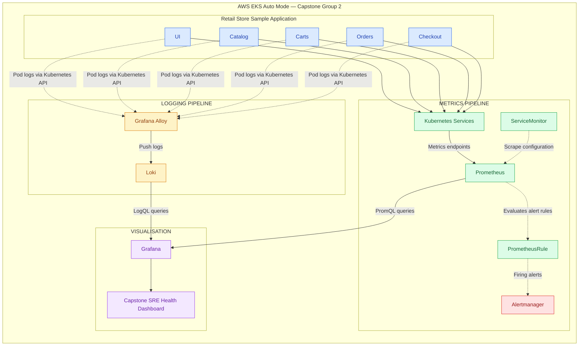

# Site Reliability Engineering (SRE)

This directory contains the Site Reliability Engineering workstream for **Capstone Group 2's AWS Retail Store Sample application**, deployed on Amazon EKS Auto Mode.

## Objective

Establish application reliability through observability, performance monitoring, service-level indicators (SLIs), service-level objectives (SLOs), alerting, and incident response.

The SRE implementation prioritises application health, operational visibility, and minimal disruption to the shared AWS infrastructure.

## Monitoring Approach

**Baseline → Logging & Metrics → SLOs → Alerting → Dashboards → Incident Response**

| Layer | Technology / Approach | Purpose |
|---|---|---|
| Baseline | AWS CLI / kubectl | Verify infrastructure, workload, and application health |
| Logging | Grafana Alloy / Loki | Collect, centralise, and investigate application logs |
| Metrics | Prometheus / ServiceMonitor | Collect application and Kubernetes workload metrics |
| Reliability | SLIs / SLOs | Define measurable availability and performance targets |
| Alerting | PrometheusRule / Alertmanager | Evaluate reliability conditions and route alerts |
| Visualisation | Grafana | Visualise application health, metrics, and logs |
| Incident response | Runbooks | Support diagnosis, escalation, and recovery |

## Observability Architecture

The proposed observability architecture separates metrics collection, application logging, alerting, and visualisation.



*Architecture status: Locally configured and validated; not yet deployed or integration-tested on the capstone EKS cluster.*

### Metrics Pipeline

`Application → Kubernetes Service → Prometheus → Grafana`

- ServiceMonitor defines which Kubernetes Services Prometheus should scrape.
- Prometheus collects metrics and evaluates configured PrometheusRule resources.
- Firing alerts are forwarded to Alertmanager for routing.
- Grafana queries Prometheus to visualise application and workload health.

### Logging Pipeline

`Application Pods → Grafana Alloy → Loki → Grafana`

- Alloy discovers matching application Pods through the Kubernetes API.
- Alloy collects container logs and forwards them to Loki.
- Loki stores and indexes log metadata for querying.
- Grafana queries Loki to support log investigation and troubleshooting.

**Technical decision:** Grafana Alloy was selected instead of the legacy Promtail agent because of its ongoing support, Kubernetes API-based log collection, and extensibility across logs, metrics, and traces.

The initial Alloy configuration uses a single-replica Deployment. Production resilience and collection performance remain subject to further evaluation.

## Key Reliability Requirements

- Monitor the five Retail Store Sample microservices: UI, Catalog, Carts, Orders, and Checkout.
- Measure product listing p95 latency against the 500 ms flash-sale requirement.
- Observe automatic scaling behaviour under increased traffic.
- Define at least two measurable SLIs/SLOs.
- Implement and validate at least two routed alerts.
- Centralise application logs with documented retention.
- Establish a baseline for application health before load and security testing.

## Implementation Status

**Phase 1 — SRE workspace initialisation: Completed**

Established the SRE workstream, monitoring objectives, documentation structure, and reliability requirements.

**Phase 2 — Observability configuration: Locally validated**

| Component | Implementation | Validation |
|---|---|---|
| Prometheus | Helm values and SLI queries | Helm rendering passed |
| Grafana | Five-panel health dashboard | JSON and datasource references validated |
| Loki | SingleBinary Helm configuration | Helm rendering passed |
| Grafana Alloy | Kubernetes Pod log collection | Helm and River validation passed |
| ServiceMonitor | Application metrics discovery manifests | YAML prepared; runtime discovery pending |
| PrometheusRule | Initial monitoring alert rule | YAML prepared; runtime evaluation pending |
| Dashboard ConfigMap | Automatic Grafana dashboard discovery | Embedded JSON and metadata validated |

**Phase 3 — EKS integration: Pending**

The following activities remain outstanding:

- Deploy the monitoring components to the approved capstone EKS environment.
- Verify application labels, ServiceMonitors, and metrics endpoints.
- Confirm end-to-end Alloy → Loki log ingestion.
- Validate Grafana dashboards using live application metrics.
- Review persistent storage and log retention.
- Configure and test Alertmanager notification receivers.
- Validate SLOs, alert thresholds, and incident response procedures.
- Confirm compatibility with EKS Auto Mode and shared infrastructure constraints.

## Repository Structure

```text
sre/
├── README.md
├── health-report.md
├── helm/
│   ├── README.md
│   ├── alloy/
│   │   └── alloy-values.yaml
│   ├── grafana/
│   │   └── dashboards/
│   │       └── capstone-health.json
│   ├── loki/
│   │   └── loki-values.yaml
│   └── prometheus/
│       ├── prometheus-values.yaml
│       └── prometheus-sli-queries.promql
├── kubernetes/
│   ├── README.md
│   ├── monitoring.yaml
│   └── grafana-dashboard-configmap.yaml
└── load-testing/
    └── ...
```

## Deployment Considerations

Monitoring resources will be introduced incrementally and coordinated with the infrastructure and application teams.

The implementation must preserve existing application functionality, respect shared EKS resource constraints, and avoid modifying unrelated infrastructure.

**Current status:** SRE observability configuration has passed local validation. Deployment, live integration testing, and production readiness remain pending.
