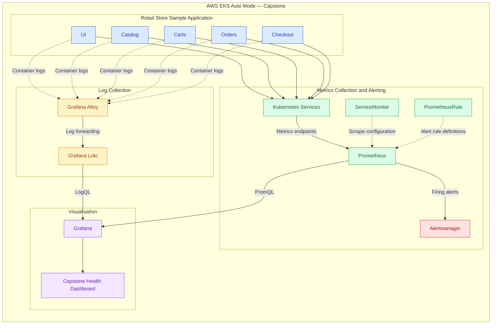
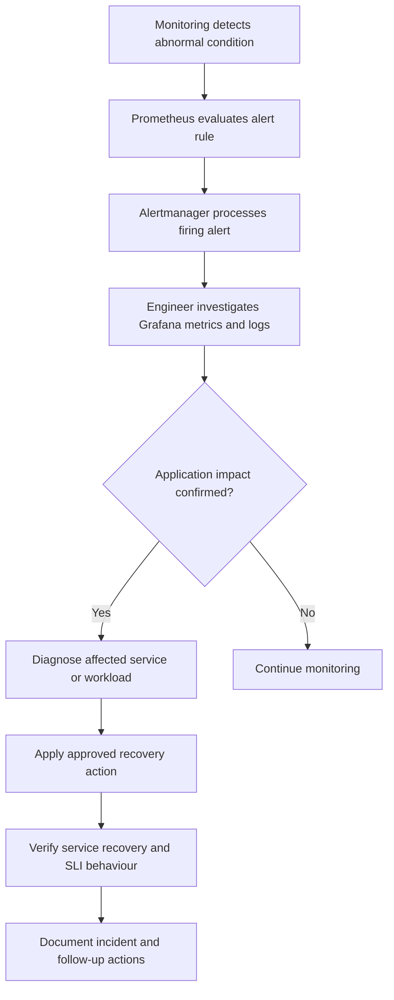
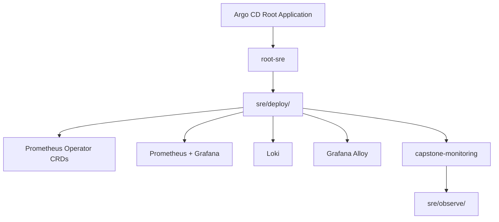

# Site Reliability Engineering (SRE)

**Capstone Group 2 | AWS Retail Store Sample | Amazon EKS Auto Mode**

This directory contains the Site Reliability Engineering (SRE) implementation for **Capstone**, a microservices-based retail application deployed on Amazon Elastic Kubernetes Service (EKS) Auto Mode.

The SRE workstream establishes observability, performance monitoring, reliability measurement, alerting, load testing, and incident response capabilities across the application and its supporting Kubernetes workloads.

The implementation follows a reliability-first approach, prioritising application health, operational visibility, measurable service performance, and minimal disruption to the shared AWS infrastructure.

---

## 1. Objectives

The primary objective is to establish a measurable and operationally useful reliability engineering framework for the Capstone application.

The SRE implementation aims to:

1. Establish baseline infrastructure, Kubernetes workload, and application health.
2. Centralise application and container logs for operational investigation.
3. Collect application and Kubernetes metrics using Prometheus.
4. Define service-level indicators (SLIs) and service-level objectives (SLOs).
5. Monitor request latency, availability, error rates, and workload resource utilisation.
6. Implement actionable alerting through Prometheus and Alertmanager.
7. Provide Grafana dashboards for health monitoring and troubleshooting.
8. Validate system behaviour under controlled application load.
9. Establish incident investigation and recovery procedures.
10. Preserve existing application functionality and shared infrastructure stability.

### Engineering Principles

| Principle | Implementation |
|---|---|
| Reliability first | Establish baseline health before performance or security testing |
| Observability | Combine metrics, logs, dashboards, and alerts |
| Declarative configuration | Maintain Kubernetes and Argo CD configuration in Git |
| Separation of concerns | Separate deployment, observability, and validation responsibilities |
| Minimal disruption | Avoid unnecessary changes to shared infrastructure |
| Reproducibility | Version-control configuration, test scripts, and validation evidence |
| Measurable outcomes | Use SLIs, SLOs, and recorded test results |
| Operational readiness | Support investigation, alerting, and incident response |

---

## 2. Technology Stack

| Layer | Technology | Responsibility |
|---|---|---|
| Cloud infrastructure | Amazon Web Services | Underlying cloud infrastructure |
| Container orchestration | Amazon EKS Auto Mode | Kubernetes workload orchestration |
| Infrastructure as Code | Terraform | Provisioning and managing AWS resources |
| GitOps | Argo CD | Declarative deployment and reconciliation |
| Package management | Helm | Installing and configuring observability components |
| Metrics | Prometheus | Metrics collection, storage, and querying |
| Metrics discovery | Prometheus Operator / ServiceMonitor | Kubernetes-native scrape configuration |
| Alert evaluation | Prometheus / PrometheusRule | Evaluating monitoring and reliability conditions |
| Alert routing | Alertmanager | Grouping and routing firing alerts |
| Log collection | Grafana Alloy | Kubernetes log collection and forwarding |
| Log aggregation | Grafana Loki | Centralised log storage and querying |
| Visualisation | Grafana | Metrics, logs, and dashboard visualisation |
| Load testing | Locust | Generating controlled HTTP application traffic |
| Automation | GitHub / GitHub Actions | Version control and CI validation |
| Operational tooling | AWS CLI / kubectl | Infrastructure and Kubernetes inspection |

The observability implementation focuses on **application workloads, Kubernetes Pods, nodes, and supporting services**. Direct monitoring of the EKS-managed Kubernetes control plane is outside the initial SRE monitoring scope.

---

## 3. Monitoring and Reliability Approach

The SRE workflow follows a progressive operational lifecycle:

**Baseline → Metrics & Logging → SLIs & SLOs → Alerting → Dashboards → Load Validation → Incident Response**

| Stage | Purpose | Expected evidence |
|---|---|---|
| Baseline | Establish initial application and infrastructure health | Pod readiness, deployment status, service reachability |
| Metrics | Collect measurable operational data | Prometheus targets and metric series |
| Logging | Centralise diagnostic information | Searchable application logs in Loki |
| Reliability | Define measurable performance objectives | SLI queries and SLO definitions |
| Alerting | Detect actionable failures or degradation | Evaluated alert rules and notification tests |
| Visualisation | Provide operational visibility | Grafana dashboards with live data |
| Load validation | Assess system behaviour under traffic | Locust reports and correlated metrics |
| Incident response | Support recovery and diagnosis | Runbooks, health reports, and incident evidence |

### Reliability Measurement

Reliability is evaluated using four principal categories:

- **Availability:** Whether application endpoints remain reachable and operational.
- **Latency:** Whether application requests complete within acceptable performance thresholds.
- **Errors:** Whether requests fail or return unexpected responses.
- **Saturation:** Whether CPU, memory, replicas, or other workload resources approach operational limits.

These measurements provide the foundation for defining SLIs, establishing SLOs, and investigating performance degradation.

---

## 4. Observability Architecture

The Capstone observability architecture separates metrics collection, log aggregation, alerting, and visualisation.



**Architecture status:** The observability Applications were previously verified as `Synced / Healthy` through Argo CD on the shared Capstone EKS cluster. End-to-end telemetry collection, dashboard accuracy, alert delivery, and operational resilience remain subject to verification.

The diagram represents the intended logical data flows. It does not independently establish that every application endpoint currently exposes Prometheus-compatible metrics or that all pipelines have passed end-to-end testing.

### 4.1 Metrics Pipeline

**Application → Kubernetes Service → Prometheus → Grafana**

The metrics pipeline consists of the following components:

1. Application and Kubernetes workloads expose measurable operational information.
2. Kubernetes Services provide stable endpoints for eligible metrics targets.
3. ServiceMonitor resources describe which Services Prometheus should discover and scrape.
4. Prometheus collects and stores time-series metrics.
5. PrometheusRule resources supply recording or alerting rule definitions.
6. Prometheus evaluates configured alert expressions.
7. Firing alerts are forwarded to Alertmanager.
8. Grafana queries Prometheus using PromQL.

A ServiceMonitor defines scrape discovery and configuration; it does not itself collect or store metrics.

The existence of a ServiceMonitor also does not guarantee a healthy target. Target discovery, endpoint reachability, and successful scraping must be verified independently.

### 4.2 Logging Pipeline

**Application Pods → Grafana Alloy → Loki → Grafana**

The logging pipeline follows these stages:

1. Kubernetes workloads generate application and container logs.
2. Grafana Alloy discovers eligible Kubernetes Pods and their log sources.
3. Alloy collects and processes the selected log streams.
4. Alloy forwards log entries to Loki.
5. Loki stores log data and indexes associated stream labels.
6. Grafana queries Loki using LogQL.
7. Engineers correlate logs with metrics to investigate application failures and performance anomalies.

**Technical decision:** Grafana Alloy was selected instead of legacy Promtail because of its supported collection architecture, Kubernetes integration, and extensibility across observability signals.

The initial Alloy configuration uses a single-replica Deployment. High availability, collection throughput, buffering, and failure recovery require further evaluation.

### 4.3 Alerting Pipeline

**PrometheusRule → Prometheus → Alertmanager → Notification Receiver**

Alerting separates detection from notification delivery.

Prometheus evaluates alert expressions defined through PrometheusRule resources. When a rule's conditions are satisfied for its configured duration, Prometheus transitions the alert into a firing state.

Alertmanager then handles alert grouping, routing, silencing, and notification delivery according to its configured receivers.

The presence of a PrometheusRule confirms only that an alert definition exists. Operational validation must confirm rule loading, evaluation, firing behaviour, routing, and receiver delivery.

### 4.4 Dashboard Pipeline

**Prometheus / Loki → Grafana → Capstone Health Dashboard**

Grafana provides a unified investigation interface for metrics and logs.

The dashboard configuration is maintained in Git and is intended to provide visibility into application health, service performance, and supporting Kubernetes workloads.

The dashboard JSON and Kubernetes ConfigMap are retained as separate deployment artifacts:

- `capstone-health.json` contains the dashboard definition.
- `grafana-dashboard.yaml` contains the Kubernetes ConfigMap representation used for dashboard provisioning.

These files should remain consistent. Dashboard provisioning and live datasource results require runtime verification.

---

## 5. Application Monitoring Scope

The primary monitoring scope consists of the five AWS Retail Store Sample microservices.

| Service | Monitoring focus |
|---|---|
| UI | User-facing availability, request latency, and HTTP errors |
| Catalog | Product retrieval performance, availability, and error rates |
| Carts | Cart operations, service health, and request failures |
| Orders | Order-processing availability and transaction failures |
| Checkout | Checkout request performance, errors, and availability |

### Kubernetes Workload Monitoring

The SRE implementation also considers:

- Pod readiness and availability.
- Deployment replica status.
- Container restarts and failure states.
- CPU and memory utilisation.
- Workload scaling behaviour.
- Service connectivity and endpoint availability.
- Persistent storage health where applicable.
- Resource pressure and operational saturation.

The initial scope does not require modification of the EKS-managed control plane.

---

## 6. Service-Level Indicators and Objectives

SLIs provide quantitative measurements of service behaviour. SLOs define the desired reliability level over a specified measurement period.

The following indicators form the intended Capstone reliability framework.

### 6.1 Availability SLI

Availability measures the proportion of eligible requests that complete successfully.

**Availability SLI:**

\[
\text{Availability} =
\frac{\text{Successful eligible requests}}
{\text{Total eligible requests}}
\times 100\%
\]

A candidate SLO may define a minimum successful-request percentage over an agreed observation window.

The exact target, request eligibility rules, and measurement period must be established and approved before the SLO can be considered operational.

### 6.2 Latency SLI

Latency measures the time required to complete eligible application requests.

The Capstone performance requirement includes:

**Product listing p95 latency: 500 ms**

The corresponding validation should determine whether the 95th-percentile product-listing latency remains at or below 500 ms under the specified flash-sale workload.

This is a requirement to test, not a claim that the application currently meets the target.

A production-grade latency SLO must also define the relevant endpoint, request population, measurement window, and acceptable traffic conditions.

### 6.3 Error Rate SLI

Error rate measures the proportion of eligible requests that fail.

\[
\text{Error Rate} =
\frac{\text{Failed eligible requests}}
{\text{Total eligible requests}}
\times 100\%
\]

Failure classification should distinguish expected client errors from application or infrastructure failures.

### 6.4 Saturation Indicators

Saturation indicators provide supporting evidence of resource pressure and potential service degradation.

Relevant measurements include CPU utilisation, memory consumption, replica availability, container restarts, and resource-related throttling.

Saturation indicators support operational diagnosis but are not automatically equivalent to user-facing reliability SLOs.

### 6.5 SLO Implementation Status

At least two measurable SLOs are required for the Capstone reliability framework.

Final SLO definitions, measurement windows, metric availability, and achieved compliance remain pending operational validation.

The repository includes PromQL queries intended to support SLI analysis:

`observe/prometheus-sli-queries.promql`

---

## 7. Alerting and Incident Response

### 7.1 Alerting Objectives

Alerting is intended to identify conditions that require operational investigation or intervention.

The initial requirements include implementing and validating at least two actionable, routed alerts.

Candidate alerting categories include:

- Application or workload unavailability.
- Sustained elevated error rates.
- Request latency degradation.
- Pod restart or readiness failures.
- Resource saturation affecting application health.

These are monitoring objectives; the actual implemented rules must be confirmed against the committed `PrometheusRule` manifest.

### 7.2 Alert Validation

Each operational alert should be validated against the following criteria:

| Validation | Requirement |
|---|---|
| Rule loading | Prometheus recognises the rule |
| Expression | The query evaluates against available metrics |
| Threshold | The configured condition represents meaningful degradation |
| Duration | Transient conditions do not trigger unnecessary notifications |
| Firing | The rule transitions correctly when conditions are met |
| Routing | Alertmanager selects the intended receiver |
| Delivery | The receiver successfully receives the notification |
| Recovery | The alert resolves after the underlying condition clears |

### 7.3 Incident Response Workflow



Incident response procedures must respect shared infrastructure ownership and avoid uncontrolled changes to unrelated services.

---

## 8. Load Testing and Reliability Validation

The load-testing workstream uses **Locust** to generate controlled HTTP traffic against the Capstone application.

The purpose is to establish measurable performance behaviour and correlate traffic conditions with observability data.

### 8.1 Test Objectives

- Establish an initial application performance baseline.
- Generate representative HTTP traffic.
- Measure response times and failure rates.
- Observe Kubernetes workload behaviour under load.
- Assess product-listing latency against the 500 ms p95 requirement.
- Investigate application errors and resource pressure.
- Observe scaling behaviour where supported.
- Produce reproducible evidence for reliability analysis.

### 8.2 Load-Testing Files

| File | Purpose |
|---|---|
| `validate/locustfile.py` | Locust user behaviour and HTTP test scenarios |
| `validate/requirements.txt` | Python dependencies |
| `validate/run.sh` | Test execution helper |
| `validate/.gitignore` | Excludes generated or local test artifacts |
| `validate/README.md` | Test setup and execution documentation |
| `validate/health-report.md` | Reliability observations and reporting |

### 8.3 Test Execution

Load testing should be performed only against approved endpoints and during agreed test windows.

Before execution:

1. Verify the intended cluster and application endpoint.
2. Confirm application baseline health.
3. Establish the approved traffic intensity and duration.
4. Ensure Prometheus and Grafana are available for observation.
5. Confirm that the test will not disrupt other teams.
6. Execute the workload using the documented Locust configuration.
7. Collect latency, throughput, error, and resource observations.
8. Compare results with the established baseline.
9. Document findings and limitations.

The existence of Locust scripts does not establish that a load test has been successfully executed against the shared cluster.

### 8.4 Reliability Validation Evidence

A complete validation record should include:

- Test date and environment.
- Application version or deployment revision.
- Test scenario and traffic configuration.
- Test duration and concurrent-user configuration.
- Request throughput and failure rate.
- Response-time distributions, including p95.
- Prometheus and Grafana observations.
- Kubernetes workload and scaling observations.
- Relevant logs and errors.
- Findings, limitations, and follow-up actions.

---

## 9. GitOps Integration

The Capstone repository separates central deployment orchestration from SRE-owned observability configuration.

### 9.1 Responsibility Boundaries

| Directory | Responsibility |
|---|---|
| `gitops/` | Central Argo CD orchestration and shared application deployment |
| `sre/deploy/` | SRE observability Application and AppProject definitions |
| `sre/observe/` | Monitoring resources, dashboards, and queries |
| `sre/validate/` | Reliability testing and operational evidence |
| `sre/reference/` | Supporting configuration references |

The SRE workstream integrates with the central GitOps structure through:

`gitops/root/root-sre.yaml`

### 9.2 Intended Application Hierarchy



This represents the intended repository and Application relationship after the directory migration. It does not imply that the new paths have already been reconciled by the live cluster.

### 9.3 Deployment Definitions

| File | Role |
|---|---|
| `deploy/alloy.yaml` | Argo CD Application for Grafana Alloy |
| `deploy/loki.yaml` | Argo CD Application for Loki |
| `deploy/prometheus-crds.yaml` | Argo CD Application for Prometheus Operator CRDs |
| `deploy/prometheus-stack.yaml` | Argo CD Application for kube-prometheus-stack |
| `deploy/monitoring-app.yaml` | Argo CD Application for monitoring manifests |
| `deploy/sre-project.yaml` | Argo CD AppProject definition |

The deployed observability Application definitions use Helm chart sources and inline `valuesObject` configuration.

Standalone Helm values are preserved under `reference/helm/`. These reference files should not be assumed to be the authoritative live configuration unless explicitly connected to the Argo CD deployment.

---

## 10. Implementation Status

### Phase 1 — SRE Workspace: Completed

Established the SRE workstream, monitoring requirements, reliability objectives, repository documentation, and initial operational architecture.

### Phase 2 — Observability Configuration: Locally Validated

Prepared and locally validated Helm configurations, monitoring manifests, Grafana dashboards, Loki, and Grafana Alloy.

The standalone reference configuration and live Argo CD `valuesObject` definitions may differ and must be assessed separately.

### Phase 3 — Argo CD Integration: Previously Reconciled

The following Applications were previously verified as `Synced / Healthy` on the shared Capstone EKS cluster:

- `root-sre`
- `prometheus-crds`
- `kube-prometheus-stack`
- `loki`
- `alloy`
- `capstone-monitoring`

These observations establish that Argo CD reported successful synchronization and health at the time of inspection.

They do not independently confirm complete metrics ingestion, application-level SLO compliance, log delivery, or Alertmanager notification routing.

### Phase 4 — Repository Consolidation: Completed Locally

The SRE repository has been reorganized into four functional directories:

- `deploy/`
- `observe/`
- `validate/`
- `reference/`

The restructuring was committed as:

`228e1f5 — refactor(sre): consolidate observability into deploy observe validate`

The commit primarily relocates existing files and updates the intended Argo CD source paths.

**The new repository paths require a coordinated GitOps migration before they can be treated as the live deployment source.**

### Phase 5 — Operational Validation: Pending Verification

| Validation area | Outstanding verification |
|---|---|
| Application metrics | Confirm actual endpoint availability and successful scraping |
| Prometheus | Verify active targets and expected metric series |
| SLIs and SLOs | Validate query correctness, measurement windows, and compliance |
| Loki | Confirm end-to-end application log ingestion |
| Grafana | Verify dashboards against live telemetry |
| Alertmanager | Confirm alert routing and receiver delivery |
| Load testing | Execute approved scenarios and capture results |
| Scaling | Observe workload behaviour under controlled load |
| Storage | Verify persistence, retention, and capacity |
| Incident response | Validate diagnosis, escalation, and recovery procedures |

No unverified operational capability should be represented as production-ready.

---

## 11. Repository Structure

```text
sre/
├── README.md
│
├── deploy/
│   ├── alloy.yaml
│   ├── loki.yaml
│   ├── monitoring-app.yaml
│   ├── prometheus-crds.yaml
│   ├── prometheus-stack.yaml
│   └── sre-project.yaml
│
├── observe/
│   ├── monitoring.yaml
│   ├── grafana-dashboard.yaml
│   ├── capstone-health.json
│   └── prometheus-sli-queries.promql
│
├── validate/
│   ├── .gitignore
│   ├── README.md
│   ├── locustfile.py
│   ├── requirements.txt
│   ├── run.sh
│   └── health-report.md
│
└── reference/
    ├── helm/
    │   ├── README.md
    │   ├── alloy-values.yaml
    │   ├── loki-values.yaml
    │   └── prometheus-values.yaml
    └── monitoring-README.md
```

### Directory Responsibilities

| Directory | Responsibility | Primary artifacts |
|---|---|---|
| `deploy/` | Declarative deployment configuration | Argo CD Applications and AppProject |
| `observe/` | Monitoring and visualisation | Prometheus manifests, Grafana dashboard, PromQL |
| `validate/` | Reliability testing and evidence | Locust scripts, documentation, health report |
| `reference/` | Supporting configuration history | Standalone Helm values and reference documentation |

The central `gitops/` directory remains separate from the SRE workstream and provides the shared deployment orchestration layer.

---

## 12. Operational Verification

The following commands provide read-only inspection of the Capstone environment.

They require an appropriately configured kubeconfig and Kubernetes context.

### 12.1 Verify Cluster Context

```bash
kubectl config current-context
kubectl cluster-info
```

Confirm that the selected context is the intended Capstone EKS cluster before performing further operations.

### 12.2 Verify Argo CD Applications

```bash
kubectl get applications.argoproj.io -n argocd
```

Inspect the synchronization and health states of the SRE Applications.

### 12.3 Verify Monitoring Workloads

```bash
kubectl get pods -n monitoring
kubectl get deployments,statefulsets -n monitoring
```

Check workload readiness, restarts, and unexpected failures.

### 12.4 Verify Logging Workloads

```bash
kubectl get pods -n logging
kubectl get deployments,statefulsets -n logging
```

Confirm the availability of Alloy and Loki workloads.

### 12.5 Inspect Monitoring Resources

```bash
kubectl get servicemonitors -n monitoring
kubectl get prometheusrules -n monitoring
kubectl get configmaps -n monitoring
```

The presence of these resources does not guarantee successful metrics collection or dashboard provisioning. Their operational behaviour must be verified through the corresponding monitoring components.

### 12.6 Inspect Persistent Storage

```bash
kubectl get pvc -n monitoring
kubectl get pvc -n logging
```

Verify claim status and investigate unexpected storage conditions before making any changes.

---

## 13. Deployment Safeguards

All SRE changes must preserve application availability, respect shared EKS resource constraints, and avoid disrupting unrelated workloads.

### Change Management

Changes involving any of the following require coordinated review:

- Argo CD Application source paths.
- App-of-Apps ownership relationships.
- Automated synchronization and pruning.
- Application deletion finalizers.
- AppProject permissions.
- Helm chart versions and deployed values.
- Persistent storage and retention settings.
- Shared Kubernetes namespaces or resources.
- Load-test intensity and duration.

### Operational Safety

The SRE implementation must:

1. Avoid uncontrolled changes to shared infrastructure.
2. Preserve the existing observability stack during GitOps migrations.
3. Validate intended changes before deployment.
4. Use approved infrastructure and Kubernetes access.
5. Maintain clear rollback and recovery procedures.
6. Coordinate high-impact testing with the relevant teams.
7. Record deployment and validation outcomes.
8. Avoid treating successful GitOps synchronization as proof of application reliability.

---

## 14. Future Improvements

The following enhancements may be considered after the initial operational validation is complete:

- Formalised availability and latency SLOs with defined measurement windows.
- Error-budget monitoring and burn-rate alerting.
- Validated Alertmanager notification receivers.
- Automated dashboard and PrometheusRule validation in CI.
- Improved observability configuration ownership and reduced duplication.
- Log retention and storage capacity policies.
- Additional reliability test scenarios.
- Continuous load-test reporting and baseline comparisons.
- High-availability assessment for logging and monitoring components.
- Incident runbooks and post-incident review templates.
- Additional application instrumentation where existing metrics are insufficient.

These are future improvements, not claims of currently implemented functionality.

---

## 15. Current Project Status

**SRE configuration:** Prepared and locally validated.

**Argo CD deployment:** Observability Applications previously verified as `Synced / Healthy`.

**Repository organization:** Consolidated into `deploy/`, `observe/`, `validate/`, and `reference/`.

**GitOps path migration:** Requires coordinated review and reconciliation.

**Operational readiness:** End-to-end metrics, logs, alerts, SLO compliance, and reliability testing remain pending verification.

The SRE workstream continues to prioritise measurable application reliability, reproducible engineering practices, and safe integration with the shared Capstone infrastructure.
